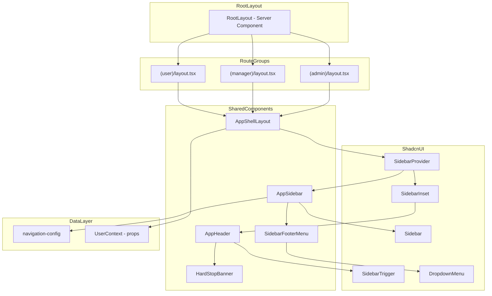
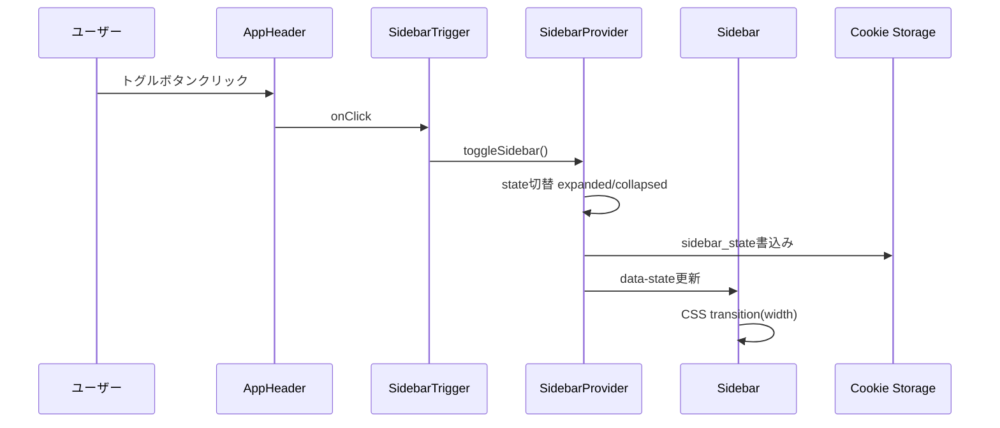
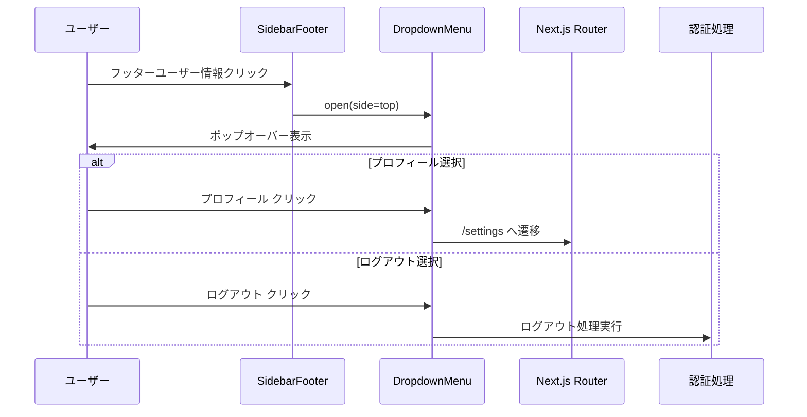
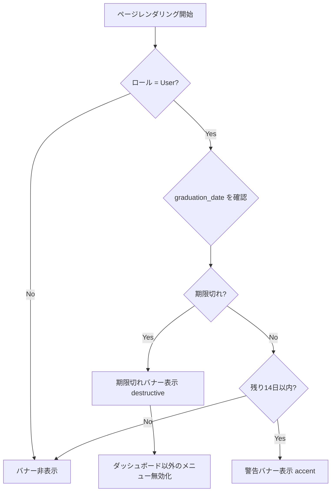
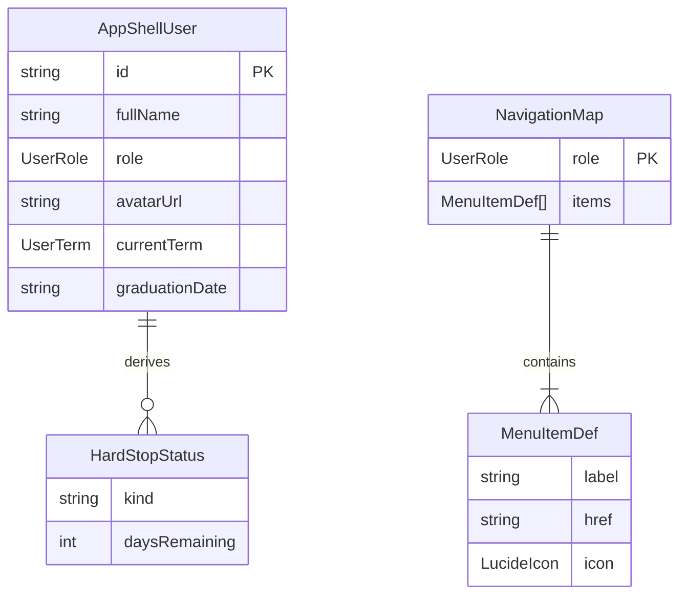

# 技術設計書: App Shell

## Overview

本機能は、LMSアプリケーションの認証済みユーザー向け共通UIシェル（App Shell）を提供する。左サイドバーナビゲーション、ヘッダー、メインコンテンツ領域で構成される2カラムレイアウトフレームワークであり、3つのロール（User / Manager / Super Admin）ごとにメニュー項目を動的に切り替える。

**ユーザー**: 認証済みの全ロール（User, Manager, Super Admin）がすべてのページで共通して利用する。

**影響**: 現在プレースホルダのみの `app/layout.tsx` を拡張し、Route Groups + 共通レイアウトコンポーネントによるロール別ルーティング基盤を構築する。フォントシステムをGeistからSora + IBM Plex Monoへ移行する。

### ゴール
- shadcn/ui Sidebarコンポーネント群を活用した展開/折りたたみ対応の2カラムレイアウトの実現
- ロール別メニュー項目の動的表示と現在パスに基づくアクティブ状態管理
- 受講期間管理（Hard Stop）の警告バナー/ロック状態表示
- デザインシステム（Pencil MCP確定デザイン）に完全準拠したUIトークンの適用

### 非ゴール
- 認証フロー（ログイン/招待登録）の実装
- Supabase Auth連携の詳細実装（認証Providerやセッション管理は別仕様）
- Middleware によるルーティングガード/リダイレクトの実装
- 各ページの具体的なコンテンツ実装
- ダークモード切り替え機能（CSS変数は定義済みだが、トグル機能は別仕様）

## Architecture

### Architecture Pattern & Boundary Map



**アーキテクチャ統合**:
- **選択パターン**: 共通レイアウトコンポーネント + Route Groups分離。各Route Groupの `layout.tsx` が同一の `AppShellLayout` を呼び出す
- **ドメイン/機能境界**: ナビゲーション設定（`navigation-config`）とレイアウト表示（`AppShellLayout`）を分離。ロール判定ロジックはナビゲーション設定層に集約
- **保持する既存パターン**: shadcn/ui Sidebarコンポーネント群をそのまま活用、Tailwind CSS変数によるテーマ管理
- **新規コンポーネントの根拠**: `AppShellLayout` は3つのRoute Groupから共通参照されるラッパー。`AppSidebar` はロール別メニューの動的構築を担当。`HardStopBanner` はHard Stop固有の表示ロジックを分離
- **ステアリング準拠**: `structure.md` の「Route Groups `(group)/` を使用してロール別にルートを分離」、`tech.md` の「Server Components優先」原則に合致

### Technology Stack

| レイヤー | 選択 / バージョン | 本機能での役割 | 備考 |
|---------|------------------|---------------|------|
| フレームワーク | Next.js 16 (App Router) | Route Groups、Server/Client Component分離、layout規約 | |
| UI | React 19 | コンポーネントレンダリング | |
| UIコンポーネント | shadcn/ui (Sidebar, DropdownMenu, Avatar, Badge, Separator) | サイドバー構造、ドロップアップメニュー、ユーザー情報表示 | 既存導入済み |
| アイコン | Lucide React | 全アイコン統一 | 6.1 |
| スタイリング | Tailwind CSS v4 + CSS変数 | デザイントークン準拠のスタイリング | |
| フォント | Sora + IBM Plex Mono (`next/font/google`) | プライマリ/セカンダリフォント | Geistからの移行が必要 |
| ルーティング | Next.js App Router (Route Groups) | `(user)/`, `(manager)/`, `(admin)/` ロール別分離 | |
| 状態永続化 | Cookie (`sidebar_state`) | サイドバー展開/折りたたみ状態の維持 | shadcn/ui標準機能 |

## System Flows

### サイドバー展開/折りたたみフロー



### ドロップアップメニューフロー



### Hard Stop 判定フロー



## Requirements Traceability

| 要件 | 概要 | コンポーネント | インターフェース | フロー |
|------|------|-------------|----------------|-------|
| 1.1 | 2カラムレイアウト | AppShellLayout | AppShellLayoutProps | - |
| 1.2 | サイドバー幅240px | AppShellLayout | SidebarProvider style | - |
| 1.3 | サイドバー折りたたみ(48px) | AppShellLayout, AppHeader | SidebarProvider collapsible | サイドバー展開/折りたたみ |
| 1.4 | レスポンシブ対応(Sheet) | AppShellLayout | Sidebar isMobile | - |
| 1.5 | スクロール可能メインコンテンツ | AppShellLayout | children prop | - |
| 2.1 | サイドバーヘッダー(ロゴ+LMS) | AppSidebar | - | - |
| 2.2 | User メニュー(4項目) | AppSidebar | NavigationConfig, MenuItemDef | - |
| 2.3 | Manager メニュー(3項目) | AppSidebar | NavigationConfig, MenuItemDef | - |
| 2.4 | Super Admin メニュー(6項目) | AppSidebar | NavigationConfig, MenuItemDef | - |
| 2.5 | アクティブ状態表示 | AppSidebar | usePathname | - |
| 2.6 | フッターユーザー情報 | SidebarFooterMenu | SidebarUserProps | - |
| 2.7 | ドロップアップメニュー | SidebarFooterMenu | DropdownMenu side=top | ドロップアップメニュー |
| 2.8 | ドロップアップ項目 | SidebarFooterMenu | FooterMenuAction | ドロップアップメニュー |
| 3.1 | ヘッダー構造(64px) | AppHeader | AppHeaderProps | - |
| 3.2 | サイドバートグルボタン | AppHeader | SidebarTrigger | サイドバー展開/折りたたみ |
| 3.3 | ページタイトル | AppHeader | pageTitle prop | - |
| 4.1 | 期限切れ警告バナー | HardStopBanner | HardStopBannerProps | Hard Stop判定 |
| 4.2 | 期限切れロック状態 | HardStopBanner, AppSidebar | HardStopStatus | Hard Stop判定 |
| 5.1 | 現在のターム表示 | SidebarFooterMenu | UserTerm | - |
| 6.1 | Server Components優先 | AppShellLayout | - | - |
| 6.2 | shadcn/ui Sidebar使用 | AppSidebar | Sidebar系コンポーネント | - |
| 6.3 | デザイントークン準拠 | 全コンポーネント | CSS変数 | - |
| 6.4 | Route Groups構成 | Route Group layouts | AppShellLayoutProps | - |
| 6.5 | Lucideアイコン統一 | 全コンポーネント | LucideIcon | - |

## Components and Interfaces

| コンポーネント | ドメイン/レイヤー | 意図 | 要件カバレッジ | 主要依存(P0/P1) | コントラクト |
|-------------|----------------|------|-------------|----------------|------------|
| AppShellLayout | Layout | 全ロール共通の2カラムレイアウトラッパー | 1.1, 1.2, 1.3, 1.4, 1.5, 6.1, 6.4 | SidebarProvider(P0) | State |
| AppSidebar | Navigation | ロール別メニューを動的構築するサイドバー本体 | 2.1-2.6, 6.2, 6.3, 6.5 | NavigationConfig(P0), Sidebar(P0) | Service |
| AppHeader | Layout | ヘッダー(トグル+タイトル+バナー) | 3.1-3.3, 4.1 | SidebarTrigger(P0), HardStopBanner(P1) | - |
| SidebarFooterMenu | Navigation | フッターユーザー情報+ドロップアップメニュー | 2.6-2.8, 5.1 | DropdownMenu(P0), Avatar(P1) | Service |
| HardStopBanner | Domain/UI | 受講期間の警告/ロック状態表示 | 4.1, 4.2 | - | Service |
| NavigationConfig | Config | ロール別メニュー定義とユーティリティ | 2.2-2.5 | - | Service |

### 共通型定義

```typescript
/** ユーザーロール */
type UserRole = "user" | "manager" | "super_admin"

/** 学習ターム */
type UserTerm = "基礎" | "実践"

/** ユーザーコンテキスト（App Shell に渡される最小限のユーザー情報） */
interface AppShellUser {
  id: string
  fullName: string
  role: UserRole
  avatarUrl: string | null
  /** User ロールのみ。null は Manager/Super Admin */
  currentTerm: UserTerm | null
  /** User ロールのみ。null は Manager/Super Admin */
  graduationDate: string | null
}

/** Hard Stop ステータス（導出値） */
type HardStopStatus =
  | { kind: "none" }
  | { kind: "warning"; daysRemaining: number }
  | { kind: "expired" }
```

### Layout レイヤー

#### AppShellLayout

| フィールド | 詳細 |
|----------|------|
| 意図 | SidebarProvider + Sidebar + SidebarInset による2カラムレイアウトを提供する |
| 要件 | 1.1, 1.2, 1.3, 1.4, 1.5, 6.1, 6.4 |

**責務 & 制約**
- SidebarProviderで展開/折りたたみ状態を管理。Cookie経由で状態永続化
- `--sidebar-width: 15rem` (240px)をオーバーライド。`collapsible="icon"` で折りたたみモード有効化
- 768px未満でSheet（オーバーレイ）モードに自動切り替え（shadcn/ui Sidebar標準動作）
- Server Componentとして構成。SidebarProviderは内部的にClient Componentだが、layout自体はServer Component

**依存**
- Inbound: Route Group layouts (`(user)/layout.tsx` 等) -- AppShellを呼び出す (P0)
- Outbound: AppSidebar, AppHeader -- サイドバーとヘッダーを描画 (P0)
- External: shadcn/ui SidebarProvider, Sidebar, SidebarInset -- レイアウト基盤 (P0)

**コントラクト**: State [x]

##### State Management

```typescript
interface AppShellLayoutProps {
  user: AppShellUser
  children: React.ReactNode
}
```

- 状態モデル: SidebarProvider内部で `open: boolean` を管理。`data-state="expanded" | "collapsed"` としてDOMに反映
- 永続化: Cookie `sidebar_state` に `true` / `false` を書き込み。リロード時に `defaultOpen` として復元
- 並行性: 単一ユーザーセッション内での排他。Cookie上書きで常に最新状態を維持

**実装ノート**
- 統合: 各Route Groupの `layout.tsx` は `cookies()` でサイドバー状態を読み取り `defaultOpen` に渡す。Next.js 16 cache components問題への対処として、必要に応じて `<Suspense>` でラップする
- バリデーション: `user` プロパティの存在を前提とし、未認証時はMiddlewareでリダイレクト済みであること
- リスク: shadcn-ui/ui#9189（Next.js 16 cache components互換性）。詳細は `research.md` 参照

#### AppHeader

| フィールド | 詳細 |
|----------|------|
| 意図 | 固定ヘッダー（64px）にサイドバートグルボタン、ページタイトル、Hard Stopバナーを配置する |
| 要件 | 3.1, 3.2, 3.3, 4.1 |

**責務 & 制約**
- SidebarInset内の上部に配置。`border-b border-border` で下線を持つ固定ヘッダー
- 左側: SidebarTrigger（PanelLeftアイコン）+ ページタイトル（font-size 18, font-weight 600, letter-spacing -1px）
- ヘッダー直下にHardStopBannerを条件付き表示

**依存**
- Inbound: AppShellLayout -- SidebarInset内に配置 (P0)
- Outbound: SidebarTrigger -- サイドバートグル (P0)
- Outbound: HardStopBanner -- 条件付き警告表示 (P1)

```typescript
interface AppHeaderProps {
  pageTitle: string
  user: AppShellUser
}
```

**実装ノート**
- `pageTitle` はRoute Groupのlayoutまたはpage側から決定する。ナビゲーション設定のメニューラベルと一致させる
- Client Component（SidebarTriggerがuseSidebarを使用するため）

### Navigation レイヤー

#### AppSidebar

| フィールド | 詳細 |
|----------|------|
| 意図 | ロール別メニュー項目を動的に構築し、アクティブ状態を管理するサイドバー本体 |
| 要件 | 2.1, 2.2, 2.3, 2.4, 2.5, 2.6, 6.2, 6.3, 6.5 |

**責務 & 制約**
- SidebarHeader: ロゴ（`/ifield-logo.svg` 140x33px、折りたたみ時28x28px）+ 「LMS」テキスト
- SidebarContent: NavigationConfigからロール別メニューを取得し、SidebarMenu/SidebarMenuItem/SidebarMenuButtonで描画
- SidebarFooter: SidebarFooterMenuコンポーネントを配置
- `usePathname()` で現在パスを取得し、一致するメニュー項目に `isActive=true` を設定
- 期限切れ（HardStopStatus = expired）時、ダッシュボード以外のメニュー項目を `disabled` にする

**依存**
- Inbound: AppShellLayout -- Sidebar内に配置 (P0)
- Outbound: NavigationConfig -- メニュー定義取得 (P0)
- Outbound: SidebarFooterMenu -- フッター描画 (P1)
- External: shadcn/ui Sidebar系コンポーネント (P0)
- External: Lucide React アイコン (P1)

**コントラクト**: Service [x]

##### Service Interface

```typescript
interface MenuItemDef {
  label: string
  icon: LucideIcon
  href: string
}

/** ロール別メニューを取得する */
function getMenuItemsForRole(role: UserRole): ReadonlyArray<MenuItemDef>

/** パスがメニュー項目にマッチするか判定する */
function isMenuItemActive(href: string, currentPath: string): boolean
```

- 前提条件: `role` は有効な `UserRole` 値
- 事後条件: 返却配列は要件定義書の順序通り
- 不変条件: 各メニュー項目は一意の `href` を持つ

**実装ノート**
- Client Component（`usePathname` フックを使用するため）
- 折りたたみ時はアイコンのみ表示。`group-data-[collapsible=icon]:hidden` でラベルテキストを非表示
- `SidebarMenuButton` の `tooltip` プロパティで折りたたみ時のツールチップを有効化

#### SidebarFooterMenu

| フィールド | 詳細 |
|----------|------|
| 意図 | サイドバーフッターにユーザー情報を表示し、ドロップアップメニュー（プロフィール/ログアウト）を提供する |
| 要件 | 2.6, 2.7, 2.8, 5.1 |

**責務 & 制約**
- Avatar（36px）+ 氏名 + ロール名を表示。Userロールの場合は学習タームバッジ（「基礎」/「実践」）を追加表示
- クリックでDropdownMenu（`side="top"`, `align="end"`）をフッター上方向に展開
- メニューヘッダー: ユーザー名(font-size 13) + ロール(font-size 11)
- メニュー項目: 「プロフィール」(Userアイコン) -> `/settings` 遷移、「ログアウト」(LogOutアイコン) -> ログアウト処理
- トリガー行: sidebar-accent背景 + ChevronsUpDownアイコン
- 折りたたみ時はアバターのみ表示

**依存**
- Inbound: AppSidebar -- SidebarFooter内に配置 (P0)
- External: shadcn/ui DropdownMenu, Avatar, Badge (P0)
- External: Lucide React (User, LogOut, ChevronsUpDown) (P1)

**コントラクト**: Service [x]

##### Service Interface

```typescript
interface SidebarUserProps {
  user: AppShellUser
  onLogout: () => void
}
```

- 前提条件: `user` に有効なユーザー情報が設定されている
- 事後条件: ログアウトアクション実行時に `onLogout` コールバックが呼ばれる

**実装ノート**
- Client Component（DropdownMenuのインタラクションが必要）
- ログアウト処理の具体的実装（Supabase Auth signOut）は本仕様のスコープ外。`onLogout` コールバック経由で外部から注入

### Domain/UI レイヤー

#### HardStopBanner

| フィールド | 詳細 |
|----------|------|
| 意図 | 受講期間の残り日数警告/期限切れロック状態を視覚的に通知する |
| 要件 | 4.1, 4.2 |

**責務 & 制約**
- Userロール以外では非表示
- 警告状態（残り14日以内）: アクセントカラー背景(`bg-accent text-accent-foreground`)、TriangleAlertアイコン、残り日数テキスト
- 期限切れ状態: destructive背景(`bg-destructive text-white`)、Lockアイコン、ロックメッセージ
- ヘッダー直下に全幅で表示

**依存**
- Inbound: AppHeader -- 条件付きレンダリング (P0)

**コントラクト**: Service [x]

##### Service Interface

```typescript
interface HardStopBannerProps {
  status: HardStopStatus
}

/** graduation_date から HardStopStatus を導出する */
function deriveHardStopStatus(
  graduationDate: string | null,
  now?: string
): HardStopStatus
```

- 前提条件: `graduationDate` が `YYYY-MM-DD` 形式の日付文字列、または `null`（Manager/Super Admin）。`now` も `YYYY-MM-DD` 形式（省略時は現在日のJST日付）
- 事後条件: `null` の場合は `{ kind: "none" }`。期限切れは `{ kind: "expired" }`。残り14日以内は `{ kind: "warning", daysRemaining }` を返却
- 不変条件: `daysRemaining` は0以上14以下の整数

**実装ノート**
- `deriveHardStopStatus` はピュア関数として `lib/` に配置。テスト容易性を確保
- **タイムゾーン安全性**: `date-fns` の `differenceInCalendarDays` + `parseISO` を使用し、「日付のみ」（時刻なし）で比較する。`Date` オブジェクトの UTC/JST 差異による Off-by-one エラー（23:59/00:00 境界値バグ）を防止する。入力は `YYYY-MM-DD` 文字列に統一し、時刻情報を持ち込まない
- バナーコンポーネント自体はServer Componentとして実装可能（インタラクションなし）

### Config レイヤー

#### NavigationConfig

| フィールド | 詳細 |
|----------|------|
| 意図 | ロール別のサイドバーメニュー定義を一元管理する設定モジュール |
| 要件 | 2.2, 2.3, 2.4, 2.5 |

**責務 & 制約**
- ロールをキーとしたメニュー項目の定義マップを提供
- メニュー項目の順序は要件定義書に厳密に従う
- ページタイトルとメニューラベルの対応関係を提供

**依存**
- External: Lucide React アイコン (P1)

**コントラクト**: Service [x]

##### Service Interface

```typescript
import type { LucideIcon } from "lucide-react"

interface MenuItemDef {
  label: string
  icon: LucideIcon
  href: string
}

/** ロール別ナビゲーションマップ */
const NAVIGATION_MAP: Record<UserRole, ReadonlyArray<MenuItemDef>>

/** パスからページタイトルを解決する */
function resolvePageTitle(role: UserRole, pathname: string): string
```

- User (4項目): ダッシュボード(`/dashboard`), 教材・演習(`/contents`), 模擬案件(`/projects`), 設定・プロフィール(`/settings`)
- Manager (3項目): マネージャーDB(`/dashboard`), ユーザー一覧(`/users`), 設定・プロフィール(`/settings`)
- Super Admin (6項目): 管理者ダッシュボード(`/dashboard`), 未採点一覧(`/grading`), ユーザー管理(`/users`), コンテンツ管理(`/contents`), システム設定(`/system-settings`), 設定・プロフィール(`/settings`)

**実装ノート**
- 純粋な設定ファイル（`config/navigation.ts`）として実装。Server/Client両方からインポート可能
- Lucideアイコンのインポートはツリーシェイキング対象となるため、名前付きインポートを使用

## Data Models

### Domain Model

App Shellは独自のデータ永続化を持たない。外部から提供される `AppShellUser` を参照するのみ。

**エンティティ**:
- `AppShellUser`: 認証済みユーザーの表示用プロジェクション。Supabaseの `profiles` テーブルから導出される想定

**値オブジェクト**:
- `UserRole`: `"user" | "manager" | "super_admin"`
- `UserTerm`: `"基礎" | "実践"`
- `HardStopStatus`: 卒業日から導出される期限状態

**ドメインルール**:
- Hard Stop判定: `graduation_date` が現在日から14日以内 -> 警告、過去日 -> 期限切れ
- 期限切れ時のメニュー無効化: ダッシュボード(`/dashboard`)のみアクセス可能

### Logical Data Model



**構造定義**:
- `AppShellUser` は認証レイヤーから渡されるread-onlyデータ。App Shell内での更新なし
- `NavigationMap` はコンパイル時に確定する静的定義。ランタイムでの動的変更なし

## Error Handling

### Error Strategy

App Shellはレイアウトフレームワークであり、データフェッチやミューテーションを直接行わない。エラーハンドリングは以下のカテゴリに限定される。

### Error Categories and Responses

**ユーザー情報欠落** (認証エラー):
- `user` プロパティが `null` / `undefined` の場合 -> Middlewareでの事前リダイレクトを前提とし、App Shell層では発生しない設計
- フォールバック: ユーザー情報が不正な場合はアバターのFallbackコンポーネント（イニシャル表示）で対応

**ナビゲーションエラー**:
- 無効なパスへの遷移 -> Next.js標準の `not-found.tsx` で処理
- メニュー項目の `href` は静的定義のため、ランタイムでの無効リンクは発生しない

**Cookie読み取り失敗**:
- `sidebar_state` Cookieが存在しない/不正な場合 -> `defaultOpen=true` にフォールバック

## Testing Strategy

### Unit Tests
- `deriveHardStopStatus`: 各境界値（15日前、14日前、1日前、当日、翌日）での正確な判定
- `getMenuItemsForRole`: 各ロールのメニュー項目数と順序
- `resolvePageTitle`: パスとロールの組み合わせによるタイトル解決
- `isMenuItemActive`: パスマッチング（完全一致、プレフィックス一致）

### Integration Tests
- AppSidebar: ロール別メニュー描画 + アクティブ状態の正確なハイライト
- SidebarFooterMenu: ドロップアップメニューの開閉 + プロフィール/ログアウトアクション
- HardStopBanner: 警告/期限切れ/非表示の3状態遷移

### E2E/UI Tests
- サイドバー展開/折りたたみのアニメーション + Cookie永続化
- モバイル表示でのSheet切り替え
- Hard Stopバナーの表示条件
- ページ遷移時のアクティブメニュー更新

## Security Considerations

- ロール判定はApp Shell層では表示制御のみに使用。実際のアクセス制御はMiddleware + Supabase RLSで二重に実施（steering/tech.md準拠）
- `user` データは認証済みセッションから取得。App Shell内でのユーザー情報の直接フェッチは行わない
- ログアウト処理はコールバック経由で認証レイヤーに委譲。App Shell内での直接的なセッション操作なし

## Performance & Scalability

- **Server Components優先**: AppShellLayoutはServer Component。Client Componentは `AppSidebar`（usePathname）、`SidebarFooterMenu`（DropdownMenu）、`AppHeader`（SidebarTrigger）に限定
- **アイコンのツリーシェイキング**: Lucideアイコンの名前付きインポートにより、バンドルサイズを最小化
- **フォント最適化**: `next/font/google` の `variable` + `display: 'swap'` で CLS を抑制
- **レイアウトの安定性**: SidebarProviderの `--sidebar-width` をCSS変数で定義。レイアウトシフトを防止
