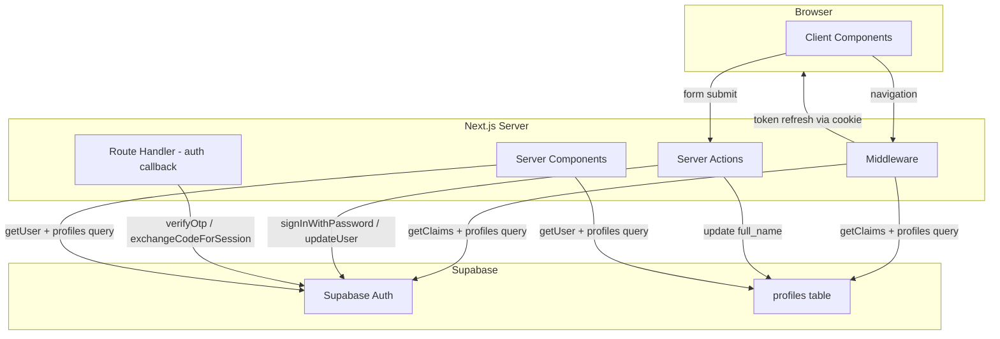
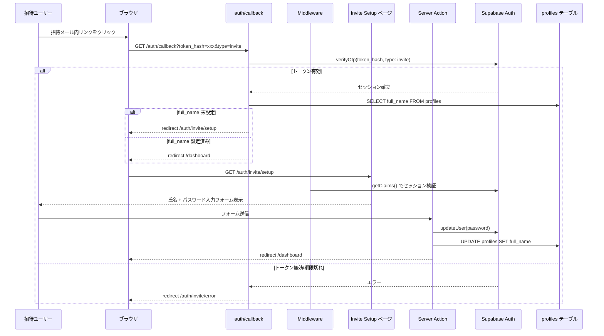
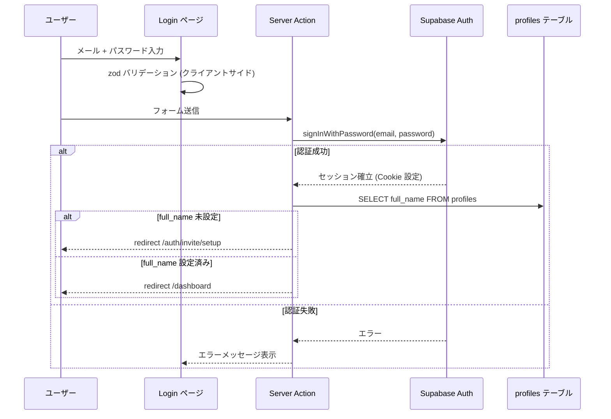
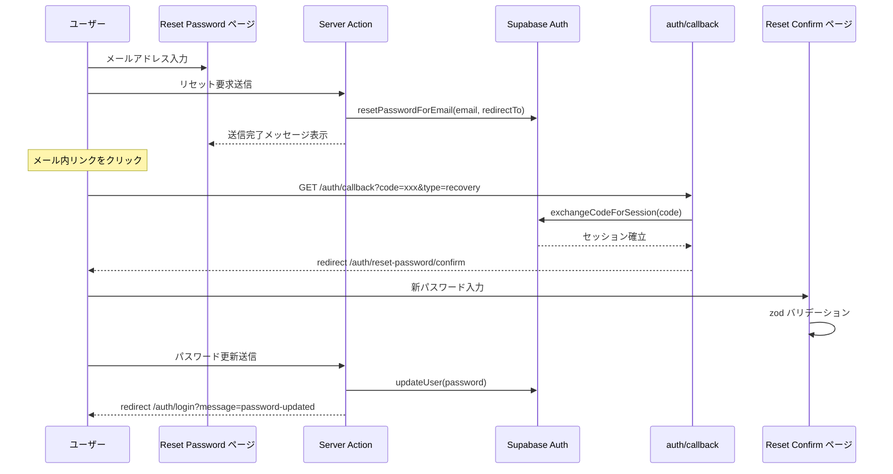

# 技術設計書: Auth

## Overview

本機能は、社内 LMS における認証・アカウント管理の基盤を提供する。Super Admin による招待 URL 発行、トークン検証を経たアカウント登録、メール + パスワードによるログイン/ログアウト、パスワードリセット、Next.js Middleware によるルート保護、Supabase Auth のセッション管理を包括する。

**ユーザー**: 全ロール（User, Manager, Super Admin）がログイン/ログアウトを利用する。User と Manager は招待 URL 経由でアカウントを作成する。Super Admin は招待を発行する。

**影響**: 現在のモック認証（`(authenticated)/layout.tsx` のハードコードされたユーザー情報）を Supabase Auth ベースの実認証に置き換える。Middleware の新規追加によりアプリケーション全体のルート保護を実現する。

### ゴール
- Cookie ベースのセッション管理を `@supabase/ssr` で確立する
- 招待制アカウント登録フロー（招待 URL 発行 → トークン検証 → プロフィール設定）を実装する
- ログイン / ログアウト / パスワードリセットの認証フローを実装する
- Next.js Middleware による認証状態・招待完了状態のルート保護を実装する
- 確定済み UI デザイン (`designs/auth.pen`) に忠実な認証画面を構築する

### スコープ外
- ユーザー管理画面（Super Admin による CRUD 操作）
- プロフィール画像アップロード（Supabase Storage 連携）
- profiles テーブルの完全な RLS ポリシー設計
- ロールベースのダッシュボード分岐（`/dashboard` 内のコンテンツ切り替え）
- 受講期間管理（ユーザーは無期限アクセスのため不要）

## Architecture

### アーキテクチャパターン

**選択パターン**: Server Actions + Client Components（Next.js App Router 推奨パターン）

認証画面は Client Components でフォーム状態を管理し、フォーム送信は Server Actions で処理する。Supabase Auth との通信はすべてサーバーサイドで行い、セッショントークンを HTTPOnly Cookie に格納する。Middleware がリクエストごとにセッション検証とトークンリフレッシュを担う。

**ドメイン境界**:
- `auth/` ディレクトリ: 認証関連ページ（App Shell なしの独立レイアウト）
- `lib/supabase/`: Supabase クライアント生成（コンテキスト別に 3 種類）
- `lib/validations/auth.ts`: 認証フォームの zod スキーマ（クライアント/サーバー共有）
- `app/auth/actions/`: 認証 Server Actions

**既存パターンとの整合**:
- ディレクトリによる画面分離パターンを踏襲（既存 `(authenticated)` Route Group と並列に `auth/` 実ディレクトリを追加）
- `lib/` ディレクトリのユーティリティ配置パターンを踏襲
- shadcn/ui コンポーネントの活用パターンを踏襲
- `lib/types/` の型定義配置パターンを踏襲



### テクノロジースタック

| レイヤー | 選択 / バージョン | 本機能での役割 | 備考 |
|---------|-----------------|--------------|------|
| フレームワーク | Next.js 16 (App Router) | ルーティング、Middleware、Server Actions、Server Components | 既存 |
| UI ライブラリ | React 19 | Client Components でのフォーム状態管理 | 既存 |
| UI コンポーネント | shadcn/ui (Form, Input, Button, Card, Label) | 認証フォーム UI | 既存（一部追加導入） |
| フォーム管理 | react-hook-form + @hookform/resolvers | フォーム状態管理 + zod 連携 | 新規追加 |
| バリデーション | zod | クライアント/サーバー共有バリデーションスキーマ | 新規追加 |
| 認証 | Supabase Auth + @supabase/ssr | Cookie ベースのセッション管理、PKCE フロー | 新規追加 |
| DB | Supabase PostgreSQL (profiles テーブル) | ユーザープロフィール情報の格納 | 既存テーブル |
| スタイリング | Tailwind CSS v4 | デザイントークンベースのスタイリング | 既存 |

> react-hook-form と zod の選定理由: shadcn/ui Form コンポーネントが react-hook-form + zod をネイティブサポートしており、要件 10.3 のリアルタイムバリデーション + フィールド直下エラー表示を最小限のコードで実現できる。同一 zod スキーマをクライアント/サーバー双方で共有することで、バリデーションロジックの重複を排除する。

## System Flows

### 招待フロー（トークン検証 → プロフィール設定）



### ログインフロー



### パスワードリセットフロー



### Middleware ルート保護フロー

```mermaid
flowchart TB
    REQ[リクエスト受信] --> STATIC{静的アセット?}
    STATIC -->|はい| PASS[バイパス]
    STATIC -->|いいえ| CALLBACK{auth/callback?}
    CALLBACK -->|はい| PASS
    CALLBACK -->|いいえ| REFRESH[トークンリフレッシュ getClaims]
    REFRESH --> AUTHED{認証済み?}
    AUTHED -->|いいえ| PROTECTED{保護ルート?}
    PROTECTED -->|はい| LOGIN_REDIRECT[/auth/login へリダイレクト]
    PROTECTED -->|いいえ| PASS
    AUTHED -->|はい| AUTH_PAGE{認証ページ?}
    AUTH_PAGE -->|はい| DASH_REDIRECT[/dashboard へリダイレクト]
    AUTH_PAGE -->|いいえ| PROFILE[profiles 取得]
    PROFILE --> SETUP{full_name 未設定?}
    SETUP -->|はい| INVITE{招待設定ページ?}
    INVITE -->|はい| PASS
    INVITE -->|いいえ| SETUP_REDIRECT[/auth/invite/setup へリダイレクト]
    SETUP -->|いいえ| PASS
```

## Requirements Traceability

| 要件 | 概要 | コンポーネント | インターフェース | フロー |
|------|------|-------------|----------------|--------|
| 1.1 | Cookie ベースセッション管理用 Supabase クライアント | SupabaseBrowserClient, SupabaseServerClient | createBrowserClient, createServerClient | -- |
| 1.2 | コンテキスト別クライアント生成関数 | SupabaseBrowserClient, SupabaseServerClient, SupabaseMiddlewareClient | createClient (各ファイル) | -- |
| 1.3 | 環境変数による初期化 | SupabaseBrowserClient, SupabaseServerClient | -- | -- |
| 1.4 | 環境変数未設定時のエラー | SupabaseBrowserClient, SupabaseServerClient | -- | -- |
| 1.5 | HTTPOnly Cookie へのトークン格納 | SupabaseServerClient, AuthMiddleware | createServerClient (cookie handlers) | -- |
| 1.6 | 自動トークンリフレッシュ | AuthMiddleware | updateSession | Middleware フロー |
| 2.1 | inviteUserByEmail による招待 | InviteAction (スコープ外 - ユーザー管理画面で実装) | -- | -- |
| 2.2 | メール + ロール指定 | InviteAction (スコープ外) | -- | -- |
| 2.3 | トークン付き招待 URL | Supabase Auth 標準機能 | -- | -- |
| 2.4 | リダイレクト先設定 | InviteAction (スコープ外) | redirectTo option | -- |
| 2.5 | 重複招待エラー | InviteAction (スコープ外) | -- | -- |
| 3.1 | トークン有効性検証 | AuthCallbackRoute | verifyOtp | 招待フロー |
| 3.2 | セッション確立 + Cookie 保存 | AuthCallbackRoute | verifyOtp response | 招待フロー |
| 3.3 | 招待登録ページへのリダイレクト | AuthCallbackRoute | redirect | 招待フロー |
| 3.4 | 無効トークンのエラー表示 | InviteErrorPage | -- | 招待フロー |
| 3.5 | 再招待依頼の案内文 | InviteErrorPage | -- | -- |
| 4.1 | 氏名入力フィールド | InviteSetupForm | InviteSetupFormValues | -- |
| 4.2 | パスワード + 確認入力フィールド | InviteSetupForm | InviteSetupFormValues | -- |
| 4.3 | 氏名の空チェック | inviteSetupSchema (zod) | -- | -- |
| 4.4 | パスワード 8 文字以上 | inviteSetupSchema (zod) | -- | -- |
| 4.5 | パスワード一致チェック | inviteSetupSchema (zod) | -- | -- |
| 4.6 | updateUser でパスワード設定 | completeInviteSetup (Server Action) | -- | 招待フロー |
| 4.7 | profiles の full_name 更新 | completeInviteSetup (Server Action) | -- | 招待フロー |
| 4.8 | ダッシュボードへリダイレクト | completeInviteSetup (Server Action) | redirect | 招待フロー |
| 4.9 | サーバーエラー時のメッセージ表示 | InviteSetupForm | ActionResult | -- |
| 4.10 | プロフィール画像ステップ非表示 | InviteSetupForm | -- | -- |
| 5.1 | メール + パスワード入力フィールド | LoginForm | LoginFormValues | -- |
| 5.2 | パスワードリセットリンク | LoginForm | -- | -- |
| 5.3 | メール形式バリデーション | loginSchema (zod) | -- | -- |
| 5.4 | パスワード空チェック | loginSchema (zod) | -- | -- |
| 5.5 | signInWithPassword | login (Server Action) | -- | ログインフロー |
| 5.6 | ダッシュボードへリダイレクト | login (Server Action) | redirect | ログインフロー |
| 5.7 | 認証失敗エラー表示 | LoginForm | ActionResult | ログインフロー |
| 5.8 | 未完了招待のリダイレクト | login (Server Action) | redirect | ログインフロー |
| 5.9 | ローディング状態 + 二重送信防止 | LoginForm, SubmitButton | isPending | -- |
| 6.1 | signOut によるセッション破棄 | logout (Server Action) | -- | -- |
| 6.2 | セッション Cookie 削除 | logout (Server Action) | -- | -- |
| 6.3 | ログインページへリダイレクト | logout (Server Action) | redirect | -- |
| 6.4 | エラー時の強制クリア + リダイレクト | logout (Server Action) | -- | -- |
| 7.1 | メールアドレス入力フィールド | ResetPasswordForm | ResetPasswordFormValues | -- |
| 7.2 | resetPasswordForEmail | requestPasswordReset (Server Action) | -- | パスワードリセットフロー |
| 7.3 | 送信完了メッセージ | ResetPasswordForm | ActionResult | パスワードリセットフロー |
| 7.4 | 登録有無に関わらず同一メッセージ | requestPasswordReset (Server Action) | -- | -- |
| 7.5 | パスワード設定ページ表示 | ResetPasswordConfirmForm | -- | パスワードリセットフロー |
| 7.6 | パスワード 8 文字以上 | resetPasswordConfirmSchema (zod) | -- | -- |
| 7.7 | パスワード一致チェック | resetPasswordConfirmSchema (zod) | -- | -- |
| 7.8 | updateUser でパスワード更新 | confirmPasswordReset (Server Action) | -- | パスワードリセットフロー |
| 7.9 | ログインページへリダイレクト + 成功メッセージ | confirmPasswordReset (Server Action) | redirect | パスワードリセットフロー |
| 7.10 | リセットトークン無効時のエラー | AuthCallbackRoute, ResetPasswordConfirmForm | -- | パスワードリセットフロー |
| 8.1 | セッション有効性検証 | AuthMiddleware | updateSession | Middleware フロー |
| 8.2 | 未認証ユーザーのリダイレクト | AuthMiddleware | -- | Middleware フロー |
| 8.3 | 認証済みユーザーの認証ページリダイレクト | AuthMiddleware | -- | Middleware フロー |
| 8.4 | 未完了招待のリダイレクト | AuthMiddleware | -- | Middleware フロー |
| 8.5 | 静的アセットのバイパス | AuthMiddleware | matcher config | -- |
| 8.6 | auth/callback のバイパス | AuthMiddleware | matcher config | -- |
| 8.7 | 自動トークンリフレッシュ | AuthMiddleware | updateSession | Middleware フロー |
| 9.1 | Auth コールバックルート提供 | AuthCallbackRoute | GET handler | -- |
| 9.2 | 認証コードのセッション交換 | AuthCallbackRoute | verifyOtp / exchangeCodeForSession | 招待フロー / パスワードリセットフロー |
| 9.3 | 未設定 full_name の招待設定リダイレクト | AuthCallbackRoute | redirect | 招待フロー |
| 9.4 | 設定済み full_name のダッシュボードリダイレクト | AuthCallbackRoute | redirect | 招待フロー |
| 9.5 | パスワードリセットのリダイレクト | AuthCallbackRoute | redirect | パスワードリセットフロー |
| 9.6 | コード交換失敗時のエラーリダイレクト | AuthCallbackRoute | redirect | -- |
| 10.1 | App Shell 非表示の独立レイアウト | AuthLayout | -- | -- |
| 10.2 | ロゴ + プロダクト名表示 | AuthLayout | -- | -- |
| 10.3 | リアルタイムクライアントサイドバリデーション | LoginForm, InviteSetupForm, ResetPasswordForm, ResetPasswordConfirmForm | zodResolver | -- |
| 10.4 | ローディング状態のボタン | SubmitButton | isPending | -- |
| 10.5 | Server Actions 使用 | login, logout, completeInviteSetup, requestPasswordReset, confirmPasswordReset | "use server" | -- |
| 10.6 | デザインシステム準拠 | 全 UI コンポーネント | CSS 変数 (design-system.pen) | -- |

## Components and Interfaces

### コンポーネントサマリー

| コンポーネント | ドメイン/レイヤー | 意図 | 要件カバレッジ | 主要依存 (P0/P1) | コントラクト |
|-------------|---------------|------|-------------|-----------------|------------|
| SupabaseBrowserClient | Infra / Client | ブラウザ用 Supabase クライアント | 1.1, 1.3, 1.4 | @supabase/ssr (P0) | Service |
| SupabaseServerClient | Infra / Server | サーバー用 Supabase クライアント | 1.1, 1.2, 1.3, 1.4, 1.5 | @supabase/ssr (P0) | Service |
| SupabaseMiddlewareClient | Infra / Middleware | Middleware 用 Supabase クライアント | 1.2, 1.5, 1.6 | @supabase/ssr (P0) | Service |
| AuthMiddleware | Infra / Middleware | ルート保護 + トークンリフレッシュ | 8.1-8.8 | SupabaseMiddlewareClient (P0) | Service |
| AuthCallbackRoute | Backend / Route Handler | トークン検証 + セッション交換 | 3.1-3.5, 9.1-9.6 | SupabaseServerClient (P0) | API |
| AuthLayout | UI / Layout | 認証ページ共通レイアウト | 10.1, 10.2, 10.6 | -- | -- |
| LoginForm | UI / Page | ログインフォーム | 5.1-5.9, 10.3, 10.4 | loginSchema (P0), login Action (P0) | State |
| InviteSetupForm | UI / Page | 招待登録フォーム | 4.1-4.10, 10.3, 10.4 | inviteSetupSchema (P0), completeInviteSetup Action (P0) | State |
| ResetPasswordForm | UI / Page | パスワードリセット要求フォーム | 7.1-7.4, 10.3, 10.4 | resetPasswordSchema (P0), requestPasswordReset Action (P0) | State |
| ResetPasswordConfirmForm | UI / Page | パスワードリセット確認フォーム | 7.5-7.10, 10.3, 10.4 | resetPasswordConfirmSchema (P0), confirmPasswordReset Action (P0) | State |
| InviteErrorPage | UI / Page | 招待エラー表示 | 3.4, 3.5 | -- | -- |
| AuthValidationSchemas | Shared / Validation | zod バリデーションスキーマ | 4.3-4.5, 5.3-5.4, 7.6-7.7 | zod (P0) | Service |
| AuthServerActions | Backend / Server Actions | 認証操作の Server Actions | 4.6-4.9, 5.5-5.8, 6.1-6.4, 7.2-7.4, 7.8-7.9, 10.5 | SupabaseServerClient (P0) | Service |
| SubmitButton | UI / Shared | ローディング状態付き送信ボタン | 5.9, 10.4 | -- | -- |

### Infrastructure Layer

#### SupabaseBrowserClient

| フィールド | 詳細 |
|----------|------|
| 意図 | Client Components からブラウザ Cookie を介して Supabase にアクセスするクライアントを生成する |
| 要件 | 1.1, 1.3, 1.4 |

**責務と制約**
- `createBrowserClient` でブラウザ側 Cookie 管理を委譲
- 環境変数 `NEXT_PUBLIC_SUPABASE_URL`, `NEXT_PUBLIC_SUPABASE_ANON_KEY` を使用
- シングルトンパターン不要（`createBrowserClient` が内部でキャッシュ）

**依存**
- External: `@supabase/ssr` の `createBrowserClient` -- Supabase クライアント生成 (P0)

**コントラクト**: Service [x]

##### Service Interface
```typescript
// lib/supabase/client.ts
import type { SupabaseClient } from "@supabase/supabase-js"
import type { Database } from "@/lib/types/database"

function createClient(): SupabaseClient<Database>
```
- 前提条件: `NEXT_PUBLIC_SUPABASE_URL` と `NEXT_PUBLIC_SUPABASE_ANON_KEY` が設定済み
- 事後条件: Cookie ベースのセッション管理が有効なクライアントインスタンスを返す

#### SupabaseServerClient

| フィールド | 詳細 |
|----------|------|
| 意図 | Server Components, Server Actions, Route Handlers から Cookie を介して Supabase にアクセスするクライアントを生成する |
| 要件 | 1.1, 1.2, 1.3, 1.4, 1.5 |

**責務と制約**
- `createServerClient` で `cookies()` API を介した Cookie 管理を実装
- Server Components（読み取り専用）と Server Actions / Route Handlers（読み書き可能）の両方に対応
- トークンの格納先は HTTPOnly Cookie

**依存**
- External: `@supabase/ssr` の `createServerClient` -- サーバー用クライアント生成 (P0)
- External: `next/headers` の `cookies` -- Cookie アクセス (P0)

**コントラクト**: Service [x]

##### Service Interface
```typescript
// lib/supabase/server.ts
import type { SupabaseClient } from "@supabase/supabase-js"
import type { Database } from "@/lib/types/database"

function createClient(): Promise<SupabaseClient<Database>>
```
- 前提条件: 環境変数設定済み、Next.js サーバーランタイム内で呼び出し
- 事後条件: Cookie ベースの認証が有効なサーバー用クライアントを返す
- 不変条件: Server Components からは Cookie 書き込み不可（読み取りのみ）

#### SupabaseMiddlewareClient

| フィールド | 詳細 |
|----------|------|
| 意図 | Middleware 内でトークンリフレッシュと Cookie 更新を行う Supabase クライアントを生成する |
| 要件 | 1.2, 1.5, 1.6 |

**責務と制約**
- `request.cookies` と `response.cookies` の両方を操作してトークンリフレッシュを実現
- `getClaims()` による JWT 署名検証を実行
- Cookie の更新はリクエスト/レスポンス双方に反映（Server Components が最新 Cookie を読めるようにする）

**依存**
- External: `@supabase/ssr` の `createServerClient` -- クライアント生成 (P0)
- External: `next/server` の `NextRequest`, `NextResponse` -- リクエスト/レスポンス操作 (P0)

**コントラクト**: Service [x]

##### Service Interface
```typescript
// lib/supabase/middleware.ts
import type { NextRequest, NextResponse } from "next/server"

function updateSession(
  request: NextRequest
): Promise<NextResponse>
```
- 前提条件: Middleware コンテキスト内で呼び出し
- 事後条件: セッショントークンが有効であればリフレッシュ済み Cookie を含む NextResponse を返す。無効であれば Cookie なしの NextResponse を返す
- 不変条件: `getSession()` は使用しない。`getClaims()` で JWT 署名を検証する

#### AuthMiddleware

| フィールド | 詳細 |
|----------|------|
| 意図 | 全リクエストに対して認証状態・招待完了状態を検証し、適切なルート保護を行う |
| 要件 | 8.1, 8.2, 8.3, 8.4, 8.5, 8.6, 8.7 |

**責務と制約**
- 静的アセット（`_next/static`, `_next/image`, `favicon.ico`）、画像ファイル（`.svg`, `.png`, `.jpg`, `.jpeg`, `.gif`, `.webp`, `.ico`）、`auth/callback` は `matcher` config でバイパス
- `updateSession` でトークンリフレッシュを実行
- `getClaims()` で認証状態を判定
- 認証済みユーザーに対して `profiles` テーブルから `full_name` を取得
- `full_name` 未設定の場合は `/auth/invite/setup` へリダイレクト（招待設定ページ自体へのアクセスは許可）
- 認証済みユーザーが `/auth/*` にアクセスした場合は `/dashboard` へリダイレクト

**依存**
- Inbound: 全 HTTP リクエスト -- ルーティング判定 (P0)
- Outbound: SupabaseMiddlewareClient -- セッション検証 (P0)
- Outbound: profiles テーブル -- ユーザー状態取得 (P0)

**コントラクト**: Service [x]

##### Service Interface
```typescript
// middleware.ts (lms-fe root)
import type { NextRequest } from "next/server"

function middleware(request: NextRequest): Promise<NextResponse>

const config: {
  matcher: string[]
}
```
- 前提条件: Next.js ランタイム内で自動呼び出し
- 事後条件: 保護ルールに基づきリダイレクトまたはパススルーの NextResponse を返す

**実装ノート**
- ルート分類: `AUTH_ROUTES` (認証ページ), `INVITE_SETUP_ROUTE` を定数として定義
- `matcher` の正規表現で画像ファイル拡張子 (`svg|png|jpg|jpeg|gif|webp|ico`) を除外し、`public/` 配下の静的画像がミドルウェアを通過しないようにする
- profiles クエリは `select('full_name').eq('id', user.id).single()` で最小限のフィールドのみ取得

### Backend Layer

#### AuthCallbackRoute

| フィールド | 詳細 |
|----------|------|
| 意図 | Supabase Auth のコールバック（招待 URL、パスワードリセット）を処理し、適切なページへリダイレクトする |
| 要件 | 3.1, 3.2, 3.3, 3.4, 3.5, 9.1, 9.2, 9.3, 9.4, 9.5, 9.6 |

**責務と制約**
- URL パラメータの `type` で処理を分岐
- `type=invite`: `verifyOtp({ token_hash, type: 'invite' })` でセッション確立（PKCE 非対応のため）
- `type=recovery`: `exchangeCodeForSession(code)` でセッション確立（PKCE 対応）
- トークン検証成功時: `full_name` の設定状態に基づきリダイレクト先を決定
- トークン検証失敗時: エラーページまたはログインページへリダイレクト

**依存**
- External: SupabaseServerClient -- トークン検証 (P0)
- Outbound: profiles テーブル -- full_name 設定状態確認 (P1)

**コントラクト**: API [x]

##### API Contract

| メソッド | エンドポイント | リクエスト | レスポンス | エラー |
|--------|------------|---------|----------|--------|
| GET | /auth/callback | `?token_hash=xxx&type=invite` または `?code=xxx&type=recovery` | 302 Redirect | 302 Redirect (エラーページ) |

**実装ノート**
- リスク: `token_hash` が URL パラメータとして露出するが、Supabase Auth の標準フローに従っている。HTTPS 通信であれば許容範囲
- `type` パラメータが不正な場合はログインページへリダイレクト

#### AuthServerActions

| フィールド | 詳細 |
|----------|------|
| 意図 | 認証操作（ログイン、ログアウト、招待完了、パスワードリセット）を Server Actions として提供する |
| 要件 | 4.6-4.9, 5.5-5.8, 6.1-6.4, 7.2-7.4, 7.8-7.9, 10.5 |

**責務と制約**
- すべて `"use server"` ディレクティブを持つ async 関数
- 入力は zod スキーマでサーバーサイドでも再バリデーション
- Supabase Auth API の呼び出し結果を `ActionResult` 型で返却
- リダイレクトが必要な場合は `redirect()` を使用

**依存**
- Outbound: SupabaseServerClient -- Supabase Auth API 呼び出し (P0)
- Outbound: AuthValidationSchemas -- 入力バリデーション (P0)

**コントラクト**: Service [x]

##### Service Interface
```typescript
// app/auth/actions/auth.ts
"use server"

/** ログイン */
function login(
  prevState: ActionResult,
  formData: FormData
): Promise<ActionResult>

/** ログアウト */
function logout(): Promise<void>

/** 招待登録完了（Step 1 + Step 2 データを一括送信） */
function completeInviteSetup(
  prevState: ActionResult,
  formData: FormData  // lastName, firstName, password, confirmPassword, avatar?(File)
): Promise<ActionResult>

/** パスワードリセット要求 */
function requestPasswordReset(
  prevState: ActionResult,
  formData: FormData
): Promise<ActionResult>

/** パスワードリセット確定 */
function confirmPasswordReset(
  prevState: ActionResult,
  formData: FormData
): Promise<ActionResult>
```
- 前提条件: Server Actions コンテキスト内で呼び出し
- 事後条件: 操作結果を `ActionResult` で返却。成功時はリダイレクトまたは成功メッセージ、失敗時はエラーメッセージ
- 不変条件: パスワードは平文でログに記録しない

### Shared Layer

#### AuthValidationSchemas

| フィールド | 詳細 |
|----------|------|
| 意図 | 認証フォームの共通バリデーションスキーマをクライアント/サーバー双方で共有する |
| 要件 | 4.3, 4.4, 4.5, 5.3, 5.4, 7.6, 7.7 |

**責務と制約**
- クライアントサイド（react-hook-form の zodResolver）とサーバーサイド（Server Actions）で同一スキーマを使用
- エラーメッセージは日本語で定義

**依存**
- External: zod -- スキーマ定義 (P0)

**コントラクト**: Service [x]

##### Service Interface
```typescript
// lib/validations/auth.ts
import { z } from "zod"

const loginSchema: z.ZodObject<{
  email: z.ZodString    // 必須、メール形式
  password: z.ZodString // 必須、空チェック
}>

const inviteSetupStep1Schema: z.ZodObject<{
  lastName: z.ZodString     // 必須、姓
  firstName: z.ZodString    // 必須、名
}>

const inviteSetupStep2Schema: z.ZodObject<{
  password: z.ZodString     // 必須、8文字以上
  confirmPassword: z.ZodString // 必須
}> // .refine で password === confirmPassword を検証

const resetPasswordSchema: z.ZodObject<{
  email: z.ZodString // 必須、メール形式
}>

const resetPasswordConfirmSchema: z.ZodObject<{
  password: z.ZodString        // 必須、8文字以上
  confirmPassword: z.ZodString // 必須
}> // .refine で password === confirmPassword を検証

/** Server Actions の戻り値型 */
type ActionResult = {
  success: boolean
  message: string
} | null
```

### UI Layer

#### AuthLayout

| フィールド | 詳細 |
|----------|------|
| 意図 | 認証関連ページに App Shell（サイドバー/ヘッダー）を含まない独立レイアウトを提供する |
| 要件 | 10.1, 10.2, 10.6 |

**責務と制約**
- `auth/` ディレクトリのレイアウトとして機能（URL パスに `auth/` が含まれる実ディレクトリ構成）
- App Shell を含まない全画面構成（`designs/auth.pen` に準拠）
- 画面中央にカードを配置する共通背景レイアウト

**実装ノート**
- ファイルパス: `app/auth/layout.tsx`
- Server Component として実装（インタラクション不要）
- 各画面共通の `$--background` 背景色 + 中央配置パターンは子ページ側で実装（各カードの幅・構成が異なるため）

#### LoginForm

| フィールド | 詳細 |
|----------|------|
| 意図 | メール + パスワードによるログインフォームを提供する |
| 要件 | 5.1, 5.2, 5.3, 5.4, 5.5, 5.6, 5.7, 5.8, 5.9, 10.3, 10.4, 10.6 |

`designs/auth.pen` の "Login" フレームに準拠した UI 構成:
- LogoArea: i.field ロゴ画像 + "LMS にログイン" タイトル + サブテキスト
- FormFields: EmailField (label + input) + PasswordField (label + "パスワードを忘れた方はこちら" リンク + input)
- ActionArea: ログインボタン (Primary, 全幅) + 招待メール案内テキスト

**コントラクト**: State [x]

##### State Management
- フォーム状態: react-hook-form + zodResolver(loginSchema)
- サーバー状態: `useActionState` で `login` Server Action の結果を管理
- ローディング状態: `useFormStatus` の `pending` でボタンの disabled + スピナー表示
- URL パラメータ: `?message=password-updated` でパスワードリセット成功メッセージを表示

**実装ノート**
- ファイルパス: `app/auth/login/page.tsx` (Server Component ラッパー) + `app/auth/login/login-form.tsx` (Client Component)
- shadcn/ui: Card, Form, FormField, FormItem, FormLabel, FormControl, FormMessage, Input, Button
- `Link` で `/auth/reset-password` へのナビゲーション

#### InviteSetupForm（2ステップ構成）

| フィールド | 詳細 |
|----------|------|
| 意図 | 招待ユーザーのプロフィール（姓名・アバター画像）とパスワードを2ステップで設定するフォームを提供する |
| 要件 | 4.1, 4.2, 4.3, 4.4, 4.5, 4.6, 4.7, 4.8, 4.9, 4.10, 10.3, 10.4, 10.6 |

`designs/auth.pen` の "Invite Setup - Step 1" / "Invite Setup - Step 2" フレームに準拠した 2 ステップ UI 構成:

**Step 1（氏名設定）**:
- LogoArea: i.field ロゴ + "アカウント設定" タイトル + "招待を受け付けました。プロフィール情報を入力してください。" サブテキスト
- Stepper: Step 1 アクティブ（Primary 背景 + "1"）── コネクタ ── Step 2 非アクティブ（Border 枠 + "2"）
- FormFields: AvatarField（破線円形アップロードエリア + "クリックして画像をアップロード（任意）"ヒント） + NameRow（姓 input placeholder "山田" | 名 input placeholder "太郎" を横並び）
- ActionArea: "次へ" ボタン (Primary, 全幅)

**Step 2（パスワード設定）**:
- LogoArea: i.field ロゴ + "アカウント設定" タイトル + "ログイン用のパスワードを設定してください。" サブテキスト
- Stepper: Step 1 完了（Primary 背景 + "✓"）── コネクタ (Primary) ── Step 2 アクティブ（Primary 背景 + "2"）
- FormFields: PasswordField (label + input placeholder "8文字以上") + ConfirmPasswordField (label "パスワード（確認）" + input placeholder "パスワードを再入力")
- ActionArea: "アカウントを作成" ボタン (Primary, 全幅) + "← 戻る" リンク

**ステップ管理**: クライアントサイドのステート (`currentStep: 1 | 2`) で画面を切り替える。URLは変わらない（`/auth/invite/setup` のまま）。Step 1 のデータはステートに保持し、Step 2 送信時にまとめて Server Action へ送信する。

**コントラクト**: State [x]

##### State Management
- ステップ状態: `useState<1 | 2>(1)` でステップを管理
- フォーム状態 Step 1: react-hook-form + zodResolver(inviteSetupStep1Schema) — 姓、名の必須チェック
- フォーム状態 Step 2: react-hook-form + zodResolver(inviteSetupStep2Schema) — パスワード 8 文字以上 + 一致チェック
- アバター状態: `useState<File | null>(null)` でアバターファイルを管理（任意）
- サーバー状態: `useActionState` で `completeInviteSetup` Server Action の結果を管理
- トランジション状態: `useTransition` の `startTransition` で `formAction` 呼び出しをラップ（React 19 の `useActionState` でプログラマティックに `formAction` を呼び出す場合は `startTransition` が必須）
- Step 1 → Step 2 遷移時: Step 1 のフォームデータをローカルステートに保存
- Step 2 送信時: Step 1 データ + Step 2 データ + アバターファイルをまとめて FormData に格納し、`startTransition` 内で `formAction` を呼び出し

**実装ノート**
- ファイルパス: `app/auth/invite/setup/page.tsx` (Server Component) + `app/auth/invite/setup/invite-setup-form.tsx` (Client Component)
- Middleware が未認証ユーザーのアクセスをブロック。認証済み + full_name 設定済みの場合は `/dashboard` へリダイレクト
- アバター画像は Supabase Storage にアップロードし、`profiles.avatar_url` を更新する。Storage バケット名は `avatars`、パスは `{user_id}/avatar.{ext}`

#### ResetPasswordForm

| フィールド | 詳細 |
|----------|------|
| 意図 | パスワードリセット用メールアドレス入力フォームを提供する |
| 要件 | 7.1, 7.2, 7.3, 7.4, 10.3, 10.4, 10.6 |

`designs/auth.pen` の "Password Reset Request" フレームに準拠した UI 構成:
- LogoArea: i.field ロゴ + "パスワードリセット" タイトル + 説明テキスト
- FormFields: EmailField (label + input placeholder "name@example.com")
- ActionArea: "リセットメールを送信" ボタン (Primary, 全幅) + "ログインに戻る" リンク ($--primary カラー)

**コントラクト**: State [x]

##### State Management
- フォーム状態: react-hook-form + zodResolver(resetPasswordSchema)
- サーバー状態: `useActionState` で結果管理
- 送信成功時: フォームを非表示にして確認メッセージを表示

**実装ノート**
- ファイルパス: `app/auth/reset-password/page.tsx` + `app/auth/reset-password/reset-password-form.tsx`

#### ResetPasswordConfirmForm

| フィールド | 詳細 |
|----------|------|
| 意図 | パスワードリセットリンクからアクセスした際の新パスワード設定フォームを提供する |
| 要件 | 7.5, 7.6, 7.7, 7.8, 7.9, 7.10, 10.3, 10.4, 10.6 |

`designs/auth.pen` の "Password Reset Confirm" フレームに準拠した UI 構成:
- LogoArea: i.field ロゴ + "新しいパスワードを設定" タイトル + サブテキスト
- FormFields: NewPasswordField (label "新しいパスワード" + input) + ConfirmPasswordField (label "新しいパスワード（確認）" + input)
- ActionArea: "パスワードを更新" ボタン (Primary, 全幅)

**コントラクト**: State [x]

##### State Management
- フォーム状態: react-hook-form + zodResolver(resetPasswordConfirmSchema)
- サーバー状態: `useActionState` で結果管理
- セッション状態: コールバック経由で確立済みのセッションが必須。Middleware が未認証アクセスをブロック

**実装ノート**
- ファイルパス: `app/auth/reset-password/confirm/page.tsx` + `app/auth/reset-password/confirm/reset-confirm-form.tsx`
- パスワードリセットのコールバックで確立されたセッションが存在することが前提

#### InviteErrorPage

| フィールド | 詳細 |
|----------|------|
| 意図 | 無効/期限切れの招待リンクエラーを表示する |
| 要件 | 3.4, 3.5 |

`designs/auth.pen` の "Invite Error" フレームに準拠した UI 構成:
- LogoArea: i.field ロゴ
- ErrorIconWrap: 赤い円形背景 (#FEE2E2) + "!" アイコン ($--destructive カラー)
- MessageArea: "招待リンクが無効または期限切れです" タイトル + 管理者への再招待依頼案内テキスト
- ActionArea: "ログインページに戻る" ボタン (Outline スタイル, 全幅)

**実装ノート**
- ファイルパス: `app/auth/invite/error/page.tsx`
- Server Component として実装可能（インタラクション不要）
- Lucide の `AlertCircle` アイコンを使用（デザインの "!" テキスト表現に代替）

#### SubmitButton

| フィールド | 詳細 |
|----------|------|
| 意図 | ローディング状態とテキスト変更を持つ汎用送信ボタンを提供する |
| 要件 | 5.9, 10.4 |

**実装ノート**
- ファイルパス: `components/ui/submit-button.tsx`
- `useFormStatus` の `pending` を監視し、送信中は `disabled` + スピナー表示 + テキスト変更（例: "ログイン" → "ログイン中..."）
- shadcn/ui `Button` を拡張

## Data Models

### Domain Model

本機能が参照・更新するデータエンティティと不変条件:

- **Supabase Auth User** (auth.users): Supabase Auth が管理する認証ユーザー。`email`, `encrypted_password`, `role` (app_metadata), `email_confirmed_at`
- **Profile** (profiles): LMS 固有のユーザープロフィール。Auth User と 1:1 対応
- **不変条件**:
  - `profiles.id` = `auth.users.id` (FK)
  - `full_name` が NULL の Profile は招待登録未完了を意味する

### Logical Data Model

本機能が利用する `profiles` テーブルのフィールド（PRD セクション 6.1 に基づく）:

| カラム | 型 | 制約 | 本機能での用途 |
|-------|-----|------|-------------|
| `id` | uuid | PK, FK → auth.users.id | ユーザー識別 |
| `full_name` | text | NULL 許可 | 招待登録完了判定、Middleware チェック |
| `avatar_url` | text | NULL 許可 | スコープ外（別仕様） |
| `role` | text | NOT NULL, CHECK ('user', 'manager', 'super_admin') | 招待時に設定、Middleware でのロール判定 |
| `current_term` | text | NULL 許可 | スコープ外 |
| `created_at` | timestamptz | NOT NULL, DEFAULT now() | -- |
| `updated_at` | timestamptz | NOT NULL, DEFAULT now() | -- |

**本機能で実行する操作**:
- `SELECT full_name FROM profiles WHERE id = ?` (Middleware, AuthCallbackRoute, Login Action)
- `UPDATE profiles SET full_name = ?, avatar_url = ?, updated_at = now() WHERE id = ?` (completeInviteSetup Action — full_name は `${lastName} ${firstName}` として結合)

### Data Contracts

#### ActionResult (Server Actions 戻り値)
```typescript
type ActionResult = {
  success: boolean
  message: string
} | null
```

初期状態は `null`。Server Action 実行後に `{ success, message }` を返す。`useActionState` と連携し、フォーム UI にフィードバックを表示する。

## Error Handling

### エラー戦略

認証フローのエラーは以下の 3 カテゴリで処理する:

**ユーザー入力エラー** (クライアントサイド):
- zod バリデーションエラー → `FormMessage` コンポーネントでフィールド直下に表示
- 例: "メールアドレスの形式が正しくありません", "パスワードは8文字以上で入力してください", "パスワードが一致しません"

**認証エラー** (サーバーサイド):
- ログイン失敗 → `ActionResult` で "メールアドレスまたはパスワードが正しくありません" を返却（5.7）
- 招待トークン無効/期限切れ → `/auth/invite/error` へリダイレクト（3.4, 3.5）
- パスワードリセットトークン無効 → ログインページへリダイレクト + エラーメッセージ（7.10）
- セキュリティ: メール存在有無を漏洩しないジェネリックメッセージを使用（7.4）

**システムエラー** (予期しないエラー):
- Server Action 内の try-catch で捕捉し、ジェネリックエラーメッセージを `ActionResult` で返却（4.9）
- ログアウト失敗時は Cookie を強制クリアしてログインページへリダイレクト（6.4）

## Testing Strategy

### Unit Tests
- `loginSchema`, `inviteSetupSchema`, `resetPasswordSchema`, `resetPasswordConfirmSchema` のバリデーションロジック（有効/無効な入力パターン）
- Middleware のルート分類ロジック（AUTH_ROUTES, PROTECTED_ROUTES の判定）

### Integration Tests
- Server Actions (`login`, `completeInviteSetup`, `requestPasswordReset`, `confirmPasswordReset`) の Supabase Auth API 呼び出し + レスポンス処理
- Auth Callback Route Handler の `type` パラメータ分岐 + リダイレクト先決定ロジック
- Middleware のセッション検証 → profiles 取得 → リダイレクト判定の一連のフロー

### E2E Tests
- ログインフロー: メール + パスワード入力 → ダッシュボード到達
- パスワードリセットフロー: メール入力 → 確認メッセージ表示
- 招待登録フロー: コールバック URL → 氏名 + パスワード設定 → ダッシュボード到達
- 未認証ユーザーの保護ルートアクセス → ログインページリダイレクト

## Security Considerations

- **セッショントークンの保護**: HTTPOnly Cookie に格納し、JavaScript からのアクセスを防止（1.5）
- **CSRF 対策**: Server Actions は Next.js の組み込み CSRF 保護を利用
- **パスワードポリシー**: 8 文字以上を zod スキーマで強制（4.4, 7.6）。Supabase Auth 側のパスワードポリシーと連携
- **情報漏洩防止**: パスワードリセット時にメールアドレスの登録有無を漏洩しない統一メッセージ（7.4）
- **JWT 検証**: `getClaims()` で JWT 署名をローカル検証。`getSession()` はサーバーサイドで使用禁止
- **招待トークン**: Supabase Auth が生成・管理。有効期限はダッシュボードで設定
- **二重送信防止**: `useFormStatus` の `pending` でボタンを disabled にする（5.9）

## Supporting References

### ファイル配置マップ

```
lms-fe/
  middleware.ts                              -- AuthMiddleware
  lib/
    supabase/
      client.ts                              -- SupabaseBrowserClient
      server.ts                              -- SupabaseServerClient
      middleware.ts                           -- SupabaseMiddlewareClient (updateSession)
    validations/
      auth.ts                                -- AuthValidationSchemas
    types/
      database.ts                            -- Supabase Database 型定義
  app/
    auth/
      layout.tsx                             -- AuthLayout
      actions/
        auth.ts                              -- AuthServerActions
      callback/
        route.ts                             -- AuthCallbackRoute (Route Handler)
      login/
        page.tsx                             -- LoginPage (Server Component)
        login-form.tsx                       -- LoginForm (Client Component)
      invite/
        setup/
          page.tsx                            -- InviteSetupPage (Server Component)
          invite-setup-form.tsx               -- InviteSetupForm (Client Component)
        error/
          page.tsx                            -- InviteErrorPage
      reset-password/
        page.tsx                             -- ResetPasswordPage (Server Component)
        reset-password-form.tsx              -- ResetPasswordForm (Client Component)
        confirm/
          page.tsx                            -- ResetPasswordConfirmPage (Server Component)
          reset-confirm-form.tsx             -- ResetPasswordConfirmForm (Client Component)
  components/
    ui/
      submit-button.tsx                      -- SubmitButton
      form.tsx                               -- shadcn/ui Form (新規追加)
```

> 注: `app/auth/` は実ディレクトリ（Route Group ではない）であり、URL パスに `auth/` がそのまま含まれる。当初 Route Group `(auth)` を使用する設計だったが、Middleware のリダイレクト先 `/auth/login` 等と URL が不一致となるため、実ディレクトリ構成に変更した。`callback/` は `auth/` 配下に統合されている。

### 新規追加パッケージ

| パッケージ | バージョン | 用途 |
|----------|----------|------|
| `@supabase/supabase-js` | ^2 | Supabase クライアントコア |
| `@supabase/ssr` | ^0.6 | Next.js App Router 向け SSR 対応 |
| `react-hook-form` | ^7 | フォーム状態管理 |
| `@hookform/resolvers` | ^3 | zod リゾルバー |
| `zod` | ^3 | バリデーションスキーマ |
