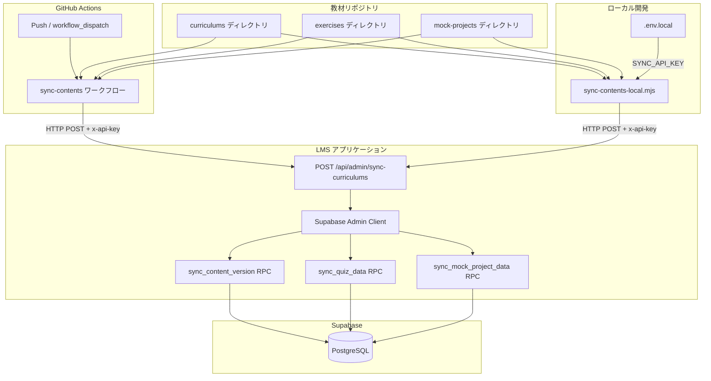
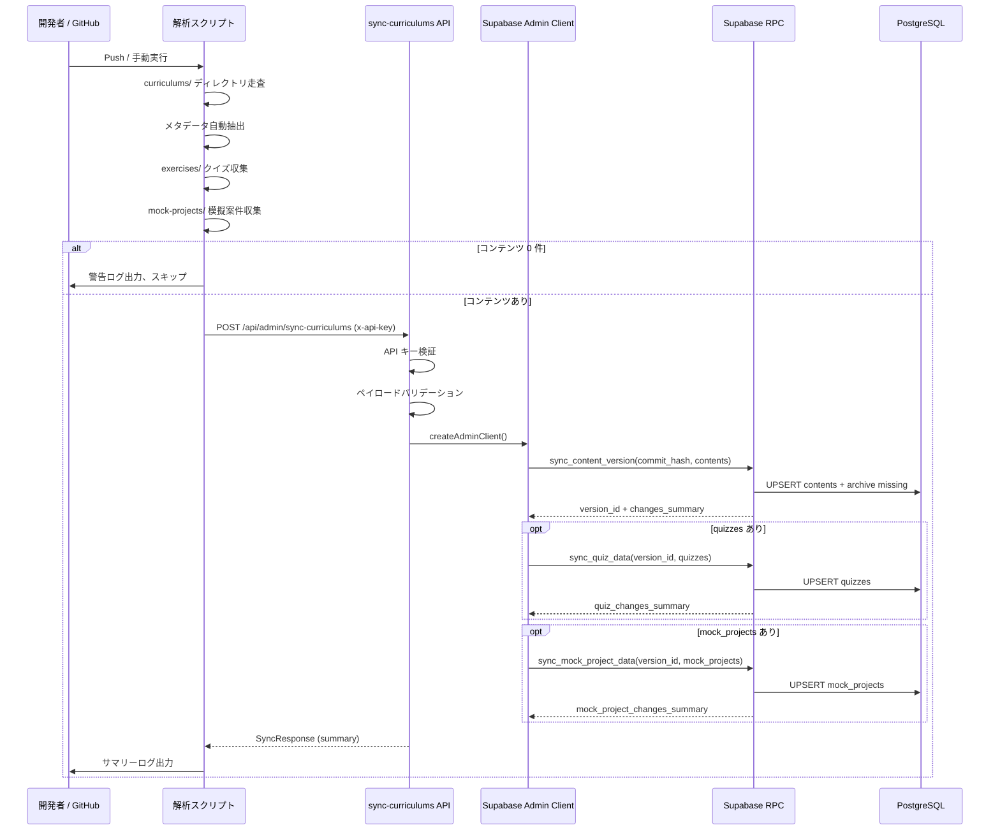

# 技術設計書: コンテンツ同期ワークフロー（content-sync-workflow）

## 概要

**目的**: 教材リポジトリ（GitHub）の `main` ブランチへの Push をトリガーに、教材ディレクトリを自動解析し、LMS の同期 API へ UPSERT リクエストを送信するワークフローを提供する。教材ファイルの修正を不要とし、ディレクトリ名・ファイル名の命名規則からメタデータを自動抽出する。

**ユーザー**: コンテンツ管理者（教材リポジトリへ Push する運営メンバー）および開発者（ローカル環境でのテスト同期）が利用する。

**影響**: LMS のコンテンツテーブルを全量同期方式で更新する。ペイロードに含まれないコンテンツは archived 状態に遷移する。

### ゴール

- 教材リポジトリの Push を契機とした自動コンテンツ同期
- ディレクトリ構造・ファイル名からのメタデータ自動抽出（教材ファイル修正不要）
- ローカル開発環境での同期テスト手段の提供
- 冪等な全量同期による運用の簡素化

### 非ゴール

- 差分同期の実装（全量同期で十分）
- LMS 管理画面からのコンテンツ編集機能
- 教材リポジトリ側の CI/CD（lint、テスト等）
- クイズ・模擬案件の解析ロジック設計（別仕様で管理、本設計では同期パイプラインへの統合のみ記述）

## アーキテクチャ

### 既存アーキテクチャ分析

本機能は Docs as Code アーキテクチャの中核コンポーネントとして、以下の既存基盤の上に構築する。

- **同期 API エンドポイント**: `POST /api/admin/sync-curriculums` が Next.js API Route として実装済み。Supabase RPC（`sync_content_version`）を呼び出し、コンテンツの UPSERT と論理削除を実行する
- **認証方式**: `x-api-key` ヘッダーによる API キー認証。`SYNC_API_KEY` 環境変数と照合する
- **データ永続化**: Supabase RPC がバージョン管理付きの UPSERT を処理する。Admin クライアント（`service_role` キー）で RLS をバイパスする

### アーキテクチャパターンと境界マップ



**アーキテクチャ統合**:
- **選択パターン**: パイプライン型（収集 → 解析 → 送信 → 永続化）。教材リポジトリのディレクトリ走査からデータベース書き込みまでの一方向データフロー
- **ドメイン境界**: 解析ロジック（GitHub Actions / ローカルスクリプト）と永続化ロジック（同期 API / Supabase RPC）を明確に分離。解析側は HTTP クライアント、永続化側は API サーバーとして独立
- **既存パターン維持**: Next.js API Route、Supabase Admin Client、RLS バイパスパターンを踏襲
- **ステアリング準拠**: Docs as Code 原則に従い、LMS 側にコンテンツ編集機能を持たない

### 技術スタック

| レイヤー | 技術 / バージョン | 本機能での役割 | 備考 |
|---------|------------------|---------------|------|
| CI/CD | GitHub Actions (ubuntu-latest) | 教材リポジトリの Push トリガーでワークフロー実行 | Node.js 20 使用 |
| スクリプト | Node.js (ESM) | ディレクトリ走査・メタデータ解析・API 呼び出し | ワークフロー: インラインスクリプト、ローカル: `.mjs` ファイル |
| API | Next.js API Route | 同期エンドポイント提供 | `app/api/admin/sync-curriculums/route.ts` |
| データ | Supabase PostgreSQL | コンテンツ・クイズ・模擬案件の永続化 | RPC 関数によるバージョン管理付き UPSERT |

## システムフロー

### 同期実行フロー



**重要な判定ポイント**:
- コンテンツ 0 件の場合は API を呼び出さずスキップする（REQ-8.3）
- quizzes / mock_projects はオプショナル。ペイロードに含まれる場合のみ同期する
- RPC エラー発生時はワークフローを失敗ステータスで終了する（REQ-6.4）

## 要件トレーサビリティ

| 要件 | 概要 | コンポーネント | インターフェース | フロー |
|------|------|---------------|-----------------|--------|
| 1.1 | main ブランチ Push で自動実行 | SyncWorkflow | - | 同期実行フロー |
| 1.2 | workflow_dispatch による手動実行 | SyncWorkflow | - | 同期実行フロー |
| 1.3 | 全量同期（冪等性前提） | SyncAPI, SyncRPC | SyncRequest | 同期実行フロー |
| 2.1-2.5 | 4 階層ディレクトリ構造の走査 | ContentCollector | - | 同期実行フロー |
| 3.1-3.3 | タイトル自動抽出 | ContentParser | - | - |
| 4.1-4.5 | order 値の抽出 | ContentParser | - | - |
| 5.1-5.5 | slug_path 生成 | ContentParser | SyncContentItem | - |
| 6.1 | 同期 API への POST 送信 | SyncWorkflow, LocalSyncScript | SyncRequest | 同期実行フロー |
| 6.2 | x-api-key ヘッダー設定 | SyncWorkflow, LocalSyncScript | - | 同期実行フロー |
| 6.3 | レスポンスサマリーのログ出力 | SyncWorkflow, LocalSyncScript | SyncResponse | 同期実行フロー |
| 6.4 | エラー時のワークフロー失敗 | SyncWorkflow, LocalSyncScript | SyncResponse | 同期実行フロー |
| 7.1-7.3 | シークレット管理 | SyncWorkflow | - | - |
| 8.1 | パースエラー時のスキップ・警告 | ContentCollector | - | - |
| 8.2 | curriculums/ 不在時のエラー終了 | SyncWorkflow, LocalSyncScript | - | - |
| 8.3 | 0 件時のスキップ | SyncWorkflow, LocalSyncScript | - | 同期実行フロー |
| 9.1 | ローカル同期スクリプト提供 | LocalSyncScript | - | 同期実行フロー |
| 9.2 | .env.local からの自動読み込み | LocalSyncScript | - | - |
| 9.3 | デフォルト localhost:3000 | LocalSyncScript | - | - |
| 9.4 | GitHub Actions と同一解析ロジック | ContentParser, ContentCollector | SyncContentItem | - |

## コンポーネントとインターフェース

| コンポーネント | ドメイン/レイヤー | 目的 | 要件カバレッジ | 主要依存 | コントラクト |
|---------------|------------------|------|---------------|---------|-------------|
| SyncWorkflow | CI/CD | GitHub Actions ワークフロー定義 | 1.1, 1.2, 6.1-6.4, 7.1-7.3, 8.2, 8.3 | ContentCollector (P0) | Batch |
| LocalSyncScript | 開発ツール | ローカル開発用同期スクリプト | 9.1-9.4, 6.1-6.4, 8.2, 8.3 | ContentCollector (P0) | Batch |
| ContentParser | 解析 | 命名規則からのメタデータ抽出 | 3.1-3.3, 4.1-4.5, 5.1-5.5 | なし | Service |
| ContentCollector | 解析 | ディレクトリ走査とコンテンツ収集 | 2.1-2.5, 8.1 | ContentParser (P0) | Service |
| SyncAPI | API | 同期エンドポイント（既存） | 1.3, 6.1-6.4 | Supabase Admin Client (P0) | API |

### 解析レイヤー

#### ContentParser

| フィールド | 詳細 |
|-----------|------|
| 目的 | ディレクトリ名・ファイル名の命名規則からメタデータ（タイトル、order、slug）を抽出する |
| 要件 | 3.1, 3.2, 3.3, 4.1, 4.2, 4.3, 4.4, 4.5, 5.1, 5.2, 5.3, 5.4, 5.5 |

**責務と制約**
- ディレクトリ名の `: ` セパレータによるスラグ・タイトル分離
- セクションファイル名の `_` セパレータによるプレフィックス・タイトル分離
- YAML フロントマター解析（簡易実装、外部ライブラリ不使用）
- Markdown 本文からの `# 見出し` 抽出
- タイトル解決の優先順位: フロントマター `title` > `# 見出し` > ファイル名（REQ-3.3）
- order 解決の優先順位: フロントマター `order` > ファイル名プレフィックス（REQ-4.5）

**依存**
- 外部依存なし（Node.js 標準 API のみ使用）

**コントラクト**: Service [x]

##### サービスインターフェース

```typescript
/** ディレクトリ名からスラグとタイトルを分離する */
function parseDirName(name: string): { slug: string; title: string }

/** スラグから order 値を抽出する */
function extractOrderFromSlug(slug: string): number

/** セクションファイル名を解析する */
function parseSectionFilename(filename: string): {
  slug: string
  title: string
  order: number
}

/** YAML フロントマターを解析する */
function parseFrontmatter(content: string): {
  attributes: Record<string, string | number>
  body: string
}

/** Markdown 本文から最初の # 見出しを抽出する */
function extractFirstHeading(body: string): string | null
```

- 前提条件: 入力文字列が空でないこと
- 事後条件: `parseDirName` は常に `slug` と `title` を返す。`: ` セパレータがない場合はディレクトリ名全体を `slug` とする
- 不変条件: 同一入力に対して常に同一の出力を返す（純粋関数）

**実装ノート**
- フロントマター解析は外部ライブラリ（gray-matter 等）を使用せず、正規表現ベースの簡易実装とする。複雑な YAML 構文（ネスト、配列等）は非対応
- `: ` セパレータが複数存在する場合、最初の出現位置で分割する

#### ContentCollector

| フィールド | 詳細 |
|-----------|------|
| 目的 | 教材リポジトリの 4 階層ディレクトリ構造を再帰走査し、コンテンツアイテムを収集する |
| 要件 | 2.1, 2.2, 2.3, 2.4, 2.5, 8.1 |

**責務と制約**
- `curriculums/` をルートとした 4 階層（genre > tutorial > chapter > section）の走査
- 各階層で ContentParser を使用してメタデータを抽出
- セクションファイル（`.md`）の読み込みと本文取得
- `_index.md` ファイルのスキップ
- パースエラー発生時は当該ファイルをスキップし、警告ログを出力（REQ-8.1）

**依存**
- Inbound: SyncWorkflow, LocalSyncScript -- コンテンツ収集の呼び出し元 (P0)
- Outbound: ContentParser -- メタデータ抽出 (P0)
- External: Node.js `fs` -- ファイルシステム操作 (P0)

**コントラクト**: Service [x]

##### サービスインターフェース

```typescript
/** curriculums/ ディレクトリを走査してコンテンツアイテム配列を返す */
function collectContents(rootDir: string): SyncContentItem[]

/** exercises/ ディレクトリからクイズ JSON を再帰収集する */
function collectQuizzes(rootDir: string): SyncQuizItem[]

/** mock-projects/ ディレクトリから模擬案件 JSON を収集する */
function collectMockProjects(rootDir: string): SyncMockProjectItem[]
```

- 前提条件: `rootDir` が有効なディレクトリパスであること
- 事後条件: パースエラーのファイルはスキップされ、正常なファイルのみ返却される
- 不変条件: ディレクトリが空の場合は空配列を返す

### CI/CD レイヤー

#### SyncWorkflow

| フィールド | 詳細 |
|-----------|------|
| 目的 | GitHub Actions ワークフローとして教材リポジトリの同期を自動実行する |
| 要件 | 1.1, 1.2, 1.3, 6.1, 6.2, 6.3, 6.4, 7.1, 7.2, 7.3, 8.2, 8.3 |

**責務と制約**
- `main` ブランチへの Push および `workflow_dispatch` をトリガーとする
- Node.js インラインスクリプトとしてパーサー・コレクターを内包する
- `GITHUB_SHA` からコミットハッシュを取得し、ペイロードに含める
- `git log` からコミットメッセージを取得し、ペイロードに含める
- シークレットは GitHub Repository Secrets から環境変数として注入する

**依存**
- Outbound: SyncAPI -- HTTP POST でコンテンツ送信 (P0)
- External: GitHub Actions -- ワークフロー実行基盤 (P0)
- External: actions/checkout@v4 -- リポジトリチェックアウト (P0)
- External: actions/setup-node@v4 -- Node.js 20 セットアップ (P1)

**コントラクト**: Batch [x]

##### バッチ/ジョブコントラクト

- **トリガー**: `push` (main ブランチ) / `workflow_dispatch` (手動)
- **入力/バリデーション**: `curriculums/` ディレクトリの存在確認。不在時はエラー終了（exit 1）
- **出力/宛先**: `POST /api/admin/sync-curriculums` へ JSON ペイロード送信
- **冪等性とリカバリ**: 全量同期のため再実行しても結果は同一。エラー時はワークフロー失敗ステータスで終了し、手動再実行可能

**実装ノート**
- ワークフローファイルは教材リポジトリに配置するが、LMS リポジトリにもテンプレートとして `.github/workflows/sync-contents.yml` を提供する
- 解析ロジックはインラインスクリプトとして Node.js heredoc（`<< 'SCRIPT'`）で記述する。外部ファイル依存を排除し、教材リポジトリへのコピー時にワークフローファイル単体で動作する設計

### 開発ツールレイヤー

#### LocalSyncScript

| フィールド | 詳細 |
|-----------|------|
| 目的 | ローカル開発環境で教材リポジトリの同期をテストするスクリプトを提供する |
| 要件 | 9.1, 9.2, 9.3, 9.4, 6.1, 6.2, 6.3, 6.4, 8.2, 8.3 |

**責務と制約**
- `scripts/sync-contents-local.mjs` として配置（ESM モジュール）
- コマンドライン引数で教材リポジトリのルートディレクトリを受け取る
- `lms-fe/.env.local` から `SYNC_API_KEY` を自動読み込み（簡易 dotenv 実装）
- デフォルトの送信先は `http://localhost:3000`。`LMS_BASE_URL` 環境変数で変更可能
- GitHub Actions ワークフローと同一の解析ロジック（ContentParser / ContentCollector）を使用する
- git コミットハッシュ・コミットメッセージを教材リポジトリから取得しペイロードに含める

**依存**
- Outbound: SyncAPI -- HTTP POST でコンテンツ送信 (P0)
- External: Node.js `fs`, `path`, `child_process` -- ファイル操作・git 実行 (P0)

**コントラクト**: Batch [x]

##### バッチ/ジョブコントラクト

- **トリガー**: `node scripts/sync-contents-local.mjs <repo-root-dir>` による手動実行
- **入力/バリデーション**: コマンドライン引数の存在確認、ディレクトリの存在確認、`SYNC_API_KEY` の存在確認。いずれも不正な場合はエラーメッセージを表示して exit 1
- **出力/宛先**: `POST {LMS_BASE_URL}/api/admin/sync-curriculums` へ JSON ペイロード送信
- **冪等性とリカバリ**: 全量同期のため再実行しても結果は同一

### API レイヤー

#### SyncAPI（既存コンポーネント）

| フィールド | 詳細 |
|-----------|------|
| 目的 | GitHub Actions / ローカルスクリプトからのコンテンツ同期リクエストを受け付け、Supabase RPC 経由でデータを永続化する |
| 要件 | 1.3, 6.1, 6.2, 6.3, 6.4 |

**責務と制約**
- `x-api-key` ヘッダーによる API キー認証
- リクエストペイロードの構造バリデーション（contents 必須、quizzes/mock_projects オプショナル）
- Supabase Admin Client（`service_role` キー）で RLS をバイパス
- `sync_content_version` RPC の呼び出し（コンテンツ UPSERT + 不在コンテンツのアーカイブ）
- `sync_quiz_data` RPC の呼び出し（クイズ同期、オプショナル）
- `sync_mock_project_data` RPC の呼び出し（模擬案件同期、オプショナル）
- バージョン ID と変更サマリーを含むレスポンスの返却

**依存**
- Inbound: SyncWorkflow, LocalSyncScript -- HTTP POST リクエスト (P0)
- Outbound: Supabase Admin Client -- RLS バイパスクライアント生成 (P0)
- Outbound: Supabase RPC -- sync_content_version, sync_quiz_data, sync_mock_project_data (P0)

**コントラクト**: API [x]

##### API コントラクト

| メソッド | エンドポイント | リクエスト | レスポンス | エラー |
|---------|--------------|-----------|-----------|--------|
| POST | /api/admin/sync-curriculums | SyncRequest | SyncResponse | 400, 401, 500 |

**リクエストヘッダー**:
- `Content-Type: application/json`
- `x-api-key: <SYNC_API_KEY>`

## データモデル

### データコントラクトと統合

#### API データ転送

**SyncRequest（リクエストペイロード）**:

```typescript
interface SyncRequest {
  contents: SyncContentItem[]
  quizzes?: SyncQuizItem[]
  mock_projects?: SyncMockProjectItem[]
  commit_hash?: string
  commit_message?: string
}

interface SyncContentItem {
  slug_path: string           // 階層結合パス（例: "engineering/tutorial-10/chapter-1/10-1-1"）
  title: string               // 抽出されたタイトル
  body?: string | null        // Markdown 本文（section のみ）
  genre: string               // ジャンルスラグ
  tutorial: string            // チュートリアルスラグ
  chapter?: string | null     // チャプタースラグ（chapter, section のみ）
  section?: string | null     // セクションスラグ（section のみ）
  content_type: "genre" | "tutorial" | "chapter" | "section"
  order?: number              // 表示順序
  metadata?: Record<string, unknown> | null
}

interface SyncQuizItem {
  file_path: string
  slug: string
  section: string
  title: string
  genre: string
  tutorial: string
  chapter: string
  questions: QuizQuestionItem[]
}

interface QuizQuestionItem {
  id: string
  type: "single" | "multiple"
  text: string
  options: { id: string; text: string }[]
  correct: string | string[]
  explanation: string
}

interface SyncMockProjectItem {
  slug: string
  title: string
  description?: string | null
  requirements?: string | null
  evaluation_items?: {
    id: string
    category: string
    criteria: string
    weight: number
  }[]
  genre: "engineering" | "design"
  order: number
  status: "active" | "archived"
}
```

**SyncResponse（レスポンス）**:

```typescript
interface SyncResponse {
  success: boolean
  version_id?: string
  summary: {
    created: number    // 新規作成 + 更新の合計
    archived: number   // アーカイブされた件数
  }
  quiz_summary?: {
    created: number
    archived: number
  }
  mock_project_summary?: {
    created: number
    archived: number
  }
  errors?: string[]
}
```

**バリデーションルール**:
- `contents` は必須。空配列の場合はエラー（400）
- `contents[].slug_path`, `title`, `genre`, `tutorial`, `content_type` は必須文字列フィールド
- `content_type` は `"genre" | "tutorial" | "chapter" | "section"` のいずれか
- `commit_hash` は指定時に空でない文字列であること
- `quizzes`, `mock_projects` はオプショナル（後方互換性維持）

## エラーハンドリング

### エラー戦略

本機能はバッチ処理としての堅牢性を優先し、個別ファイルのエラーでワークフロー全体を停止させない設計とする。ただし、前提条件の不備や API エラーはフェイルファストで即座に終了する。

### エラーカテゴリとレスポンス

**クライアント入力エラー（解析側）**:
- `curriculums/` ディレクトリ不在: エラーメッセージ出力、exit 1（REQ-8.2）
- `SYNC_API_KEY` 未設定（ローカル）: エラーメッセージ出力、exit 1
- コマンドライン引数不足（ローカル）: 使用方法を表示、exit 1
- 個別ファイルのパースエラー: 警告ログ出力、当該ファイルをスキップして続行（REQ-8.1）
- コンテンツ 0 件: 警告ログ出力、API 呼び出しをスキップ（REQ-8.3）

**API エラー（サーバー側）**:
- 401 Unauthorized: API キー不一致
- 400 Bad Request: ペイロードバリデーション失敗（必須フィールド不足、content_type 不正等）
- 500 Internal Server Error: RPC 実行エラー、予期しない例外

**ワークフロー失敗処理**:
- API がエラーレスポンス（`!response.ok || !result.success`）を返した場合、レスポンス内容を標準エラーに出力し、exit 1 で終了する（REQ-6.4）

## テスト戦略

### 単体テスト

- `parseDirName`: `: ` セパレータの有無による分岐、日本語タイトルの正常抽出
- `parseSectionFilename`: 各種命名パターン（`10-1-1_タイトル.md`、アンダースコアなし等）
- `parseFrontmatter`: フロントマターあり/なし、数値変換、クォート除去
- `extractFirstHeading`: 見出しあり/なし、複数見出しから最初のみ抽出
- `extractOrderFromSlug`: `tutorial-10` -> 10、`chapter-1` -> 1、数字なし -> 0

### 統合テスト

- `collectContents`: テスト用 4 階層ディレクトリを用意し、全コンテンツタイプの正常収集を検証
- `collectContents` + パースエラー: 不正な Markdown ファイルを含む場合のスキップと警告ログ
- ペイロードバリデーション: 正常ペイロード、空 contents、必須フィールド不足の各パターン
- API 認証: 正しい x-api-key での成功、不正キーでの 401

### E2E テスト

- ローカルスクリプトの end-to-end 実行: テスト用教材ディレクトリ -> ローカルサーバー -> DB 反映の確認
- エラーハンドリング: `curriculums/` 不在時のエラー終了、`SYNC_API_KEY` 未設定時のエラー終了

## セキュリティ考慮事項

- **シークレット管理**: `SYNC_API_KEY` と `LMS_BASE_URL` は GitHub Repository Secrets に保存し、ワークフロー環境変数として注入する（REQ-7.1, 7.2, 7.3）
- **API キー認証**: `x-api-key` ヘッダーによる簡易認証。同期 API は内部利用のみであり、外部公開しない前提
- **RLS バイパス**: 同期 API は `service_role` キーで RLS をバイパスするため、API キー認証が唯一のアクセス制御ゲートとなる
- **ローカル開発**: `.env.local`（Git 管理外）からシークレットを読み込むことで、シークレットの漏洩を防止する
