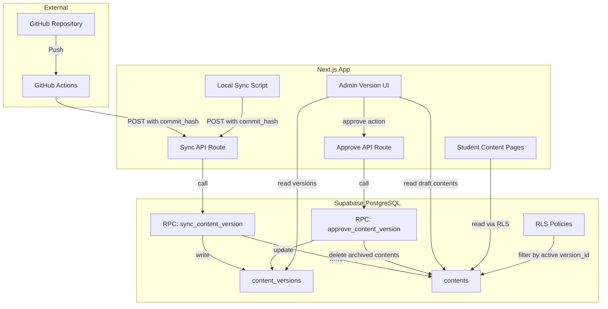
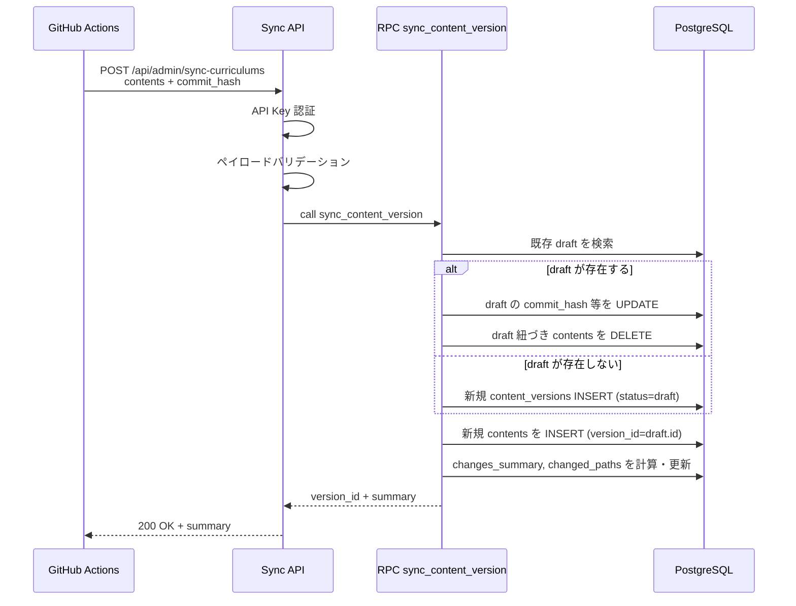
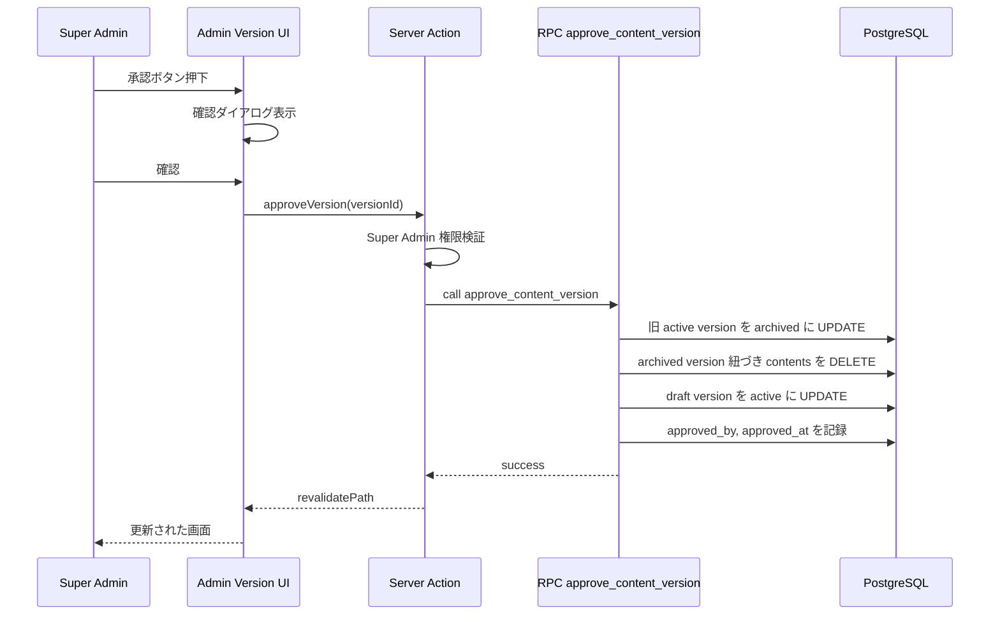
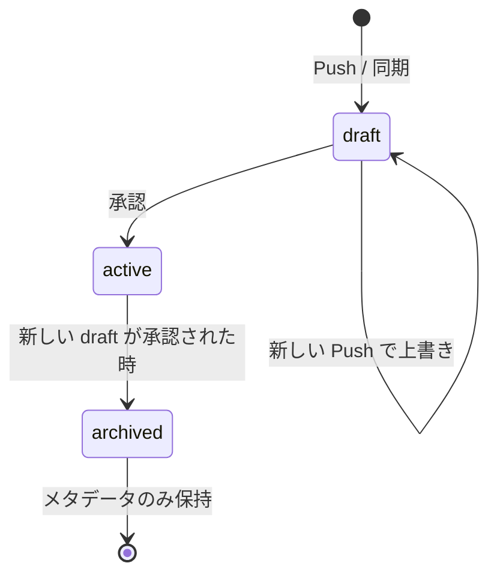
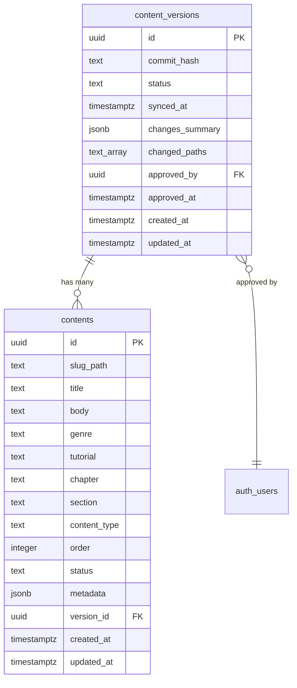
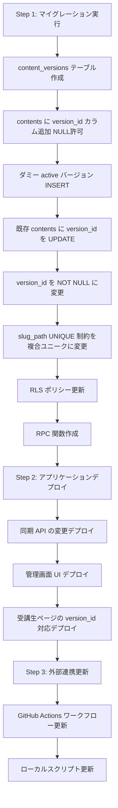

# 技術設計書: コンテンツバージョン管理

## Overview

本機能は、教材リポジトリ（GitHub）への Push 単位でコンテンツのバージョンを管理し、管理画面での承認を経て受講生に公開するワークフローを実現する。現行の「Push → 即 active」フローを「Push → draft 作成 → プレビュー確認 → 承認 → active 昇格」に変更し、意図しないコンテンツ公開を防止する。

**Users**: Super Admin がバージョンの確認・承認を行い、受講生（User）は承認済みコンテンツのみを閲覧する。Manager はコンテンツへのアクセス権限を持たない。

**Impact**: 既存の同期 API、受講生向けコンテンツページ、RLS ポリシー、GitHub Actions ワークフロー、ローカル同期スクリプトに変更が発生する。`contents` テーブルに `version_id` カラムを追加し、`content_versions` テーブルを新規作成する。

### Goals

- Push 単位でバージョンを識別し、draft → active の承認フローを確立する
- 受講生への影響ゼロで draft コンテンツを管理する
- 既存ページ再利用によるプレビュー機能を提供する
- バージョン履歴の軽量なメタデータ管理を実現する

### Non-Goals

- 差し戻し（リジェクト）フローの実装（判断-2 で不要と確定）
- 過去バージョンへのロールバック機能（判断-3 で不要と確定）
- Manager ロールへの承認権限の拡張（将来検討事項）
- コンテンツの差分表示（diff ビュー）-- 変更ファイル一覧と個別プレビューで代替

## Architecture

### Existing Architecture Analysis

現行システムのコンテンツ管理パイプラインは以下の構成:

- **同期 API** (`POST /api/admin/sync-curriculums`): GitHub Actions / ローカルスクリプトからコンテンツを受け取り、`contents` テーブルに UPSERT。`status = 'active'` を直接セットする。
- **受講生ページ**: `.eq("status", "active")` でフィルタリングしてコンテンツを表示。
- **RLS**: `status = 'active'` 条件で User ロールのアクセスを制御。
- **管理画面**: Super Admin が全コンテンツ（active + archived）を閲覧可能。

主要な変更点:
- `contents.status` ベースのフィルタリングを `contents.version_id` ベースに移行
- `slug_path` の UNIQUE 制約を `(slug_path, version_id)` 複合ユニーク制約に変更
- 承認・同期ロジックのアトミック性確保のため PostgreSQL 関数（RPC）を導入

### Architecture Pattern & Boundary Map



**Architecture Integration**:
- **Selected pattern**: 既存の Server Components + API Routes パターンを維持し、バージョン管理レイヤーを追加
- **Domain boundaries**: 同期処理（API Route + RPC）と承認処理（Server Action + RPC）を分離
- **Existing patterns preserved**: Server Component でのデータフェッチ、`createClient()` / `createAdminClient()` の使い分け、Server Actions による状態変更
- **New components rationale**: `content_versions` テーブルと RPC 関数はアトミックなバージョン管理に必須。管理画面 UI はバージョン確認・承認ワークフローに必要。
- **Steering compliance**: TypeScript strict mode、RLS 適用、Docs as Code 分離を維持

### Technology Stack

| Layer | Choice / Version | Role in Feature | Notes |
|-------|------------------|-----------------|-------|
| Frontend | Next.js 16 App Router + React 19 | 管理画面 UI、受講生ページの version_id 対応 | 既存スタック |
| Backend | Next.js API Routes + Server Actions | 同期 API、承認処理 | 既存パターン |
| Data | Supabase PostgreSQL + RPC Functions | content_versions テーブル、アトミック処理 | RPC 関数を新規追加 |
| UI Components | shadcn/ui + Tailwind CSS v4 | バージョン管理 UI コンポーネント | 既存スタック |
| CI/CD | GitHub Actions | commit_hash のペイロード追加 | ワークフロー変更 |

## System Flows

### 同期フロー（Push → draft 作成）



**Key Decisions**: draft 上書き時は DELETE + INSERT を採用。UPSERT ではなく全置換方式により、ファイル名変更や削除にも対応。RPC 関数内でトランザクションを管理し、中間状態を防止。

### 承認フロー（draft → active 昇格）



**Key Decisions**: 承認処理は単一の RPC 関数で実行し、3つの状態変更（旧 active の archived 化、旧コンテンツ削除、draft の active 昇格）をアトミックに完了する。

### バージョンライフサイクル



## Requirements Traceability

| Requirement | Summary | Components | Interfaces | Flows |
|-------------|---------|------------|------------|-------|
| 1.1 | バージョンレコード作成 | SyncAPI, RPC_Sync | sync_content_version RPC | 同期フロー |
| 1.2 | draft ステータスで作成 | RPC_Sync | sync_content_version RPC | 同期フロー |
| 1.3 | version_id 紐付け保存 | RPC_Sync, ContentsMigration | contents.version_id | 同期フロー |
| 1.4 | active 継続公開 | RLS, StudentContentPages | version_id ベースフィルタ | - |
| 2.1 | 既存 draft 上書き | RPC_Sync | sync_content_version RPC | 同期フロー |
| 2.2 | 中間バージョン非保持 | RPC_Sync | - | 同期フロー |
| 2.3 | draft コンテンツ置換 | RPC_Sync | sync_content_version RPC | 同期フロー |
| 3.1 | 変更ファイル一覧表示 | VersionDetailPage | changed_paths, changes_summary | - |
| 3.2 | 変更種別バッジ | ChangedFilesList | ChangeTypeBadge | - |
| 3.3 | Markdown プレビュー | StudentContentPages | ?version_id パラメータ | - |
| 3.4 | 全体プレビュー | StudentContentPages | ?version_id パラメータ | - |
| 3.5 | 既存ページ再利用・Super Admin 限定 | StudentContentPages | version_id searchParam | - |
| 4.1 | content_versions テーブル定義 | ContentVersionsMigration | content_versions DDL | - |
| 4.2 | 過去 body 非保持 | RPC_Approve | archived contents DELETE | 承認フロー |
| 4.3 | バージョン履歴閲覧 | VersionHistoryTable | content_versions SELECT | - |
| 5.1 | draft → active 昇格 | RPC_Approve, ApproveAction | approve_content_version RPC | 承認フロー |
| 5.2 | 旧 active → archived | RPC_Approve | approve_content_version RPC | 承認フロー |
| 5.3 | archived コンテンツ行削除 | RPC_Approve | approve_content_version RPC | 承認フロー |
| 5.4 | approved_by, approved_at 記録 | RPC_Approve | approve_content_version RPC | 承認フロー |
| 5.5 | 初回同期時の即 active 昇格 | RPC_Approve, VersionDetailPage | approve_content_version RPC | 承認フロー |
| 6.1 | commit_hash フィールド受け取り | SyncAPI | SyncRequest 型 | 同期フロー |
| 6.2 | GHA commit_hash 送信 | GitHubActionsWorkflow | ペイロード | - |
| 6.3 | ローカルスクリプト commit_hash | LocalSyncScript | ペイロード | - |
| 6.4 | version_id 紐付け UPSERT | RPC_Sync | sync_content_version RPC | 同期フロー |
| 7.1 | active コンテンツのみ表示 | StudentContentPages, RLS | version_id ベースフィルタ | - |
| 7.2 | draft 非表示 | RLS | version_id ベースポリシー | - |
| 7.3 | version_id ベースフィルタ移行 | StudentContentPages, RLS | - | - |
| 8.1 | バージョン管理セクション | VersionDashboardPage | content_versions SELECT | - |
| 8.2 | 変更確認ボタン | VersionDashboardPage | VersionDetailPage リンク | - |
| 8.3 | 差分ビューから承認 | VersionDetailPage, ApproveButton | approveVersion action | 承認フロー |
| 8.4 | 確認ダイアログ | ApproveConfirmDialog | - | 承認フロー |
| 9.1 | content_versions RLS | ContentVersionsRLS | Super Admin SELECT | - |
| 9.2 | contents RLS 更新 | ContentsRLSUpdate | version_id ベースポリシー | - |
| 9.3 | Manager アクセス不可維持 | ContentsRLSUpdate | - | - |

## Components and Interfaces

| Component | Domain/Layer | Intent | Req Coverage | Key Dependencies (P0/P1) | Contracts |
|-----------|--------------|--------|--------------|--------------------------|-----------|
| SyncAPI | Backend / API Route | commit_hash を含む同期リクエストを受け付け、RPC を呼び出す | 1.1-1.4, 2.1-2.3, 6.1, 6.4 | RPC_Sync (P0) | API |
| RPC_Sync | Data / PostgreSQL | draft バージョンの作成・上書きとコンテンツ保存をアトミックに実行 | 1.1-1.3, 2.1-2.3, 6.4 | content_versions, contents (P0) | Service |
| RPC_Approve | Data / PostgreSQL | draft → active 昇格、旧 active 行削除をアトミックに実行 | 5.1-5.5, 4.2 | content_versions, contents (P0) | Service |
| ApproveAction | Backend / Server Action | Super Admin 権限検証後に RPC_Approve を呼び出す | 5.1, 5.4, 8.3 | RPC_Approve (P0), createClient (P1) | Service |
| VersionDashboardPage | Frontend / Page | バージョン管理のメインページ（active, draft, 履歴） | 8.1, 8.2, 4.3 | content_versions (P0) | State |
| VersionDetailPage | Frontend / Page | draft の変更ファイル一覧とプレビューリンクを表示 | 3.1, 3.2, 3.4, 8.2, 8.3 | content_versions, contents (P0) | State |
| ApproveConfirmDialog | Frontend / UI | 承認の確認ダイアログ | 8.4 | ApproveAction (P0) | - |
| StudentContentPages | Frontend / Page | version_id パラメータによるプレビュー対応 | 3.3-3.5, 7.1-7.3 | contents, content_versions (P0) | - |
| GitHubActionsWorkflow | CI/CD | commit_hash をペイロードに追加 | 6.2 | SyncAPI (P0) | - |
| LocalSyncScript | Script | commit_hash をペイロードに追加 | 6.3 | SyncAPI (P0) | - |
| ContentVersionsMigration | Data / Migration | content_versions テーブル作成、contents に version_id 追加 | 4.1, 1.3 | - | - |
| RLSMigration | Data / Migration | RLS ポリシーの更新 | 9.1-9.3 | content_versions (P0) | - |

### Data / PostgreSQL

#### RPC: sync_content_version

| Field | Detail |
|-------|--------|
| Intent | Push 単位の draft バージョン作成・上書きとコンテンツ保存をアトミックに実行する |
| Requirements | 1.1, 1.2, 1.3, 2.1, 2.2, 2.3, 6.4 |

**Responsibilities & Constraints**
- 既存 draft の存在確認と上書き（commit_hash, synced_at の UPDATE + 紐づきコンテンツの DELETE + 再 INSERT）
- 新規 draft バージョンの作成（draft が存在しない場合）
- active バージョンとの差分計算（changes_summary, changed_paths の算出）
- トランザクション内での一貫した実行

**Dependencies**
- Inbound: SyncAPI -- 同期リクエストの処理委譲 (P0)
- External: content_versions テーブル、contents テーブル (P0)

**Contracts**: Service [x]

##### Service Interface

```typescript
// RPC 関数シグネチャ（PostgreSQL 関数として実装）
// supabase.rpc('sync_content_version', params) で呼び出す

interface SyncContentVersionParams {
  p_commit_hash: string;
  p_contents: SyncContentItem[];  // JSON 配列として渡す
}

interface SyncContentVersionResult {
  version_id: string;
  is_new_draft: boolean;
  summary: {
    added: number;
    updated: number;
    deleted: number;
  };
}
```

- Preconditions: commit_hash が空でないこと、contents 配列が空でないこと
- Postconditions: draft バージョンが 1 つだけ存在すること、全コンテンツが version_id に紐づいていること
- Invariants: active バージョンのコンテンツは変更されない

**Implementation Notes**
- Integration: `SECURITY DEFINER` で定義し、service_role 経由で呼び出す。RLS をバイパスする必要があるため。
- Validation: 関数内で commit_hash の NOT NULL チェックを実施
- Risks: 大量コンテンツの一括 INSERT のパフォーマンス。`json_populate_recordset` を使用して効率的に処理する。

#### RPC: approve_content_version

| Field | Detail |
|-------|--------|
| Intent | draft → active 昇格、旧 active の archived 化、旧コンテンツ行削除をアトミックに実行する |
| Requirements | 5.1, 5.2, 5.3, 5.4, 5.5, 4.2 |

**Responsibilities & Constraints**
- 対象バージョンが draft ステータスであることの検証
- 旧 active バージョンの archived 化（存在する場合）
- archived バージョンに紐づく contents 行の削除
- draft バージョンの active 昇格
- approved_by, approved_at の記録
- 初回同期（active が存在しない場合）にも対応

**Dependencies**
- Inbound: ApproveAction -- 承認処理の委譲 (P0)
- External: content_versions テーブル、contents テーブル (P0)

**Contracts**: Service [x]

##### Service Interface

```typescript
// RPC 関数シグネチャ
// supabase.rpc('approve_content_version', params) で呼び出す

interface ApproveContentVersionParams {
  p_version_id: string;     // UUID
  p_approved_by: string;    // UUID (auth.users.id)
}

interface ApproveContentVersionResult {
  success: boolean;
  archived_version_id: string | null;
  deleted_contents_count: number;
}
```

- Preconditions: 対象バージョンの status が 'draft' であること
- Postconditions: 対象バージョンが 'active'、旧 active が 'archived'（存在した場合）、archived のコンテンツ行が削除済み
- Invariants: active バージョンは常に 0 または 1 つ

**Implementation Notes**
- Integration: `SECURITY DEFINER` で定義。Server Action 経由で呼び出す。
- Validation: draft ステータスの検証、存在チェック。違反時は `RAISE EXCEPTION`。
- Risks: 同時承認リクエストの競合。関数内の SELECT ... FOR UPDATE でロックを取得。

### Backend / API Route

#### SyncAPI (既存 API の変更)

| Field | Detail |
|-------|--------|
| Intent | commit_hash を含む同期リクエストを受け付け、RPC sync_content_version を呼び出す |
| Requirements | 1.1, 1.2, 1.3, 1.4, 2.1, 2.2, 2.3, 6.1, 6.4 |

**Responsibilities & Constraints**
- API キー認証（既存処理を維持）
- ペイロードバリデーション（commit_hash フィールドの追加検証）
- RPC sync_content_version の呼び出し
- レスポンスの返却（version_id, summary）

**Dependencies**
- Inbound: GitHub Actions, ローカルスクリプト -- HTTP POST (P0)
- Outbound: RPC_Sync -- アトミック同期処理 (P0)
- External: createAdminClient -- RLS バイパス (P0)

**Contracts**: API [x]

##### API Contract

| Method | Endpoint | Request | Response | Errors |
|--------|----------|---------|----------|--------|
| POST | /api/admin/sync-curriculums | SyncRequestV2 | SyncResponseV2 | 400, 401, 500 |

```typescript
// 変更後のリクエスト型
interface SyncRequestV2 {
  contents: SyncContentItem[];
  commit_hash: string;  // 追加フィールド
}

// 変更後のレスポンス型
interface SyncResponseV2 {
  success: boolean;
  version_id: string;   // 追加フィールド
  summary: {
    added: number;      // 名称変更: created → added
    updated: number;
    deleted: number;    // 名称変更: archived → deleted
  };
  errors?: string[];
}
```

**Implementation Notes**
- Integration: 既存の `validatePayload` 関数に `commit_hash` の検証を追加。UPSERT ロジックを RPC 呼び出しに置換。
- Validation: `commit_hash` が文字列かつ空でないことを検証。
- Risks: 既存の GitHub Actions ワークフローが commit_hash を送信するまでの間、後方互換性が必要。移行期間中は commit_hash が未指定の場合に 'unknown' をフォールバック値として使用する。

### Backend / Server Action

#### ApproveAction

| Field | Detail |
|-------|--------|
| Intent | Super Admin 権限を検証後、RPC approve_content_version を呼び出す |
| Requirements | 5.1, 5.4, 8.3 |

**Responsibilities & Constraints**
- 認証・Super Admin 権限の検証（既存 `verifySuperAdmin` パターンを再利用）
- version_id のバリデーション
- RPC approve_content_version の呼び出し
- revalidatePath による画面更新

**Dependencies**
- Inbound: ApproveConfirmDialog -- フォーム送信 (P0)
- Outbound: RPC_Approve -- 承認処理 (P0)
- External: createClient -- ユーザー認証 (P0)

**Contracts**: Service [x]

##### Service Interface

```typescript
// Server Action
function approveVersion(
  prevState: ActionResult,
  formData: FormData
): Promise<ActionResult>;
// formData には versionId: string を含む
```

- Preconditions: 呼び出し元が認証済み Super Admin であること
- Postconditions: 対象バージョンが active に昇格していること、画面が revalidate されていること

**Implementation Notes**
- Integration: `lms-fe/app/(authenticated)/admin/contents/versions/actions.ts` に配置。既存の `verifySuperAdmin` パターンを踏襲。
- Risks: RPC エラー時のユーザーへのフィードバック。PostgreSQL エラーメッセージを日本語に変換して返却。

### Frontend / Pages

#### VersionDashboardPage

| Field | Detail |
|-------|--------|
| Intent | バージョン管理のメインダッシュボード。active/draft 情報とバージョン履歴一覧を表示する |
| Requirements | 8.1, 8.2, 4.3 |

**Responsibilities & Constraints**
- Server Component としてデータフェッチ
- 現在の active バージョン情報の表示
- 未承認 draft バージョンの有無と情報の表示
- 過去バージョン（archived）の履歴一覧
- Super Admin 権限チェック

**Dependencies**
- Inbound: Admin サイドバーナビゲーション (P1)
- Outbound: VersionDetailPage -- draft 確認画面への遷移 (P1)
- External: content_versions テーブル (P0)

**Contracts**: State [x]

##### State Management

- State model: Server Component によるサーバーサイドフェッチ。クライアント状態は不要。
- Persistence: content_versions テーブルからの読み取り。`status` でフィルタリング。
- Concurrency: Server Component のため並行性の問題なし。

**Implementation Notes**
- Integration: `lms-fe/app/(authenticated)/admin/contents/versions/page.tsx` に配置。既存の admin/users/page.tsx のパターンに倣う。
- Risks: バージョン数が大量になった場合のパフォーマンス。ページネーションを導入（archived のみ）。

#### VersionDetailPage

| Field | Detail |
|-------|--------|
| Intent | draft バージョンの変更ファイル一覧、プレビューリンク、承認ボタンを表示する |
| Requirements | 3.1, 3.2, 3.4, 8.2, 8.3 |

**Responsibilities & Constraints**
- draft バージョンの `changed_paths` から変更ファイル一覧を表示
- 各ファイルの変更種別（追加/更新/削除）をバッジで表示
- 各ファイルから `?version_id` 付きプレビューリンクを生成
- 全体プレビューリンク（チュートリアル一覧ページへの `?version_id` 付きリンク）を提供
- 承認ボタン（ApproveConfirmDialog を含む）

**Dependencies**
- Inbound: VersionDashboardPage -- 「変更を確認」リンク (P1)
- Outbound: StudentContentPages -- プレビューリンク (P1)
- Outbound: ApproveAction -- 承認処理 (P0)
- External: content_versions, contents テーブル (P0)

**Contracts**: State [x]

##### State Management

- State model: Server Component + Client Component（承認ダイアログ）の組み合わせ
- Persistence: content_versions の `changed_paths`, `changes_summary` を使用
- Concurrency: 承認ボタンは楽観的 UI ではなく、Server Action の完了を待つ

**Implementation Notes**
- Integration: `lms-fe/app/(authenticated)/admin/contents/versions/[id]/page.tsx` に配置。
- Validation: `id` パラメータが有効な UUID であること、対象バージョンが draft であること。
- Risks: changed_paths の配列が大きい場合の表示パフォーマンス。仮想スクロールは初期実装では不要（教材の規模上、数百件程度を想定）。

#### ApproveConfirmDialog (Summary-only)

承認ボタン押下時に表示する確認ダイアログ。Client Component として実装。shadcn/ui の AlertDialog を使用。formData に versionId を含むフォームを Server Action に送信する。

#### VersionHistoryTable (Summary-only)

archived バージョンのメタデータ一覧を表示するテーブルコンポーネント。VersionDashboardPage 内で使用。コミットハッシュ、同期日時、承認者、変更サマリーを表示する。

#### ChangedFilesList (Summary-only)

変更ファイル一覧を変更種別バッジ付きで表示するコンポーネント。VersionDetailPage 内で使用。各ファイルにプレビューリンクを付与する。

#### StudentContentPages (既存ページの変更)

| Field | Detail |
|-------|--------|
| Intent | 受講生向けコンテンツ表示ページに version_id パラメータのサポートを追加する |
| Requirements | 3.3, 3.4, 3.5, 7.1, 7.2, 7.3 |

**Responsibilities & Constraints**
- `searchParams` に `version_id` パラメータのハンドリングを追加
- `version_id` 指定時: Super Admin 権限を検証し、指定バージョンのコンテンツを表示
- `version_id` 未指定時: 従来通り active バージョンのコンテンツを表示
- version_id ベースのフィルタリングへの移行（`.eq("status", "active")` → `.eq("version_id", activeVersionId)`)

**Dependencies**
- External: content_versions テーブル (P0) -- active バージョン ID の取得
- External: contents テーブル (P0)

**Implementation Notes**
- Integration: 以下のページを変更:
  - `lms-fe/app/(authenticated)/contents/page.tsx`（教材一覧）
  - `lms-fe/app/(authenticated)/contents/[tutorial]/page.tsx`（チュートリアル詳細）
  - `lms-fe/app/(authenticated)/contents/[tutorial]/[chapter]/[section]/page.tsx`（セクション詳細）
- Validation: version_id が UUID 形式であること。非 Super Admin ユーザーが version_id を指定した場合は無視（active バージョンにフォールバック）。
- Risks: 全コンテンツクエリに version_id フィルタを追加する必要がある。active バージョン ID の取得を共通ユーティリティとして抽出する。

### CI/CD & Scripts

#### GitHubActionsWorkflow (Summary-only)

`.github/workflows/sync-contents.yml` のペイロードに `commit_hash: "${{ github.sha }}"` を追加する。変更量は最小限。

#### LocalSyncScript (Summary-only)

`scripts/sync-contents-local.mjs` に `child_process.execSync('git rev-parse HEAD')` で取得した commit_hash をペイロードに追加する。

## Data Models

### Domain Model

- **Aggregate Root**: `ContentVersion` -- バージョンのライフサイクル（draft → active → archived）を管理
- **Entity**: `Content` -- version_id に紐づくコンテンツデータ（slug_path, title, body 等）
- **Value Object**: `ChangesSummary` -- 追加・更新・削除の件数
- **Domain Events**: バージョン作成、バージョン承認、バージョンアーカイブ
- **Invariants**:
  - active バージョンは同時に 0 または 1 つのみ存在する
  - draft バージョンは同時に 0 または 1 つのみ存在する
  - archived バージョンの contents 行は存在しない



### Logical Data Model

**content_versions テーブル**:
- 1:N の関係: 1 バージョン → 複数コンテンツ
- status カラムで draft/active/archived のライフサイクルを管理
- active は最大 1 レコード、draft は最大 1 レコードの制約（アプリケーション層 + RPC で保証）

**contents テーブル変更**:
- `version_id` カラム追加（FK → content_versions.id）
- `slug_path` の UNIQUE 制約を `(slug_path, version_id)` 複合ユニーク制約に変更
- `status` カラムは段階的に廃止（version_id ベースのフィルタリングに移行後、将来的に削除検討）

### Physical Data Model

#### content_versions テーブル

```sql
CREATE TABLE public.content_versions (
  id UUID PRIMARY KEY DEFAULT gen_random_uuid(),
  commit_hash TEXT NOT NULL,
  status TEXT NOT NULL DEFAULT 'draft'
    CHECK (status IN ('draft', 'active', 'archived')),
  synced_at TIMESTAMPTZ NOT NULL DEFAULT NOW(),
  changes_summary JSONB DEFAULT '{"added": 0, "updated": 0, "deleted": 0}'::jsonb,
  changed_paths TEXT[] DEFAULT '{}',
  approved_by UUID REFERENCES auth.users(id) ON DELETE SET NULL,
  approved_at TIMESTAMPTZ,
  created_at TIMESTAMPTZ NOT NULL DEFAULT NOW(),
  updated_at TIMESTAMPTZ NOT NULL DEFAULT NOW()
);

-- インデックス
CREATE INDEX idx_content_versions_status ON public.content_versions (status);
```

#### contents テーブルの変更

```sql
-- version_id カラム追加
ALTER TABLE public.contents
  ADD COLUMN version_id UUID REFERENCES public.content_versions(id) ON DELETE CASCADE;

-- 既存の slug_path UNIQUE 制約を DROP
ALTER TABLE public.contents DROP CONSTRAINT contents_slug_path_key;

-- 複合ユニーク制約を追加
ALTER TABLE public.contents
  ADD CONSTRAINT contents_slug_path_version_id_key UNIQUE (slug_path, version_id);

-- version_id を含むインデックス追加
CREATE INDEX idx_contents_version_id ON public.contents (version_id);
```

#### 初回移行（ダミー active バージョン）

```sql
-- ダミー active バージョンを作成
INSERT INTO public.content_versions (id, commit_hash, status, synced_at)
VALUES (gen_random_uuid(), 'initial', 'active', NOW())
RETURNING id;

-- 既存 contents の全レコードに version_id を設定
UPDATE public.contents
SET version_id = (SELECT id FROM public.content_versions WHERE commit_hash = 'initial')
WHERE version_id IS NULL;

-- version_id を NOT NULL に変更
ALTER TABLE public.contents ALTER COLUMN version_id SET NOT NULL;
```

#### RLS ポリシー変更

```sql
-- content_versions テーブルの RLS
ALTER TABLE public.content_versions ENABLE ROW LEVEL SECURITY;

CREATE POLICY "super_admin_select_content_versions" ON content_versions
  FOR SELECT TO authenticated
  USING (
    EXISTS (
      SELECT 1 FROM profiles
      WHERE profiles.id = auth.uid()
      AND profiles.role = 'super_admin'
    )
  );

-- contents テーブルの既存 RLS ポリシーを削除
DROP POLICY IF EXISTS "users_select_active_contents" ON contents;

-- 新しい RLS ポリシー: User は active バージョンのコンテンツのみ参照可
CREATE POLICY "users_select_active_version_contents" ON contents
  FOR SELECT TO authenticated
  USING (
    EXISTS (
      SELECT 1 FROM profiles
      WHERE profiles.id = auth.uid()
      AND profiles.role IN ('user', 'super_admin')
    )
    AND version_id = (
      SELECT id FROM content_versions WHERE status = 'active' LIMIT 1
    )
  );

-- Super Admin 向けポリシーは既存の super_admin_select_all_contents で対応済み
-- （全ステータスのコンテンツにアクセス可能）
```

### Data Contracts & Integration

**Sync API リクエスト/レスポンスの変更**:

```typescript
// リクエスト: commit_hash フィールド追加
interface SyncRequestV2 {
  contents: SyncContentItem[];
  commit_hash: string;
}

// レスポンス: version_id 追加、サマリーのキー名変更
interface SyncResponseV2 {
  success: boolean;
  version_id: string;
  summary: {
    added: number;
    updated: number;
    deleted: number;
  };
  errors?: string[];
}
```

**changes_summary JSONB 構造**:

```typescript
interface ChangesSummary {
  added: number;    // 新規追加されたコンテンツ数
  updated: number;  // 更新されたコンテンツ数（slug_path が active にも存在）
  deleted: number;  // 削除されたコンテンツ数（active に存在するが draft に不在）
}
```

## Error Handling

### Error Strategy

本機能のエラーは「同期処理エラー」と「承認処理エラー」の 2 カテゴリに分類する。いずれも RPC 関数内で PostgreSQL 例外として RAISE し、アプリケーション層で捕捉して適切なレスポンスに変換する。

### Error Categories and Responses

**User Errors (4xx)**:
- `commit_hash` 未指定 → 400 Bad Request（バリデーションエラー）
- 無効な version_id で承認試行 → 404 Not Found
- 非 Super Admin による承認試行 → 403 Forbidden（権限エラー）

**Business Logic Errors (422)**:
- active でないバージョンの承認試行 → 422（"指定されたバージョンは draft ステータスではありません"）
- draft が存在しない状態での承認試行 → 422

**System Errors (5xx)**:
- RPC 関数の実行失敗 → 500 Internal Server Error
- DB 接続エラー → 500（既存のエラーハンドリングパターンを踏襲）

### Monitoring

- 同期 API の呼び出し結果を `console.error` / `console.log` で記録（既存パターン踏襲）
- RPC 関数の失敗時にエラーメッセージとパラメータをログ出力
- 承認操作の成功/失敗を Server Action 内でログ出力

## Testing Strategy

### Unit Tests
- `validatePayload` 関数: commit_hash フィールドの検証ロジック
- changes_summary の計算ロジック（added/updated/deleted の正確性）
- version_id パラメータの UUID バリデーション

### Integration Tests
- 同期 API: commit_hash 付きリクエスト → draft バージョン作成 → コンテンツ保存の一連フロー
- 承認フロー: draft → active 昇格 → 旧 active の archived 化 → 旧コンテンツ行削除
- draft 上書き: 既存 draft がある状態での再同期 → コンテンツ置換の確認
- RLS: User ロールが active バージョンのコンテンツのみ参照可能であること

### E2E/UI Tests
- Super Admin: バージョン管理画面 → 変更確認 → プレビュー → 承認の一連ワークフロー
- 受講生: 承認前後でのコンテンツ表示の変化確認（draft は非表示、承認後に新コンテンツが表示）
- プレビュー: `?version_id` 付きアクセスで draft コンテンツが表示されること（Super Admin のみ）

## Security Considerations

- **承認権限**: Super Admin のみ。Server Action 内で `verifySuperAdmin` を呼び出し、RPC 関数は `SECURITY DEFINER` で実行するためアプリケーション層の権限チェックが唯一のゲート。
- **プレビューアクセス制御**: `?version_id` パラメータは Server Component 内で Super Admin 判定し、非 Super Admin の場合は無視する。RLS は Super Admin に全レコードアクセスを許可済み。
- **同期 API の認証**: 既存の API キー認証を維持。commit_hash の改ざんリスクは低い（GitHub Actions の `${{ github.sha }}` は信頼可能なソース）。
- **RLS の堅牢性**: User ロールは version_id ベースの RLS で active バージョンのコンテンツのみ参照可能。Manager ロールは引き続きアクセス不可。

## Migration Strategy



**Phase 1: DB マイグレーション** -- 単一マイグレーションファイルで content_versions テーブル作成、contents テーブル変更、ダミーバージョン作成、RLS 更新、RPC 関数作成をアトミックに実行。ダウンタイムゼロ。

**Phase 2: アプリケーションデプロイ** -- 同期 API、管理画面、受講生ページの変更を同時にデプロイ。ダミー active バージョンが存在するため、デプロイ直後から正常動作する。

**Phase 3: 外部連携更新** -- GitHub Actions ワークフローとローカルスクリプトに commit_hash を追加。移行期間中は同期 API 側で commit_hash 未指定を 'unknown' にフォールバック。

**Rollback trigger**: マイグレーション失敗時は Supabase のマイグレーションロールバック機構を利用。アプリケーション層は Git revert でロールバック。
