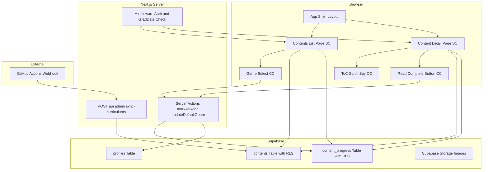
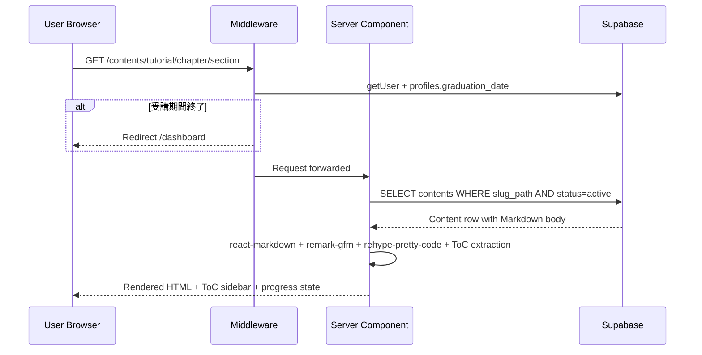
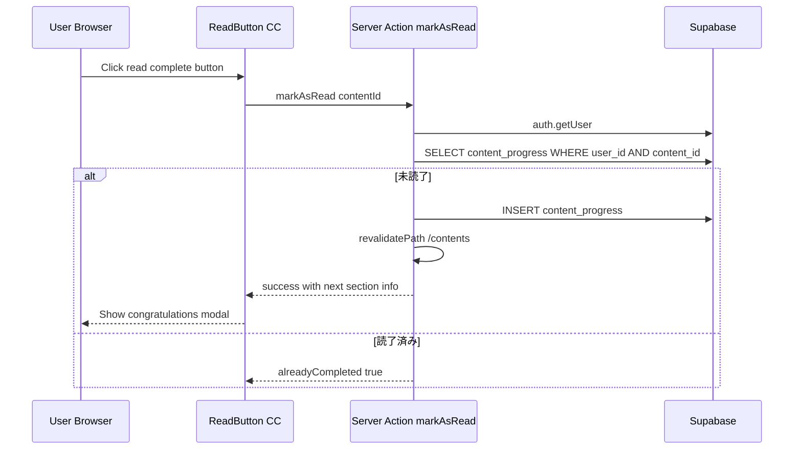
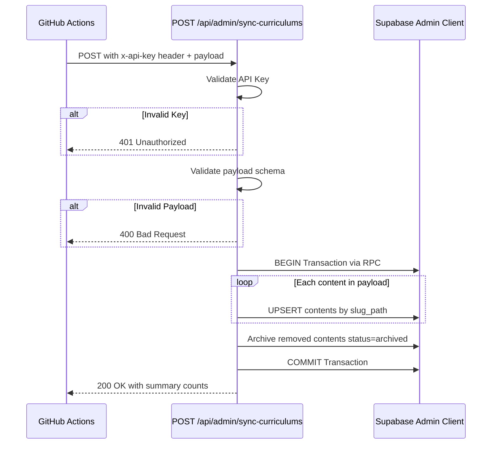
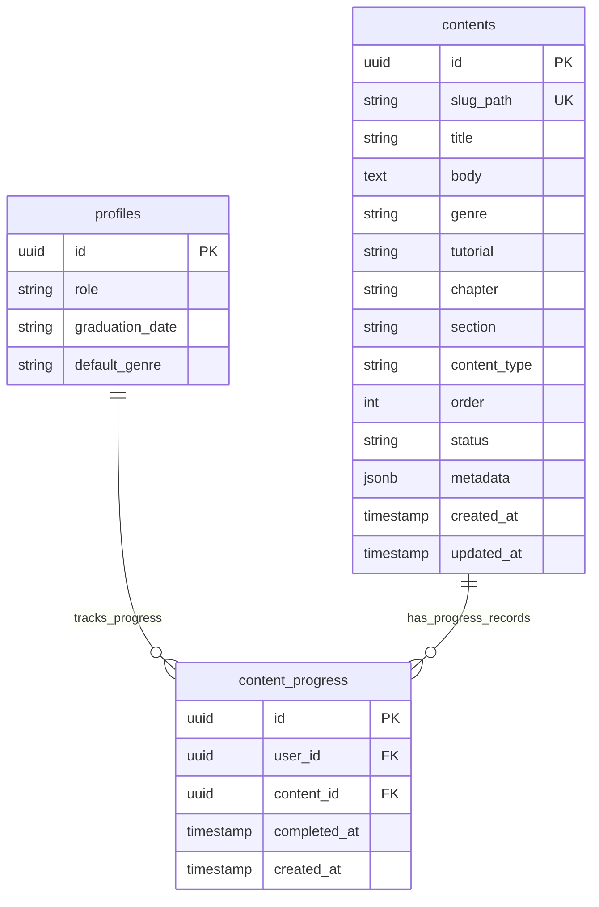

# 技術設計書: 教材・演習（Contents）

## Overview

本機能は、LMS（社内研修学習管理システム）における教材コンテンツの一覧表示・閲覧・学習進捗管理・コンテンツ同期を実現する。GitHub リポジトリで Docs-as-Code 方式により管理された Markdown 教材を、Supabase の `contents` テーブルに同期し、Next.js App Router の Server Component でサーバーサイドレンダリングして受講生に提供する。

**ユーザー**: User（受講生）が教材の一覧閲覧・学習・進捗記録に利用する。Super Admin がコンテンツの同期状態を管理画面で確認する。System（GitHub Actions）がコンテンツ同期 API を呼び出す。

**影響**: 既存の App Shell レイアウトに `/contents` 配下のルートを追加する。`contents` テーブルおよび `content_progress` テーブルを新設し、RLS ポリシーを適用する。Middleware にコンテンツパスの受講期間チェックを追加する。`profiles` テーブルへの `default_genre` カラム追加および `graduation_date` カラムの再追加が必要（app-shell spec との依存関係）。

### ゴール

- GitHub から同期済みの教材コンテンツを階層的に一覧表示し、ジャンルプルダウンでフィルタリングできる直感的な UI を提供する
- `react-markdown` + `remark-gfm` による GFM 準拠の Markdown レンダリングと、`rehype-pretty-code`（Shiki / github-dark）によるシンタックスハイライトを実現する
- サイドバー目次（ToC）のスクロール追従アクティブハイライトにより、長い教材の閲覧体験を向上させる
- セクション単位の読了記録と進捗率表示により、学習の達成感と体系的な学習を支援する
- GitHub Actions Webhook による自動同期 API を提供し、Docs-as-Code のワークフローを確立する
- ロールベースのアクセス制御を DB 層（RLS）と Middleware 層の二重防御で実現する

### Non-Goals

- **確認クイズ（演習問題）の出題・回答・採点**: 別 spec で将来実装。タブ UI のプレースホルダーのみ配置
- **セマンティック検索の実装**: 検索バー UI はヘッダーに配置するが、検索ロジック（Embedding / pgvector）は本 spec のスコープ外
- **コンテンツの作成・編集 UI**: Docs-as-Code 方針に基づき、LMS 画面でのコンテンツ CRUD は提供しない
- **段階的コンテンツ解放**: 全コンテンツを初期公開する方針（Q1 確定事項）
- **リアルタイム同期**: Webhook Push 時の同期のみ。ポーリングや WebSocket は対象外

---

## 技術選定（確定済み）

### Markdown パーサー: `react-markdown` + `remark-gfm`

GitHub Flavored Markdown (GFM) 仕様に準拠するため、`react-markdown` に `remark-gfm` プラグインを組み合わせる。テーブル、取り消し線、タスクリスト、オートリンクをサポート。Server Component 内で直接レンダリング可能。React 19 対応。

### シンタックスハイライト: `rehype-pretty-code`（Shiki / github-dark テーマ）

GitHub のコードブロック表示に近い見た目を実現するため、Shiki ベースの `rehype-pretty-code` を採用。`github-dark` テーマを使用。行ハイライト・単語ハイライトにも対応。サーバーサイドで完結するため、クライアントバンドルに影響しない。

### `contents` テーブル: フラットテーブル（単一テーブル + `content_type` 識別子）

`content_type` カラムで genre/tutorial/chapter/section を区別する単一テーブル設計。`genre` カラムはエンジニアリング/デザインの教材カテゴリ分類に使用（UI 上でプルダウン切替）。同期 API の UPSERT がシンプルに保てる。

### ToC 見出し抽出: Markdown AST（remark プラグイン）

remark プラグインで AST を解析し、heading ノードを抽出。`react-markdown` の `remarkPlugins` にネイティブ統合。レンダリング前に ToC データが確定するため Server Component と相性良好。

### ジャンル選択 UI

- 教材一覧ページのタブ行右側にジャンル選択プルダウン（エンジニアリング / デザイン）を配置
- ユーザーごとのデフォルトジャンル設定を `profiles` テーブルの `default_genre` カラムで管理
- 初回アクセス時はデフォルトジャンルの教材を表示

---

## Architecture

### Architecture Pattern & Boundary Map

Server Component をデフォルトとし、インタラクティブな部分のみ Client Component（Client Island）として分離するパターンを採用する。既存の App Shell レイアウトを継承し、`/contents` 配下にルートを追加する。



**Architecture Integration**:
- **選定パターン**: Server Component + Client Island -- Next.js App Router の推奨パターンに準拠。既存の日報・学習目標ページと同一のアーキテクチャ
- **ドメイン/機能境界**: 教材閲覧（User 向け）とコンテンツ管理（Super Admin 向け）は同じ `contents` テーブルを参照するが、ルートグループで分離。`(authenticated)/contents/` と `(authenticated)/admin/contents/`
- **既存パターン継承**: `(authenticated)/layout.tsx` の AppShellLayout、Server Action パターン（`ActionResult` 型、`reports/actions.ts` 準拠）、Supabase Server Client パターン（`createClient()`）、Admin Client パターン（`createAdminClient()`）
- **新規コンポーネントの根拠**: Markdown レンダリング、ToC スクロール追従、読了ボタン、同期 API はいずれも既存コードベースに存在しない新規ドメイン
- **Steering 準拠**: Server Components 優先、RLS 二重防御、Docs-as-Code 分離、`any` 禁止

### Technology Stack

| レイヤー | 選定 / バージョン | 本機能での役割 | 備考 |
|---------|------------------|---------------|------|
| Frontend | Next.js 16.1.6 (App Router) / React 19.2.3 | ルーティング、Server Component、Client Component | 既存スタック |
| UI | shadcn/ui + Tailwind CSS v4 | カード、タブ、ボタン、ダイアログ、プルダウン等の UI コンポーネント | 既存スタック |
| Markdown | `react-markdown` + `remark-gfm` | Markdown to React Node サーバーサイド変換。GFM 対応 | 新規依存 |
| Syntax Highlight | `rehype-pretty-code` (Shiki ^1.0.0) | コードブロックのシンタックスハイライト（github-dark テーマ） | 新規依存 |
| ToC | remark カスタムプラグイン | Markdown AST から h2/h3 見出しを抽出 | 自前実装 |
| BaaS | Supabase (PostgreSQL / Auth / Storage) | contents テーブル、content_progress テーブル、RLS、画像ストレージ | 既存スタック |
| API | Next.js Route Handler | `POST /api/admin/sync-curriculums` | 新規エンドポイント |
| CI/CD | GitHub Actions | main ブランチ Push 時に同期 API を呼び出す Webhook | 新規ワークフロー |

---

## System Flows

### 教材閲覧フロー



### 読了記録フロー



### コンテンツ同期フロー



---

## Requirements Traceability

| 要件ID | サマリー | コンポーネント | インターフェース | フロー |
|--------|---------|-------------|--------------|-------|
| 1.1 | ジャンル一覧を order 順に表示 | ContentsListPage | Supabase SELECT | -- |
| 1.2 | チュートリアルカード表示 | TutorialCard | -- | -- |
| 1.3 | チャプター/セクション構成表示 | TutorialDetailPage | Supabase SELECT | -- |
| 1.4 | active コンテンツのみ表示 | ContentsListPage | Supabase WHERE status=active | -- |
| 1.5 | URL スラッグ階層パス | App Router dynamic routes | -- | -- |
| 1.6 | 全コンテンツ公開 | -- (制約なし) | -- | -- |
| 1.7 | カード進捗率表示 | TutorialCard, ProgressSummaryCards | content_progress SELECT | -- |
| 1.8 | ジャンル別表示 | GenreSelect + ContentsListPage | ジャンルプルダウンでフィルタ | -- |
| 2.1 | Markdown サーバーサイド変換 | ContentDetailPage, MarkdownRenderer | react-markdown + remark-gfm | 教材閲覧フロー |
| 2.2 | 画像表示 | MarkdownRenderer | Supabase Storage URL | -- |
| 2.3 | セクション間ナビゲーション | SectionNavigation | Supabase SELECT siblings | -- |
| 2.4 | パンくずリスト | ContentBreadcrumb | -- | -- |
| 2.5 | 受講期間チェック・リダイレクト | Middleware | profiles.graduation_date | 教材閲覧フロー |
| 2.6 | サイドバー目次表示 | TableOfContents | Markdown AST heading extraction | -- |
| 2.7 | 目次スクロール追従 | TableOfContentsClient | Intersection Observer API | -- |
| 2.8 | シンタックスハイライト | MarkdownRenderer | rehype-pretty-code / Shiki | -- |
| 3.1 | 読了ボタン配置 | ReadCompleteButton | -- | -- |
| 3.2 | 読了記録作成 | markAsRead Server Action | INSERT content_progress | 読了記録フロー |
| 3.3 | おめでとうモーダル | CongratulationsModal | -- | 読了記録フロー |
| 3.4 | モーダル内ナビゲーション | CongratulationsModal | Next link | -- |
| 3.5 | チャプター最終セクション判定 | CongratulationsModal | siblings 判定 | -- |
| 3.6 | 読了済み状態表示 | ReadCompleteButton | content_progress SELECT | -- |
| 3.7 | チャプター一覧の読了チェック | ChapterSectionList | content_progress SELECT | -- |
| 3.8 | チュートリアル進捗プログレスバー | TutorialCard | content_progress 集計 | -- |
| 3.9 | content_progress RLS | Supabase RLS Policy | auth.uid() | -- |
| 4.1 | 同期 API エンドポイント | SyncCurriculumsRoute | POST /api/admin/sync-curriculums | 同期フロー |
| 4.2 | API キー検証 | SyncCurriculumsRoute | x-api-key header | 同期フロー |
| 4.3 | トランザクション UPSERT | SyncCurriculumsRoute | Supabase RPC | 同期フロー |
| 4.4 | Frontmatter パース・マッピング | SyncCurriculumsRoute | payload mapping | 同期フロー |
| 4.5 | エラー時ロールバック | SyncCurriculumsRoute | PostgreSQL EXCEPTION | 同期フロー |
| 4.6 | 成功レスポンス | SyncCurriculumsRoute | JSON summary | 同期フロー |
| 4.7 | main ブランチ Push トリガー | GitHub Actions workflow | -- | 同期フロー |
| 5.1 | contents テーブル RLS | Supabase RLS Policy | -- | -- |
| 5.2 | User/Super Admin SELECT 許可 | Supabase RLS Policy | profiles.role check | -- |
| 5.3 | Manager SELECT 拒否 | Supabase RLS Policy | ポリシー未作成=拒否 | -- |
| 5.4 | 受講期間 Middleware チェック | Middleware | graduation_date | 教材閲覧フロー |
| 5.5 | 同期 API キー保護 | SyncCurriculumsRoute | API Key header | 同期フロー |
| 6.1 | SA コンテンツ一覧管理画面 | AdminContentsPage | Supabase SELECT all | -- |
| 6.2 | ステータス・同期日時表示 | AdminContentsPage | -- | -- |
| 6.3 | SA コンテンツ詳細表示 | AdminContentDetailPage | -- | -- |
| 6.4 | SA 教材閲覧 | ContentDetailPage (共通) | RLS で Super Admin 許可 | -- |
| 7.1 | App Shell 統合 | (authenticated) layout | AppShellLayout | -- |
| 7.2 | デザイントークン準拠 | 全コンポーネント | CSS 変数 / Tailwind | -- |
| 7.3 | ローディング状態 | loading.tsx | Skeleton UI | -- |
| 7.4 | Server Components デフォルト | 全ページコンポーネント | -- | -- |

> 1.5 の URL パスはデザイン確定仕様により `/contents/{tutorial}/{chapter}/{section}` に変更（genre 除外）。1.8 のジャンル別グループ化はデザイン確定仕様によりジャンルプルダウンでフィルタに変更（フラット表示）。

---

## Components and Interfaces

### コンポーネントサマリー

| コンポーネント | ドメイン/レイヤー | 意図 | 要件カバレッジ | 主要依存 (P0/P1) | コントラクト |
|--------------|----------------|------|-------------|-----------------|------------|
| ContentsListPage | UI / Page | 教材一覧 + 進捗サマリー + タブ + ジャンルプルダウン | 1.1, 1.2, 1.4, 1.6, 1.7, 1.8, 3.8, 7.1-7.4 | Supabase (P0) | State |
| TutorialCard | UI / Presentational | チュートリアルカードの表示 | 1.2, 1.7, 3.8 | -- | -- |
| ProgressSummaryCards | UI / Presentational | 進捗サマリー統計行（ジャンル連動） | 1.7, 3.8 | -- | -- |
| GenreSelect | UI / Interaction | ジャンルプルダウン選択 + デフォルト保存 | 1.8 | updateDefaultGenre SA (P1) | State |
| ContentDetailPage | UI / Page | 教材セクション詳細ページ | 2.1-2.8, 3.1, 3.6, 7.1-7.4 | Supabase (P0), MarkdownRenderer (P0) | State |
| MarkdownRenderer | UI / Rendering | Markdown to React Node 変換 + ToC 抽出 | 2.1, 2.2, 2.8 | react-markdown (P0), rehype-pretty-code (P0) | Service |
| TableOfContents | UI / Navigation | サイドバー目次（SC 部分） | 2.6 | -- | -- |
| TableOfContentsClient | UI / Navigation | スクロール追従アクティブハイライト | 2.7 | Intersection Observer (P0) | State |
| ContentBreadcrumb | UI / Navigation | パンくずリスト | 2.4 | -- | -- |
| SectionNavigation | UI / Navigation | 前へ/次へナビゲーション | 2.3 | -- | -- |
| ReadCompleteButton | UI / Interaction | 読了ボタン + 状態管理 | 3.1, 3.2, 3.6 | markAsRead SA (P0) | State |
| CongratulationsModal | UI / Feedback | 読了完了モーダル | 3.3, 3.4, 3.5 | -- | -- |
| markAsRead | Logic / Server Action | 読了記録の INSERT | 3.2, 3.9 | Supabase (P0) | Service |
| updateDefaultGenre | Logic / Server Action | デフォルトジャンルの UPDATE | 1.8 | Supabase (P0) | Service |
| SyncCurriculumsRoute | API / Route Handler | コンテンツ同期エンドポイント | 4.1-4.7, 5.5 | Supabase Admin (P0) | API |
| Middleware (拡張) | Infra / Middleware | 受講期間チェック追加 | 2.5, 5.4 | profiles table (P0) | -- |
| AdminContentsPage | UI / Page | SA 向けコンテンツ管理画面 | 6.1-6.3 | Supabase (P0) | State |
| SearchBarPlaceholder | UI / Presentational | セマンティック検索バー（未実装プレースホルダー） | デザインリファレンス | -- | -- |

### User 向け教材ページ

#### ContentsListPage

| Field | Detail |
|-------|--------|
| Intent | 教材一覧画面。進捗サマリー + タブ + ジャンルプルダウン + チュートリアルカードグリッドを表示する Server Component ページ |
| Requirements | 1.1, 1.2, 1.4, 1.6, 1.7, 1.8, 3.8, 7.1-7.4 |

**責務 & 制約**
- `contents` テーブルから `status = 'active'` かつ `content_type = 'tutorial'` のレコードを `order` 順に取得
- `content_progress` テーブルからユーザーの進捗データを集計し、チュートリアルごとの進捗率を算出
- ジャンルプルダウンの選択値を URL searchParams（`?genre=engineering`）で管理し、Server Component で取得データをフィルタリング
- 進捗サマリーカード（ジャンル進捗、完了チュートリアル、学習中）を表示。選択中ジャンルに連動して集計値を再計算
- チュートリアルカードをフラットにグリッド表示（ジャンル別グループ化なし）
- 「教材」「演習問題」タブを表示（演習問題タブは disabled / Coming Soon）

**依存**
- Outbound: `contents` テーブル -- チュートリアル一覧取得 (P0)
- Outbound: `content_progress` テーブル -- 進捗データ集計 (P0)
- Outbound: `profiles` テーブル -- `default_genre` 読み取り (P1)

**Contracts**: State [x]

##### State Management
- **State model**: Server Component で取得した `tutorials: TutorialWithProgress[]`、`progressSummary: GenreProgressSummary`、`selectedGenre: string` をページ内で構成
- **Persistence**: ジャンル選択は URL searchParams で管理。初回アクセス時は `profiles.default_genre` またはデフォルト値（`"engineering"`）を使用
- **Concurrency**: Server Component の単一リクエスト処理。並行性の考慮不要

**Implementation Notes**
- ファイルパス: `lms-fe/app/(authenticated)/contents/page.tsx`
- `loading.tsx` で Skeleton UI を提供（7.3）
- デザインリファレンスの進捗サマリー統計行（3カード等高）、タブ、カードグリッドのレイアウトに準拠
- 「学習中」カードの「続きから学習する」リンクは、`content_progress` の最新未完了セクションへの直接リンクを生成

#### ContentDetailPage

| Field | Detail |
|-------|--------|
| Intent | 教材セクション詳細ページ。パンくずリスト + サイドバー ToC + Markdown コンテンツ + ナビゲーション + 読了ボタンを表示する Server Component ページ |
| Requirements | 2.1-2.8, 3.1, 3.6, 7.1-7.4 |

**責務 & 制約**
- URL パラメータ `[tutorial]/[chapter]/[section]` から `slug_path` を構築し、`contents` テーブルから該当レコードを取得
- Markdown 本文を `MarkdownRenderer` で React Node に変換し、見出し情報を ToC データとして抽出
- 同一チャプター内の前後セクションを取得し、ナビゲーションリンクを提供
- `content_progress` テーブルから当該セクションの読了状態を取得
- 未読了セクションではセクションナビゲーション（前へ/次へ）を非表示にし、読了セクションを表示

**依存**
- Outbound: `contents` テーブル -- セクションコンテンツ取得 (P0)
- Outbound: `content_progress` テーブル -- 読了状態取得 (P0)
- Outbound: MarkdownRenderer -- Markdown to React Node 変換 (P0)
- External: Supabase Storage -- 画像 URL 解決 (P1)

**Contracts**: State [x]

##### State Management
- **State model**: Server Component でクエリ結果を取得。`content: ContentRow`, `siblings: SiblingSection[]`, `tocItems: TocItem[]`, `isCompleted: boolean` を子コンポーネントに props で渡す
- **Persistence**: Server Component のリクエスト単位。読了ボタン操作後は `revalidatePath` で再取得

**Implementation Notes**
- ファイルパス: `lms-fe/app/(authenticated)/contents/[tutorial]/[chapter]/[section]/page.tsx`
- Dynamic Route: `[tutorial]`, `[chapter]`, `[section]` の3セグメント
- 存在しないコンテンツへのアクセス時は `notFound()` を返却
- デザインリファレンスのメインレイアウト（サイドバー ToC 240px + メインコンテンツ）に準拠

### Markdown レンダリング

#### MarkdownRenderer

| Field | Detail |
|-------|--------|
| Intent | Markdown 原文を React Node に変換し、シンタックスハイライト付きでレンダリングする。同時に ToC 用の見出し情報を抽出する |
| Requirements | 2.1, 2.2, 2.8 |

**責務 & 制約**
- `react-markdown` + `remark-gfm` で GFM 準拠の Markdown をサーバーサイドで React Node に変換する
- `rehype-pretty-code`（Shiki / `github-dark` テーマ）でコードブロックにシンタックスハイライトを適用する
- Markdown 内の画像リンク（Supabase Storage URL）を正しく解決する
- カスタム remark プラグインで見出し（h2, h3）から ToC データ（id, text, level）を抽出する
- 見出し ID はスラッグ化し、重複時はサフィックスを付与して一意性を保証する

**依存**
- External: `react-markdown` -- Markdown to React Node 変換 (P0)
- External: `remark-gfm` -- GFM 拡張 (P0)
- External: `rehype-pretty-code` -- Shiki ベースのシンタックスハイライト (P0)

**Contracts**: Service [x]

##### Service Interface
```typescript
interface TocItem {
  id: string        // slug化された見出しID（アンカーリンク用）
  text: string      // 見出しテキスト
  level: 2 | 3      // h2 = 2, h3 = 3
}

interface MarkdownRenderResult {
  content: React.ReactNode  // react-markdown でレンダリング済み React Node
  tocItems: TocItem[]       // 抽出された見出し一覧
}

function renderMarkdown(markdownBody: string): Promise<MarkdownRenderResult>
```
- 前提条件: `markdownBody` は空でない文字列
- 事後条件: `tocItems` は Markdown 内の h2/h3 の出現順に並ぶ。`content` は XSS セーフな React Node
- 不変条件: 見出し ID はドキュメント内で一意。`rehype-pretty-code` は非同期処理（Shiki の highlighter 初期化）のため `Promise` を返却

**Implementation Notes**
- `react-markdown` は React コンポーネントとして使用し、`remarkPlugins` / `rehypePlugins` で拡張する
- ToC 抽出用のカスタム remark プラグインを実装し、AST 走査で heading ノードを収集する
- `rehype-pretty-code` は `getHighlighter` の初期化が非同期のため、`renderMarkdown` は `async` 関数とする
- デザインリファレンスのタイポグラフィ（h2: Sora 18px/600, 本文: IBM Plex Mono 14px, コードブロック: bg=#1E293B）に準拠するカスタムコンポーネントスタイルを適用
- XSS 防止: `react-markdown` はデフォルトで HTML タグをサニタイズする

### ToC & ナビゲーション

#### TableOfContentsClient

| Field | Detail |
|-------|--------|
| Intent | サイドバー目次のスクロール追従アクティブハイライトを Client Component として実装する |
| Requirements | 2.7 |

**責務 & 制約**
- Server Component から受け取った `tocItems` を表示し、Intersection Observer API で画面内の見出しを検出
- アクティブな見出しをハイライト表示し、クリックで該当箇所にスムーズスクロール
- `rootMargin: '0px 0px -70% 0px'` で画面上部 30% の見出し検出

**依存**
- Inbound: ContentDetailPage -- `tocItems: TocItem[]` を props で受領 (P0)

**Contracts**: State [x]

##### State Management
- **State model**: `activeId: string` -- 現在アクティブな見出しの ID
- **Persistence**: メモリ内のみ（スクロール位置に連動するリアルタイム状態）
- **Concurrency**: Intersection Observer のコールバックで更新。Observer 自体が最適化済み

**Implementation Notes**
- `"use client"` ディレクティブ必須
- デザインリファレンスの ToC スタイル（アクティブ: bg=#EFF9FE, left-border 3px #00B0EC）に準拠
- `useEffect` 内で IntersectionObserver を初期化し、cleanup で disconnect

#### SectionNavigation, ContentBreadcrumb

- **SectionNavigation**: 前へ/次へボタン。`prevSection` / `nextSection` の slug_path を受け取り、Link コンポーネントでレンダリング。**読了済みセクションでのみ表示**し、未読了では非表示。デザインリファレンスの outline/filled ボタンスタイルに準拠
- **ContentBreadcrumb**: `教材 / {tutorial.title} / {chapter.title} / {section.title}` のパンくずリスト。デザインリファレンスのセパレータ・カラースタイルに準拠
- 両コンポーネントとも Server Component。新規の境界やロジックは導入しない

### 読了記録

#### ReadCompleteButton

| Field | Detail |
|-------|--------|
| Intent | 読了ボタンの表示・操作・状態管理を行う Client Component |
| Requirements | 3.1, 3.2, 3.6 |

**責務 & 制約**
- 未読了: 「読了する」ボタンを表示。クリックで `markAsRead` Server Action を呼び出す
- 読了済み: 「読了済み」状態でボタンを disabled 表示。再押下しても重複記録しない
- Server Action 完了後、`CongratulationsModal` を表示

**依存**
- Inbound: ContentDetailPage -- `contentId: string`, `isCompleted: boolean`, `sectionTitle: string`, `hasNextSection: boolean`, `nextSectionPath: string | null`, `chapterListPath: string` を props で受領 (P0)
- Outbound: markAsRead Server Action -- 読了記録の INSERT (P0)

**Contracts**: State [x]

##### State Management
- **State model**: `isCompleted: boolean`（初期値は Server Component から）, `showModal: boolean`
- **Persistence**: Server Action 成功後に `revalidatePath` でサーバー側キャッシュを無効化
- **Concurrency**: optimistic update は行わず、Server Action の結果を待って状態更新

**Implementation Notes**
- `"use client"` ディレクティブ必須
- デザインリファレンスの読了ボタンスタイル（未読了: bg=#00B0EC, 読了済み: bg=#F3F4F6, text=#22C55E）に準拠
- ローディング状態の表示に `useActionState` / `useTransition` を使用

#### CongratulationsModal

- shadcn/ui の Dialog コンポーネントをベースに実装
- 通常セクション: 「次のセクションに進む」ボタン + 「教材一覧に戻る」ボタン
- チャプター最終セクション: 「チャプター一覧に戻る」ボタン + 「教材一覧に戻る」ボタン
- デザインリファレンスのモーダルスタイル（w=440, radius=12, shadow: 0 8 40 rgba(0,0,0,0.3)）に準拠
- ReadCompleteButton の子コンポーネントとして実装（モーダル表示状態は ReadCompleteButton が管理）

#### markAsRead Server Action

| Field | Detail |
|-------|--------|
| Intent | 読了記録を `content_progress` テーブルに INSERT する Server Action |
| Requirements | 3.2, 3.9 |

**責務 & 制約**
- `auth.getUser()` で認証チェック
- `content_progress` テーブルに対して SELECT で既存レコードを確認し、未読了の場合のみ INSERT
- RLS ポリシーにより、自身のレコードのみ操作可能
- 成功時に `revalidatePath('/contents')` でキャッシュを無効化

**依存**
- Outbound: Supabase `content_progress` テーブル -- INSERT (P0)

**Contracts**: Service [x]

##### Service Interface
```typescript
interface MarkAsReadResult {
  success: boolean
  message: string
  alreadyCompleted?: boolean
}

async function markAsRead(
  prevState: MarkAsReadResult | null,
  formData: FormData
): Promise<MarkAsReadResult>
```
- FormData には `contentId: string` を含む
- 前提条件: ユーザーが認証済み。`contentId` が有効な contents レコードの ID
- 事後条件: 成功時、`content_progress` に新規レコードが存在する。既に読了済みの場合は `alreadyCompleted: true`
- 不変条件: 同一ユーザー・同一コンテンツの組み合わせで重複レコードは作成しない（UNIQUE 制約 + アプリ層チェック）

**Implementation Notes**
- ファイルパス: `lms-fe/app/(authenticated)/contents/actions.ts`
- 既存の Server Action パターン（`reports/actions.ts` の `ActionResult` 型）に準拠
- `revalidatePath('/contents')` でリスト画面の進捗率も更新

#### updateDefaultGenre Server Action

| Field | Detail |
|-------|--------|
| Intent | ユーザーのデフォルトジャンル設定を `profiles` テーブルに UPDATE する Server Action |
| Requirements | 1.8 |

**Contracts**: Service [x]

##### Service Interface
```typescript
async function updateDefaultGenre(
  prevState: ActionResult,
  formData: FormData
): Promise<ActionResult>
```
- FormData には `genre: string`（`"engineering"` または `"design"`）を含む
- 前提条件: ユーザーが認証済み
- 事後条件: `profiles.default_genre` が指定値に更新される

**Implementation Notes**
- ファイルパス: `lms-fe/app/(authenticated)/contents/actions.ts`（`markAsRead` と同一ファイル）
- ジャンルプルダウン変更時に非同期で呼び出す（UI のブロッキングなし）

### 同期 API

#### SyncCurriculumsRoute

| Field | Detail |
|-------|--------|
| Intent | GitHub Actions から呼び出されるコンテンツ同期 API エンドポイント |
| Requirements | 4.1-4.7, 5.5 |

**責務 & 制約**
- `POST /api/admin/sync-curriculums` エンドポイントを提供
- リクエストヘッダーの `x-api-key` を環境変数 `SYNC_API_KEY` と照合し、不一致で 401 返却
- ペイロードの各コンテンツアイテムについて `contents` テーブルに UPSERT
- ペイロードに含まれない既存 active コンテンツを `archived` に論理削除
- トランザクション内で処理し、エラー時はロールバック
- 成功時、作成・更新・アーカイブの件数サマリーを返却

**依存**
- External: GitHub Actions -- Webhook トリガー (P0)
- Outbound: Supabase Admin Client -- RLS バイパスで contents テーブル操作 (P0)

**Contracts**: API [x]

##### API Contract

| メソッド | エンドポイント | リクエスト | レスポンス | エラー |
|---------|-------------|---------|---------|--------|
| POST | /api/admin/sync-curriculums | SyncRequest | SyncResponse | 401, 400, 500 |

```typescript
interface SyncContentItem {
  slug_path: string        // e.g. "html-css-basics/chapter1/intro"
  title: string
  body: string             // Markdown原文（Frontmatter除去後）
  genre: string            // e.g. "engineering"
  tutorial: string         // e.g. "html-css-basics"
  chapter: string          // e.g. "chapter1"
  section: string          // e.g. "intro"
  content_type: "genre" | "tutorial" | "chapter" | "section"
  order: number
  metadata?: Record<string, unknown>  // Frontmatter の追加フィールド
}

interface SyncRequest {
  contents: SyncContentItem[]
}

interface SyncResponse {
  success: boolean
  summary: {
    created: number
    updated: number
    archived: number
  }
  errors?: string[]
}
```

**Implementation Notes**
- ファイルパス: `lms-fe/app/api/admin/sync-curriculums/route.ts`
- `createAdminClient()` を使用して RLS をバイパス（既存パターン `lib/supabase/admin.ts`）
- Frontmatter パースは同期元の GitHub Actions 側で完了している前提。Route Handler はパース済みペイロードを受け取る
- 環境変数 `SYNC_API_KEY` を `.env.local` に追加
- トランザクション制御は Supabase の `rpc()` で PostgreSQL 関数を呼び出すか、Admin クライアントで順次 UPSERT を実行し catch でロールバック処理

### Middleware 拡張

既存の `middleware.ts` に受講期間チェックを追加する。

**変更内容**:
- Step 5 の `profiles` クエリに `graduation_date` カラムを追加（`.select("full_name, graduation_date")`）
- 認証済みユーザーが `/contents/*` パスにアクセスした場合、`graduation_date` が過去日付であれば `/dashboard` にリダイレクト
- `graduation_date` が NULL の場合はアクセスを許可（期間未設定 = 制限なし）
- `/contents` パス以外では `graduation_date` チェックをスキップ

**Implementation Notes**
- 現在の Middleware は `profiles.full_name` のみ取得している。同一クエリに `graduation_date` カラムを追加するだけで済む
- `profiles` テーブルの型定義（`database.ts`）に `graduation_date: string | null` カラムを追加
- **依存**: `graduation_date` カラムは過去のマイグレーションで DROP されている。本機能の DB マイグレーションで再追加する必要がある（app-shell spec の `AppShellUser.graduationDate` とも整合）

### Super Admin 向けコンテンツ管理

#### AdminContentsPage

| Field | Detail |
|-------|--------|
| Intent | Super Admin がコンテンツの同期状態を確認する管理画面 |
| Requirements | 6.1-6.4 |

**責務 & 制約**
- 全コンテンツ（active + archived）を一覧表示
- ステータス、最終同期日時（`updated_at`）、`slug_path`、階層情報を表示
- コンテンツ詳細表示では User 向けと同じ `MarkdownRenderer` を共有

**依存**
- Outbound: Supabase `contents` テーブル -- 全レコード取得 (P0)

**Contracts**: State [x]

##### State Management
- **State model**: Server Component でクエリ結果を取得。フィルタリング・ソートは将来実装
- **Persistence**: Supabase クエリ結果をそのまま利用

**Implementation Notes**
- ファイルパス: `lms-fe/app/(authenticated)/admin/contents/page.tsx`
- 既存の admin ページパターン（`admin/users/page.tsx`）に準拠
- Super Admin のサイドバー「コンテンツ管理」リンクを `/admin/contents` に設定

### App Shell 拡張

#### SearchBarPlaceholder

- ヘッダー中央にセマンティック検索バーの UI を配置するプレースホルダー
- User ロールのみ表示。検索機能は未実装（disabled 状態）
- `AppHeader` コンポーネントを拡張し、検索バー slot を追加
- デザインリファレンスの検索バースタイル（w=600, h=36, bg=#F3F4F6, radius=8）に準拠

---

## Data Models

### Domain Model



**ビジネスルール & 不変条件**:
- `contents.slug_path` はシステム全体で一意（UNIQUE 制約）
- `content_progress` は `(user_id, content_id)` の組み合わせで一意（UNIQUE 制約）-- 重複読了記録を防止
- `contents.status` は `'active'` または `'archived'` のみ（CHECK 制約）
- `contents.content_type` は `'genre'`, `'tutorial'`, `'chapter'`, `'section'` のいずれか（CHECK 制約）
- `profiles.default_genre` は `'engineering'` または `'design'` のいずれか。NULL はデフォルト（`'engineering'`）として扱う

### Logical Data Model

**contents テーブル**:
- `id` (UUID, PK, default gen_random_uuid())
- `slug_path` (TEXT, UNIQUE, NOT NULL) -- e.g. `"html-css-basics/chapter1/intro"`
- `title` (TEXT, NOT NULL)
- `body` (TEXT) -- Markdown 原文。genre/tutorial/chapter レベルでは NULL 可
- `genre` (TEXT, NOT NULL) -- e.g. `"engineering"`, `"design"`
- `tutorial` (TEXT, NOT NULL) -- e.g. `"html-css-basics"`
- `chapter` (TEXT) -- section, chapter レベルのみ
- `section` (TEXT) -- section レベルのみ
- `content_type` (TEXT, NOT NULL, CHECK IN ('genre', 'tutorial', 'chapter', 'section'))
- `order` (INTEGER, NOT NULL, DEFAULT 0)
- `status` (TEXT, NOT NULL, DEFAULT 'active', CHECK IN ('active', 'archived'))
- `metadata` (JSONB) -- Frontmatter の追加フィールド
- `created_at` (TIMESTAMPTZ, DEFAULT now())
- `updated_at` (TIMESTAMPTZ, DEFAULT now())

**content_progress テーブル**:
- `id` (UUID, PK, default gen_random_uuid())
- `user_id` (UUID, FK -> auth.users.id, NOT NULL)
- `content_id` (UUID, FK -> contents.id, NOT NULL)
- `completed_at` (TIMESTAMPTZ, DEFAULT now())
- `created_at` (TIMESTAMPTZ, DEFAULT now())
- UNIQUE (`user_id`, `content_id`)

**profiles テーブル（追加カラム）**:
- `graduation_date` (DATE) -- 受講期間の終了日。NULL は制限なし。過去のマイグレーションで DROP されたため再追加が必要
- `default_genre` (TEXT) -- デフォルトジャンル設定。NULL は `'engineering'` として扱う

**インデックス**:
- `contents`: `slug_path` (UNIQUE), `(content_type, status, order)`, `(genre, content_type, status, order)`, `(tutorial, content_type, order)`, `(tutorial, chapter, content_type, order)`
- `content_progress`: `(user_id, content_id)` (UNIQUE), `user_id`

### Physical Data Model

**RLS ポリシー: `contents` テーブル**:

```sql
-- RLS 有効化
ALTER TABLE contents ENABLE ROW LEVEL SECURITY;

-- User ロール: active コンテンツのみ SELECT 可
CREATE POLICY "users_select_active_contents" ON contents
  FOR SELECT
  TO authenticated
  USING (
    status = 'active'
    AND EXISTS (
      SELECT 1 FROM profiles
      WHERE profiles.id = auth.uid()
      AND profiles.role IN ('user', 'super_admin')
    )
  );

-- Super Admin: 全ステータスのコンテンツを SELECT 可
CREATE POLICY "super_admin_select_all_contents" ON contents
  FOR SELECT
  TO authenticated
  USING (
    EXISTS (
      SELECT 1 FROM profiles
      WHERE profiles.id = auth.uid()
      AND profiles.role = 'super_admin'
    )
  );
```

> Manager ロールにはポリシーを作成しないことで、デフォルト拒否が適用される（5.3）。

**RLS ポリシー: `content_progress` テーブル**:

```sql
ALTER TABLE content_progress ENABLE ROW LEVEL SECURITY;

-- User: 自身のレコードのみ SELECT
CREATE POLICY "users_select_own_progress" ON content_progress
  FOR SELECT
  TO authenticated
  USING (user_id = auth.uid());

-- User: 自身のレコードのみ INSERT
CREATE POLICY "users_insert_own_progress" ON content_progress
  FOR INSERT
  TO authenticated
  WITH CHECK (user_id = auth.uid());
```

### Data Contracts & Integration

**TypeScript 型定義（`database.ts` 追加分）**:
```typescript
// contents テーブル
contents: {
  Row: {
    id: string
    slug_path: string
    title: string
    body: string | null
    genre: string
    tutorial: string
    chapter: string | null
    section: string | null
    content_type: "genre" | "tutorial" | "chapter" | "section"
    order: number
    status: "active" | "archived"
    metadata: Record<string, unknown> | null
    created_at: string
    updated_at: string
  }
  Insert: {
    id?: string
    slug_path: string
    title: string
    body?: string | null
    genre: string
    tutorial: string
    chapter?: string | null
    section?: string | null
    content_type: "genre" | "tutorial" | "chapter" | "section"
    order?: number
    status?: "active" | "archived"
    metadata?: Record<string, unknown> | null
    created_at?: string
    updated_at?: string
  }
  Update: {
    id?: string
    slug_path?: string
    title?: string
    body?: string | null
    genre?: string
    tutorial?: string
    chapter?: string | null
    section?: string | null
    content_type?: "genre" | "tutorial" | "chapter" | "section"
    order?: number
    status?: "active" | "archived"
    metadata?: Record<string, unknown> | null
    created_at?: string
    updated_at?: string
  }
  Relationships: []
}

// content_progress テーブル
content_progress: {
  Row: {
    id: string
    user_id: string
    content_id: string
    completed_at: string
    created_at: string
  }
  Insert: {
    id?: string
    user_id: string
    content_id: string
    completed_at?: string
    created_at?: string
  }
  Update: {
    id?: string
    user_id?: string
    content_id?: string
    completed_at?: string
    created_at?: string
  }
  Relationships: [
    {
      foreignKeyName: "content_progress_user_id_fkey"
      columns: ["user_id"]
      referencedRelation: "profiles"
      referencedColumns: ["id"]
    },
    {
      foreignKeyName: "content_progress_content_id_fkey"
      columns: ["content_id"]
      referencedRelation: "contents"
      referencedColumns: ["id"]
    },
  ]
}

// profiles テーブル（追加カラム）
// 既存の Row/Insert/Update に以下を追加:
graduation_date: string | null
default_genre: string | null
```

**同期 API ペイロード**: `SyncRequest` / `SyncResponse` 型は Components セクションの SyncCurriculumsRoute API Contract を参照。

---

## Error Handling

### Error Strategy

既存の Server Action パターン（`ActionResult` 型: `{ success: boolean; message: string } | null`）に準拠し、各レイヤーで適切なエラーハンドリングを実装する。

### Error Categories and Responses

**User Errors (4xx)**:
- コンテンツ未発見（`slug_path` 不一致）: `notFound()` で Next.js の 404 ページを表示
- 認証エラー: Middleware でログインページにリダイレクト
- 受講期間切れ: Middleware でダッシュボードにリダイレクト
- 読了済みセクションの再読了: `alreadyCompleted: true` で UI に反映（エラーとしては扱わない）

**System Errors (5xx)**:
- Supabase 接続エラー: `error.tsx` でフォールバック UI を表示。`console.error` でログ
- 同期 API のトランザクションエラー: ロールバック後に 500 レスポンスでエラー詳細を返却

**Business Logic Errors (422)**:
- 同期 API の不正ペイロード: 400 Bad Request でバリデーションエラー詳細を返却
- 同期 API の API キー不一致: 401 Unauthorized

### Monitoring

- 同期 API のエラーログは `console.error` で出力し、GitHub Actions のログで確認可能
- Server Action のエラーはクライアントに `ActionResult` 形式で返却

---

## Testing Strategy

### Unit Tests
- `renderMarkdown` 関数: Markdown 入力に対する React Node 出力・ToC 抽出の正確性。GFM 拡張（テーブル、タスクリスト）の正しいレンダリング
- `SyncCurriculumsRoute`: API キー検証、ペイロードバリデーション、UPSERT ロジック
- RLS ポリシー: ロール別アクセス制御の正確性（User: active のみ、Super Admin: 全件、Manager: 拒否）

### Integration Tests
- 読了フロー: `markAsRead` Server Action -> `content_progress` INSERT -> ページ再描画で状態反映
- 同期フロー: 同期 API リクエスト -> `contents` テーブル UPSERT -> 論理削除 -> レスポンスサマリー
- Middleware: 受講期間切れユーザーの `/contents/*` アクセスリダイレクト

### E2E Tests
- 教材一覧 -> チュートリアルカード -> セクション閲覧 -> 読了ボタン -> モーダル表示 -> 次のセクション遷移
- 進捗サマリーカードの数値が読了操作後に更新されること
- パンくずリストから各階層への遷移
- ジャンルプルダウンの切替によるカードフィルタリング

---

## Security Considerations

- **RLS 二重防御**: Middleware（受講期間チェック）+ Supabase RLS（ロールベースアクセス制御）の二重構造
- **Manager コンテンツ流出防止**: `contents` テーブルの RLS ポリシーで Manager ロールの SELECT を明示的に拒否（ポリシー未作成 = デフォルト拒否）
- **同期 API の認証**: API キーを `x-api-key` ヘッダーで検証。`SYNC_API_KEY` は環境変数で管理（Git 管理外）
- **XSS 防止**: `react-markdown` はデフォルトで HTML タグをサニタイズする。ユーザー入力を含まない GitHub 同期コンテンツのため、追加のサニタイズは不要
- **CSRF**: Server Action は Next.js のビルトイン CSRF 保護を使用。同期 API は API キー認証で保護

## Performance & Scalability

- **Server Component レンダリング**: Markdown 変換はサーバーサイドで完結し、クライアントに JS バンドルを送信しない。`react-markdown` + `rehype-pretty-code` のバンドルはサーバー側のみ
- **Supabase クエリ最適化**: `slug_path` の UNIQUE インデックスにより、セクション取得は O(1)。`(genre, content_type, status, order)` の複合インデックスでジャンル別一覧も高速
- **画像**: Supabase Storage の CDN URL を使用。`next/image` で最適化
- **進捗集計**: チュートリアル一覧画面での進捗率計算は Server Component 内で SQL 集計関数を使用し、N+1 クエリを回避
- **Shiki highlighter 初期化**: `rehype-pretty-code` の Shiki highlighter は初回リクエスト時に初期化されキャッシュされる。2回目以降のリクエストでは初期化コストなし
