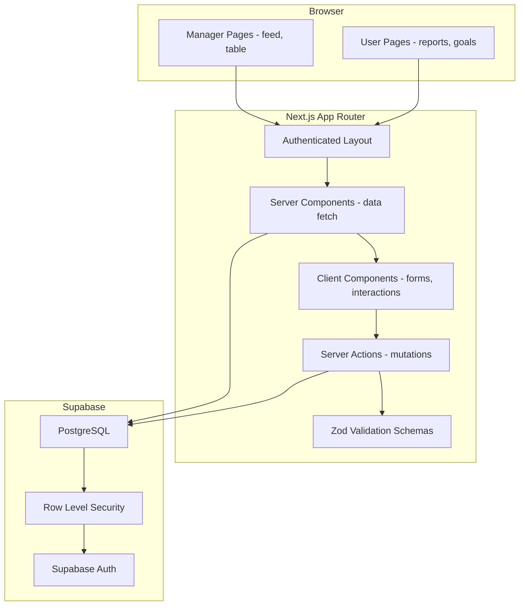
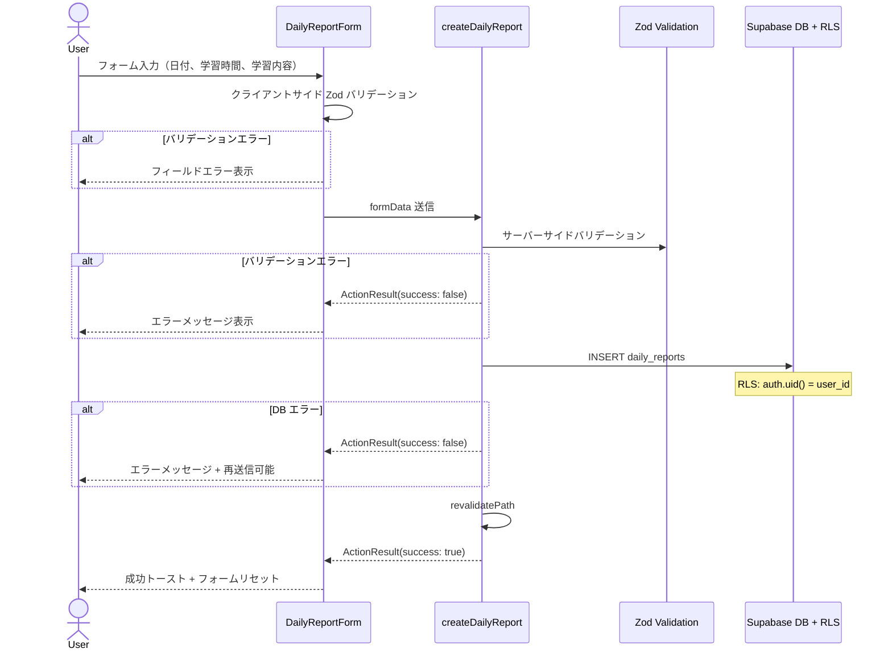
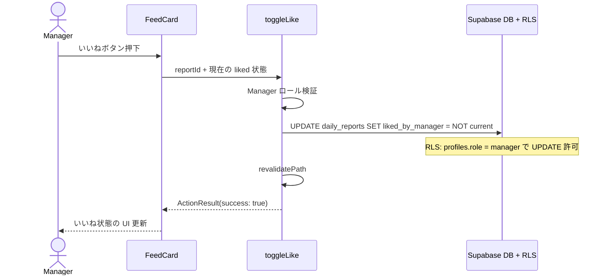
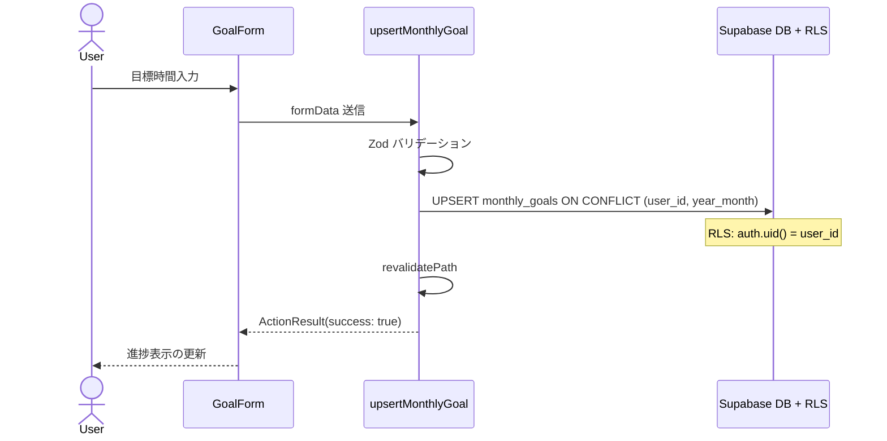
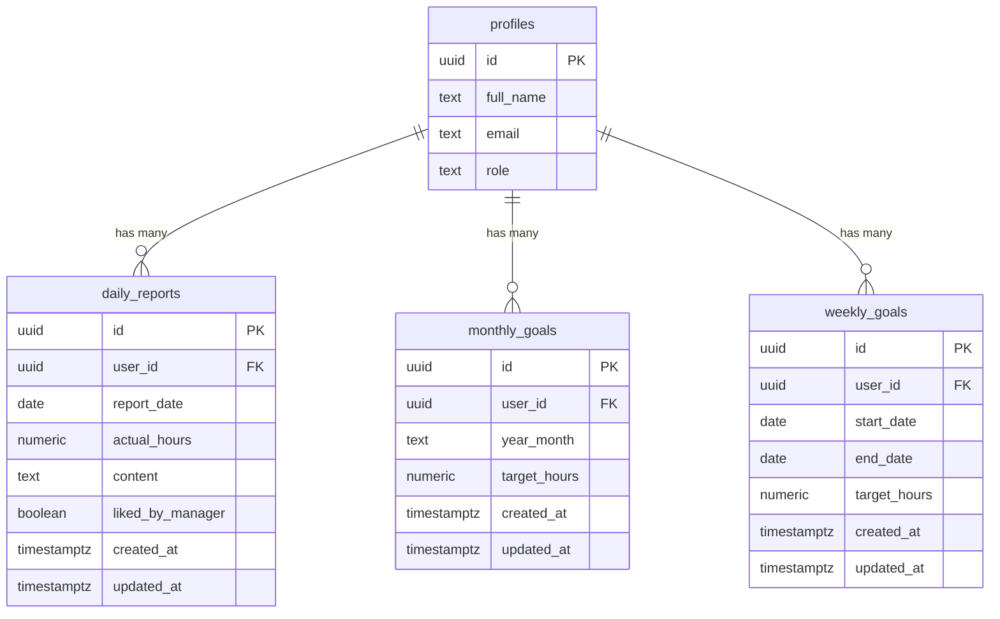
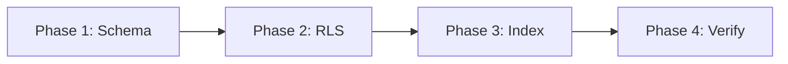

# 技術設計書: 日報・学習目標

## Overview

本機能は、社内 LMS における日報入力・閲覧、月次/週次学習目標の設定・進捗追跡、Manager による「いいね」リアクションを提供する。受講生（User）が日々の学習時間と内容を記録し、目標に対する達成度を可視化することで、学習の習慣化と自律的なペース管理を支援する。

**ユーザー**: User（受講生）は日報入力・閲覧・目標設定を行い、Manager は担当ユーザーの日報フィードを閲覧し「いいね」でモチベーション支援を行う。Super Admin は全ユーザーの日報をテーブル形式で管理閲覧する。

**影響範囲**: 3 つの新規テーブル（`daily_reports`, `monthly_goals`, `weekly_goals`）を作成し、RLS ポリシーを適用する。既存のナビゲーション定義（`config/navigation.ts`）と型定義（`lib/types/database.ts`）を拡張する。

### Goals

- User が日報を入力・編集・削除し、日付別にグループ化された一覧で自身の学習履歴を振り返れる
- User が月次・週次の学習目標を設定し、達成率をリアルタイムで確認できる
- User が学習時間の推移を折れ線グラフで可視化し、目標ラインと比較できる
- Manager が担当ユーザーの日報フィードを閲覧し、「いいね」トグルでリアクションできる
- Manager / Super Admin がテーブル形式で日報一覧を閲覧・フィルタリングできる
- RLS により全テーブルのアクセス制御をロールに基づいて厳格に実施する

### Non-Goals

- ダッシュボード上の進捗サマリーウィジェット（別仕様で扱う）
- 日報へのコメント機能
- リアルタイム通知（いいね通知等）
- 日報のエクスポート / PDF 出力

### 仕様決定事項

設計レビューで確定した仕様判断を以下に記録する。

| # | 項目 | 決定 |
|---|------|------|
| Q1 | Super Admin のいいね権限 | Manager のみ。Super Admin は閲覧専用（いいねボタン非表示） |
| Q2 | Manager の閲覧スコープ | 全ユーザーの日報を閲覧可能（担当概念は将来拡張） |
| Q3 | ページネーション | 初期から実装。Screen 2/4: cursor-based（20 件）、Screen 5: offset-based（20 件） |
| Q4 | 学習時間の入力精度 | 0.5 時間刻み（`step="0.5"`、Zod で `v % 0.5 === 0` を検証） |
| Q5 | 週次目標の対象週 | 任意の週を選択可能（週セレクター・ドロップダウン）。デフォルトは今週 |
| Q6 | 日報入力成功後の動作 | トースト表示 + `/reports/list` へ遷移（`router.push`） |
| Q7 | 日報の編集・削除 | User は自身の日報を編集・削除可能。ダイアログ UI で確認後に実行 |
| Q8 | 週次目標の曜日バリデーション | UI がドロップダウンで月曜〜日曜を保証するため、Zod スキーマでの曜日チェックは不要 |
| Q9 | セレクター範囲 | アカウント作成日〜今月/今週+12ヶ月/12週先。上限なしの未来ナビゲーション |
| Q10 | チャート目標フォールバック | 表示期間に目標が未設定の場合、直近の過去の目標にフォールバック表示 |
| Q11 | URL パラメータ設計 | 目標カード（`month`, `week`）とチャート（`chartMonth`, `chartWeek`）で独立管理 |
| Q12 | タイムゾーン対応 | `toISOString()` は UTC 変換で JST 環境の日付ズレを起こすため、`formatLocalDate()` でローカル日付を使用 |

## Architecture

### Existing Architecture Analysis

既存システムは Next.js App Router ベースの SPA で、`(authenticated)` Route Group 内に全認証済みページを配置する構成を採用している。

- **レイアウト**: `app/(authenticated)/layout.tsx` が Supabase Auth でユーザーを検証し、`AppShellLayout` に `AppShellUser` を渡す
- **ナビゲーション**: `config/navigation.ts` の `NAVIGATION_MAP` でロール別メニューを定義。`getMenuItemsForRole` / `isMenuItemActive` で動的にレンダリング
- **Server Actions**: `ActionResult` 型 + Zod バリデーション + `revalidatePath` パターンが `admin/users/actions.ts` で確立済み
- **型定義**: `lib/types/database.ts` で Supabase Database 型を手動管理。`lib/types/` にドメイン型、`lib/validations/` に Zod スキーマ

これらのパターンをそのまま踏襲し、新規の独自パターンは導入しない。

### Architecture Pattern & Boundary Map



**Architecture Integration**:
- **選定パターン**: 既存の Server Components + Server Actions パターンを踏襲。データフェッチは Server Components、ミューテーションは Server Actions で分離
- **ドメイン境界**: 日報ドメイン（`daily-reports`）と目標ドメイン（`goals`）を同一機能スコープ内で管理。ルーティングでは `/reports` と `/goals` で分離
- **既存パターン維持**: `ActionResult` 型、Zod バリデーション、`revalidatePath`、`_components/` ディレクトリ構成、`AppShellLayout` 統合
- **新規コンポーネント理由**: 日報フォーム、日報リスト、目標カード、フィードカード、管理テーブルは全て新規 UI だが、shadcn/ui コンポーネントをベースに構築
- **Steering 準拠**: Server Components 優先、RLS 二重防御、TypeScript strict mode、`any` 禁止

### Technology Stack

| Layer | Choice / Version | Role in Feature | Notes |
|-------|------------------|-----------------|-------|
| Frontend | Next.js 16 (App Router) + React 19 | ページルーティング、Server/Client Components、Server Actions | 既存スタック |
| UI | shadcn/ui + Tailwind CSS v4 | Card, Button, Input, Textarea, Table, Badge, Avatar, Form | 既存コンポーネント活用 |
| Validation | Zod | フォーム入力バリデーション（クライアント + サーバー） | 既存パターン踏襲 |
| Data | Supabase (PostgreSQL + RLS) | daily_reports, monthly_goals, weekly_goals テーブル + RLS ポリシー | 新規テーブル 3 つ |
| Auth | Supabase Auth | ユーザー認証、`auth.uid()` による RLS 制御 | 既存基盤 |
| Icons | Lucide React | ナビゲーション、UI アイコン | FileText, Target, Heart 等を追加使用 |

## System Flows

### 日報入力フロー



### Manager いいねトグルフロー



### 月次/週次目標 UPSERT フロー



## Requirements Traceability

| 要件 | 概要 | コンポーネント | インターフェース | フロー |
|------|------|--------------|----------------|--------|
| 1.1 - 1.2 | 日報フォームフィールド（学習時間、学習内容、対象日付） | DailyReportForm | dailyReportSchema | 日報入力フロー |
| 1.3 - 1.5 | 日報レコード作成（複数回可、過去日可） | createDailyReport | DailyReportService | 日報入力フロー |
| 1.6 - 1.8 | 日報バリデーション（時間 > 0、内容非空、未来日不可） | dailyReportSchema | Zod Schema | 日報入力フロー |
| 1.9 - 1.10 | エラー表示、ローディング状態、二重送信防止 | DailyReportForm, SubmitButton | ActionResult | 日報入力フロー |
| 1.11 - 1.12 | 日報編集（ダイアログ UI + 所有者検証） | EditReportDialog, updateDailyReport | DailyReportService | -- |
| 1.13 - 1.14 | 日報削除（確認ダイアログ + 所有者検証） | DeleteReportDialog, deleteDailyReport | DailyReportService | -- |
| 2.1 - 2.2 | User 日報一覧（降順、各エントリ表示） | UserReportList | fetchUserReports | -- |
| 2.3 | 日次合計学習時間 | UserReportList | groupReportsByDate | -- |
| 2.4 | 他ユーザー日報非表示 | RLS Policy | -- | -- |
| 2.5 | いいね状態表示 | ReportEntryCard | LikeIndicator | -- |
| 3.1 - 3.7 | 月次目標設定（UPSERT、バリデーション、進捗表示） | MonthlyGoalCard | upsertMonthlyGoal, monthlyGoalSchema | 目標 UPSERT フロー |
| 3.8 - 3.10 | 月セレクター、「今月」ボタン、URLパラメータ保持 | MonthlyGoalCard | useSearchParams, generateAvailableMonths | -- |
| 4.1 - 4.7 | 週次目標設定（UPSERT、バリデーション、進捗表示） | WeeklyGoalCard | upsertWeeklyGoal, weeklyGoalSchema | 目標 UPSERT フロー |
| 4.8 - 4.10 | 週セレクター、「今週」ボタン、URLパラメータ保持 | WeeklyGoalCard | useSearchParams, generateAvailableWeeks | -- |
| 4.11 | 前週目標デフォルト値 | WeeklyGoalCard | previousWeekTargetHours | -- |
| 4.12 | 月次目標からの参考週次目標時間 | WeeklyGoalCard, GoalsPage | suggestedWeeklyHours | -- |
| 5.1 | Manager 日報フィード表示 | ManagerFeedPage | fetchAllReports | -- |
| 5.2 - 5.5 | いいねトグル（Manager 専用） | FeedCard, toggleLike | ToggleLikeService | いいねトグルフロー |
| 5.6 | User にいいねボタン非表示 | FeedCard | ロール判定 | -- |
| 6.1 - 6.4 | Manager/SA 日報テーブル閲覧 | AdminReportTable | fetchAdminReports | -- |
| 6.5 | ユーザー名フィルタ | ReportSearchFilter | searchParams | -- |
| 7.1 - 7.10 | RLS ポリシー（全テーブル。User の daily_reports UPDATE/DELETE 許可含む） | SQL Migration | RLS Policies | -- |
| 8.1 - 8.4 | 進捗集計（SUM、達成率、未設定表示） | MetricsRow, GoalCards | Progress 集計ロジック | -- |
| 9.1 - 9.10 | 学習時間推移チャート（折れ線グラフ、目標ライン、ナビゲーション） | LearningHoursChart | SVG, useSearchParams | -- |
| 10.1 - 10.6 | UI 共通要件（App Shell、Server Actions、デザインシステム） | 全 UI コンポーネント | AppShellLayout 統合 | -- |

## Components and Interfaces

### コンポーネント概要

| Component | Domain/Layer | Intent | Req Coverage | Key Dependencies | Contracts |
|-----------|-------------|--------|-------------|-----------------|-----------|
| DailyReportForm | UI / User | 日報入力フォーム | 1.1-1.10 | dailyReportSchema (P0), createDailyReport (P0) | State |
| EditReportDialog | UI / User | 日報編集ダイアログ | 1.11-1.12 | updateDailyReport (P0) | State |
| DeleteReportDialog | UI / User | 日報削除確認ダイアログ | 1.13-1.14 | deleteDailyReport (P0) | State |
| MetricsRow | UI / User | 月次・週次・日次の学習時間メトリクスカード | 8.1-8.4 | Progress データ (P0) | -- |
| UserReportList | UI / User | 日付グループ化された日報一覧（編集・削除対応） | 2.1-2.5 | fetchUserReports (P0) | -- |
| MonthlyGoalCard | UI / User | 月次目標の設定と進捗表示（月セレクター付き） | 3.1-3.10 | upsertMonthlyGoal (P0), monthlyGoalSchema (P0), useSearchParams (P0) | State |
| WeeklyGoalCard | UI / User | 週次目標の設定と進捗表示（週セレクター + 参考値付き） | 4.1-4.12 | upsertWeeklyGoal (P0), weeklyGoalSchema (P0), useSearchParams (P0) | State |
| LearningHoursChart | UI / User | 学習時間推移の折れ線グラフ（月次/週次タブ + ナビゲーション） | 9.1-9.10 | useSearchParams (P0) | State |
| FeedCard | UI / Manager | 日報フィードカード（いいねトグル付き） | 5.1-5.6 | toggleLike (P0) | State |
| AdminReportTable | UI / Manager, SA | 日報テーブル一覧（進捗バー付き） | 6.1-6.5 | fetchAdminReports (P0) | -- |
| ReportSearchFilter | UI / Manager, SA | ユーザー名検索フィルタ | 6.5 | searchParams (P1) | -- |
| DailyReportService | Logic / Server Actions | 日報 CRUD 操作 | 1.3-1.5, 1.11-1.14, 5.3-5.4 | Supabase DB (P0), Zod (P0) | Service |
| GoalService | Logic / Server Actions | 目標 UPSERT 操作 | 3.3-3.4, 4.3-4.4 | Supabase DB (P0), Zod (P0) | Service |
| ValidationSchemas | Logic / Shared | Zod バリデーションスキーマ | 1.6-1.8, 3.5, 4.5 | Zod (P0) | -- |
| WeekHelpers | Logic / Shared | 日付・期間ユーティリティ | 3.8, 4.8, 9.7 | -- | -- |
| NavigationExtension | Config | ナビゲーション定義の拡張 | 10.1 | navigation.ts (P0) | -- |
| RLS Policies | Data / Security | ロール別アクセス制御ポリシー | 7.1-7.10 | Supabase Auth (P0) | -- |

### Data Layer

#### RLS Policies

| Field | Detail |
|-------|--------|
| Intent | 3 つの新規テーブルに対するロール別アクセス制御を PostgreSQL RLS で実装する |
| Requirements | 7.1-7.10 |

**Responsibilities & Constraints**
- `daily_reports`: User は自身のレコードの SELECT/INSERT/UPDATE/DELETE。Manager は全レコードの SELECT + `liked_by_manager` の UPDATE。Super Admin は全レコードの SELECT
- `monthly_goals`: User は自身のレコードの SELECT/INSERT/UPDATE。Manager/Super Admin は全レコードの SELECT
- `weekly_goals`: User は自身のレコードの SELECT/INSERT/UPDATE。Manager/Super Admin は全レコードの SELECT
- 全ポリシーで `(select auth.uid())` ラッパーを使用してパフォーマンスを最適化

**Dependencies**
- External: Supabase Auth -- `auth.uid()` による行レベル制御 (P0)
- Inbound: profiles テーブル -- `role` カラムによるロール判定 (P0)

**Contracts**: Service [x]

##### Service Interface

```sql
-- daily_reports policies
CREATE POLICY "users_select_own_reports" ON daily_reports
  FOR SELECT USING ((select auth.uid()) = user_id);

CREATE POLICY "users_insert_own_reports" ON daily_reports
  FOR INSERT WITH CHECK ((select auth.uid()) = user_id);

CREATE POLICY "users_update_own_reports" ON daily_reports
  FOR UPDATE USING ((select auth.uid()) = user_id);

CREATE POLICY "users_delete_own_reports" ON daily_reports
  FOR DELETE USING ((select auth.uid()) = user_id);

CREATE POLICY "managers_select_all_reports" ON daily_reports
  FOR SELECT USING (
    EXISTS (
      SELECT 1 FROM profiles
      WHERE profiles.id = (select auth.uid())
      AND profiles.role IN ('manager', 'super_admin')
    )
  );

CREATE POLICY "managers_update_like" ON daily_reports
  FOR UPDATE USING (
    EXISTS (
      SELECT 1 FROM profiles
      WHERE profiles.id = (select auth.uid())
      AND profiles.role = 'manager'
    )
  );

-- monthly_goals / weekly_goals policies (同一パターン)
CREATE POLICY "users_select_own_goals" ON monthly_goals
  FOR SELECT USING ((select auth.uid()) = user_id);

CREATE POLICY "users_upsert_own_goals" ON monthly_goals
  FOR INSERT WITH CHECK ((select auth.uid()) = user_id);

CREATE POLICY "users_update_own_goals" ON monthly_goals
  FOR UPDATE USING ((select auth.uid()) = user_id);

CREATE POLICY "admins_select_all_goals" ON monthly_goals
  FOR SELECT USING (
    EXISTS (
      SELECT 1 FROM profiles
      WHERE profiles.id = (select auth.uid())
      AND profiles.role IN ('manager', 'super_admin')
    )
  );
```

- Preconditions: テーブルに `ALTER TABLE ... ENABLE ROW LEVEL SECURITY` が適用済み
- Postconditions: 認証済みユーザーのみがロールに応じたデータにアクセスできる
- Invariants: `user_id` カラムにインデックスが存在すること

**Implementation Notes**
- Integration: マイグレーション SQL で `ENABLE RLS` と `CREATE POLICY` をセットで記述し、RLS 無効状態を防止する
- Validation: RLS テストはクライアント SDK 経由で行う。SQL Editor は RLS をバイパスするため不適切
- Risks: Manager の UPDATE ポリシーは `liked_by_manager` カラムのみの更新を意図するが、PostgreSQL RLS はカラムレベルの制御ができない。Server Action 側で更新カラムを `liked_by_manager` のみに制限することで対応する

### Logic Layer (Server Actions)

#### DailyReportService

| Field | Detail |
|-------|--------|
| Intent | 日報の作成・編集・削除およびいいねトグルの Server Actions を提供する |
| Requirements | 1.3-1.5, 1.9-1.14, 5.3-5.4 |

**Responsibilities & Constraints**
- `createDailyReport`: FormData を受け取り、Zod バリデーション後に `daily_reports` テーブルへ INSERT
- `updateDailyReport`: FormData（reportId 含む）を受け取り、所有者検証後に `daily_reports` テーブルを UPDATE
- `deleteDailyReport`: FormData（reportId 含む）を受け取り、所有者検証後に `daily_reports` テーブルから DELETE
- `toggleLike`: Manager ロールを検証し、`liked_by_manager` の boolean を反転 UPDATE
- 全 Action は `ActionResult` 型を返す
- `user_id` は Server Action 内で `auth.getUser()` から取得し、フォームからは受け取らない（セキュリティ）
- `updateDailyReport` / `deleteDailyReport` は `.eq("user_id", user.id)` で所有者を二重検証する

**Dependencies**
- Outbound: Supabase DB -- daily_reports テーブル操作 (P0)
- Outbound: Zod -- dailyReportSchema によるバリデーション (P0)
- Inbound: DailyReportForm -- formData 経由の入力 (P0)
- Inbound: FeedCard -- toggleLike 呼び出し (P0)

**Contracts**: Service [x]

##### Service Interface

```typescript
// app/(authenticated)/reports/actions.ts
import type { ActionResult } from "@/lib/validations/auth"

/** 日報作成 Server Action */
declare function createDailyReport(
  prevState: ActionResult,
  formData: FormData
): Promise<ActionResult>

/** 日報更新 Server Action */
declare function updateDailyReport(
  prevState: ActionResult,
  formData: FormData
): Promise<ActionResult>

/** 日報削除 Server Action */
declare function deleteDailyReport(
  prevState: ActionResult,
  formData: FormData
): Promise<ActionResult>

/** いいねトグル Server Action (Manager 専用) */
declare function toggleLike(
  prevState: ActionResult,
  formData: FormData
): Promise<ActionResult>
```

- Preconditions: 認証済みユーザー。`toggleLike` は Manager ロールのみ
- Postconditions: `createDailyReport` は新規レコード挿入 + `revalidatePath("/reports")`。`updateDailyReport` / `deleteDailyReport` は所有者検証後に実行 + `revalidatePath("/reports")` + `revalidatePath("/reports/list")`。`toggleLike` は `liked_by_manager` 反転 + `revalidatePath`
- Invariants: `user_id` はサーバーサイドで `auth.getUser()` から設定。クライアントからの `user_id` 指定は不可。UPDATE/DELETE は `.eq("user_id", user.id)` で所有者を二重検証

**Implementation Notes**
- Integration: 既存の `admin/users/actions.ts` パターン（`verifySuperAdmin` 相当の認証ヘルパー + Zod パース + Supabase 操作 + `revalidatePath`）を踏襲
- Validation: `dailyReportSchema` でクライアント・サーバー双方で検証。`actual_hours > 0`、`content` 非空、`report_date` が未来日でないことを保証
- Risks: `toggleLike` で Manager が `liked_by_manager` 以外のカラムを更新するリクエストを送信する可能性。Server Action 内で `update({ liked_by_manager: !currentValue })` のみを実行することで緩和

#### GoalService

| Field | Detail |
|-------|--------|
| Intent | 月次・週次学習目標の UPSERT Server Actions を提供する |
| Requirements | 3.3-3.5, 4.3-4.5 |

**Responsibilities & Constraints**
- `upsertMonthlyGoal`: `monthly_goals` テーブルへの UPSERT（`onConflict: 'user_id,year_month'`）
- `upsertWeeklyGoal`: `weekly_goals` テーブルへの UPSERT（`onConflict: 'user_id,start_date'`）
- 目標時間は 0 より大きい正の数値であることを検証

**Dependencies**
- Outbound: Supabase DB -- monthly_goals, weekly_goals テーブル操作 (P0)
- Outbound: Zod -- goalSchema によるバリデーション (P0)
- Inbound: MonthlyGoalCard, WeeklyGoalCard -- formData 経由の入力 (P0)

**Contracts**: Service [x]

##### Service Interface

```typescript
// app/(authenticated)/goals/actions.ts
import type { ActionResult } from "@/lib/validations/auth"

/** 月次目標 UPSERT Server Action */
declare function upsertMonthlyGoal(
  prevState: ActionResult,
  formData: FormData
): Promise<ActionResult>

/** 週次目標 UPSERT Server Action */
declare function upsertWeeklyGoal(
  prevState: ActionResult,
  formData: FormData
): Promise<ActionResult>
```

- Preconditions: 認証済み User ロール
- Postconditions: 月次/週次目標レコードの挿入または更新 + `revalidatePath("/goals")`
- Invariants: `user_id` はサーバーサイドで設定。`target_hours > 0`

**Implementation Notes**
- Integration: Supabase SDK の `.upsert()` メソッドに `onConflict` を指定。UNIQUE 制約はマイグレーションで定義
- Risks: 週次目標の `start_date` / `end_date` の整合性（ISO 週の境界）。UI のドロップダウンセレクターが月曜〜日曜の期間を保証するため、Zod スキーマでの曜日バリデーションは不要

#### ValidationSchemas

| Field | Detail |
|-------|--------|
| Intent | 日報・目標関連フォームの Zod バリデーションスキーマを定義する |
| Requirements | 1.6-1.8, 3.5, 4.5 |

**Responsibilities & Constraints**
- クライアントサイド（リアルタイムバリデーション）とサーバーサイド（Server Action 内）の双方で使用
- 日本語エラーメッセージを返す

**Contracts**: Service [x]

##### Service Interface

```typescript
// lib/validations/daily-reports.ts
import { z } from "zod"

const dailyReportSchema: z.ZodObject<{
  report_date: z.ZodString    // ISO 8601 日付文字列、未来日不可
  actual_hours: z.ZodNumber   // > 0、0.5 刻み必須（step="0.5"、`.refine(v => v % 0.5 === 0)` で検証）
  content: z.ZodString        // 1 文字以上
}>

type DailyReportFormValues = z.infer<typeof dailyReportSchema>

// lib/validations/goals.ts
const monthlyGoalSchema: z.ZodObject<{
  year_month: z.ZodString     // "YYYY-MM" 形式
  target_hours: z.ZodNumber   // > 0
}>

const weeklyGoalSchema: z.ZodObject<{
  start_date: z.ZodString     // ISO 8601 日付文字列（UI が月曜日を保証。サーバーサイドの曜日チェックなし）
  end_date: z.ZodString       // ISO 8601 日付文字列（UI が日曜日を保証。サーバーサイドの曜日チェックなし）
  target_hours: z.ZodNumber   // > 0
}>

type MonthlyGoalFormValues = z.infer<typeof monthlyGoalSchema>
type WeeklyGoalFormValues = z.infer<typeof weeklyGoalSchema>
```

**Implementation Notes**
- Integration: 既存の `lib/validations/auth.ts`、`lib/validations/user-management.ts` と同じディレクトリ配置パターンに従う
- Validation: `report_date` の未来日チェックは `.refine()` で実装。`actual_hours` は `.positive()` + `.refine(v => v % 0.5 === 0)` で 0.5 時間刻みを保証

### UI Layer -- User Pages

#### DailyReportForm

| Field | Detail |
|-------|--------|
| Intent | 日報の新規作成フォーム（対象日付、学習時間、学習内容の入力） |
| Requirements | 1.1-1.10, 9.2-9.4, 9.6 |

**Responsibilities & Constraints**
- Client Component（`"use client"`）。`useActionState` で Server Action と連携
- 対象日付（date picker）、学習時間（number input、"h" サフィックス）、学習内容（textarea）の 3 フィールド
- クライアントサイド Zod バリデーション + フィールド直下のエラー表示
- 送信中はボタンをローディング状態にし、二重送信を防止（SubmitButton コンポーネント）
- 送信成功時: トースト表示（sonner） + `/reports/list` へ `router.push` で遷移
- 送信失敗時: エラーメッセージ表示 + 再送信可能状態

**Dependencies**
- Outbound: createDailyReport Server Action (P0)
- Outbound: dailyReportSchema -- バリデーション (P0)
- External: shadcn/ui -- Card, Input, Textarea, Button, Form (P1)

**Contracts**: State [x]

##### State Management

- State model: `useActionState` で `ActionResult` を管理。フォームフィールド値は uncontrolled（FormData）
- Persistence: なし（送信成功で `/reports/list` へ遷移）
- Concurrency: `useActionState` の `pending` フラグで二重送信防止

**Implementation Notes**
- Integration: Pencil MCP デザイン Screen 1 (EEQfS) に準拠。カード内にフォームを配置し、ヘッダーに「新しい日報を作成」タイトル
- Validation: `dailyReportSchema.safeParse()` でクライアントサイドバリデーション実行。エラーは各フィールド直下に表示
- Risks: date picker の実装が shadcn/ui に直接存在しない場合、`<input type="date">` で代替

#### MetricsRow

| Field | Detail |
|-------|--------|
| Intent | 今月・今週・本日の学習時間を 3 枚のメトリクスカードで横並び表示する |
| Requirements | 8.1-8.4 |

Server Component。親ページ（`/reports` の `page.tsx`）でデータフェッチした進捗データを Props で受け取り表示する。

**Props**:

```typescript
interface MetricsRowProps {
  monthly: {
    actual: number
    target: number | null  // 目標未設定時 null
    percentage: number | null
  }
  weekly: {
    actual: number
    target: number | null
    percentage: number | null
  }
  daily: {
    actual: number
  }
}
```

**Implementation Notes**
- Pencil MCP デザイン Screen 1 (EEQfS) MetricsRow に準拠。Card + プログレスバー + 達成率表示
- 目標未設定時は「目標未設定」バッジを表示し、目標設定ページへのリンクを提供（8.4）

#### UserReportList

| Field | Detail |
|-------|--------|
| Intent | User の日報一覧を日付でグループ化して降順表示する |
| Requirements | 2.1-2.5 |

Server Component。ページ内でデータフェッチし、日付ごとにグループ化して表示する。各日付グループにはヘッダー（日付 + 合計時間）と、その日のエントリカード群を配置する。

**Props**:

```typescript
interface DailyReportEntry {
  id: string
  reportDate: string
  actualHours: number
  content: string
  likedByManager: boolean
  createdAt: string
}

interface DateGroup {
  date: string              // "2026-02-27"
  dayOfWeek: string         // "木"
  totalHours: number        // その日の合計
  entries: DailyReportEntry[]
}

interface UserReportListProps {
  groups: DateGroup[]
  nextCursor: string | null  // cursor-based ページネーション（created_at ベース）
}
```

**Implementation Notes**
- Pencil MCP デザイン Screen 2 (K0rkI) に準拠。日付グループヘッダー + 左アクセントバー付きエントリカード
- いいね状態: `liked_by_manager === true` の場合、ハートアイコンを赤色で表示し「いいね済み」ラベル。`false` の場合はグレー
- グループ化ロジックは Server Component 内のユーティリティ関数で実装

#### MonthlyGoalCard

| Field | Detail |
|-------|--------|
| Intent | 月次学習目標の設定フォームと進捗表示を 1 枚のカードで提供する。月セレクターで任意の月を切り替え可能 |
| Requirements | 3.1-3.10, 8.2 |

Client Component。`useActionState` で `upsertMonthlyGoal` と連携。`useSearchParams` で URL パラメータを保持しつつ月を切り替える。進捗バーと達成率を表示し、フォームで目標時間を更新する。

**Props**:

```typescript
interface MonthlyGoalCardProps {
  currentMonth: string      // "2026年2月"
  yearMonth: string         // "2026-02"
  actualHours: number       // 選択月の合計学習時間
  currentGoal: {
    targetHours: number
  } | null                  // 目標未設定時 null
  availableMonths: Array<{  // 月セレクター用の選択肢（アカウント作成月〜+12ヶ月）
    yearMonth: string
    label: string           // "2026年2月" 形式
  }>
}
```

**Implementation Notes**
- Pencil MCP デザイン Screen 3 (sx4YZ) 左カラムに準拠
- ヘッダーに月セレクター（shadcn/ui Select）を配置。今月以外の表示時に「今月」ボタンを表示
- `handleMonthChange` は `useSearchParams` で他のパラメータ（`week` 等）を保持しつつ `month` を更新
- `handleGoToToday` は `month` パラメータを削除してデフォルト（今月）に戻す
- `useEffect` でサーバーから渡される `yearMonth` が変わった場合にローカル state を同期
- 進捗セクション: 実績時間 / 目標時間、プログレスバー（primary カラー）、達成率表示
- 目標未設定時: 目標設定を促すメッセージ表示

#### WeeklyGoalCard

| Field | Detail |
|-------|--------|
| Intent | 週次学習目標の設定フォームと進捗表示を 1 枚のカードで提供する。週セレクターで任意の週を切り替え可能 |
| Requirements | 4.1-4.12, 8.3 |

Client Component。`useActionState` で `upsertWeeklyGoal` と連携。`useSearchParams` で URL パラメータを保持しつつ週を切り替える。MonthlyGoalCard と同一パターン。

**Props**:

```typescript
interface WeeklyGoalCardProps {
  currentWeekLabel: string   // "週次学習目標"
  startDate: string          // ISO 8601（デフォルト: 今週の月曜日）
  endDate: string            // ISO 8601（デフォルト: 今週の日曜日）
  actualHours: number
  currentGoal: {
    targetHours: number
  } | null
  availableWeeks: Array<{    // 週セレクター用の選択肢（アカウント作成週〜+12週）
    startDate: string
    endDate: string
    label: string            // "2/24 - 3/2" 形式
  }>
  previousWeekTargetHours: number | null  // 前週の目標時間（目標未設定時のフォームデフォルト値）
  suggestedWeeklyHours: number | null     // 月次目標から算出した参考週次目標時間
}
```

**Implementation Notes**
- Pencil MCP デザイン Screen 3 (sx4YZ) 右カラムに準拠
- ヘッダーに週セレクター（shadcn/ui Select）を配置。今週以外の表示時に「今週」ボタンを表示
- `handleWeekChange` は `useSearchParams` で他のパラメータ（`month` 等）を保持しつつ `week` を更新
- `handleGoToToday` は `week` パラメータを削除してデフォルト（今週）に戻す
- 目標時間入力の `defaultValue` は `currentGoal?.targetHours ?? previousWeekTargetHours ?? ""`（前週の目標にフォールバック）
- `suggestedWeeklyHours` が設定されている場合、月次目標からの参考値をインフォボックスで表示
- `useEffect` でサーバーから渡される `startDate` が変わった場合にローカル state を同期
- 週を切り替えると対応する目標と実績を再フェッチ（Server Component のデータフェッチ）

#### LearningHoursChart

| Field | Detail |
|-------|--------|
| Intent | 学習時間の推移を月次/週次タブ切替の折れ線グラフで可視化し、目標ラインとの比較を提供する |
| Requirements | 9.1-9.10 |

Client Component。純粋な SVG で折れ線グラフを描画（外部チャートライブラリ不使用）。`useRouter` + `useSearchParams` でチャート期間ナビゲーションを管理する。

**Props**:

```typescript
interface DailyBar {
  label: string
  hours: number
  isToday?: boolean
}

interface LearningHoursChartProps {
  monthlyData: DailyBar[]        // 月次チャートデータ（日ごとの学習時間）
  weeklyData: DailyBar[]         // 週次チャートデータ（曜日ごとの学習時間）
  monthLabel: string             // "2026年2月"
  weekLabel: string              // "2/24（月）〜 3/2（日）"
  currentMonthKey: string        // 表示中の月 "YYYY-MM"
  currentWeekStart: string       // 表示中の週の月曜日 "YYYY-MM-DD"
  monthlyTargetHours: number | null  // 月次目標時間（未設定の場合 null）
  weeklyTargetHours: number | null   // 週次目標時間（未設定の場合 null）
  accountCreatedAt: string       // アカウント作成日（ナビゲーション範囲制限用）
}
```

**Implementation Notes**
- ファイル配置: `app/(authenticated)/reports/_components/learning-hours-chart.tsx`（目標ページで import して使用）
- shadcn/ui Tabs でタブ切替（「月」「週」）、Card でラップ
- SVG viewBox ベースのレスポンシブレイアウト（`width="100%"` でカード幅に追従）
- Y 軸: `computeYTicks()` でデータ最大値に基づくきりのいい目盛りを自動算出
- 目標ライン: 月次は `monthlyTargetHours / daysInMonth`、週次は `weeklyTargetHours / 7` を日次目標として amber 色の破線で表示
- チャートナビゲーション: `chartMonth` / `chartWeek` URL パラメータで管理（目標カードの `month` / `week` とは独立）
- `canMonthPrev` / `canWeekPrev`: アカウント作成日より前への「前へ」ナビゲーションを無効化
- 「今日」ボタン: 現在期間以外の表示時に outline スタイルのボタンを表示
- 今日ハイライト: `isToday` フラグのデータポイントを primary カラー＋大きめの円で強調
- コンパクトモード: データポイントが 10 以上の場合、X 軸ラベルを間引いて表示
- 目標フォールバック: 表示期間に目標が未設定の場合、サーバー側（goals/page.tsx）で直近の過去の目標を取得して渡す

### Utility Layer

#### week-helpers

| Field | Detail |
|-------|--------|
| Intent | 日付・期間に関するユーティリティ関数を提供する |
| Requirements | 3.8, 4.8, 9.7 |

**ファイル**: `lib/utils/week-helpers.ts`

```typescript
/** Date をローカルタイムゾーンで "YYYY-MM-DD" にフォーマット。toISOString() は UTC 変換で JST 環境の日付ズレを回避 */
declare function formatLocalDate(d: Date): string

/** 月の選択肢を生成（アカウント作成月〜今月+12ヶ月先、新しい月から降順） */
declare function generateAvailableMonths(
  createdAt: string
): Array<{ yearMonth: string; label: string }>

/** 週の選択肢を生成（アカウント作成週〜今週+12週先、新しい週から降順） */
declare function generateAvailableWeeks(
  createdAt: string
): Array<{ startDate: string; endDate: string; label: string }>
```

**Implementation Notes**
- `formatLocalDate` は `d.getFullYear()` / `d.getMonth()` / `d.getDate()` のローカルゲッターを使用（UTC 変換しない）
- 生成範囲: アカウント作成日から未来（+12ヶ月/12週）まで。降順ソート（新しい方が先）
- 週の境界: 月曜始まり（日曜 = dayOfWeek 0 → offset 6）

### UI Layer -- Manager / Admin Pages

#### FeedCard

| Field | Detail |
|-------|--------|
| Intent | Manager 向け日報フィードの個別カード。いいねトグルボタンを含む |
| Requirements | 5.1-5.6 |

Client Component。いいねボタンの押下で `toggleLike` Server Action を呼び出す。

**Props**:

```typescript
interface FeedCardProps {
  report: {
    id: string
    userId: string
    userName: string
    reportDate: string
    actualHours: number
    content: string
    likedByManager: boolean
  }
  /** 現在のユーザーロール（Manager のみいいねボタン表示） */
  currentUserRole: UserRole
}
```

**Implementation Notes**
- Pencil MCP デザイン Screen 4 (9iAHg) に準拠
- いいね済みカード: 背景色 `#FEF2F2`、ボーダー `border-red-200`、ボタン赤背景 `#EF4444` + ハートアイコン塗り + 「いいね済み」テキスト
- 未いいねカード: 背景色 `var(--card)`、ボタン outline + ハートアイコン線 + 「いいね」テキスト
- Avatar: `lib/utils/avatar.ts` の `getAvatarInitial()` / `getAvatarColor()` ユーティリティを使用。ユーザー名から頭文字を取得し、userId のハッシュから固定背景色を決定
- **いいね権限**: `shouldShowLikeButton(currentUserRole)` で判定。Manager のみトグル可能。Super Admin はいいねボタンを表示しない（閲覧専用）
- 日付表示: `reportDate` からコンポーネント内で曜日を計算して表示（`dayOfWeek` props は不要）

#### AdminReportTable

| Field | Detail |
|-------|--------|
| Intent | Manager/Super Admin 向けの日報テーブルビュー。行クリックで詳細モーダル表示 |
| Requirements | 6.1-6.5 |

Client Component。親の Server Component からデータを受け取り、shadcn/ui Table で表示する。行クリックで詳細モーダルを開き、Manager はモーダル内でいいねトグルが可能。

**Props**:

```typescript
interface AdminReportRow {
  id: string
  userId: string
  userName: string
  avatarUrl: string | null
  reportDate: string
  actualHours: number
  content: string
  likedByManager: boolean
}

interface AdminReportTableProps {
  reports: AdminReportRow[]
  totalCount: number
  currentPage: number       // offset-based ページネーション
  pageSize: number          // デフォルト 20
  currentUserRole?: UserRole  // Manager のみモーダル内でいいねトグル可能
  paginationSlot?: React.ReactNode  // ページネーション UI をスロットとして受け取る
}
```

**Implementation Notes**
- Pencil MCP デザイン Screen 5 (xzpcn) に準拠
- テーブルカラム: ユーザー(160px), 日付(90px), 学習時間(80px), 学習内容(fill), いいね(70px)
- いいねカラム: ハートアイコン（赤塗り=済み、グレー=未済）
- 行クリックで日報詳細モーダルを表示。モーダル内に日付・学習時間・学習内容を表示し、Manager はいいねトグルが可能
- ユーザー名クリックでユーザー詳細ページ（`/admin/users/[userId]`）に遷移
- Avatar: `lib/utils/avatar.ts` の `getAvatarInitial()` / `getAvatarColor()` を使用
- **注記**: 月次進捗カラムは将来的に追加予定（現時点では未実装）

#### ReportSearchFilter

| Field | Detail |
|-------|--------|
| Intent | ユーザー名での日報フィルタリング入力 |
| Requirements | 6.5 |

Client Component。`useRouter` + `useSearchParams` で URL クエリパラメータを更新し、Server Component のデータフェッチをトリガーする。

**Implementation Notes**
- 既存の `admin/users/_components/user-filters.tsx` パターンを踏襲
- デバウンス付きテキスト入力で `?search=` パラメータを更新

### Config Layer

#### NavigationExtension

| Field | Detail |
|-------|--------|
| Intent | ナビゲーション定義にロール別メニュー項目を追加する |
| Requirements | 9.1 |

**変更対象**: `config/navigation.ts`

```typescript
// User ロールに追加
{ label: "日報", icon: FileText, href: "/reports" },
{ label: "学習目標", icon: Target, href: "/goals" },

// Manager ロールに追加
{ label: "日報", icon: FileText, href: "/manager/reports" },

// Super Admin ロールに追加
{ label: "日報", icon: FileText, href: "/manager/reports" },
```

**Implementation Notes**
- Lucide アイコン: `FileText`（日報）、`Target`（学習目標）を import に追加
- Manager/Super Admin の日報閲覧は `/manager/reports` パスに統一

### ルーティング構成

| ルート | ロール | コンポーネント | 画面 |
|--------|-------|-------------|------|
| `/reports` | User | ReportInputPage | Screen 1: 日報入力 + MetricsRow |
| `/reports/list` | User | ReportListPage | Screen 2: 日報一覧（編集・削除対応） |
| `/goals` | User | GoalsPage | Screen 3: 目標設定 + 学習時間推移チャート |
| `/manager/reports` | Manager, SA | ManagerReportsPage | Screen 4+5: 日報テーブル + 検索フィルタ + ページネーション |
| `/manager/reports/table` | Manager, SA | (リダイレクト) | → `/manager/reports` にリダイレクト（既存リンク互換性維持用） |

**Goals ページの searchParams**:
- `month`: 月次目標カードの選択月（"YYYY-MM"）
- `week`: 週次目標カードの選択週の月曜日（"YYYY-MM-DD"）
- `chartMonth`: チャート月次タブの表示月（"YYYY-MM"）
- `chartWeek`: チャート週次タブの表示週の月曜日（"YYYY-MM-DD"）

ファイル配置:

```
app/(authenticated)/
  reports/
    page.tsx              -- 日報入力 (User)
    list/
      page.tsx            -- 日報一覧 (User)
    actions.ts            -- createDailyReport, updateDailyReport, deleteDailyReport, toggleLike
    _components/
      daily-report-form.tsx
      metrics-row.tsx
      report-entry-card.tsx
      user-report-list.tsx
      edit-report-dialog.tsx   -- 日報編集ダイアログ
      delete-report-dialog.tsx -- 日報削除確認ダイアログ
      learning-hours-chart.tsx -- 学習時間推移チャート（goals ページで import）
    loading.tsx
  goals/
    page.tsx              -- 目標設定 + チャート (User)
    actions.ts            -- upsertMonthlyGoal, upsertWeeklyGoal
    _components/
      monthly-goal-card.tsx  -- 月セレクター + 「今月」ボタン付き
      weekly-goal-card.tsx   -- 週セレクター + 「今週」ボタン + 参考目標時間
    loading.tsx
  manager/
    reports/
      page.tsx            -- 日報テーブル + 検索 + ページネーション (Manager/SA)
      table/
        page.tsx          -- /manager/reports へリダイレクト（互換性維持用）
      _components/
        feed-card.tsx
        feed-list.tsx
        admin-report-table.tsx  -- テーブル + 詳細モーダル（いいねトグル付き）
        report-search-filter.tsx
        report-pagination.tsx   -- offset-based ページネーション UI
      loading.tsx
lib/
  utils/
    week-helpers.ts       -- formatLocalDate, generateAvailableMonths, generateAvailableWeeks
```

## Data Models

### Domain Model



**ビジネスルールと不変条件**:
- 1 ユーザーが同一日に複数の `daily_reports` レコードを持つことが可能
- `daily_reports.actual_hours` は 0 より大きい正の数値
- `daily_reports.report_date` は未来の日付であってはならない
- User は自身の `daily_reports` レコードを UPDATE / DELETE 可能（要件 1.11-1.14、RLS ポリシー対応済み）
- `monthly_goals` は `(user_id, year_month)` の組み合わせでユニーク
- `weekly_goals` は `(user_id, start_date)` の組み合わせでユニーク
- `liked_by_manager` は Manager ロールのユーザーのみが更新可能

### Physical Data Model

#### daily_reports テーブル

```sql
CREATE TABLE daily_reports (
  id UUID PRIMARY KEY DEFAULT gen_random_uuid(),
  user_id UUID NOT NULL REFERENCES profiles(id) ON DELETE CASCADE,
  report_date DATE NOT NULL,
  actual_hours NUMERIC(5,2) NOT NULL CHECK (actual_hours > 0),
  content TEXT NOT NULL CHECK (content <> ''),
  liked_by_manager BOOLEAN NOT NULL DEFAULT FALSE,
  created_at TIMESTAMPTZ NOT NULL DEFAULT NOW(),
  updated_at TIMESTAMPTZ NOT NULL DEFAULT NOW()
);

-- RLS パフォーマンス用インデックス
CREATE INDEX idx_daily_reports_user_id ON daily_reports(user_id);
-- 日付降順表示用インデックス
CREATE INDEX idx_daily_reports_user_date ON daily_reports(user_id, report_date DESC);

ALTER TABLE daily_reports ENABLE ROW LEVEL SECURITY;
```

#### monthly_goals テーブル

```sql
CREATE TABLE monthly_goals (
  id UUID PRIMARY KEY DEFAULT gen_random_uuid(),
  user_id UUID NOT NULL REFERENCES profiles(id) ON DELETE CASCADE,
  year_month TEXT NOT NULL CHECK (year_month ~ '^\d{4}-\d{2}$'),
  target_hours NUMERIC(5,2) NOT NULL CHECK (target_hours > 0),
  created_at TIMESTAMPTZ NOT NULL DEFAULT NOW(),
  updated_at TIMESTAMPTZ NOT NULL DEFAULT NOW(),
  UNIQUE (user_id, year_month)
);

CREATE INDEX idx_monthly_goals_user_id ON monthly_goals(user_id);

ALTER TABLE monthly_goals ENABLE ROW LEVEL SECURITY;
```

#### weekly_goals テーブル

```sql
CREATE TABLE weekly_goals (
  id UUID PRIMARY KEY DEFAULT gen_random_uuid(),
  user_id UUID NOT NULL REFERENCES profiles(id) ON DELETE CASCADE,
  start_date DATE NOT NULL,
  end_date DATE NOT NULL,
  target_hours NUMERIC(5,2) NOT NULL CHECK (target_hours > 0),
  created_at TIMESTAMPTZ NOT NULL DEFAULT NOW(),
  updated_at TIMESTAMPTZ NOT NULL DEFAULT NOW(),
  UNIQUE (user_id, start_date),
  CHECK (end_date > start_date)
);

CREATE INDEX idx_weekly_goals_user_id ON weekly_goals(user_id);

ALTER TABLE weekly_goals ENABLE ROW LEVEL SECURITY;
```

### TypeScript 型定義

```typescript
// lib/types/database.ts への追加
// Database.public.Tables に以下を追加

daily_reports: {
  Row: {
    id: string
    user_id: string
    report_date: string
    actual_hours: number
    content: string
    liked_by_manager: boolean
    created_at: string
    updated_at: string
  }
  Insert: {
    id?: string
    user_id: string
    report_date: string
    actual_hours: number
    content: string
    liked_by_manager?: boolean
    created_at?: string
    updated_at?: string
  }
  Update: {
    id?: string
    user_id?: string
    report_date?: string
    actual_hours?: number
    content?: string
    liked_by_manager?: boolean
    created_at?: string
    updated_at?: string
  }
  Relationships: [
    {
      foreignKeyName: "daily_reports_user_id_fkey"
      columns: ["user_id"]
      referencedRelation: "profiles"
      referencedColumns: ["id"]
    }
  ]
}

monthly_goals: {
  Row: {
    id: string
    user_id: string
    year_month: string
    target_hours: number
    created_at: string
    updated_at: string
  }
  Insert: {
    id?: string
    user_id: string
    year_month: string
    target_hours: number
    created_at?: string
    updated_at?: string
  }
  Update: {
    id?: string
    user_id?: string
    year_month?: string
    target_hours?: number
    created_at?: string
    updated_at?: string
  }
  Relationships: [
    {
      foreignKeyName: "monthly_goals_user_id_fkey"
      columns: ["user_id"]
      referencedRelation: "profiles"
      referencedColumns: ["id"]
    }
  ]
}

weekly_goals: {
  Row: {
    id: string
    user_id: string
    start_date: string
    end_date: string
    target_hours: number
    created_at: string
    updated_at: string
  }
  Insert: {
    id?: string
    user_id: string
    start_date: string
    end_date: string
    target_hours: number
    created_at?: string
    updated_at?: string
  }
  Update: {
    id?: string
    user_id?: string
    start_date?: string
    end_date?: string
    target_hours?: number
    created_at?: string
    updated_at?: string
  }
  Relationships: [
    {
      foreignKeyName: "weekly_goals_user_id_fkey"
      columns: ["user_id"]
      referencedRelation: "profiles"
      referencedColumns: ["id"]
    }
  ]
}
```

### フロントエンドドメイン型

```typescript
// lib/types/daily-reports.ts

/** 日報エントリ（フロントエンド用 camelCase） */
interface DailyReportEntry {
  id: string
  reportDate: string
  actualHours: number
  content: string
  likedByManager: boolean
  createdAt: string
}

/** 日付グループ */
interface DateGroup {
  date: string
  dayOfWeek: string
  totalHours: number
  entries: DailyReportEntry[]
}

/** Manager/Admin 向けフィードアイテム */
interface ReportFeedItem {
  id: string
  userId: string
  userName: string
  avatarUrl: string | null
  reportDate: string
  actualHours: number
  content: string
  likedByManager: boolean
}

/** Admin テーブル行 */
interface AdminReportRow {
  id: string
  userId: string
  userName: string
  avatarUrl: string | null
  reportDate: string
  actualHours: number
  content: string
  likedByManager: boolean
}

/** 学習進捗メトリクス */
interface LearningMetrics {
  monthly: {
    actual: number
    target: number | null
    percentage: number | null
  }
  weekly: {
    actual: number
    target: number | null
    percentage: number | null
  }
  daily: {
    actual: number
  }
}
```

## Error Handling

### Error Strategy

既存の `ActionResult` パターン（`{ success: boolean; message: string } | null`）を踏襲し、全 Server Action で統一的なエラーハンドリングを行う。

### Error Categories and Responses

**User Errors (4xx)**:
- バリデーションエラー（時間 <= 0、内容空、未来日）: Zod スキーマのエラーメッセージをフィールド直下に表示
- 権限エラー（User が toggleLike を呼び出し等）: 「この操作を行う権限がありません」メッセージ + リダイレクト

**System Errors (5xx)**:
- Supabase DB エラー: 「保存に失敗しました。もう一度お試しください。」メッセージ + 再送信可能状態を維持
- ネットワークエラー: Server Action のエラーバウンダリでキャッチ

**Business Logic Errors (422)**:
- UPSERT 競合（想定外）: エラーログ出力 + ユーザーへのリトライ案内

### Monitoring

- Server Action 内の `console.error` でエラーログを出力（既存パターン踏襲）
- 将来的に Sentry 等のエラートラッキングサービスへの移行を検討

## Testing Strategy

### Unit Tests

- `dailyReportSchema`: 正常値、境界値（0h、空文字、未来日）のバリデーション検証
- `monthlyGoalSchema` / `weeklyGoalSchema`: 正常値、不正形式のバリデーション検証
- `groupReportsByDate`: 日報エントリの日付グループ化ロジック検証
- 進捗計算ロジック: 達成率計算、目標未設定時の null ハンドリング

### Integration Tests

- `createDailyReport`: 認証済み User での日報作成フロー（バリデーション + DB INSERT + revalidate）
- `toggleLike`: Manager ロールでのいいねトグル（true/false 切り替え + RLS 検証）
- `upsertMonthlyGoal`: 新規作成 + 既存更新の UPSERT 動作検証
- RLS ポリシー: User が他ユーザーの日報を取得できないことの検証

### E2E Tests

- 日報入力 → 一覧表示 → いいね確認の一連のフロー
- 月次目標設定 → 日報入力 → 進捗更新の確認
- Manager フィード表示 → いいねトグル → User 側のいいね表示確認

## Security Considerations

- **RLS 二重防御**: フロントエンドのロール判定 + DB 層の RLS ポリシーで二重にアクセス制御
- **user_id のサーバーサイド設定**: Server Action 内で `auth.getUser()` から取得し、クライアントからの user_id 指定を受け付けない
- **Manager UPDATE 制限**: RLS ポリシーはカラムレベルの制御ができないため、Server Action 内で `liked_by_manager` カラムのみの更新に制限する
- **CSRF 防御**: Next.js Server Actions はデフォルトで CSRF トークンを自動付与
- **入力サニタイズ**: `content` フィールドはテキストとして保存し、表示時に React の自動エスケープで XSS を防止

## Migration Strategy



- **Phase 1**: `CREATE TABLE` で 3 テーブルを作成
- **Phase 2**: `ENABLE RLS` + `CREATE POLICY` で全ポリシーを適用
- **Phase 3**: パフォーマンス用インデックスを作成
- **Phase 4**: クライアント SDK 経由で各ロールのアクセス制御を検証

全フェーズを単一のマイグレーションファイルで実行する。ロールバックは `DROP TABLE ... CASCADE` で対応。
