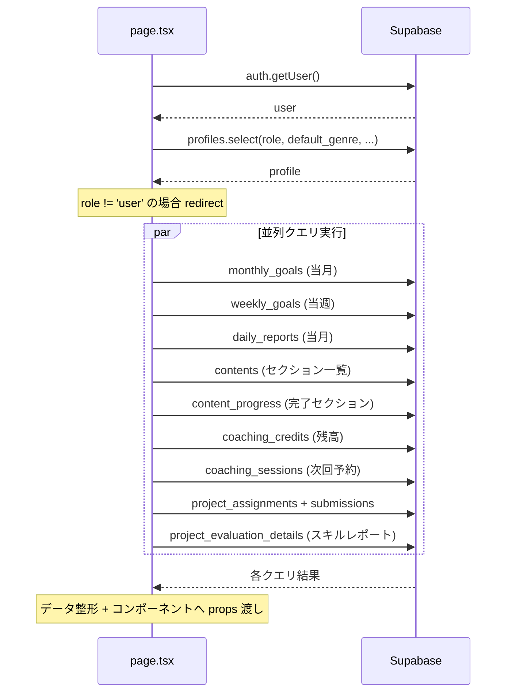
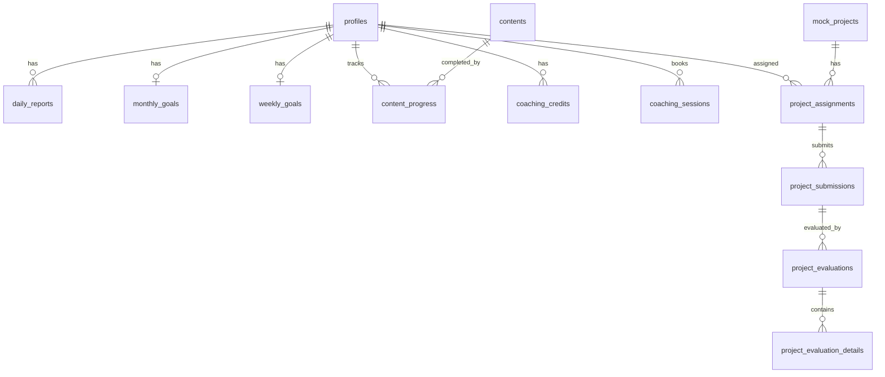

# Design Document: Dashboard

## Overview

**Purpose**: ダッシュボード（`/dashboard`）は、User（受講生）に対して学習状況のサマリーを一目で把握できるページを提供する。既存の複数テーブル（`daily_reports`, `monthly_goals`, `weekly_goals`, `contents`, `content_progress`, `coaching_credits`, `coaching_sessions`, `project_assignments`, `project_submissions`, `project_evaluations`, `project_evaluation_details`）からデータを集約し、閲覧専用で表示する。

**Users**: User（受講生）がログイン直後に利用する。Manager は `/users` へ、Super Admin は `/admin/grading` へリダイレクトされるため、ダッシュボードコンテンツは User 専用となる。

**Impact**: 既存のプレースホルダーページ（`app/(authenticated)/dashboard/page.tsx`）を完全に置き換える。新規テーブルやスキーマ変更は不要。

### Goals
- User が学習進捗（目標達成率・教材完了率）を一目で確認できる
- 日報入力状況、コーチング予約、模擬案件ステータスをダッシュボードに集約する
- スキルレポート（レーダーチャート）の概要を表示する
- Manager / Super Admin は適切な画面にリダイレクトする

### Non-Goals
- Manager / Super Admin 向けダッシュボードの構築
- データの作成・更新操作（日報入力モーダル等）
- `graduation_date`（受講期限）関連の表示
- リアルタイム更新（WebSocket / Polling）
- データのクライアントサイドキャッシュ

---

## Architecture

### Existing Architecture Analysis

現行のアーキテクチャパターンと制約:

- **Server Component 優先**: データフェッチは Server Component で行い、Client Component は必要最小限（Steering 方針）
- **認証パターン**: `createClient()` -> `supabase.auth.getUser()` -> `profiles` テーブルでロール取得（`layout.tsx` 既存パターン）
- **RLS 依存**: User は自身のデータのみアクセス可能（`user_id = auth.uid()` のポリシー）
- **既存ユーティリティ**: `deriveProjectStatus()`, `isProjectActive()`, `formatLocalDate()`, `getActiveVersionId()` が利用可能
- **UI コンポーネント**: `Card`, `CardHeader`, `CardTitle`, `CardContent` (shadcn/ui) が利用可能

### Architecture Pattern & Boundary Map

```mermaid
graph TB
    subgraph DashboardPage
        Page[page.tsx - Server Component]
        Page --> RoleRouter[Role Router]
        RoleRouter -->|User| DataFetcher[Data Fetcher - Promise.all]
        RoleRouter -->|Manager| RedirectUsers[redirect /users]
        RoleRouter -->|SuperAdmin| RedirectGrading[redirect /admin/grading]
    end

    subgraph DataSources
        DataFetcher --> Profiles[profiles]
        DataFetcher --> DailyReports[daily_reports]
        DataFetcher --> MonthlyGoals[monthly_goals]
        DataFetcher --> WeeklyGoals[weekly_goals]
        DataFetcher --> Contents[contents]
        DataFetcher --> ContentProgress[content_progress]
        DataFetcher --> CoachingCredits[coaching_credits]
        DataFetcher --> CoachingSessions[coaching_sessions]
        DataFetcher --> ProjectAssignments[project_assignments]
        DataFetcher --> ProjectSubmissions[project_submissions]
        DataFetcher --> ProjectEvalDetails[project_evaluation_details]
    end

    subgraph UIComponents
        Page --> DeactivatedBanner[DeactivatedBanner]
        Page --> GoalProgressCard[GoalProgressCard]
        Page --> TutorialProgressCard[TutorialProgressCard]
        Page --> DailyReportCard[DailyReportCard]
        Page --> CoachingCard[CoachingCard]
        Page --> ProjectStatusCard[ProjectStatusCard]
        Page --> SkillReportCard[SkillReportCard - Client]
    end
```



**Architecture Integration**:
- **Selected pattern**: Server Component + Props Drilling（既存パターン踏襲）
- **Domain boundaries**: データフェッチは `page.tsx` 内で一括実行し、各 Card コンポーネントは表示責務のみ
- **Existing patterns preserved**: `createClient()` による認証、`redirect()` によるロール分岐、shadcn/ui Card コンポーネント
- **New components rationale**: 各セクションを独立した Card コンポーネントに分離し、表示責務を明確化
- **Steering compliance**: Server Components 優先、TypeScript strict mode、`any` 禁止

### Technology Stack

| Layer | Choice / Version | Role in Feature | Notes |
|-------|------------------|-----------------|-------|
| Frontend | Next.js 16 (App Router) / React 19 | Server Component ベースのページレンダリング | 既存 |
| UI | shadcn/ui (Card, Progress, Badge) | ダッシュボードカードの UI 構築 | 既存。Progress コンポーネントは未導入の場合 shadcn CLI で追加 |
| Chart | @nivo/radar v0.99.0 | スキルレポートのレーダーチャート | 既存依存。Client Component 必須 |
| Data | Supabase (PostgreSQL + RLS) | データストア・アクセス制御 | 既存 |
| Auth | @supabase/ssr | Cookie ベース認証 | 既存 |

---

## System Flows

### ロールベースルーティングフロー

```mermaid
flowchart TD
    Start[/dashboard アクセス] --> Auth{認証済み?}
    Auth -->|No| Login[redirect /auth/login]
    Auth -->|Yes| FetchProfile[profiles から role 取得]
    FetchProfile --> RoleCheck{role?}
    RoleCheck -->|manager| RedirectUsers[redirect /users]
    RoleCheck -->|super_admin| RedirectGrading[redirect /admin/grading]
    RoleCheck -->|user| CheckBan{無効化チェック}
    CheckBan --> FetchData[データ並列取得]
    FetchData --> Render[ダッシュボード表示]
```

### データ取得フロー



---

## Requirements Traceability

| Requirement | Summary | Components | Interfaces | Flows |
|-------------|---------|------------|------------|-------|
| 1.1 | User は学習サマリーダッシュボードを表示 | DashboardPage | DashboardData | ロールベースルーティング |
| 1.2 | Manager は /users にリダイレクト | DashboardPage | - | ロールベースルーティング |
| 1.3 | Super Admin は /admin/grading にリダイレクト | DashboardPage | - | ロールベースルーティング |
| 1.4 | 全セクション閲覧専用 | 全 Card コンポーネント | - | - |
| 2.1 | 今月の目標達成率表示 | GoalProgressCard | GoalProgressData | データ取得フロー |
| 2.2 | 今週の目標達成率表示 | GoalProgressCard | GoalProgressData | データ取得フロー |
| 2.3 | 達成率をプログレスバーで視覚表示 | GoalProgressCard | - | - |
| 2.4 | 月次目標未設定時のフォールバック | GoalProgressCard | GoalProgressData | - |
| 2.5 | 週次目標未設定時のフォールバック | GoalProgressCard | GoalProgressData | - |
| 3.1 | チュートリアル完了率表示 | TutorialProgressCard | TutorialProgressItem | データ取得フロー |
| 3.2 | 完了率算出（完了セクション / 全セクション） | DashboardPage (データ整形) | TutorialProgressItem | データ取得フロー |
| 3.3 | プログレスバーで完了率表示 | TutorialProgressCard | - | - |
| 3.4 | チュートリアル名クリックで遷移 | TutorialProgressCard | - | - |
| 3.5 | 教材なし時のフォールバック | TutorialProgressCard | - | - |
| 4.1 | 今日の日報入力判定 | DailyReportCard | DailyReportStatus | データ取得フロー |
| 4.2 | 入力済み時のサマリー表示 | DailyReportCard | DailyReportStatus | - |
| 4.3 | 未入力時の CTA 表示 | DailyReportCard | DailyReportStatus | - |
| 4.4 | /daily-reports への遷移 | DailyReportCard | - | - |
| 5.1 | コーチングクレジット残高表示 | CoachingCard | CoachingData | データ取得フロー |
| 5.2 | 次回セッション情報表示 | CoachingCard | CoachingData | データ取得フロー |
| 5.3 | 予約なし時のフォールバック | CoachingCard | CoachingData | - |
| 5.4 | /coaching への遷移 | CoachingCard | - | - |
| 6.1 | 進行中案件表示 | ProjectStatusCard | ProjectItem | データ取得フロー |
| 6.2 | 直近完了案件表示（最新3件） | ProjectStatusCard | ProjectItem | データ取得フロー |
| 6.3 | 案件タイトル・ステータス表示 | ProjectStatusCard | ProjectItem | - |
| 6.4 | /projects/{slug} への遷移 | ProjectStatusCard | - | - |
| 6.5 | 進行中案件なし時のフォールバック | ProjectStatusCard | ProjectItem | - |
| 7.1 | 無効化バナー表示 | DeactivatedBanner | - | - |
| 7.2 | 無効化時もデータ表示は通常通り | DashboardPage | - | - |

---

## Components and Interfaces

| Component | Domain/Layer | Intent | Req Coverage | Key Dependencies | Contracts |
|-----------|-------------|--------|--------------|-----------------|-----------|
| DashboardPage | Page | ロール分岐・データ取得・子コンポーネントへの配信 | 1.1-1.4, 3.2, 7.2 | Supabase (P0), profiles (P0) | Service |
| DeactivatedBanner | UI | アカウント無効化バナー表示 | 7.1, 7.2 | DashboardPage (P0) | - |
| GoalProgressCard | UI | 月次・週次目標達成率の表示 | 2.1-2.5 | DashboardPage (P0) | - |
| TutorialProgressCard | UI | チュートリアル完了率一覧の表示 | 3.1, 3.3-3.5 | DashboardPage (P0) | - |
| DailyReportCard | UI | 今日の日報ステータス表示 | 4.1-4.4 | DashboardPage (P0) | - |
| CoachingCard | UI | コーチング情報表示 | 5.1-5.4 | DashboardPage (P0) | - |
| ProjectStatusCard | UI | 模擬案件ステータス表示 | 6.1-6.5 | DashboardPage (P0), deriveProjectStatus (P1) | - |
| SkillReportCard | UI (Client) | スキルレポートレーダーチャート表示 | - (追加要件) | @nivo/radar (P0) | - |

### Page Layer

#### DashboardPage

| Field | Detail |
|-------|--------|
| Intent | ロールベースルーティング、データ取得、子コンポーネントへのデータ配信 |
| Requirements | 1.1, 1.2, 1.3, 1.4, 3.2, 7.2 |

**Responsibilities & Constraints**
- 認証チェックとロール判定を行い、Manager / Super Admin はリダイレクト
- User の場合、全ダッシュボードデータを `Promise.all` で並列取得
- 取得データを各 Card コンポーネントの Props 型に整形して渡す
- Server Component として実装（`"use client"` を使用しない）

**Dependencies**
- Inbound: App Shell Layout -- 認証済みユーザーのレンダリング (P0)
- Outbound: Supabase Client (`createClient()`) -- データフェッチ (P0)
- Outbound: `getActiveVersionId()` -- コンテンツバージョン解決 (P0)
- Outbound: `deriveProjectStatus()` -- 模擬案件ステータス導出 (P1)
- Outbound: `formatLocalDate()` -- 日付フォーマット (P2)

**Contracts**: Service [x]

##### Service Interface

```typescript
/** DashboardPage が取得・整形する全データの型 */
interface DashboardData {
  profile: {
    fullName: string | null
    role: "user" | "manager" | "super_admin"
    defaultGenre: string | null
  }
  isBanned: boolean
  goalProgress: GoalProgressData
  tutorialProgress: TutorialProgressItem[]
  dailyReport: DailyReportStatus
  coaching: CoachingData
  projects: ProjectsData
  skillReport: SkillReportData
}
```

**Implementation Notes**
- `page.tsx` 内でのデータフェッチは既存の `UserDetailPage` (`admin/users/[id]/page.tsx`) パターンに準拠
- `Promise.all` で独立したクエリを並列実行し、レイテンシを最小化
- `profiles` クエリは role 判定後に `default_genre` 等の追加フィールドを取得する（1回のクエリで完結）

### UI Layer -- Server Components

#### DeactivatedBanner

| Field | Detail |
|-------|--------|
| Intent | アカウント無効化時の警告バナー表示 |
| Requirements | 7.1, 7.2 |

```typescript
interface DeactivatedBannerProps {
  isBanned: boolean
}
```

**Implementation Notes**
- `isBanned` が true の場合のみ表示
- 画面上部に固定表示。shadcn/ui の Alert コンポーネント（destructive variant）または独自スタイルのバナー
- テキスト: 「アカウントが無効化されています。詳細は管理者にお問い合わせください。」

#### GoalProgressCard

| Field | Detail |
|-------|--------|
| Intent | 今月・今週の学習目標達成率をプログレスバーで表示 |
| Requirements | 2.1, 2.2, 2.3, 2.4, 2.5 |

```typescript
interface GoalProgressData {
  monthly: {
    actual: number       // 当月の実績時間合計
    target: number | null // 月次目標（null = 未設定）
    percentage: number | null
  }
  weekly: {
    actual: number       // 当週の実績時間合計
    target: number | null // 週次目標（null = 未設定）
    percentage: number | null
  }
}

interface GoalProgressCardProps {
  data: GoalProgressData
}
```

**Implementation Notes**
- `target` が null の場合は「目標未設定」と表示し、`/daily-reports` への Link を提示
- 達成率 100% 超の場合も正しく表示（プログレスバーは max 100% でキャップ、テキストは実値表示）
- shadcn/ui の `Progress` コンポーネントを使用（未導入の場合は `npx shadcn add progress`）

#### TutorialProgressCard

| Field | Detail |
|-------|--------|
| Intent | チュートリアルごとの教材完了率をプログレスバー一覧で表示 |
| Requirements | 3.1, 3.3, 3.4, 3.5 |

```typescript
interface TutorialProgressItem {
  tutorialSlug: string
  tutorialTitle: string
  genre: string
  completedSections: number
  totalSections: number
  percentage: number  // Math.round((completedSections / totalSections) * 100)
}

interface TutorialProgressCardProps {
  items: TutorialProgressItem[]
  defaultGenre: string | null
}
```

**Implementation Notes**
- `items` が空の場合は「教材なし」と表示
- 各チュートリアル名は `/contents/{tutorialSlug}?genre={genre}` へのリンク
- プログレスバー + パーセンテージテキスト（例: "12 / 15 セクション (80%)"）

#### DailyReportCard

| Field | Detail |
|-------|--------|
| Intent | 今日の日報の入力状況を表示し、未入力時は CTA を提示 |
| Requirements | 4.1, 4.2, 4.3, 4.4 |

```typescript
type DailyReportStatus =
  | {
      type: "entered"
      totalHours: number
      entries: { actualHours: number; content: string }[]
    }
  | {
      type: "not_entered"
    }

interface DailyReportCardProps {
  status: DailyReportStatus
}
```

**Implementation Notes**
- `type: "entered"` の場合: 本日の学習時間合計と内容サマリーを表示
- `type: "not_entered"` の場合: 「今日の日報を入力しましょう」の CTA + `/daily-reports` リンク
- 日報は1日に複数回入力可能なため、`entries` は配列

#### CoachingCard

| Field | Detail |
|-------|--------|
| Intent | コーチングクレジット残高と次回セッション情報を表示 |
| Requirements | 5.1, 5.2, 5.3, 5.4 |

```typescript
interface CoachingData {
  creditBalance: number
  nextSession: {
    sessionDate: string  // "YYYY-MM-DD"
    startTime: string    // "HH:MM"
    endTime: string      // "HH:MM"
    genre: "engineering" | "design"
  } | null
}

interface CoachingCardProps {
  data: CoachingData
}
```

**Implementation Notes**
- `nextSession` が null の場合: 「予約なし」 + `/coaching` へのリンク
- クレジット残高は `coaching_credits` の `amount` 合計で算出
- 次回セッションは `status = 'scheduled'` かつ `session_date >= today` のうち最も近いもの

#### ProjectStatusCard

| Field | Detail |
|-------|--------|
| Intent | 進行中・直近完了の模擬案件ステータスを一覧表示 |
| Requirements | 6.1, 6.2, 6.3, 6.4, 6.5 |

```typescript
interface ProjectItem {
  projectSlug: string
  projectTitle: string
  status: ProjectStatus  // "未着手" | "着手済み" | "提出済み" | "採点中" | "採点完了" | "差し戻し"
  latestScore: number | null
}

interface ProjectsData {
  activeProjects: ProjectItem[]     // 進行中（着手済み・提出済み・採点中・差し戻し）
  recentCompleted: ProjectItem[]    // 直近完了（採点完了、最新3件）
}

interface ProjectStatusCardProps {
  data: ProjectsData
}
```

**Implementation Notes**
- 既存の `deriveProjectStatus()` を使用してステータスを導出
- `activeProjects` が空の場合: 「進行中の案件なし」 + `/projects` へのリンク
- 各案件名は `/projects/{slug}` へのリンク
- ステータスは Badge コンポーネントで色分け表示

### UI Layer -- Client Component

#### SkillReportCard

| Field | Detail |
|-------|--------|
| Intent | スキルレポートのレーダーチャートとカテゴリ別達成率を表示 |
| Requirements | 追加要件（スキルレポート統合） |

```typescript
interface SkillCategoryScore {
  categoryLarge: string
  okCount: number
  totalCount: number
  percentage: number  // Math.round((okCount / totalCount) * 100)
}

interface SkillReportData {
  categories: SkillCategoryScore[]
  hasData: boolean
}

interface SkillReportCardProps {
  data: SkillReportData
}
```

**Implementation Notes**
- `"use client"` 指定（`@nivo/radar` が Client Component を要求）
- `hasData` が false の場合: 「採点済みの案件がありません」と表示
- レーダーチャートのデータは `categories` 配列から `@nivo/radar` の `ResponsiveRadar` に変換
- カテゴリ別達成率をチャート下部にテキストで併記

---

## Data Models

### Domain Model

ダッシュボードは新規テーブルやスキーマ変更を伴わない。既存テーブルからの読み取り専用アクセス。



**Business Rules & Invariants**:
- `content_progress` の `content_id` は `contents.content_type = 'section'` のレコードのみを対象とする
- `coaching_credits.amount` は正（付与）と負（消費）の両方を持ち、合計がクレジット残高となる
- 模擬案件のステータスは `project_assignments` + `project_submissions` の最新レコードから `deriveProjectStatus()` で導出する
- スキルレポートのデータは `project_evaluation_details` の `status = 'finalized'` の評価のみを対象とする

### Data Query Specifications

各クエリの仕様を以下に定義する。

#### Q1: Profile（ロール・ジャンル取得）

```
FROM: profiles
SELECT: role, default_genre, full_name
WHERE: id = auth.uid()
```

#### Q2: 月次目標

```
FROM: monthly_goals
SELECT: target_hours
WHERE: user_id = auth.uid() AND year_month = currentYearMonth
```

#### Q3: 週次目標

```
FROM: weekly_goals
SELECT: target_hours
WHERE: user_id = auth.uid() AND start_date = currentMonday
```

#### Q4: 当月の日報（月次・週次・日次の実績算出に共用）

```
FROM: daily_reports
SELECT: actual_hours, report_date, content
WHERE: user_id = auth.uid() AND report_date >= monthStart AND report_date <= monthEnd
```

- 月次実績: 全レコードの `actual_hours` 合計
- 週次実績: `report_date` が当週範囲内のレコードの `actual_hours` 合計
- 本日の日報判定: `report_date = today` のレコード有無

#### Q5: 教材セクション一覧（チュートリアル完了率の分母）

```
FROM: contents
SELECT: id, tutorial, title, slug_path, genre
WHERE: genre = profile.default_genre AND content_type = 'section' AND status = 'active' AND version_id = activeVersionId
```

#### Q6: チュートリアル一覧（タイトル取得用）

```
FROM: contents
SELECT: tutorial, title, slug_path, genre
WHERE: genre = profile.default_genre AND content_type = 'tutorial' AND status = 'active' AND version_id = activeVersionId
ORDER BY: order ASC
```

#### Q7: 完了済みセクション

```
FROM: content_progress
SELECT: content_id
WHERE: user_id = auth.uid()
```

- Q5 の結果（セクション ID 一覧）と突合して完了率を算出

#### Q8: コーチングクレジット残高

```
FROM: coaching_credits
SELECT: amount
WHERE: user_id = auth.uid()
```

- 全レコードの `amount` を合計

#### Q9: 次回コーチングセッション

```
FROM: coaching_sessions
SELECT: session_date, start_time, end_time, genre
WHERE: user_id = auth.uid() AND status = 'scheduled' AND session_date >= today
ORDER BY: session_date ASC, start_time ASC
LIMIT: 1
```

#### Q10: 模擬案件（assignment + submission）

```
FROM: project_assignments
SELECT: id, project_id, mock_projects(slug, title)
WHERE: user_id = auth.uid()

-- 各 assignment について最新の submission を取得
FROM: project_submissions
SELECT: status, score
WHERE: assignment_id = assignment.id
ORDER BY: created_at DESC
LIMIT: 1
```

#### Q11: スキルレポート（評価詳細の集計）

```
FROM: project_evaluation_details
SELECT: category_large, is_ok, point
JOIN: project_evaluations ON evaluation_id (status = 'finalized')
JOIN: project_submissions ON submission_id
JOIN: project_assignments ON assignment_id (user_id = auth.uid())
```

- `category_large` ごとに `is_ok = true` のカウントと総数を集計

---

## 設計判断（解決済み TBD）

### TBD-1: データ取得戦略 → **A案: 個別クエリ + Promise.all**
既存パターンとの一貫性、型安全性、個別エラーハンドリングの容易さから採用。

### TBD-2: アカウント無効化（banned）の取得方法 → **A案: Server Component 内で Admin Client**
`createAdminClient()` で自身の `banned_until` を取得。既存 `admin/users/[id]/page.tsx` と同パターン。

### TBD-3: 教材完了率の分母定義 → **A案: アクティブバージョンの section のみ**
`version_id = activeVersionId AND content_type = 'section' AND status = 'active'`。既存 TutorialDetailPage と同条件。

### TBD-4: スキルレポートの集計対象 → **B案: 案件ごとに最新の finalized のみ使用**
同一 `project_id` に対する最新の `finalized` 評価のみを使用。再提出でスコア改善が反映される。

### TBD-5: スキルレポートクエリの実装方式 → **A案: Supabase ネストセレクト**
1クエリで4テーブル JOIN が完結し、DB-サーバー間ラウンドトリップが最小（最速）。`project_assignments` -> `project_submissions` -> `project_evaluations` -> `project_evaluation_details` のチェーン。

---

## Error Handling

### Error Strategy

ダッシュボードは閲覧専用ページのため、エラー時はグレースフルデグラデーションを基本とする。

### Error Categories and Responses

**User Errors (4xx)**:
- 未認証: `redirect("/auth/login")` (既存パターン)

**System Errors (5xx)**:
- Supabase クエリエラー: 該当セクションを「データを取得できませんでした」で表示し、他セクションは正常表示を維持
- 全クエリ失敗: Next.js の `error.tsx` でエラーバウンダリ表示

**Business Logic Errors**:
- `default_genre` が null: 教材完了率セクションを「ジャンルが設定されていません」で表示
- アクティブバージョンなし: 教材完了率セクションを「教材が公開されていません」で表示

### Monitoring

- Supabase クエリエラーは `console.error` でサーバーログに出力（既存パターン準拠）

---

## Testing Strategy

### Unit Tests
- `deriveProjectStatus()` のステータス導出ロジック（既存テスト）
- 目標達成率の計算ロジック（percentage 算出、null ハンドリング、0 除算）
- 教材完了率の計算ロジック（completedSections / totalSections）
- スキルレポートの集計ロジック（category_large ごとの is_ok 集計）

### Integration Tests
- ロールベースリダイレクト: Manager -> `/users`, Super Admin -> `/admin/grading`
- User ダッシュボードのデータフェッチ: 全セクションのデータが正しく取得・表示されること
- 空データ状態のフォールバック: 各セクションで「なし」「未設定」等の表示

### E2E Tests
- User ログイン後にダッシュボードが表示されること
- 各 CTA リンク（`/daily-reports`, `/coaching`, `/projects`）が正しく遷移すること
- チュートリアル名クリックで `/contents/{tutorial}` に遷移すること

---

## Performance & Scalability

### Performance Targets
- ダッシュボードの初回表示: 2 秒以内（Server Component レンダリング完了まで）
- データクエリ合計: 500ms 以内（並列実行想定）

### Optimization Techniques
- **クエリ並列化**: `Promise.all` で独立したクエリを並列実行
- **最小限のカラム選択**: 各クエリで必要なカラムのみ `select`
- **LIMIT の適用**: 模擬案件の完了済みは `LIMIT 3`、コーチングセッションは `LIMIT 1`
- **RLS の活用**: `user_id = auth.uid()` のフィルタは RLS で自動適用されるため、アプリ側のフィルタを省略可能な箇所あり

### Scaling Considerations
- ダッシュボードは個人データの集約のみのため、データ量はユーザーあたり数百レコード程度で性能問題は想定されない
- 教材セクション数が大量になった場合、`content_progress` の `IN` 句のサイズに注意（現状は数十〜数百セクション程度）
