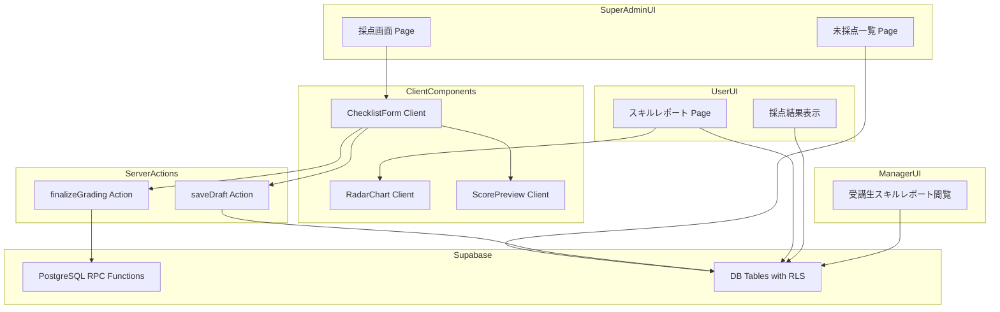
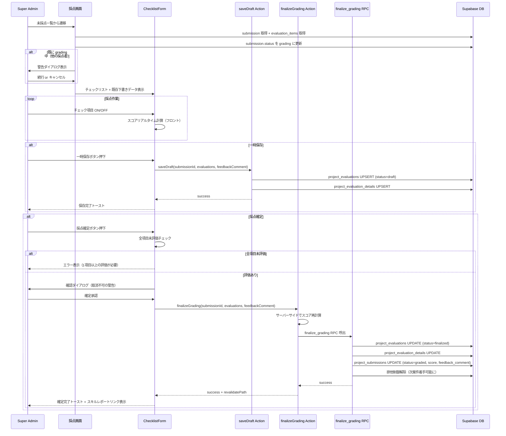
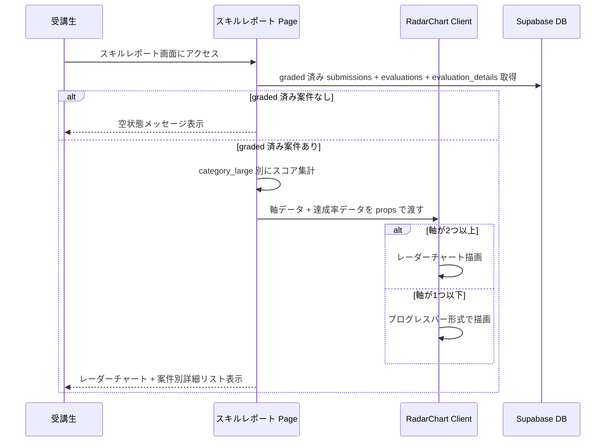
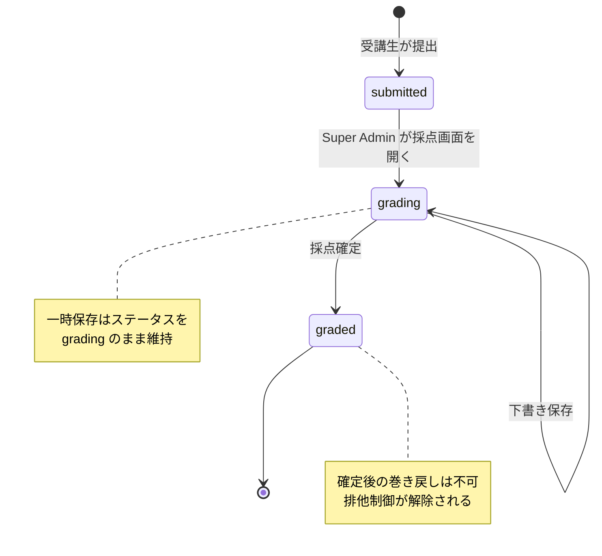

# 技術設計書: mock-project-grading（模擬案件 採点・スキルレポート機能）

## Overview

本機能は、LMS（社内研修学習管理システム）において Super Admin による模擬案件提出物の採点フローと、受講生・Manager・Super Admin 向けのスキルレポート（レーダーチャート）閲覧機能を提供する。採点は PRD 準拠の階層型チェックリスト（`category_large` > `category_medium` > `items`）で行い、各項目の OK/NG 判定とスコア自動計算を実装する。

**Users**: Super Admin が採点画面で提出物を評価・確定する。受講生は自身の採点結果とスキルレポートを閲覧する。Manager は担当受講生のスキルレポート（集約スコアのみ）を閲覧する。

**Impact**: 既存 `project_submissions` テーブルへの `feedback_comment` カラム追加、`EvaluationItem` 型の PRD 準拠階層型への更新、新規 UI ページ（採点画面・スキルレポート画面）の追加、チャートライブラリの導入を伴う。

### Goals
- Super Admin が階層型チェックリストで提出物を効率的に採点できるフローを提供する
- 下書き保存による採点作業の中断・再開を可能にする
- 受講生がスキルの達成状況をレーダーチャートで視覚的に把握できるレポート画面を提供する
- Manager が担当受講生のスキル傾向を閲覧できる機能を提供する

### Non-Goals
- 受講生側の案件一覧・提出フロー（mock-projects spec で定義済み）
- 模擬案件データの同期（mock-projects spec で定義済み）
- 採点結果の CSV エクスポート
- 複数採点者による同時採点（楽観的ロックによる警告のみ）
- 再提出フロー（本スコープでは `submitted` -> `grading` -> `graded` の一方向遷移のみ）

## Architecture

### Existing Architecture Analysis

本機能は mock-projects spec で確立された以下のパターンを踏襲・拡張する。

- **Server Components 優先**: Page レベルで Supabase クライアントを生成しデータフェッチ。Client Component は必要最小限（チェックリスト操作、チャート描画等）
- **Server Actions**: mutation 処理は `"use server"` 関数で実行。既存の `startProject`, `submitWork` パターンを踏襲
- **Supabase RLS**: 全テーブルに RLS 適用。採点操作は Super Admin（`service_role`）限定
- **Admin Client**: Super Admin の採点操作は `createAdminClient()` を使用して RLS をバイパスする既存パターンを踏襲
- **searchParams によるフィルタ/状態管理**: 未採点一覧のジャンルフィルタ、タブ管理に使用

### Architecture Pattern & Boundary Map



**Architecture Integration**:
- **Selected pattern**: Server Components + Server Actions（既存パターン踏襲）
- **Domain boundaries**: 採点ドメインを Super Admin ルート内に集約。スキルレポートは受講生・Manager それぞれのルートに配置
- **Existing patterns preserved**: Supabase RLS, Admin Client, Server Actions, searchParams フィルタ
- **New components rationale**: `ChecklistForm` は大量のチェックボックス操作が必要なため Client Component。`RadarChart` はチャートライブラリの描画が必要なため Client Component
- **Steering compliance**: TypeScript strict mode, `any` 禁止, Server Components 優先, RLS 必須

### Technology Stack

| Layer | Choice / Version | Role in Feature | Notes |
|-------|------------------|-----------------|-------|
| Frontend | Next.js 16 / React 19 | ページルーティング、Server Components、Server Actions | 既存スタック |
| UI Components | shadcn/ui / Radix UI | アコーディオン、バッジ、ボタン、ダイアログ、チェックボックス、テキストエリア | 既存スタック |
| Chart Library | Nivo (@nivo/radar) v0.99+ | レーダーチャート描画 | SVGベース。React 19 公式対応。ResponsiveRadar で自動レスポンシブ |
| State Management | React useState / useTransition | チェックリスト状態、スコアプレビュー | 追加ライブラリ不要 |
| Form Validation | zod | フィードバックコメントのバリデーション | 既存スタック |
| Backend | Supabase PostgreSQL + RPC | データ永続化、採点確定トランザクション | 既存スタック |
| Toast | sonner | 操作完了通知 | 既存スタック |

## 確定済み設計判断

### TBD-D1（確定）: レーダーチャートライブラリ → Nivo (@nivo/radar)

**選定理由**: 描画品質とサイズ柔軟性を最優先とし、以下の根拠で決定。
- **描画品質**: SVGベースで拡縮時も鮮明。テーマシステム・`blendMode`・`fillOpacity` 等の美的制御が最も充実
- **サイズ柔軟性**: `ResponsiveRadar` コンポーネントで自動レスポンシブ。`gridLabelOffset` + `margin` プロパティで300x300pxのモバイルサイズでもラベル切れ/重なりを防止
- **React 19 対応**: 3候補中唯一の公式サポート（v0.98.0 で react-spring を React 19 対応にアップグレード済み）
- **TypeScript ファースト**: 型安全な開発が可能

### TBD-D2（確定）: 採点データ保存パターン → B案（新規テーブル分離）

**選定理由**: `project_evaluations` + `project_evaluation_details` テーブルを新設。
- `category_large` での `GROUP BY` によるレーダーチャート軸集計が簡潔
- FK制約・CHECK制約によるDBレベルのデータ整合性保証
- `project_evaluations.status` カラムによる明確な下書き管理

## System Flows

### 採点フロー（下書き保存 + 確定）



### スキルレポート表示フロー



### ステータス遷移図



## Requirements Traceability

| Requirement | Summary | Components | Interfaces | Flows |
|-------------|---------|------------|------------|-------|
| 1.1-1.6 | 未採点提出一覧 | GradingListPage, SubmissionCard, GenreFilter | fetchPendingSubmissions query | - |
| 2.1-2.8 | 採点画面チェックリスト | GradingPage, ChecklistForm, CategoryAccordion | saveDraft Action, fetchEvaluationItems query | 採点フロー |
| 3.1-3.5 | スコア算出 | ScorePreview, ChecklistForm | calculateScore util, finalizeGrading Action | 採点フロー |
| 4.1-4.5 | 採点確定 | ChecklistForm, ConfirmDialog | finalizeGrading Action, finalize_grading RPC | 採点フロー |
| 5.1-5.5 | フィードバックコメント | FeedbackTextarea | saveDraft Action, finalizeGrading Action | 採点フロー |
| 6.1-6.4 | 下書き保存 | ChecklistForm | saveDraft Action | 採点フロー |
| 7.1-7.5 | 受講生向け採点結果閲覧 | GradedResultView, ResultAccordion | fetchGradingResult query | - |
| 8.1-8.5 | スキルレポート画面 | SkillReportPage, ProjectScoreList | fetchSkillReport query | スキルレポート表示フロー |
| 9.1-9.5 | レーダーチャート表示 | RadarChart, ProgressBar | RadarChartProps | スキルレポート表示フロー |
| 10.1-10.4 | Manager向けスキルレポート閲覧 | ManagerSkillReportPage | fetchSkillReport query | スキルレポート表示フロー |
| 11.1-11.3 | Super Admin向けスキルレポート閲覧 | AdminSkillReportPage | fetchSkillReport query | スキルレポート表示フロー |
| 12.1-12.7 | アクセス制御とセキュリティ | RLS Policies, Middleware | - | - |
| 13.1-13.4 | ステータス遷移の整合性 | finalizeGrading Action, finalize_grading RPC | - | 採点フロー |

## Components and Interfaces

| Component | Domain/Layer | Intent | Req Coverage | Key Dependencies | Contracts |
|-----------|--------------|--------|--------------|------------------|-----------|
| GradingListPage | UI/Page | 未採点提出一覧 Server Component | 1.1-1.6 | Supabase (P0) | - |
| SubmissionCard | UI/Presentation | 提出物カード表示 | 1.2 | - | - |
| GenreFilter | UI/Client | ジャンルフィルタ | 1.6 | searchParams (P0) | State |
| GradingPage | UI/Page | 採点画面 Server Component | 2.1, 2.3, 2.4, 2.7, 2.8 | Supabase (P0), ChecklistForm (P1) | - |
| ChecklistForm | UI/Client | 階層型チェックリストフォーム | 2.1-2.6, 3.1-3.5, 4.1-4.5, 5.1-5.3, 6.1-6.4 | saveDraft (P0), finalizeGrading (P0) | Service, State |
| CategoryAccordion | UI/Presentation | 大項目/中項目のアコーディオン表示 | 2.1, 2.5, 7.2, 7.3 | - | - |
| ScorePreview | UI/Client | スコアリアルタイムプレビュー | 2.6, 3.1, 3.4 | - | State |
| FeedbackTextarea | UI/Client | フィードバックコメント入力 | 5.1-5.5 | - | State |
| ConfirmDialog | UI/Client | 採点確定の確認ダイアログ | 4.2 | shadcn/ui Dialog (P1) | - |
| GradedResultView | UI/Server | 採点結果詳細表示 | 7.1-7.5 | Supabase (P0) | - |
| ResultAccordion | UI/Presentation | 採点結果アコーディオン | 7.2, 7.3 | - | - |
| SkillReportPage | UI/Page | 受講生スキルレポート Server Component | 8.1-8.5, 9.1-9.5 | Supabase (P0), RadarChart (P1) | - |
| RadarChart | UI/Client | レーダーチャート描画 | 9.1-9.5 | Nivo @nivo/radar (P0) | State |
| ProgressBar | UI/Presentation | 1軸以下時の代替表示 | 9.4 | - | - |
| ProjectScoreList | UI/Presentation | 案件別スコアリスト | 8.2, 8.4 | - | - |
| ManagerSkillReportPage | UI/Page | Manager向けスキルレポート | 10.1-10.4 | Supabase (P0), RadarChart (P1) | - |
| AdminSkillReportPage | UI/Page | Super Admin向けスキルレポート | 11.1-11.3 | Supabase (P0), RadarChart (P1) | - |
| saveDraft Action | Server Action | 下書き保存 | 6.1-6.4 | Supabase Admin (P0) | Service |
| finalizeGrading Action | Server Action | 採点確定 | 3.2, 3.3, 4.1, 4.3, 4.4, 4.5, 5.3, 13.1-13.4 | finalize_grading RPC (P0) | Service |
| finalize_grading RPC | DB/Function | 採点確定トランザクション | 4.3, 4.5, 13.1, 13.4 | PostgreSQL (P0) | Service |
| RLS Policies | DB/Security | 採点・レポートのアクセス制御 | 12.1-12.7 | Supabase Auth (P0) | - |

### UI Layer

#### GradingListPage

| Field | Detail |
|-------|--------|
| Intent | 未採点・採点中の提出物一覧を表示する Server Component |
| Requirements | 1.1, 1.2, 1.3, 1.4, 1.5, 1.6 |

**Responsibilities & Constraints**
- `project_submissions` テーブルから `status IN ('submitted', 'grading')` の提出物を `created_at` 昇順で取得
- `project_assignments` -> `profiles` を JOIN して受講生名を取得
- `project_assignments` -> `mock_projects` を JOIN して案件タイトル・ジャンルを取得
- `status = 'grading'` の提出物は「採点中」バッジで区別
- 空状態時は「未採点の提出はありません」メッセージを表示
- searchParams `?genre=` によるジャンルフィルタ

**Dependencies**
- Outbound: SubmissionCard -- カード描画 (P1), GenreFilter -- フィルタ UI (P1)
- External: Supabase Admin Client (P0) -- 全ユーザーの submission を取得するため

**Implementation Notes**
- ファイルパス: `app/(authenticated)/admin/grading/page.tsx`
- Super Admin ロール限定ページ（Server Component 内でロールチェック）
- 既存の admin ページ（`admin/users`）と同様のパターンで認証・権限チェック

#### GradingPage

| Field | Detail |
|-------|--------|
| Intent | 採点画面の Server Component。チェックリストデータを取得し ChecklistForm に渡す |
| Requirements | 2.1, 2.3, 2.4, 2.7, 2.8 |

**Responsibilities & Constraints**
- URL パラメータ `[submissionId]` で提出物を特定
- `project_submissions` + `project_assignments` + `mock_projects` を JOIN してデータ取得
- `mock_projects.evaluation_items` を階層構造としてパースし ChecklistForm に渡す
- 採点画面アクセス時に `submission.status` を `grading` に更新（2.7）
- 既に他の採点者が `grading` 中の場合は警告を表示（2.8）
- 既存の下書きデータ（`project_evaluations`）がある場合は復元データも渡す

**Dependencies**
- Outbound: ChecklistForm (P0), CategoryAccordion (P1)
- External: Supabase Admin Client (P0)

**Implementation Notes**
- ファイルパス: `app/(authenticated)/admin/grading/[submissionId]/page.tsx`
- ステータス更新は Server Component 内で直接実行（side effect として許容）

#### ChecklistForm

| Field | Detail |
|-------|--------|
| Intent | 階層型チェックリスト + スコアプレビュー + 下書き保存 + 確定の Client Component |
| Requirements | 2.1, 2.2, 2.5, 2.6, 3.1, 3.4, 3.5, 4.1-4.5, 5.1-5.3, 6.1-6.4 |

**Responsibilities & Constraints**
- evaluation_items を階層表示（大項目 > 中項目 > 小項目）
- 各小項目に対して OK/NG トグル（チェックボックス）を提供
- 大項目ごとの小計（OK数 / 全項目数）をリアルタイム表示
- 全体スコア（%）をリアルタイム計算・表示
- フィードバックコメント入力欄（2000文字制限）
- 一時保存ボタンと採点確定ボタン
- 全項目未評価時の確定ブロック

**Dependencies**
- Outbound: ScorePreview (P1), FeedbackTextarea (P1), CategoryAccordion (P1), ConfirmDialog (P1)
- External: saveDraft Action (P0), finalizeGrading Action (P0)

**Contracts**: Service, State

##### State Management
```typescript
/** evaluation_items の階層構造型（PRD準拠） */
interface EvaluationCategory {
  category_large: string
  category_medium: string
  items: EvaluationItemEntry[]
}

interface EvaluationItemEntry {
  id: string
  label: string
  point: number
}

/** チェック状態: item.id -> boolean (true=OK, false=NG, undefined=未評価) */
type EvaluationState = Record<string, boolean>

interface ChecklistFormProps {
  submissionId: string
  studentName: string
  projectTitle: string
  githubUrl: string
  categories: EvaluationCategory[]
  initialEvaluations: EvaluationState
  initialFeedbackComment: string
  isDraft: boolean
}

interface CategoryScore {
  categoryLarge: string
  okCount: number
  totalCount: number
  earnedPoints: number
  totalPoints: number
  percentage: number
}
```
- **State model**: `useState<EvaluationState>` でチェック状態を管理。`useState<string>` でフィードバックコメントを管理
- **Persistence**: `saveDraft` Server Action で DB に永続化。`finalizeGrading` Server Action で確定
- **Concurrency**: `useTransition` で保存/確定中のローディング表示

##### Service Interface
```typescript
/** スコア計算ユーティリティ（フロントエンド + サーバーサイド共用） */
function calculateScore(
  categories: EvaluationCategory[],
  evaluations: EvaluationState
): {
  totalScore: number          // 全体スコア (0-100, 整数)
  categoryScores: CategoryScore[]  // 大項目別スコア
  totalOkCount: number
  totalItemCount: number
  totalEarnedPoints: number
  totalMaxPoints: number
}

/** スコア計算式: (OK判定された項目のpoint合計 / 全項目のpoint合計) x 100（四捨五入） */
```

**Implementation Notes**
- `calculateScore` はフロントエンドでリアルタイムプレビューに使用し、サーバーサイドでも確定時に再計算・検証する。同一ロジックを共有モジュールとして `lib/utils/grading.ts` に配置
- 大量のチェック項目（100項目程度）を扱うため、不要な再レンダリングを避ける設計を考慮

#### RadarChart

| Field | Detail |
|-------|--------|
| Intent | レーダーチャートを描画する Client Component |
| Requirements | 9.1, 9.2, 9.3, 9.4, 9.5 |

**Responsibilities & Constraints**
- `category_large` を軸としたレーダーチャートを描画
- 各軸の値は達成率（%: 0-100）
- 各頂点に軸名と達成率の数値を表示
- 1軸以下の場合はプログレスバー形式にフォールバック
- レスポンシブ対応（モバイル画面で視認可能なサイズ）

**Dependencies**
- External: Nivo @nivo/radar (P0)

**Contracts**: State

##### State Management
```typescript
interface RadarAxisData {
  axis: string           // category_large 名 (例: "Backend", "Frontend")
  value: number          // 達成率 (0-100)
  fullMark: number       // 常に 100
}

interface RadarChartProps {
  data: RadarAxisData[]
  width?: number
  height?: number
}

interface ProgressBarProps {
  axis: string
  value: number
}
```

**Implementation Notes**
- Nivo の `ResponsiveRadar` コンポーネントを使用。SVGベースで拡縮時も鮮明に描画
- `gridLabelOffset` でラベル位置を調整し、小サイズ（300x300px）でもラベル切れを防止
- `"use client"` コンポーネント。SSR では描画せず、Client 側でのみレンダリング
- `@nivo/radar` と `@nivo/core` をインストール

#### SkillReportPage

| Field | Detail |
|-------|--------|
| Intent | 受講生のスキルレポートを表示する Server Component |
| Requirements | 8.1, 8.2, 8.3, 8.4, 8.5, 9.1-9.5 |

**Responsibilities & Constraints**
- 認証済みユーザーの `graded` 済み submissions を取得
- 案件ごとにレーダーチャートを表示（TBD-2 確定: 案件ごとに表示）
- 同一案件に複数回の採点がある場合、最新の `graded` 結果を集計対象とする
- `evaluation_details` から `category_large` 別の達成率を集計
- 案件ごとの詳細セクション（案件名、スコア、採点日）をリスト表示
- 詳細クリックで採点結果詳細（GradedResultView）へ遷移

**Dependencies**
- Outbound: RadarChart (P0), ProjectScoreList (P1), ProgressBar (P1)
- External: Supabase (P0)

**Implementation Notes**
- ファイルパス: `app/(authenticated)/users/skill-report/page.tsx`（受講生向け）
- Manager 向け: `app/(authenticated)/admin/users/[id]/skill-report/page.tsx`
- Super Admin 向け: 同上（Manager と同じパスで、ロールに応じて表示内容を分岐）

#### GradedResultView

| Field | Detail |
|-------|--------|
| Intent | 採点結果の詳細表示（アコーディオン形式）を提供する Server Component |
| Requirements | 7.1, 7.2, 7.3, 7.4, 7.5 |

**Responsibilities & Constraints**
- `graded` 済みの提出物に対してスコア（%）とフィードバックコメントを表示
- 大項目 > 中項目 > 小項目のアコーディオン形式で各項目の OK/NG を表示
- 大項目ごとの小計（OK数 / 全項目数、達成率%）を表示
- `submitted` または `grading` 状態の場合は「採点待ち」「採点中」メッセージを表示
- 受講生は閲覧のみ（変更操作なし）

**Dependencies**
- Outbound: ResultAccordion (P1)
- External: Supabase (P0)

**Implementation Notes**
- 採点結果表示は mock-projects spec の DetailPage 内にタブとして統合する可能性あり。または独立ページとしてルーティングする
- Super Admin は evaluation_items の項目レベル詳細（OK/NG 結果）も閲覧可能（11.2）

### Server Actions Layer

#### saveDraft Action

| Field | Detail |
|-------|--------|
| Intent | 採点の一時保存（下書き）Server Action |
| Requirements | 6.1, 6.2, 6.3, 6.4 |

**Responsibilities & Constraints**
- Super Admin ロール限定
- `project_evaluations` テーブルに UPSERT（`status = 'draft'`）
- `project_evaluation_details` テーブルに各項目の評価結果を UPSERT
- `project_submissions.status` は `grading` のまま維持
- フィードバックコメントも下書きとして保存

**Dependencies**
- External: Supabase Admin Client (P0)

**Contracts**: Service

##### Service Interface
```typescript
interface SaveDraftInput {
  submissionId: string
  evaluations: EvaluationState    // { "item-id": true/false }
  feedbackComment: string
}

interface SaveDraftResult {
  success: boolean
  message: string
}

function saveDraft(input: SaveDraftInput): Promise<SaveDraftResult>
```
- Preconditions: 呼出者が `super_admin` ロール。submission が `grading` 状態
- Postconditions: `project_evaluations` に下書きレコードが存在。`project_evaluation_details` に各項目の評価が記録
- Invariants: submission の status は `grading` のまま変更しない

**Implementation Notes**
- ファイルパス: `app/(authenticated)/admin/grading/actions.ts`
- `createAdminClient()` を使用（RLS バイパス）
- UPSERT は `submission_id` をキーとして実行

#### finalizeGrading Action

| Field | Detail |
|-------|--------|
| Intent | 採点確定の Server Action。スコア再計算 + RPC による確定トランザクション |
| Requirements | 3.2, 3.3, 4.1, 4.3, 4.4, 4.5, 5.3, 13.1, 13.2, 13.3, 13.4 |

**Responsibilities & Constraints**
- Super Admin ロール限定
- サーバーサイドでスコアを再計算（フロント側プレビューとの整合性検証）
- `finalize_grading` RPC を呼び出して以下を同一トランザクションで実行:
  - `project_evaluations` の `status` を `finalized` に更新
  - `project_submissions` の `status` を `graded` に、`score` と `feedback_comment` を保存
  - 排他制御の解除（次案件着手可能に）
- ステータス遷移の検証: `grading` -> `graded` のみ許可。`graded` からの変更は拒否
- 全項目未評価の場合はエラー（4.4: アプリ層バリデーション）

**Dependencies**
- External: Supabase Admin Client (P0), finalize_grading RPC (P0)

**Contracts**: Service

##### Service Interface
```typescript
interface FinalizeGradingInput {
  submissionId: string
  evaluations: EvaluationState
  feedbackComment: string
}

interface FinalizeGradingResult {
  success: boolean
  message: string
  score?: number
}

function finalizeGrading(
  input: FinalizeGradingInput
): Promise<FinalizeGradingResult>
```
- Preconditions: 呼出者が `super_admin` ロール。submission が `grading` 状態。1項目以上が評価済み
- Postconditions: submission が `graded` 状態に更新。score と feedback_comment が記録。排他制御が解除
- Invariants: `graded` に遷移した submission は二度と変更できない

**Implementation Notes**
- `calculateScore` を再実行してスコアを再計算
- RPC 関数内で `submission.status` の遷移を検証し、不正な遷移は PostgreSQL EXCEPTION で拒否（HTTP 422 相当）
- 成功時は `revalidatePath` で関連ページを再検証

### Database Layer

#### finalize_grading RPC

| Field | Detail |
|-------|--------|
| Intent | 採点確定を単一トランザクションで実行する PostgreSQL 関数 |
| Requirements | 4.3, 4.5, 13.1, 13.4 |

**Responsibilities & Constraints**
- `project_submissions.status` が `grading` であることを検証
- `project_evaluations.status` を `finalized` に更新
- `project_submissions` の `status`, `score`, `result_data`, `feedback_comment` を更新
- 排他制御の解除: 当該ユーザーの assignment に紐づく submission が全て `graded` になった場合、次案件の着手が可能になる（mock-projects spec の排他制御ロジックと整合）
- 不正なステータス遷移時は EXCEPTION を raise

**Dependencies**
- External: PostgreSQL (P0)

**Contracts**: Service

##### Service Interface
```sql
CREATE OR REPLACE FUNCTION finalize_grading(
  p_submission_id UUID,
  p_score INTEGER,
  p_result_data JSONB,
  p_feedback_comment TEXT
) RETURNS JSONB AS $$
-- Returns: { "success": true, "score": INTEGER }
-- Raises: EXCEPTION 'INVALID_STATUS_TRANSITION' (grading 以外からの遷移時)
-- Raises: EXCEPTION 'SUBMISSION_NOT_FOUND'
$$
```
- Preconditions: `p_submission_id` が有効な `project_submissions.id`。`status = 'grading'`
- Postconditions: submission が `graded` に更新。evaluation が `finalized` に更新
- Invariants: 1トランザクション内で全操作を完了。途中エラー時は全てロールバック

## Data Models

### Domain Model

```mermaid
erDiagram
    mock_projects ||--o{ project_assignments : "has"
    project_assignments ||--o{ project_submissions : "has"
    project_submissions ||--o| project_evaluations : "has evaluation"
    project_evaluations ||--o{ project_evaluation_details : "has details"
    profiles ||--o{ project_assignments : "starts"
    profiles ||--o{ project_evaluations : "grades"

    mock_projects {
        uuid id PK
        text slug UK
        text title
        jsonb evaluation_items
        text genre
    }

    project_assignments {
        uuid id PK
        uuid user_id FK
        uuid project_id FK
    }

    project_submissions {
        uuid id PK
        uuid assignment_id FK
        text github_url
        text status
        int score
        jsonb result_data
        text feedback_comment
    }

    project_evaluations {
        uuid id PK
        uuid submission_id FK_UK
        uuid grader_id FK
        text status
        int score
        text feedback_comment
    }

    project_evaluation_details {
        uuid id PK
        uuid evaluation_id FK
        text item_id
        text category_large
        text category_medium
        text item_label
        int point
        boolean is_ok
    }
```

**Aggregates and Transactional Boundaries**:
- **Submission Aggregate**: `project_submissions` を aggregate root とし、`project_evaluations` と `project_evaluation_details` を子エンティティとする
- **Grading Transaction**: 採点確定時は `project_evaluations`, `project_evaluation_details`, `project_submissions` の更新を単一トランザクションで実行（`finalize_grading` RPC）
- **Business Invariants**:
  - 1つの submission に対して `project_evaluations` は最大1レコード（1:1 リレーション）
  - `project_evaluations.status` は `draft` -> `finalized` の一方向遷移のみ
  - `project_submissions.status` は `submitted` -> `grading` -> `graded` の一方向遷移のみ
  - `graded` に遷移した submission の `score`, `result_data`, `feedback_comment` は不変

### Physical Data Model

#### project_submissions テーブル（既存テーブルの変更）

```sql
-- 既存テーブルに feedback_comment カラムを追加
ALTER TABLE project_submissions
  ADD COLUMN feedback_comment TEXT;

-- ステータスの CHECK 制約は変更しない（'rejected' は残す）
-- アプリケーション層で submitted -> grading -> graded の遷移のみを許可
```

> **Note**: `result_data` カラムは既存のまま使用する。採点データは `project_evaluations` + `project_evaluation_details` に正規化して保存し、`result_data` にも集約結果を保存する（閲覧時の JOIN 削減目的）。

#### project_evaluations テーブル（新規）

```sql
CREATE TABLE project_evaluations (
  id UUID PRIMARY KEY DEFAULT gen_random_uuid(),
  submission_id UUID NOT NULL UNIQUE REFERENCES project_submissions(id) ON DELETE CASCADE,
  grader_id UUID NOT NULL REFERENCES profiles(id),
  status TEXT NOT NULL DEFAULT 'draft' CHECK (status IN ('draft', 'finalized')),
  score INTEGER,
  feedback_comment TEXT,
  created_at TIMESTAMPTZ NOT NULL DEFAULT NOW(),
  updated_at TIMESTAMPTZ NOT NULL DEFAULT NOW()
);

-- submission_id に UNIQUE 制約があるため、1 submission に対して 1 evaluation のみ
CREATE INDEX idx_project_evaluations_grader_id ON project_evaluations(grader_id);
CREATE INDEX idx_project_evaluations_status ON project_evaluations(status);
```

#### project_evaluation_details テーブル（新規）

```sql
CREATE TABLE project_evaluation_details (
  id UUID PRIMARY KEY DEFAULT gen_random_uuid(),
  evaluation_id UUID NOT NULL REFERENCES project_evaluations(id) ON DELETE CASCADE,
  item_id TEXT NOT NULL,
  category_large TEXT NOT NULL,
  category_medium TEXT NOT NULL,
  item_label TEXT NOT NULL,
  point INTEGER NOT NULL,
  is_ok BOOLEAN NOT NULL DEFAULT false,
  created_at TIMESTAMPTZ NOT NULL DEFAULT NOW()
);

-- evaluation_id + item_id で一意（同一評価内で同一項目は1回のみ）
CREATE UNIQUE INDEX idx_evaluation_details_eval_item
  ON project_evaluation_details(evaluation_id, item_id);

-- レーダーチャートの軸集計用インデックス
CREATE INDEX idx_evaluation_details_category_large
  ON project_evaluation_details(category_large);

-- evaluation_id での検索用
CREATE INDEX idx_evaluation_details_evaluation_id
  ON project_evaluation_details(evaluation_id);
```

#### evaluation_items 型定義の更新

```typescript
// lib/types/database.ts

/** PRD準拠の evaluation_items 階層構造（案件マスタ側） */
interface EvaluationCategory {
  category_large: string
  category_medium: string
  items: EvaluationItemEntry[]
}

interface EvaluationItemEntry {
  id: string
  label: string
  point: number
}

// 旧 EvaluationItem 型は非推奨とし、EvaluationCategory に置換する
// mock_projects.evaluation_items: EvaluationCategory[]
```

### RLS Policies

#### project_evaluations

```sql
ALTER TABLE project_evaluations ENABLE ROW LEVEL SECURITY;

-- Super Admin: service_role 経由で全操作可能（RLS バイパス）
-- 通常クライアント（User/Manager）にはポリシーを設定しない = アクセス不可

-- User: 自身の submission に紐づく finalized 評価のみ参照可能
CREATE POLICY "Users can view own finalized evaluations"
  ON project_evaluations FOR SELECT
  TO authenticated
  USING (
    status = 'finalized'
    AND EXISTS (
      SELECT 1 FROM project_submissions ps
      JOIN project_assignments pa ON pa.id = ps.assignment_id
      WHERE ps.id = project_evaluations.submission_id
      AND pa.user_id = auth.uid()
    )
  );

-- Manager: 全ユーザーの finalized 評価を参照可能（スコアのみ。evaluation_details は別ポリシー）
CREATE POLICY "Managers can view finalized evaluations"
  ON project_evaluations FOR SELECT
  TO authenticated
  USING (
    status = 'finalized'
    AND EXISTS (
      SELECT 1 FROM profiles
      WHERE profiles.id = auth.uid()
      AND profiles.role = 'manager'
    )
  );
```

#### project_evaluation_details

```sql
ALTER TABLE project_evaluation_details ENABLE ROW LEVEL SECURITY;

-- User: 自身の evaluation に紐づく details を参照可能
CREATE POLICY "Users can view own evaluation details"
  ON project_evaluation_details FOR SELECT
  TO authenticated
  USING (
    EXISTS (
      SELECT 1 FROM project_evaluations pe
      JOIN project_submissions ps ON ps.id = pe.submission_id
      JOIN project_assignments pa ON pa.id = ps.assignment_id
      WHERE pe.id = project_evaluation_details.evaluation_id
      AND pe.status = 'finalized'
      AND pa.user_id = auth.uid()
    )
  );

-- Manager: evaluation_details へのアクセスは不可
-- (Manager は evaluation の score のみ閲覧可能。項目レベルの詳細は Super Admin のみ)
-- ポリシーなし = アクセス不可
```

#### project_submissions（追加ポリシー）

```sql
-- Super Admin: 全 submissions の status/score/feedback_comment を更新可能
-- (既存の RLS に追加。Super Admin の採点操作は service_role 経由のため、
-- このポリシーは明示的には不要だが、将来的に anon key での採点を検討する場合に備える)
```

> **Note**: 採点操作は全て `createAdminClient()`（`service_role` キー）を使用するため、RLS をバイパスする。上記の RLS ポリシーは閲覧制御のみを担当する。

### Data Contracts & Integration

#### スコア集計クエリ（スキルレポート用）

```sql
-- B案（新規テーブル分離）の場合のレーダーチャート軸集計
SELECT
  ped.category_large,
  SUM(CASE WHEN ped.is_ok THEN ped.point ELSE 0 END) AS earned_points,
  SUM(ped.point) AS total_points,
  ROUND(
    SUM(CASE WHEN ped.is_ok THEN ped.point ELSE 0 END)::NUMERIC
    / NULLIF(SUM(ped.point), 0) * 100
  ) AS percentage
FROM project_evaluation_details ped
JOIN project_evaluations pe ON pe.id = ped.evaluation_id
JOIN project_submissions ps ON ps.id = pe.submission_id
JOIN project_assignments pa ON pa.id = ps.assignment_id
WHERE pa.user_id = :user_id
  AND ps.id = :submission_id
  AND pe.status = 'finalized'
GROUP BY ped.category_large;
```

#### result_data JSON Schema（確定時に project_submissions に保存）

```typescript
/** project_submissions.result_data の型定義 */
interface GradingResultData {
  evaluations: Record<string, boolean>  // { "item-id": true/false }
  categoryScores: {
    categoryLarge: string
    earnedPoints: number
    totalPoints: number
    percentage: number
  }[]
}
```

#### Database 型定義の更新

```typescript
// lib/types/database.ts に追加・更新する型定義

// mock_projects の evaluation_items 型を更新
mock_projects: {
  Row: {
    // ... 既存フィールド
    evaluation_items: EvaluationCategory[]  // EvaluationItem[] から変更
  }
}

// project_submissions に feedback_comment を追加
project_submissions: {
  Row: {
    // ... 既存フィールド
    feedback_comment: string | null  // 新規追加
  }
}

// 新規テーブル（B案の場合）
project_evaluations: {
  Row: {
    id: string
    submission_id: string
    grader_id: string
    status: "draft" | "finalized"
    score: number | null
    feedback_comment: string | null
    created_at: string
    updated_at: string
  }
  Insert: {
    id?: string
    submission_id: string
    grader_id: string
    status?: "draft" | "finalized"
    score?: number | null
    feedback_comment?: string | null
    created_at?: string
    updated_at?: string
  }
  Update: {
    id?: string
    submission_id?: string
    grader_id?: string
    status?: "draft" | "finalized"
    score?: number | null
    feedback_comment?: string | null
    created_at?: string
    updated_at?: string
  }
  Relationships: [
    {
      foreignKeyName: "project_evaluations_submission_id_fkey"
      columns: ["submission_id"]
      referencedRelation: "project_submissions"
      referencedColumns: ["id"]
    },
    {
      foreignKeyName: "project_evaluations_grader_id_fkey"
      columns: ["grader_id"]
      referencedRelation: "profiles"
      referencedColumns: ["id"]
    }
  ]
}

project_evaluation_details: {
  Row: {
    id: string
    evaluation_id: string
    item_id: string
    category_large: string
    category_medium: string
    item_label: string
    point: number
    is_ok: boolean
    created_at: string
  }
  Insert: {
    id?: string
    evaluation_id: string
    item_id: string
    category_large: string
    category_medium: string
    item_label: string
    point: number
    is_ok?: boolean
    created_at?: string
  }
  Update: {
    id?: string
    evaluation_id?: string
    item_id?: string
    category_large?: string
    category_medium?: string
    item_label?: string
    point?: number
    is_ok?: boolean
    created_at?: string
  }
  Relationships: [
    {
      foreignKeyName: "project_evaluation_details_evaluation_id_fkey"
      columns: ["evaluation_id"]
      referencedRelation: "project_evaluations"
      referencedColumns: ["id"]
    }
  ]
}
```

## Error Handling

### Error Strategy

本機能のエラーは以下の3カテゴリに分類し、各 Server Action で一貫したエラーレスポンス形式（`{ success: boolean; message: string }`）を使用する。

### Error Categories and Responses

**User Errors (4xx)**:
- **未認証**: Server Action 内で `auth.getUser()` 確認。未認証の場合は `{ success: false, message: "認証されていません" }` を返却
- **権限不足**: `super_admin` ロール以外からの採点操作。Server Action 内でロールチェック後、`{ success: false, message: "採点権限がありません" }` を返却
- **バリデーションエラー**: フィードバックコメントの文字数超過（2000文字上限）。Client Component 側で即時フィードバック

**System Errors (5xx)**:
- **DB エラー**: Supabase クエリ/RPC のエラー。`console.error` でログ出力し、ユーザーには汎用メッセージを表示
- **RPC 例外**: `finalize_grading` 関数の EXCEPTION。Server Action 側でキャッチしエラーメッセージに変換

**Business Logic Errors (422)**:
- **不正なステータス遷移**: `graded` 済み submission への採点試行。RPC 内で EXCEPTION を raise（`INVALID_STATUS_TRANSITION`）
- **全項目未評価での確定**: アプリ層バリデーションでブロック。`{ success: false, message: "1項目以上の評価が必要です" }` を返却
- **楽観的ロック競合**: 他の採点者が `grading` 中。フロント側で警告表示し、続行確認を取る

## Testing Strategy

### Unit Tests
- `calculateScore` ユーティリティ: 各種パターン（全OK、全NG、混在、空入力）のスコア計算
- `EvaluationCategory` 型のバリデーション: 不正な JSON 構造の検出
- ステータス遷移バリデーション: 有効/無効な遷移パターンの網羅テスト
- フィードバックコメントバリデーション: 文字数チェック（0, 1, 2000, 2001文字）

### Integration Tests
- `saveDraft` Server Action: 新規下書き保存、既存下書き上書き、復元確認
- `finalizeGrading` Server Action: 正常確定、全項目未評価での拒否、graded 済み submission への拒否
- `finalize_grading` RPC: トランザクション保証（確定成功時の全テーブル更新、エラー時のロールバック）
- スキルレポートクエリ: category_large 別集計の正確性、複数 submission がある場合の最新選択

### E2E Tests
- 未採点一覧: ジャンルフィルタ切替、空状態表示、採点画面への遷移
- 採点フロー: チェック操作 -> スコアプレビュー -> 下書き保存 -> 復元 -> 確定
- 受講生スキルレポート: レーダーチャート表示、案件詳細への遷移、空状態表示
- Manager スキルレポート: 受講生のレポート閲覧、項目詳細の非表示確認

## Security Considerations

### RLS 設計方針
- 採点操作（`project_evaluations` / `project_evaluation_details` への書き込み）は `service_role` キーによる Admin Client で RLS バイパス
- 受講生: 自身の `finalized` 評価のみ閲覧可能
- Manager: `finalized` 評価のスコア集計のみ閲覧可能（`evaluation_details` へのアクセスは不可）
- Super Admin: `service_role` 経由で全データにアクセス

### 採点権限の二重防御
- フロントエンド: ページアクセス時にロールチェック（Server Component）
- Server Action: `super_admin` ロール限定チェック
- DB: RLS + `service_role` キー

### 楽観的ロックによる競合防止
- 採点画面アクセス時に `status = 'grading'` に更新
- 既に `grading` 中の場合は警告表示
- 厳密な排他ロックは行わず、最後に確定した採点が有効（楽観的アプローチ）

## Migration Strategy

### Phase 1: DB スキーマ変更
1. `project_submissions` に `feedback_comment TEXT` カラム追加
2. `project_evaluations` テーブル作成（B案の場合）
3. `project_evaluation_details` テーブル作成（B案の場合）
4. インデックス作成
5. RLS ポリシー設定
6. `finalize_grading` RPC 関数作成

### Phase 2: 型定義・ユーティリティ更新
1. `EvaluationItem` -> `EvaluationCategory` 型の更新
2. `project_submissions` 型に `feedback_comment` 追加
3. 新テーブルの型定義追加
4. `calculateScore` ユーティリティ作成

### Phase 3: 採点UI実装
1. 未採点一覧ページ
2. 採点画面（チェックリスト + スコアプレビュー）
3. 下書き保存 Server Action
4. 採点確定 Server Action + RPC

### Phase 4: スキルレポートUI実装
1. レーダーチャートコンポーネント（チャートライブラリ PoC 後）
2. 受講生向けスキルレポートページ
3. 採点結果詳細表示
4. Manager/Super Admin 向けスキルレポートページ

## Supporting References

### Pencil MCP デザイン画面対応表

| Screen | 対応コンポーネント | 備考 |
|--------|-------------------|------|
| Grading Screen (Manager) | GradingPage + ChecklistForm | 採点フォーム全体 |
| Skill Report (Student) | SkillReportPage + RadarChart | レーダーチャート + 詳細リスト |
| Graded Result (Student) - Resubmit | GradedResultView | 採点結果表示 |
| Grading Resubmission (Manager) | GradingPage（再提出時） | 同一画面で対応 |
| MockProject Detail - Progress (Resubmit) | mock-projects spec の ProjectDetailPage | 進捗タブ内ステータス表示 |
