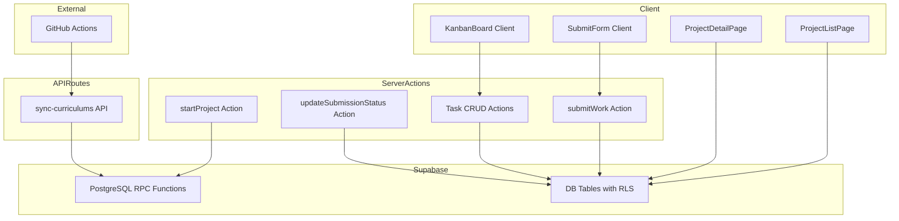
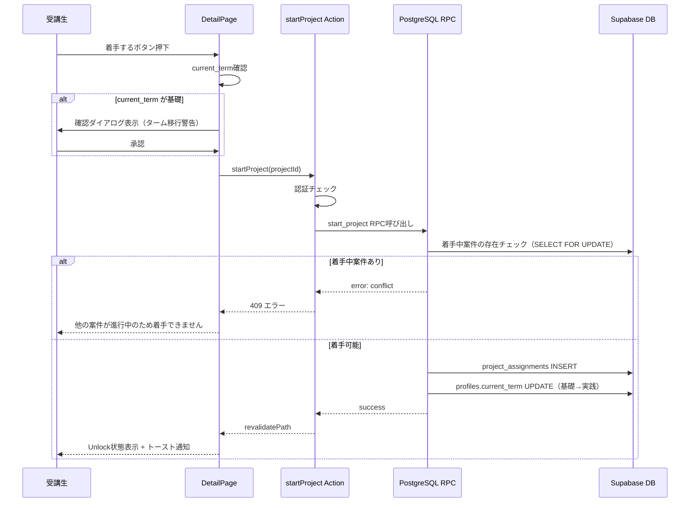
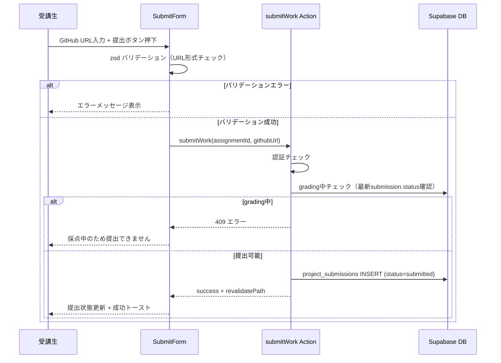
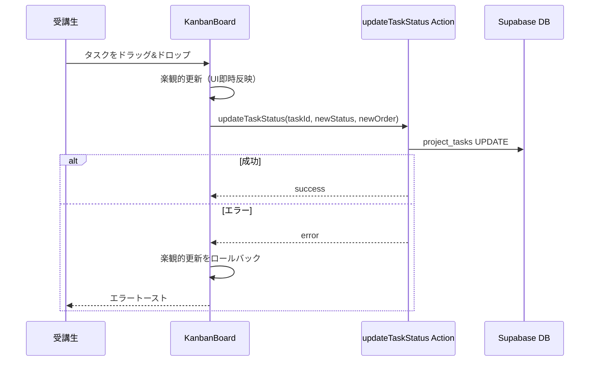
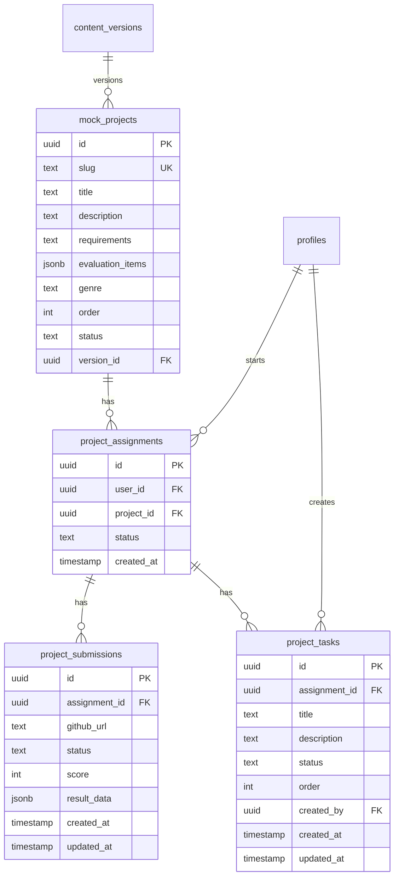

# 技術設計書: mock-projects（模擬案件機能）

## Overview

本機能は、LMS（社内研修学習管理システム）の受講生（User）に対して、模擬案件の一覧閲覧、案件詳細の確認（Lock/Unlock）、成果物（GitHub URL）の提出フロー、およびカンバンボード形式のタスク管理を提供する。案件マスタは GitHub から JSON 形式で同期される Docs as Code アーキテクチャに従い、既存の同期 API（`/api/admin/sync-curriculums`）に統合する。

**Users**: 受講生（User）が模擬案件の閲覧・着手・提出・タスク管理を行う。Super Admin は採点ステータスの手動変更およびタスク編集を行う。Manager はコンテンツへのアクセス権限を持たないため、本機能の対象外。

**Impact**: 新規テーブル4つ（`mock_projects`, `project_assignments`, `project_submissions`, `project_tasks`）の追加、既存の同期 API の拡張、Middleware への模擬案件パスの `graduation_date` チェック追加を伴う。

### Goals
- 受講生が模擬案件を一覧で確認し、着手・提出できるフローを提供する
- 排他制御（1案件制限 + 採点中提出制限）により学習の集中と評価プロセスの整合性を保つ
- カンバンボードによるタスク管理で案件の進捗を可視化する
- 既存の Docs as Code アーキテクチャに統合し、コンテンツ管理の一貫性を維持する

### Non-Goals
- Super Admin 向け採点機能（手動 graded 変更権限を除く）
- スキルレポート閲覧機能
- Super Admin 向け archive 警告 UI（着手済みユーザー数の表示）
- リアルタイム共同編集（カンバンボードはシングルユーザー操作を前提とする）

## Architecture

### Existing Architecture Analysis

現行システムは以下のパターンを採用しており、本機能もこれらを踏襲する。

- **Server Components 優先**: Page レベルで Supabase クライアントを生成しデータフェッチ。Client Component は必要最小限（ボタン操作、D&D 等）
- **Server Actions**: mutation 処理は `"use server"` 関数で実行（例: `markAsRead`, `updateDefaultGenre`）
- **Supabase RLS**: 全テーブルに RLS 適用。User は自身のデータのみ参照・作成可能
- **searchParams によるフィルタ/状態管理**: `?genre=`, `?page=` パラメータの使用パターンが確立済み
- **同期 API + RPC パターン**: GitHub Actions から `/api/admin/sync-curriculums` を呼び出し、Supabase RPC で UPSERT 処理

### Architecture Pattern & Boundary Map



**Architecture Integration**:
- **Selected pattern**: Server Components + Server Actions（既存パターン踏襲）
- **Domain boundaries**: 模擬案件ドメインを `app/(authenticated)/projects/` 配下に集約。Server Actions は `projects/actions.ts` に配置
- **Existing patterns preserved**: Supabase RLS, searchParams フィルタ, Server Actions, RPC 同期パターン
- **New components rationale**: カンバンボードは D&D インタラクションが必要なため Client Component として新設。排他制御は RPC 関数でトランザクション保証
- **Steering compliance**: TypeScript strict mode, `any` 禁止, Server Components 優先, RLS 必須

### Technology Stack

| Layer | Choice / Version | Role in Feature | Notes |
|-------|------------------|-----------------|-------|
| Frontend | Next.js 16 / React 19 | ページルーティング、Server Components、Server Actions | 既存スタック |
| UI Components | shadcn/ui / Radix UI | タブ、バッジ、ボタン、ダイアログ、フォーム | 既存スタック |
| D&D Library | @dnd-kit/react v0.3.2 | カンバンボードのドラッグ&ドロップ | React 19 動作実績あり。0.x だが現時点で最適 |
| State Management | React useState / useTransition / useOptimistic | カンバンの楽観的更新、フォーム状態 | 追加ライブラリ不要 |
| Form Validation | zod + react-hook-form | GitHub URL バリデーション | 既存スタック |
| Backend | Supabase PostgreSQL + RPC | データ永続化、排他制御、同期処理 | 既存スタック |
| Toast | sonner | 操作完了通知 | 既存スタック |

## 設計決定事項（確定済み）

### TBD-D1: ドラッグ&ドロップライブラリ → **@dnd-kit/react を採用**

- **選定**: `@dnd-kit/react` v0.3.2
- **理由**: React 19 + Next.js 16 環境での動作実績があり、低レベル API によるカスタマイズ自由度が高い
- **リスク**: semver 0.x のため API 変更リスクあり。バージョンを固定して運用する
- **対抗案として検討した @hello-pangea/dnd**: peer dependency が React 18 に制約されており、React 19 環境では非推奨

### TBD-D2: 排他制御のトランザクション → **PostgreSQL RPC 関数を採用**

- **選定**: PostgreSQL RPC 関数（`start_project`）
- **理由**: `SELECT ... FOR UPDATE` による行ロックでトランザクション保証が可能。データ整合性の保証が最優先
- **既存パターン**: `sync_content_version`, `sync_quiz_data` RPC で確立済みのパターンを踏襲
- **対抗案として検討した Server Action 内逐次クエリ**: Supabase JS クライアントでは明示的トランザクション制御が困難で、race condition リスクがあるため不採用

## System Flows

### 着手操作フロー（排他制御 + ターム移行）



### 成果物提出フロー



### タスクステータス変更フロー（カンバン D&D）



## Requirements Traceability

| Requirement | Summary | Components | Interfaces | Flows |
|-------------|---------|------------|------------|-------|
| 1.1-1.10 | 模擬案件一覧表示 | ProjectListPage, ProjectCard, GenreSelect | fetchProjects query | - |
| 2.1-2.7 | 詳細 Lock 状態 | ProjectDetailPage, StartProjectButton, ConfirmDialog | startProject Action | 着手操作フロー |
| 3.1-3.5 | 詳細 Unlock 状態（着手操作） | ProjectDetailPage, TabContainer | startProject Action, start_project RPC | 着手操作フロー |
| 4.1-4.4 | ターム自動移行 | StartProjectButton, ConfirmDialog | startProject Action, start_project RPC | 着手操作フロー |
| 5.1-5.8 | 成果物提出 | SubmissionTab, SubmitForm | submitWork Action | 成果物提出フロー |
| 6.1-6.7 | 排他制御 | StartProjectButton, SubmitForm | startProject Action, submitWork Action, start_project RPC | 着手操作フロー, 成果物提出フロー |
| 7.1-7.3 | 提出状態表示 | HistoryTab, SubmissionList, SubmissionPagination | fetchSubmissions query | - |
| 8.1-8.5 | アクセス制御 | Middleware, RLS Policies | - | - |
| 9.1-9.8 | データ同期 | sync-curriculums API, sync_mock_project_data RPC | SyncAPI 拡張 | - |
| 10.1-10.4 | タブ構成 | ProjectDetailPage, TabContainer, TabNavigation | searchParams tab | - |
| 11.1-11.6 | タスク管理（カンバン） | TasksTab, KanbanBoard, KanbanColumn, TaskCard, TaskDialog | createTask, updateTaskStatus, updateTask, deleteTask Actions | タスクステータス変更フロー |

## Components and Interfaces

| Component | Domain/Layer | Intent | Req Coverage | Key Dependencies | Contracts |
|-----------|--------------|--------|--------------|------------------|-----------|
| ProjectListPage | UI/Page | 模擬案件一覧の Server Component | 1.1-1.10 | Supabase (P0), GenreSelect (P1) | - |
| ProjectCard | UI/Presentation | 案件カード表示 | 1.2, 1.10 | - | - |
| GenreSelect | UI/Client | ジャンルフィルタドロップダウン | 1.8, 1.9 | searchParams (P0) | State |
| ProjectDetailPage | UI/Page | 案件詳細の Server Component（Lock/Unlock分岐） | 2.1-2.7, 3.2-3.4, 10.1-10.4 | Supabase (P0), TabContainer (P1) | - |
| TabNavigation | UI/Client | タブ切替 UI（searchParams 更新） | 10.2, 10.4 | useSearchParams (P0) | State |
| StartProjectButton | UI/Client | 着手ボタン + 確認ダイアログ | 2.2, 2.4-2.6, 3.1 | startProject Action (P0) | Service |
| SubmissionTab | UI/Server | 成果物提出タブ | 5.1, 5.2 | SubmitForm (P1) | - |
| SubmitForm | UI/Client | GitHub URL 提出フォーム | 5.3-5.8 | submitWork Action (P0), zod (P1) | Service |
| HistoryTab | UI/Server | 提出履歴タブ（ページネーション付き） | 7.1-7.3 | Supabase (P0) | - |
| TasksTab | UI/Server | タスク管理タブ（カンバンラッパー） | 11.1, 11.6 | KanbanBoard (P0) | - |
| KanbanBoard | UI/Client | カンバンボード本体（D&D） | 11.1, 11.4 | D&D Library (P0), Task Actions (P0) | State |
| TaskCard | UI/Client | タスクカード表示 | 11.3 | - | - |
| TaskDialog | UI/Client | タスク作成・編集ダイアログ | 11.2, 11.3 | createTask/updateTask Actions (P0) | Service |
| startProject Action | Server Action | 着手操作（排他制御 + ターム移行） | 3.1, 4.1-4.3, 6.1-6.4, 6.6 | start_project RPC (P0) | Service |
| submitWork Action | Server Action | 成果物提出 | 5.3, 5.8, 6.5, 6.6 | Supabase (P0) | Service |
| Task CRUD Actions | Server Action | タスク作成・更新・削除・並び替え | 11.2-11.4 | Supabase (P0) | Service |
| updateSubmissionStatus Action | Server Action | Super Admin によるステータス手動変更 | 6.7 | Supabase Admin (P0) | Service |
| start_project RPC | DB/Function | 排他制御 + 着手 + ターム移行トランザクション | 3.1, 4.1-4.3, 6.1-6.4 | PostgreSQL (P0) | Service |
| sync_mock_project_data RPC | DB/Function | 模擬案件データの UPSERT + archive | 9.1-9.8 | PostgreSQL (P0) | Service |
| RLS Policies | DB/Security | 行レベルセキュリティ | 8.2-8.5 | Supabase Auth (P0) | - |

### UI Layer

#### ProjectListPage

| Field | Detail |
|-------|--------|
| Intent | 模擬案件一覧を表示する Server Component。ジャンルフィルタ・着手状況バッジを含む |
| Requirements | 1.1, 1.2, 1.3, 1.4, 1.5, 1.6, 1.7, 1.8, 1.9, 1.10 |

**Responsibilities & Constraints**
- `mock_projects` テーブルから active 案件を `order` 昇順で取得
- `project_assignments` と `project_submissions` を LEFT JOIN して受講生ごとの着手状況を導出
- archived 案件は着手済みユーザーにのみ表示（1.6, 1.7）
- searchParams `?genre=` でフィルタ。未指定時は `profiles.default_genre` をフォールバック

**Dependencies**
- Inbound: なし
- Outbound: ProjectCard -- カード描画 (P1), GenreSelect -- フィルタ UI (P1)
- External: Supabase -- データフェッチ (P0)

**Implementation Notes**
- ファイルパス: `app/(authenticated)/projects/page.tsx`
- 着手状況の導出ロジック: assignment 未作成=未着手、assignment 有+submission 無=着手済み、直近 submission のステータスに準拠（submitted/grading/graded/rejected）
- 既存の `contents` 一覧ページのパターン（Server Component + searchParams）を踏襲

#### ProjectDetailPage

| Field | Detail |
|-------|--------|
| Intent | 案件詳細を表示する Server Component。Lock/Unlock 状態に応じて表示を分岐する |
| Requirements | 2.1-2.7, 3.2-3.4, 10.1-10.4 |

**Responsibilities & Constraints**
- slug パラメータで案件を特定
- Lock 状態（assignment 未作成）: タイトル + description 表示、着手ボタン表示、タブバー非表示
- Unlock 状態（assignment 存在）: タブ構成表示（案件要件/タスク管理/成果物提出/提出履歴）
- searchParams `?tab=` でアクティブタブ管理、デフォルトは `requirements`

**Dependencies**
- Outbound: TabNavigation (P1), StartProjectButton (P1), SubmissionTab (P1), TasksTab (P1), HistoryTab (P1)
- External: Supabase (P0)

**Contracts**: State

##### State Management
- **State model**: `?tab=requirements|tasks|submission|history` を URL searchParams で管理
- **Persistence**: URL ベース（ブックマーク・共有可能）
- **Concurrency**: Server Component の再レンダリングで常に最新データを表示

**Implementation Notes**
- ファイルパス: `app/(authenticated)/projects/[slug]/page.tsx`
- Lock/Unlock の判定は Server Component 内で assignment の存在を確認
- タブコンテンツは条件分岐で描画（Parallel Routes は使用しない。単一ページ内での分岐がシンプル）

#### TabNavigation

| Field | Detail |
|-------|--------|
| Intent | タブ切替 UI を提供する Client Component。searchParams を更新する |
| Requirements | 10.2, 10.4 |

**Responsibilities & Constraints**
- 4つのタブ（案件要件/タスク管理/成果物提出/提出履歴）を表示
- タブクリック時に `router.replace` で `?tab=` パラメータを更新
- アクティブタブのスタイリング

**Dependencies**
- External: useSearchParams, useRouter (P0)

**Contracts**: State

##### State Management
```typescript
type TabKey = "requirements" | "tasks" | "submission" | "history"

interface TabNavigationProps {
  activeTab: TabKey
}
```

**Implementation Notes**
- `"use client"` コンポーネント
- `useSearchParams()` で現在のタブを取得、`useRouter().replace()` で URL 更新
- 既存の searchParams パターン（`?genre=` 等）と共存可能

#### KanbanBoard

| Field | Detail |
|-------|--------|
| Intent | 4カラムカンバンボード（D&D 対応）を提供する Client Component |
| Requirements | 11.1, 11.2, 11.4 |

**Responsibilities & Constraints**
- 4カラム: backlog / todo / in_progress / done
- ドラッグ&ドロップによるカラム間移動と並び替え
- 楽観的更新: UI を即時更新し、Server Action の結果に応じてロールバック
- 受講生および Super Admin のみ編集可能（Manager は閲覧不可: RLS で制御）

**Dependencies**
- Inbound: TasksTab -- 初期タスクデータを props で受け取る (P0)
- Outbound: TaskCard (P1), TaskDialog (P1)
- External: @dnd-kit/react (P0), updateTaskStatus Action (P0), updateTaskOrder Action (P0)

**Contracts**: State

##### State Management
```typescript
type TaskStatus = "backlog" | "todo" | "in_progress" | "done"

interface KanbanTask {
  id: string
  title: string
  description: string | null
  status: TaskStatus
  order: number
  createdBy: string
}

interface KanbanBoardProps {
  assignmentId: string
  initialTasks: KanbanTask[]
  canEdit: boolean
}
```
- **State model**: `useState` でローカルタスク配列を管理。D&D イベントで楽観的にステータス・順序を更新
- **Persistence**: `updateTaskStatus` / `updateTaskOrder` Server Actions でサーバーに永続化
- **Concurrency**: `useTransition` で非同期処理中の UI フィードバック。エラー時はローカル状態をロールバック

**Implementation Notes**
- D&D ライブラリは `@dnd-kit/react` v0.3.2 を使用する
- カラムの定義は定数として抽出し、ステータス名と表示ラベルをマッピング

#### StartProjectButton

| Field | Detail |
|-------|--------|
| Intent | 着手ボタン + 確認ダイアログを提供する Client Component |
| Requirements | 2.2, 2.4, 2.5, 2.6, 3.1, 4.4, 6.6 |

**Responsibilities & Constraints**
- Lock 状態のときのみ表示
- 他案件が進行中の場合はボタン非活性 + 警告メッセージ（フロント側の排他チェック）
- `current_term === '基礎'` の場合はターム移行警告付き確認ダイアログ表示
- `current_term === '実践'` の場合は即座に着手処理実行

**Dependencies**
- External: startProject Action (P0), shadcn/ui Dialog (P1)

**Contracts**: Service

##### Service Interface
```typescript
interface StartProjectButtonProps {
  projectId: string
  currentTerm: string | null
  hasActiveAssignment: boolean
}
```

**Implementation Notes**
- `useTransition` で着手処理中のローディング表示
- Server Action の戻り値でエラー/成功を判定し、トースト通知を表示

#### SubmitForm

| Field | Detail |
|-------|--------|
| Intent | GitHub URL 提出フォームを提供する Client Component |
| Requirements | 5.1-5.8, 6.5, 6.6 |

**Responsibilities & Constraints**
- GitHub URL 入力フィールドと「提出する」ボタン
- zod による URL 形式バリデーション（`https://github.com/` で始まる）
- grading 中の場合はフォーム非活性
- archived 案件の場合はフォーム非表示 + メッセージ

**Dependencies**
- External: submitWork Action (P0), zod (P1), react-hook-form (P1)

**Contracts**: Service

##### Service Interface
```typescript
const githubUrlSchema = z.string()
  .url()
  .regex(/^https:\/\/github\.com\//, "GitHub の URL を入力してください")

interface SubmitFormProps {
  assignmentId: string
  isGrading: boolean
  isArchived: boolean
}
```

### Server Actions Layer

#### startProject Action

| Field | Detail |
|-------|--------|
| Intent | 着手操作の Server Action。排他制御チェック + assignment 作成 + ターム移行をトランザクションで実行 |
| Requirements | 3.1, 4.1, 4.2, 4.3, 6.1, 6.2, 6.3, 6.4, 6.6 |

**Responsibilities & Constraints**
- 認証チェック（未認証はエラー返却）
- `start_project` RPC 関数を呼び出して排他制御 + 着手 + ターム移行を単一トランザクションで実行
- RPC がエラー（conflict）を返した場合は HTTP 409 相当のエラーを返却
- 成功時は `revalidatePath` で詳細ページを再検証

**Dependencies**
- External: Supabase RPC (P0)

**Contracts**: Service

##### Service Interface
```typescript
interface StartProjectResult {
  success: boolean
  message: string
  termChanged?: boolean
}

function startProject(
  projectId: string
): Promise<StartProjectResult>
```
- Preconditions: ユーザーが認証済みであること
- Postconditions: `project_assignments` に1レコード追加。必要に応じて `profiles.current_term` が `実践` に更新
- Invariants: 同一ユーザーの着手中案件は最大1件

**Implementation Notes**
- ファイルパス: `app/(authenticated)/projects/actions.ts`
- `"use server"` ディレクティブ
- RPC 呼び出しパターンは既存の `sync_content_version` と同様

#### submitWork Action

| Field | Detail |
|-------|--------|
| Intent | 成果物提出の Server Action |
| Requirements | 5.3, 5.8, 6.5, 6.6 |

**Responsibilities & Constraints**
- 認証チェック
- grading 中の提出を拒否（HTTP 409 相当）
- `project_submissions` に `status='submitted'` でレコード作成
- 成功時は `revalidatePath` で詳細ページを再検証

**Dependencies**
- External: Supabase (P0)

**Contracts**: Service

##### Service Interface
```typescript
interface SubmitWorkResult {
  success: boolean
  message: string
}

function submitWork(
  assignmentId: string,
  githubUrl: string
): Promise<SubmitWorkResult>
```
- Preconditions: ユーザーが認証済み、assignment が存在、grading 中でないこと
- Postconditions: `project_submissions` に1レコード追加

#### Task CRUD Actions

| Field | Detail |
|-------|--------|
| Intent | タスクの作成・更新・削除・並び替えの Server Actions |
| Requirements | 11.2, 11.3, 11.4 |

**Responsibilities & Constraints**
- 認証チェック + ロール確認（User: 自身の assignment のタスクのみ、Super Admin: 全タスク）
- Manager は編集不可（RLS + Server Action 側で二重チェック）

**Dependencies**
- External: Supabase (P0)

**Contracts**: Service

##### Service Interface
```typescript
interface TaskResult {
  success: boolean
  message: string
  task?: {
    id: string
    title: string
    description: string | null
    status: TaskStatus
    order: number
  }
}

function createTask(
  assignmentId: string,
  title: string,
  description: string | null,
  status: TaskStatus
): Promise<TaskResult>

function updateTask(
  taskId: string,
  title: string,
  description: string | null
): Promise<TaskResult>

function updateTaskStatus(
  taskId: string,
  status: TaskStatus,
  order: number
): Promise<TaskResult>

function deleteTask(
  taskId: string
): Promise<{ success: boolean; message: string }>
```

#### updateSubmissionStatus Action

| Field | Detail |
|-------|--------|
| Intent | Super Admin がsubmission のステータスを手動変更する Server Action |
| Requirements | 6.7 |

**Responsibilities & Constraints**
- Super Admin ロール限定
- `graded` への手動変更を許可（長期 rejected の異常系ブロック解除用）

**Dependencies**
- External: Supabase Admin Client (P0)

**Contracts**: Service

##### Service Interface
```typescript
function updateSubmissionStatus(
  submissionId: string,
  status: "graded"
): Promise<{ success: boolean; message: string }>
```

### Database Layer

#### start_project RPC

| Field | Detail |
|-------|--------|
| Intent | 排他制御チェック + 着手記録作成 + ターム移行を単一トランザクションで実行する PostgreSQL 関数 |
| Requirements | 3.1, 4.1, 4.2, 4.3, 6.1, 6.2, 6.3, 6.4 |

**Responsibilities & Constraints**
- 同一ユーザーの着手中案件（直近 submission が `graded` でない assignment）の存在チェック
- `SELECT ... FOR UPDATE` で race condition を防止
- assignment INSERT + ターム更新を同一トランザクション内で処理
- 排他制御違反時は例外を raise してトランザクションをロールバック

**Dependencies**
- External: PostgreSQL (P0)

**Contracts**: Service

##### Service Interface
```sql
-- RPC 関数シグネチャ
CREATE OR REPLACE FUNCTION start_project(
  p_user_id UUID,
  p_project_id UUID
) RETURNS JSONB AS $$
-- Returns: { "assignment_id": UUID, "term_changed": BOOLEAN }
-- Raises: EXCEPTION 'USER_HAS_ACTIVE_PROJECT' (排他制御違反時)
$$
```
- Preconditions: p_user_id が有効な profiles.id、p_project_id が有効な mock_projects.id
- Postconditions: project_assignments に1レコード追加。条件を満たす場合 profiles.current_term を更新
- Invariants: 着手中案件は同一ユーザーに最大1件

#### sync_mock_project_data RPC

| Field | Detail |
|-------|--------|
| Intent | GitHub から同期された模擬案件データの UPSERT + archive 処理 |
| Requirements | 9.1, 9.3, 9.4, 9.7, 9.8 |

**Responsibilities & Constraints**
- `slug` をキーとして UPSERT（既存案件の更新 + 新規案件の作成）
- 同期元に存在しない案件の `status` を `archived` に設定（論理削除）
- `version_id` を受け取り、content_versions との紐付けを維持

**Dependencies**
- External: PostgreSQL (P0)

**Contracts**: Service

##### Service Interface
```sql
CREATE OR REPLACE FUNCTION sync_mock_project_data(
  p_version_id UUID,
  p_mock_projects JSONB
) RETURNS JSONB AS $$
-- Returns: { "mock_project_changes_summary": { "added": INT, "updated": INT, "deleted": INT } }
$$
```

## Data Models

### Domain Model



**Aggregates and Transactional Boundaries**:
- **MockProject Aggregate**: `mock_projects` は同期 API で管理されるマスタデータ。読み取り専用（受講生からの変更不可）
- **Assignment Aggregate**: `project_assignments` を aggregate root として、`project_submissions` と `project_tasks` を子エンティティとする。着手操作は `start_project` RPC で排他制御
- **Business Invariants**:
  - 同一ユーザーの着手中案件は最大1件
  - grading 中の案件への再提出は不可
  - assignment の status は `started` のみ（提出状態は submissions で管理）

### Physical Data Model

#### mock_projects テーブル

```sql
CREATE TABLE mock_projects (
  id UUID PRIMARY KEY DEFAULT gen_random_uuid(),
  slug TEXT NOT NULL UNIQUE,
  title TEXT NOT NULL,
  description TEXT,
  requirements TEXT,
  evaluation_items JSONB DEFAULT '[]'::JSONB,
  genre TEXT NOT NULL CHECK (genre IN ('engineering', 'design')),
  "order" INTEGER NOT NULL DEFAULT 0,
  status TEXT NOT NULL DEFAULT 'active' CHECK (status IN ('active', 'archived')),
  version_id UUID NOT NULL REFERENCES content_versions(id),
  created_at TIMESTAMPTZ NOT NULL DEFAULT NOW(),
  updated_at TIMESTAMPTZ NOT NULL DEFAULT NOW()
);

CREATE INDEX idx_mock_projects_genre ON mock_projects(genre);
CREATE INDEX idx_mock_projects_status_order ON mock_projects(status, "order");
CREATE INDEX idx_mock_projects_version_id ON mock_projects(version_id);
```

#### project_assignments テーブル

```sql
CREATE TABLE project_assignments (
  id UUID PRIMARY KEY DEFAULT gen_random_uuid(),
  user_id UUID NOT NULL REFERENCES profiles(id) ON DELETE CASCADE,
  project_id UUID NOT NULL REFERENCES mock_projects(id) ON DELETE CASCADE,
  status TEXT NOT NULL DEFAULT 'started' CHECK (status IN ('started')),
  created_at TIMESTAMPTZ NOT NULL DEFAULT NOW(),
  UNIQUE(user_id, project_id)
);

CREATE INDEX idx_project_assignments_user_id ON project_assignments(user_id);
CREATE INDEX idx_project_assignments_project_id ON project_assignments(project_id);
```

#### project_submissions テーブル

```sql
CREATE TABLE project_submissions (
  id UUID PRIMARY KEY DEFAULT gen_random_uuid(),
  assignment_id UUID NOT NULL REFERENCES project_assignments(id) ON DELETE CASCADE,
  github_url TEXT NOT NULL,
  status TEXT NOT NULL DEFAULT 'submitted'
    CHECK (status IN ('submitted', 'grading', 'graded', 'rejected')),
  score INTEGER,
  result_data JSONB,
  created_at TIMESTAMPTZ NOT NULL DEFAULT NOW(),
  updated_at TIMESTAMPTZ NOT NULL DEFAULT NOW()
);

CREATE INDEX idx_project_submissions_assignment_id ON project_submissions(assignment_id);
CREATE INDEX idx_project_submissions_status ON project_submissions(status);
CREATE INDEX idx_project_submissions_created_at ON project_submissions(assignment_id, created_at DESC);
```

#### project_tasks テーブル

```sql
CREATE TABLE project_tasks (
  id UUID PRIMARY KEY DEFAULT gen_random_uuid(),
  assignment_id UUID NOT NULL REFERENCES project_assignments(id) ON DELETE CASCADE,
  title TEXT NOT NULL,
  description TEXT,
  status TEXT NOT NULL DEFAULT 'backlog'
    CHECK (status IN ('backlog', 'todo', 'in_progress', 'done')),
  "order" INTEGER NOT NULL DEFAULT 0,
  created_by UUID NOT NULL REFERENCES profiles(id),
  created_at TIMESTAMPTZ NOT NULL DEFAULT NOW(),
  updated_at TIMESTAMPTZ NOT NULL DEFAULT NOW()
);

CREATE INDEX idx_project_tasks_assignment_id ON project_tasks(assignment_id);
CREATE INDEX idx_project_tasks_status_order ON project_tasks(assignment_id, status, "order");
```

### RLS Policies

#### mock_projects

```sql
ALTER TABLE mock_projects ENABLE ROW LEVEL SECURITY;

-- User: active 案件は全件閲覧可能。archived は着手済みの場合のみ閲覧可能
CREATE POLICY "Users can view active mock_projects"
  ON mock_projects FOR SELECT
  TO authenticated
  USING (
    status = 'active'
    OR EXISTS (
      SELECT 1 FROM project_assignments pa
      WHERE pa.project_id = mock_projects.id
      AND pa.user_id = auth.uid()
    )
  );

-- Manager: アクセス不可（ポリシーなし = 全拒否）
-- Super Admin: service_role 経由でアクセス（RLS バイパス）

-- Manager を明示的にブロック
CREATE POLICY "Managers cannot access mock_projects"
  ON mock_projects FOR SELECT
  TO authenticated
  USING (
    NOT EXISTS (
      SELECT 1 FROM profiles
      WHERE profiles.id = auth.uid()
      AND profiles.role = 'manager'
    )
  );
```

> **Note**: Manager のブロックは RLS ポリシーの組み合わせで実現する。Supabase の RLS はポリシーが OR 条件で評価されるため、Manager ブロックポリシーを追加で設定する。実装時に RESTRICTIVE ポリシー（`AS RESTRICTIVE`）の使用を検討すること。

#### project_assignments

```sql
ALTER TABLE project_assignments ENABLE ROW LEVEL SECURITY;

-- User: 自身の assignment のみ参照可能
CREATE POLICY "Users can view own assignments"
  ON project_assignments FOR SELECT
  TO authenticated
  USING (user_id = auth.uid());

-- User: 自身の assignment のみ作成可能
CREATE POLICY "Users can create own assignments"
  ON project_assignments FOR INSERT
  TO authenticated
  WITH CHECK (user_id = auth.uid());
```

#### project_submissions

```sql
ALTER TABLE project_submissions ENABLE ROW LEVEL SECURITY;

-- User: 自身の assignment に紐づく submission のみ参照可能
CREATE POLICY "Users can view own submissions"
  ON project_submissions FOR SELECT
  TO authenticated
  USING (
    EXISTS (
      SELECT 1 FROM project_assignments pa
      WHERE pa.id = project_submissions.assignment_id
      AND pa.user_id = auth.uid()
    )
  );

-- User: 自身の assignment に紐づく submission のみ作成可能
CREATE POLICY "Users can create own submissions"
  ON project_submissions FOR INSERT
  TO authenticated
  WITH CHECK (
    EXISTS (
      SELECT 1 FROM project_assignments pa
      WHERE pa.id = assignment_id
      AND pa.user_id = auth.uid()
    )
  );
```

#### project_tasks

```sql
ALTER TABLE project_tasks ENABLE ROW LEVEL SECURITY;

-- User: 自身の assignment に紐づくタスクのみ参照可能
CREATE POLICY "Users can view own tasks"
  ON project_tasks FOR SELECT
  TO authenticated
  USING (
    EXISTS (
      SELECT 1 FROM project_assignments pa
      WHERE pa.id = project_tasks.assignment_id
      AND pa.user_id = auth.uid()
    )
  );

-- User: 自身の assignment に紐づくタスクの作成・更新・削除が可能
CREATE POLICY "Users can manage own tasks"
  ON project_tasks FOR ALL
  TO authenticated
  USING (
    EXISTS (
      SELECT 1 FROM project_assignments pa
      WHERE pa.id = project_tasks.assignment_id
      AND pa.user_id = auth.uid()
    )
  )
  WITH CHECK (
    EXISTS (
      SELECT 1 FROM project_assignments pa
      WHERE pa.id = project_tasks.assignment_id
      AND pa.user_id = auth.uid()
    )
  );

-- Super Admin: service_role 経由で全タスク編集可能（RLS バイパス）
-- Manager: ポリシーなし = アクセス不可
```

### Data Contracts & Integration

#### 同期 API ペイロード拡張

```typescript
// 既存の SyncRequest に mock_projects フィールドを追加
interface SyncMockProjectItem {
  slug: string
  title: string
  description: string | null
  requirements: string | null
  evaluation_items: EvaluationItem[]
  genre: "engineering" | "design"
  order: number
  status: "active" | "archived"
}

interface EvaluationItem {
  id: string
  category: string
  criteria: string
  weight: number
}

// SyncRequest の拡張
interface SyncRequest {
  contents: SyncContentItem[]
  quizzes?: SyncQuizItem[]
  mock_projects?: SyncMockProjectItem[]  // 新規追加
  commit_hash?: string
  commit_message?: string
}
```

#### Database 型定義の拡張

```typescript
// lib/types/database.ts に追加する型定義
mock_projects: {
  Row: {
    id: string
    slug: string
    title: string
    description: string | null
    requirements: string | null
    evaluation_items: EvaluationItem[]
    genre: "engineering" | "design"
    order: number
    status: "active" | "archived"
    version_id: string
    created_at: string
    updated_at: string
  }
  Insert: { /* 同様の構造（id, created_at, updated_at はオプショナル） */ }
  Update: { /* 全フィールドオプショナル */ }
  Relationships: [
    {
      foreignKeyName: "mock_projects_version_id_fkey"
      columns: ["version_id"]
      referencedRelation: "content_versions"
      referencedColumns: ["id"]
    }
  ]
}

project_assignments: {
  Row: {
    id: string
    user_id: string
    project_id: string
    status: "started"
    created_at: string
  }
  Insert: { /* id, status, created_at はオプショナル */ }
  Update: { /* 全フィールドオプショナル */ }
  Relationships: [
    {
      foreignKeyName: "project_assignments_user_id_fkey"
      columns: ["user_id"]
      referencedRelation: "profiles"
      referencedColumns: ["id"]
    },
    {
      foreignKeyName: "project_assignments_project_id_fkey"
      columns: ["project_id"]
      referencedRelation: "mock_projects"
      referencedColumns: ["id"]
    }
  ]
}

project_submissions: {
  Row: {
    id: string
    assignment_id: string
    github_url: string
    status: "submitted" | "grading" | "graded" | "rejected"
    score: number | null
    result_data: Record<string, unknown> | null
    created_at: string
    updated_at: string
  }
  Insert: { /* id, status, score, result_data, created_at, updated_at はオプショナル */ }
  Update: { /* 全フィールドオプショナル */ }
  Relationships: [
    {
      foreignKeyName: "project_submissions_assignment_id_fkey"
      columns: ["assignment_id"]
      referencedRelation: "project_assignments"
      referencedColumns: ["id"]
    }
  ]
}

project_tasks: {
  Row: {
    id: string
    assignment_id: string
    title: string
    description: string | null
    status: "backlog" | "todo" | "in_progress" | "done"
    order: number
    created_by: string
    created_at: string
    updated_at: string
  }
  Insert: { /* id, description, status, order, created_at, updated_at はオプショナル */ }
  Update: { /* 全フィールドオプショナル */ }
  Relationships: [
    {
      foreignKeyName: "project_tasks_assignment_id_fkey"
      columns: ["assignment_id"]
      referencedRelation: "project_assignments"
      referencedColumns: ["id"]
    },
    {
      foreignKeyName: "project_tasks_created_by_fkey"
      columns: ["created_by"]
      referencedRelation: "profiles"
      referencedColumns: ["id"]
    }
  ]
}
```

## Error Handling

### Error Strategy

本機能のエラーは以下の3カテゴリに分類し、各 Server Action で一貫したエラーレスポンス形式（`{ success: boolean; message: string }`）を使用する。

### Error Categories and Responses

**User Errors (4xx)**:
- **未認証**: Server Action 内で `auth.getUser()` 確認。未認証の場合は `{ success: false, message: "認証されていません..." }` を返却
- **バリデーションエラー**: zod スキーマによる GitHub URL の形式チェック。Client Component 側で即時フィードバック
- **排他制御違反 (409)**: 着手中案件がある場合、grading 中に提出しようとした場合。フロント側のボタン非活性 + Server Action の二重防御

**System Errors (5xx)**:
- **DB エラー**: Supabase クエリ/RPC のエラー。`console.error` でログ出力し、ユーザーには汎用メッセージを表示
- **RPC 例外**: `start_project` 関数の EXCEPTION。Server Action 側でキャッチしエラーメッセージに変換

**Business Logic Errors (422)**:
- **archived 案件への提出試行**: フォーム非表示 + メッセージ表示で事前防止
- **Manager によるタスク編集試行**: RLS で遮断 + Server Action 側でロールチェック

## Testing Strategy

### Unit Tests
- `githubUrlSchema` のバリデーション（有効/無効な URL パターン）
- 着手状況の導出ロジック（assignment/submission の組み合わせごとのステータス判定）
- タブキーのバリデーション（有効/無効な tab パラメータ）
- カンバンボードの楽観的更新ロジック（ステータス変更、順序更新）

### Integration Tests
- `startProject` Server Action: 排他制御の正常系（着手成功 + ターム移行）と異常系（着手中案件あり）
- `submitWork` Server Action: 正常提出、grading 中の提出拒否、バリデーションエラー
- Task CRUD Actions: タスクの作成・更新・削除、権限チェック（Manager の編集拒否）
- 同期 API 拡張: `mock_projects` フィールド付きペイロードの UPSERT + archive 処理

### E2E Tests
- 一覧ページ: ジャンルフィルタ切替、案件カードのクリック遷移
- 詳細ページ: Lock 状態 → 着手 → Unlock 状態遷移、タブ切替
- 提出フロー: GitHub URL 入力 → 提出 → 提出履歴への反映
- カンバンボード: タスク作成 → D&D によるステータス変更 → 永続化確認

## Security Considerations

### RLS 設計方針
- 全4テーブルに RLS を適用
- User: 自身のデータのみアクセス可能（`auth.uid()` ベース）
- Manager: `mock_projects` および関連テーブルへのアクセスを遮断（RESTRICTIVE ポリシー検討）
- Super Admin: `service_role` キーによる Admin Client で RLS バイパス

### 排他制御のセキュリティ
- フロントエンド: ボタン非活性化による UX レベルの制御
- Server Action: 認証チェック + ビジネスルールバリデーション
- DB: RPC 関数内の `SELECT ... FOR UPDATE` による行ロック + 排他制御

### Middleware 拡張
- `/projects` および `/projects/*` パスに対して `graduation_date` チェックを追加
- 既存の `/contents` パスと同一のロジックを適用

## Migration Strategy

### Phase 1: DB スキーマ作成
1. `mock_projects`, `project_assignments`, `project_submissions`, `project_tasks` テーブル作成
2. インデックス作成
3. RLS ポリシー設定
4. `start_project` RPC 関数作成
5. `sync_mock_project_data` RPC 関数作成

### Phase 2: 同期 API 拡張
1. `/api/admin/sync-curriculums` に `mock_projects` フィールドのバリデーション追加
2. `sync_mock_project_data` RPC 呼び出しロジック追加

### Phase 3: フロントエンド実装
1. 一覧ページ + ジャンルフィルタ
2. 詳細ページ（Lock/Unlock 状態分岐 + タブ構成）
3. 着手操作 + 排他制御
4. 成果物提出フォーム + 提出履歴
5. カンバンボード（D&D ライブラリ PoC 後に実装）

### Phase 4: 型定義・Middleware 更新
1. `lib/types/database.ts` に新テーブルの型定義追加
2. Middleware に `/projects` パスの graduation_date チェック追加
