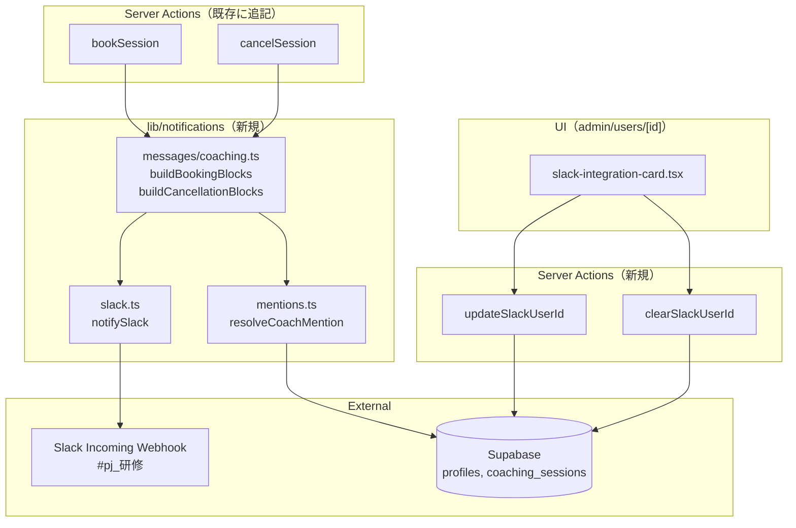

# Design Document: Notifications

## Overview

**Purpose**: コーチング新規予約・受講生キャンセルのイベント発生時に、Slack Incoming Webhook を経由して社内チャンネル `#pj_研修` へ即時通知を送る基盤を構築する。担当コーチ（Super Admin）を Slack メンションで明示し、未登録時は `@here` でフォールバックする。`profiles` テーブルに `slack_user_id` カラムを追加し、`/admin/users/[id]` 画面から Super Admin が他の Super Admin の Slack ID を登録・更新・解除できる UI を提供する。

**Users**: 主に自社コーチ（Super Admin）が `#pj_研修` チャンネルで通知を受ける。受講生（User）は通知の発生源として `bookSession` / `cancelSession` を実行するが、受講生自身への通知は本仕様では扱わない。

**Impact**:
- 既存の `bookSession` / `cancelSession` Server Action に通知送信フックを追加（呼び出し元の動作には影響しない fail-safe 設計）
- 新規モジュール `lib/notifications/` を追加
- `profiles` テーブルにマイグレーションでカラム追加（後方互換）
- `app/(authenticated)/admin/users/[id]/` に新規セクションを追加
- 環境変数 `SLACK_WEBHOOK_URL` を Vercel に追加

### Goals
- 運営チームがコーチング予約・キャンセルを Slack で即時に把握できる
- 担当コーチ個人を Slack メンションで呼び出せる
- 通知失敗が予約処理本体を阻害しない（fail-safe）
- 通知ロジックを Server Action から分離し、テスト可能な単位に整理する
- 将来の通知追加（メール、他イベント）に拡張可能な構造を残す

### Non-Goals
- 受講生宛のメール通知（B 群、別仕様）
- アプリ内通知ベル（In-App Notification Center）
- 模擬案件提出・再提出の通知（A3 / A4）
- バッチ系・運用監視通知（C 群）
- Slack 以外のチャネル（Discord / LINE / Teams）
- メッセージキューや非同期ジョブ基盤の導入

---

## Architecture

### Existing Architecture Analysis

現行アーキテクチャと制約:

- **Server Action 中心**: ユーザー操作は Server Action で完結する設計（既存 `bookSession` / `cancelSession` / `adminDisconnectGoogleCalendar` 等）
- **Supabase クライアント**: `createClient()` (Cookie ベース、RLS 適用) と `createAdminClient()` (Service Role、RLS バイパス) の2種を使い分け
- **権限チェックパターン**: `auth.getUser()` → `profiles` テーブルから `role` 取得 → 比較（既存 `adminDisconnectGoogleCalendar:25-40` に踏襲）
- **fire-and-forget 風処理の前例**: Google Calendar 連携 (`createCalendarEvent`) は失敗してもユーザー操作のレスポンスを返す設計（`coaching/actions.ts:262-277`）
- **toast 通知**: クライアント側成功/失敗フィードバックは sonner の `toast` を使用（既存 `genre-section.tsx`）
- **UI 規約**: shadcn/ui の `Card`, `Tooltip`, `Input`, `Button`, `Separator` を利用

### Architecture Pattern & Boundary Map



### Layered Responsibility

| レイヤー | 役割 | 失敗時の挙動 |
|---|---|---|
| Server Action（`bookSession` 等） | イベント発火元。通知ヘルパを `try/catch` で呼び出す | 通知失敗を握り潰し、本処理のレスポンスは成功で返す |
| メッセージビルダー（`messages/coaching.ts`） | DB から必要情報を取得し Block Kit を構築。`notifySlack` を呼ぶ | エラーログを出して return（例外を投げない） |
| メンション解決（`mentions.ts`） | `coach_id` から Slack User ID を引き、メンション文字列を返す | 取得失敗時は `<!here>` を返す |
| Slack クライアント（`slack.ts`） | Webhook URL に POST するだけ。環境変数チェック | 未設定なら no-op、HTTP 失敗はログのみ |

---

## Data Model

### Migration: `profiles.slack_user_id` 追加

**ファイル名**: `supabase/migrations/20260409170000_profiles_add_slack_user_id.sql`

```sql
-- Migration: profiles テーブルに slack_user_id カラムを追加
-- Description: Slack 通知における担当コーチのメンション機能を実現するため、
-- profiles テーブルに Slack User ID（U または W で始まる文字列）を保存するカラムを追加。
-- 既存レコードは NULL のまま運用可能（後方互換）。
-- Requirements: 4.1, 5

ALTER TABLE public.profiles
  ADD COLUMN IF NOT EXISTS slack_user_id text;

COMMENT ON COLUMN public.profiles.slack_user_id IS
  'Slack の User ID（U または W で始まる文字列）。Super Admin のみ使用。Slack 通知のメンションに利用。';
```

#### マイグレーションの判断
- **NOT NULL 制約は付けない**: 既存レコードに対する後方互換のため
- **CHECK 制約も付けない**: バリデーションはアプリケーション層で行う（柔軟な変更を許容するため）
- **インデックスは作らない**: メンション解決は `coach_id` 起点で `profiles` を1件 SELECT するだけのため、PK で十分
- **RLS 変更は不要**: `profiles` の既存 SELECT/UPDATE ポリシーで `slack_user_id` カラムも自動的にカバーされる（カラム単位の RLS は使用していない）

### 型定義への影響
`lib/types/database.ts` の `profiles` 型に `slack_user_id: string | null` が自動追加される（Supabase 型生成を再実行する必要あり）。

---

## Module Design

### File Layout

```
lms-fe/
├── lib/
│   └── notifications/
│       ├── slack.ts                      # 共通 Webhook クライアント
│       ├── mentions.ts                   # Slack ID → メンション文字列解決
│       └── messages/
│           └── coaching.ts               # A1/A2 メッセージビルダー
├── app/(authenticated)/
│   ├── coaching/
│   │   └── actions.ts                    # bookSession / cancelSession に通知フック追加
│   └── admin/users/
│       ├── actions.ts                    # updateSlackUserId / clearSlackUserId 追加
│       └── [id]/
│           ├── page.tsx                  # SlackIntegrationCard を super_admin の場合のみ表示
│           └── _components/
│               └── slack-integration-card.tsx  # 新規 UI
└── supabase/migrations/
    └── 20260409170000_profiles_add_slack_user_id.sql
```

### `lib/notifications/slack.ts`

責務: Slack Incoming Webhook への HTTP POST と環境変数チェック。

```ts
// 概要（実装時に詳細化）
type SlackBlock = Record<string, unknown>

export type SlackPayload = {
  text: string         // 通知バナー / フォールバック用要約
  blocks: SlackBlock[] // Block Kit 構造
}

/**
 * Slack Incoming Webhook へ通知を送信する。
 * - SLACK_WEBHOOK_URL 未設定時: console.warn を出して no-op（ローカル開発用）
 * - HTTP / ネットワーク失敗時: console.error を出すが例外は投げない
 */
export async function notifySlack(payload: SlackPayload): Promise<void> {
  const url = process.env.SLACK_WEBHOOK_URL
  if (!url) {
    console.warn("[notifications] SLACK_WEBHOOK_URL is not set, skipping notification")
    return
  }

  try {
    const res = await fetch(url, {
      method: "POST",
      headers: { "Content-Type": "application/json" },
      body: JSON.stringify(payload),
    })
    if (!res.ok) {
      const body = await res.text()
      console.error(`[notifications] Slack webhook failed: ${res.status} ${body}`)
    }
  } catch (err) {
    console.error("[notifications] Slack webhook network error:", err)
  }
}
```

#### 設計判断
- **`text` フィールドを必須にする**: `blocks` だけだと Slack のプッシュ通知バナーが空になるため、要約テキストも必ず含める
- **戻り値は `Promise<void>`**: 呼び出し元でハンドリング不要。エラーは内部でログに記録
- **`fetch` を直接使う**: SDK を入れると依存追加になるため、Node 標準の `fetch` で十分（Next.js 16 / Node 20+ 前提）

### `lib/notifications/mentions.ts`

責務: コーチの Slack User ID を取得し、メンション文字列を返す。

```ts
import type { SupabaseClient } from "@supabase/supabase-js"
import type { Database } from "@/lib/types/database"

/**
 * 担当コーチの Slack User ID を取得し、メンション文字列を返す。
 * - 登録済み: <@U01ABC...>
 * - 未登録 / 取得失敗: <!here>
 */
export async function resolveCoachMention(
  client: SupabaseClient<Database>,
  coachId: string | null
): Promise<string> {
  if (!coachId) {
    console.warn("[notifications] coachId is null, falling back to @here")
    return "<!here>"
  }

  const { data, error } = await client
    .from("profiles")
    .select("slack_user_id")
    .eq("id", coachId)
    .single()

  if (error || !data) {
    console.error("[notifications] failed to fetch coach profile:", error?.message)
    return "<!here>"
  }

  if (!data.slack_user_id) {
    return "<!here>"
  }

  return `<@${data.slack_user_id}>`
}
```

#### 設計判断
- **Supabase クライアントを引数で受け取る**: `bookSession` / `cancelSession` 内で既に `createAdminClient()` を持っているため、新規生成せず再利用する
- **失敗時は必ず `<!here>` を返す**: throw しない。呼び出し元はメンション文字列を必ず受け取れる
- **`slack_user_id` 単独の SELECT**: 必要な情報だけ取得（パフォーマンスと最小権限の原則）

### `lib/notifications/messages/coaching.ts`

責務: A1/A2 のイベントから Slack Block Kit メッセージを構築し、`notifySlack` を呼ぶ。

```ts
import type { SupabaseClient } from "@supabase/supabase-js"
import type { Database } from "@/lib/types/database"
import { notifySlack } from "../slack"
import { resolveCoachMention } from "../mentions"

const ADMIN_COACHING_URL = "https://ifield-lms.vercel.app/admin/coaching"
const GENRE_LABELS = { engineering: "エンジニアリング", design: "デザイン" } as const

export type BookingNotificationInput = {
  studentName: string
  coachId: string | null
  coachName: string | null
  genre: "engineering" | "design"
  sessionDate: string  // "2026-04-15"
  startTime: string    // "14:00"
  endTime: string      // "15:00"
  meetUrl?: string | null
}

export async function notifyCoachingBooked(
  client: SupabaseClient<Database>,
  input: BookingNotificationInput
): Promise<void> {
  const mention = await resolveCoachMention(client, input.coachId)
  const blocks = buildBookingBlocks(input, mention)
  const summary = `📅 新規コーチング予約: ${input.studentName} ${input.sessionDate} ${input.startTime}〜${input.endTime}`
  await notifySlack({ text: summary, blocks })
}

export type CancellationNotificationInput = Omit<BookingNotificationInput, "meetUrl">

export async function notifyCoachingCancelled(
  client: SupabaseClient<Database>,
  input: CancellationNotificationInput
): Promise<void> {
  const mention = await resolveCoachMention(client, input.coachId)
  const blocks = buildCancellationBlocks(input, mention)
  const summary = `❌ コーチング予約キャンセル: ${input.studentName} ${input.sessionDate} ${input.startTime}〜${input.endTime}`
  await notifySlack({ text: summary, blocks })
}

// ピュア関数（テスト容易）
export function buildBookingBlocks(input: BookingNotificationInput, mention: string): SlackBlock[] { ... }
export function buildCancellationBlocks(input: CancellationNotificationInput, mention: string): SlackBlock[] { ... }
```

#### Slack Block Kit ペイロード仕様（A1: 新規予約）

```json
{
  "text": "📅 新規コーチング予約: 山田太郎 2026-04-15 14:00〜15:00",
  "blocks": [
    {
      "type": "header",
      "text": { "type": "plain_text", "text": "📅 新規コーチング予約", "emoji": true }
    },
    {
      "type": "section",
      "text": { "type": "mrkdwn", "text": "<@U01ABCDEF> 新しいコーチング予約が入りました。" }
    },
    {
      "type": "section",
      "fields": [
        { "type": "mrkdwn", "text": "*受講生:*\n山田太郎" },
        { "type": "mrkdwn", "text": "*ジャンル:*\nエンジニアリング" },
        { "type": "mrkdwn", "text": "*日時:*\n2026/04/15 (水) 14:00〜15:00" },
        { "type": "mrkdwn", "text": "*担当コーチ:*\n佐藤花子" }
      ]
    },
    {
      "type": "actions",
      "elements": [
        {
          "type": "button",
          "text": { "type": "plain_text", "text": "管理画面で開く" },
          "url": "https://ifield-lms.vercel.app/admin/coaching"
        }
      ]
    }
  ]
}
```

#### Slack Block Kit ペイロード仕様（A2: キャンセル）

```json
{
  "text": "❌ コーチング予約キャンセル: 山田太郎 2026-04-15 14:00〜15:00",
  "blocks": [
    {
      "type": "header",
      "text": { "type": "plain_text", "text": "❌ コーチング予約キャンセル", "emoji": true }
    },
    {
      "type": "section",
      "text": { "type": "mrkdwn", "text": "<@U01ABCDEF> 受講生がコーチング予約をキャンセルしました。" }
    },
    {
      "type": "section",
      "fields": [
        { "type": "mrkdwn", "text": "*受講生:*\n山田太郎" },
        { "type": "mrkdwn", "text": "*ジャンル:*\nエンジニアリング" },
        { "type": "mrkdwn", "text": "*元の日時:*\n2026/04/15 (水) 14:00〜15:00" },
        { "type": "mrkdwn", "text": "*担当コーチ:*\n佐藤花子" }
      ]
    },
    {
      "type": "actions",
      "elements": [
        {
          "type": "button",
          "text": { "type": "plain_text", "text": "管理画面で開く" },
          "url": "https://ifield-lms.vercel.app/admin/coaching"
        }
      ]
    }
  ]
}
```

#### フォールバック時のメッセージ例（Slack ID 未登録）
冒頭のメンション部分が `<!here>` に置き換わる:
```
"text": { "type": "mrkdwn", "text": "<!here> 新しいコーチング予約が入りました。" }
```

#### 日時フォーマット
- `sessionDate` (YYYY-MM-DD) と `startTime` / `endTime` (HH:MM) を結合し、`2026/04/15 (水) 14:00〜15:00` 形式で表示
- 曜日変換は既存の `lib/utils/coaching-slots.ts` のヘルパを利用、または日本語ロケールで `Intl.DateTimeFormat('ja-JP', { weekday: 'short' })` を使用

---

## Server Action Changes

### `bookSession`（既存に追記）

`coaching/actions.ts:279` の `revalidatePath("/coaching")` 直前に通知呼び出しを追加:

```ts
// --- Slack 通知（fail-safe） ---
try {
  await notifyCoachingBooked(adminClient, {
    studentName,
    coachId: selectedCoachId,
    coachName: selectedCoachName,
    genre: genre as "engineering" | "design",
    sessionDate: date,
    startTime,
    endTime,
    meetUrl,
  })
} catch (err) {
  console.error("bookSession: notification failed:", err)
  // 通知失敗は予約成功レスポンスを変えない
}

revalidatePath("/coaching")
```

#### 設計判断
- `notifyCoachingBooked` 自体が内部で fail-safe だが、念のため Server Action 側でも `try/catch` で囲み、想定外の例外（型エラー等）でも本処理を阻害しないようにする
- `await` する理由: Vercel Serverless 環境では fire-and-forget の `void` 呼び出しはレスポンス返却後にプロセスが終了し送信が中断される可能性があるため

### `cancelSession`（既存に追記）

`coaching/actions.ts:362` の `revalidatePath("/coaching")` 直前に追記。
キャンセル時は `studentName` / `coachName` / `genre` / `sessionDate` / `startTime` / `endTime` を session レコードから取得する必要があるため、`fetchError` チェック直後の `select` クエリを拡張する:

```ts
// セッション取得 & 所有権確認（既存クエリを拡張）
const { data: session, error: fetchError } = await adminClient
  .from("coaching_sessions")
  .select(`
    id, user_id, status, google_event_id, coach_id,
    session_date, start_time, end_time, genre,
    profiles!coaching_sessions_user_id_fkey(full_name)
  `)
  .eq("id", sessionId)
  .single()
```

通知呼び出し:
```ts
// --- Slack 通知（fail-safe） ---
try {
  // 担当コーチ氏名取得
  const { data: coachProfile } = await adminClient
    .from("profiles")
    .select("full_name")
    .eq("id", session.coach_id)
    .single()

  await notifyCoachingCancelled(adminClient, {
    studentName: session.profiles?.full_name ?? "受講生",
    coachId: session.coach_id,
    coachName: coachProfile?.full_name ?? null,
    genre: session.genre as "engineering" | "design",
    sessionDate: session.session_date,
    startTime: session.start_time,
    endTime: session.end_time,
  })
} catch (err) {
  console.error("cancelSession: notification failed:", err)
}

revalidatePath("/coaching")
```

### `updateSlackUserId`（新規）

`app/(authenticated)/admin/users/actions.ts` に追加。

```ts
const SLACK_USER_ID_REGEX = /^[UW][A-Z0-9]+$/

export async function updateSlackUserId(
  _prevState: ActionResult | null,
  formData: FormData
): Promise<ActionResult> {
  // 1. 認証 & 呼び出し元が super_admin か検証
  const supabase = await createClient()
  const { data: { user } } = await supabase.auth.getUser()
  if (!user) return { success: false, message: "認証されていません。" }

  const { data: callerProfile } = await supabase
    .from("profiles")
    .select("role")
    .eq("id", user.id)
    .single()
  if (callerProfile?.role !== "super_admin") {
    return { success: false, message: "権限がありません。" }
  }

  const targetUserId = formData.get("userId") as string
  const slackUserId = (formData.get("slackUserId") as string ?? "").trim()

  if (!targetUserId) {
    return { success: false, message: "対象ユーザーIDが不足しています。" }
  }
  if (!slackUserId) {
    return {
      success: false,
      message: "Slack User ID が空です。解除する場合は『解除』ボタンを使用してください。",
    }
  }
  if (!SLACK_USER_ID_REGEX.test(slackUserId)) {
    return {
      success: false,
      message: "Slack User ID の形式が正しくありません（U または W から始まる英数字）。",
    }
  }

  // 2. 更新対象ユーザーのロール検証
  const adminClient = createAdminClient()
  const { data: targetProfile } = await adminClient
    .from("profiles")
    .select("role")
    .eq("id", targetUserId)
    .single()

  if (targetProfile?.role !== "super_admin") {
    return {
      success: false,
      message: "Slack User ID は Super Admin にのみ登録できます。",
    }
  }

  // 3. UPDATE
  const { error } = await adminClient
    .from("profiles")
    .update({ slack_user_id: slackUserId })
    .eq("id", targetUserId)

  if (error) {
    console.error("updateSlackUserId: update error:", error.message)
    return { success: false, message: "Slack User ID の保存に失敗しました。" }
  }

  revalidatePath(`/admin/users/${targetUserId}`)
  return { success: true, message: "Slack User ID を保存しました。" }
}
```

### `clearSlackUserId`（新規）

```ts
export async function clearSlackUserId(targetUserId: string): Promise<ActionResult> {
  // 1. 認証 & 呼び出し元が super_admin か検証（updateSlackUserId と同じパターン）
  // ...

  // 2. 更新対象が super_admin か検証
  // ...

  // 3. NULL に更新
  const { error } = await adminClient
    .from("profiles")
    .update({ slack_user_id: null })
    .eq("id", targetUserId)

  if (error) {
    console.error("clearSlackUserId: error:", error.message)
    return { success: false, message: "解除に失敗しました。" }
  }

  revalidatePath(`/admin/users/${targetUserId}`)
  return { success: true, message: "Slack User ID を解除しました。" }
}
```

#### 設計判断
- `clearSlackUserId` は引数を直接受け取る関数型（フォームではなくボタン押下でそのまま呼ぶ）。`adminDisconnectGoogleCalendar` と同じパターン
- `updateSlackUserId` は `useActionState` 互換のシグネチャ `(prev, formData)`

---

## UI Component Design

### `slack-integration-card.tsx`（新規）

#### 配置
`app/(authenticated)/admin/users/[id]/_components/slack-integration-card.tsx`

#### 表示条件
親 `page.tsx` で対象ユーザーのロールが `super_admin` の場合のみ `<SlackIntegrationCard />` をレンダリング。
Manager / User の場合はカード自体を出さない（既存の `coaching-credits-card` の表示制御パターンを踏襲）。

#### Props
```ts
interface SlackIntegrationCardProps {
  userId: string
  currentSlackUserId: string | null
}
```

#### 構造（擬似 JSX）
```tsx
<Card>
  <CardHeader>
    <CardTitle className="flex items-center gap-2">
      <SlackIcon />
      Slack 連携
      <Tooltip>
        <TooltipTrigger>
          <Info className="size-3.5" />
        </TooltipTrigger>
        <TooltipContent className="max-w-[300px]">
          Slack のプロフィール → 「その他」→ 「メンバー ID をコピー」で取得できる
          U または W から始まる文字列を貼り付けてください。
          <br />
          コーチング予約・キャンセル時の Slack 通知でこのコーチがメンションされます。
        </TooltipContent>
      </Tooltip>
    </CardTitle>
  </CardHeader>

  <CardContent>
    <form action={formAction}>
      <input type="hidden" name="userId" value={userId} />
      <Label>Slack User ID</Label>
      <Input
        name="slackUserId"
        defaultValue={currentSlackUserId ?? ""}
        placeholder="U01ABC..."
        pattern="^[UWuw][A-Za-z0-9]+$"
      />
      <p className="text-[11px] text-muted-foreground">
        現在の状態: {currentSlackUserId
          ? <Badge variant="success">登録済み: {currentSlackUserId}</Badge>
          : <Badge variant="outline">未登録（フォールバック: @here）</Badge>}
      </p>
      <div className="flex gap-2">
        <Button type="submit" disabled={isPending}>保存</Button>
        {currentSlackUserId && (
          <AlertDialog>
            <AlertDialogTrigger asChild>
              <Button type="button" variant="destructive">解除</Button>
            </AlertDialogTrigger>
            <AlertDialogContent>
              <AlertDialogTitle>Slack 連携を解除しますか？</AlertDialogTitle>
              <AlertDialogDescription>
                解除すると、このコーチへの個別メンションが行われなくなり、通知は @here でフォールバックされます。
              </AlertDialogDescription>
              <AlertDialogAction onClick={handleClear}>解除する</AlertDialogAction>
              <AlertDialogCancel>キャンセル</AlertDialogCancel>
            </AlertDialogContent>
          </AlertDialog>
        )}
      </div>
    </form>
  </CardContent>
</Card>
```

#### 状態管理
- `useActionState(updateSlackUserId, null)` で保存 Server Action を管理
- 解除ボタンは `useTransition` + 直接 `clearSlackUserId(userId)` 呼び出し
- 成功/失敗フィードバックは `toast.success` / `toast.error`（既存パターン踏襲）

#### `page.tsx` への組み込み
`app/(authenticated)/admin/users/[id]/page.tsx` の既存セクション（`<ProfileCard />`, `<ActionsCard />`, `<CoachingCreditsCard />` 等）と並んで以下を追加:

```tsx
{userDetail.role === "super_admin" && (
  <SlackIntegrationCard
    userId={userDetail.id}
    currentSlackUserId={userDetail.slack_user_id}
  />
)}
```

`UserDetail` 型（`lib/types/user-management.ts`）に `slack_user_id: string | null` を追加し、ページ側のクエリで `slack_user_id` カラムを含める。

---

## Error Handling Strategy

### 通知関連エラーの分類と対応

| 状況 | 原因 | 検出箇所 | 対応 | ユーザー影響 |
|---|---|---|---|---|
| `SLACK_WEBHOOK_URL` 未設定 | env 未設定（ローカル開発） | `notifySlack` 入口 | `console.warn` で no-op | なし |
| Slack Webhook HTTP 4xx/5xx | Webhook URL 不正、Slack 障害 | `notifySlack` レスポンス | `console.error` でステータスとレスポンスボディを記録 | なし（通知のみ未送） |
| Webhook ネットワークエラー | DNS / TLS / タイムアウト | `notifySlack` の `try/catch` | `console.error` | なし |
| `coach_id` が NULL | コーチ未割り当て（理論上発生しない） | `resolveCoachMention` | `<!here>` でフォールバック | 個別メンションされない |
| `profiles` SELECT 失敗 | DB 障害 / RLS | `resolveCoachMention` | `<!here>` でフォールバック | 同上 |
| `slack_user_id` が NULL | 未登録コーチ | `resolveCoachMention` | `<!here>` でフォールバック | 同上 |
| メッセージビルダー内例外 | 想定外（型不整合等） | Server Action 側の `try/catch` | `console.error` | なし（予約成功は維持） |

### ログフォーマット
すべてのログは `[notifications]` プレフィックスを付け、後で `vercel logs` 等で grep しやすくする。

```
[notifications] SLACK_WEBHOOK_URL is not set, skipping notification
[notifications] Slack webhook failed: 404 No service
[notifications] failed to fetch coach profile: ...
```

### Slack User ID バリデーション関連エラー

| 入力 | 期待される挙動 |
|---|---|
| 正常値 `U01ABC123` / `W01XYZ` | バリデーション通過、保存成功 |
| 空文字 `""` | `success: false`「『解除』ボタンを使用してください」 |
| 形式不正 `abc123` | `success: false`「形式が正しくありません」 |
| 小文字 `u01abc` | バリデーション失敗（regex は大文字のみ許容） |
| 対象ユーザーが Manager / User | `success: false`「Super Admin にのみ登録可能」 |
| 呼び出し元が Manager / User | `success: false`「権限がありません」 |

---

## Environment Variables

### 追加する env

| キー | 用途 | 必須 | 設定先 |
|---|---|---|---|
| `SLACK_WEBHOOK_URL` | `#pj_研修` チャンネルの Incoming Webhook URL | 本番のみ | Vercel Production Environment |

### Vercel 設定手順
1. Slack ワークスペースで `#pj_研修` 用の Incoming Webhook を作成（Slack App → Incoming Webhooks → Add New Webhook to Workspace → 投稿先チャンネル選択 → Webhook URL コピー）
2. Vercel Project Settings → Environment Variables → `SLACK_WEBHOOK_URL` を Production 環境のみに追加（Preview / Development には設定しない）
3. 再デプロイで反映

### ローカル開発
`.env.local` に `SLACK_WEBHOOK_URL` を設定しなければ no-op になる。検証時のみ自分用テストチャンネルの Webhook を貼り付けて確認する運用。

### 既存の env への影響
なし。Google OAuth 関連等の既存変数とは独立。

---

## Testing Strategy

### Unit Tests（vitest 既存基盤を利用）

#### `__tests__/lib/notifications/slack.test.ts`
- `SLACK_WEBHOOK_URL` 未設定時: `fetch` がモックで呼ばれないこと
- 200 OK レスポンス: 例外が投げられないこと
- 500 エラー: `console.error` が呼ばれるが例外は投げられないこと
- ネットワークエラー: 同上

`fetch` は `vi.spyOn(globalThis, 'fetch')` でモック。

#### `__tests__/lib/notifications/mentions.test.ts`
- `coachId` が null → `<!here>` を返す
- `coachId` 該当の `slack_user_id` が登録済み → `<@U...>` を返す
- `slack_user_id` が NULL → `<!here>` を返す
- `profiles` SELECT がエラー → `<!here>` を返す + ログ

Supabase クライアントはメソッドチェーンをモック（既存 `__tests__/` のパターンに準拠）。

#### `__tests__/lib/notifications/messages/coaching.test.ts`
- `buildBookingBlocks` のスナップショットテスト（メンション付き / `@here` フォールバック / Meet URL あり/なし の4パターン）
- `buildCancellationBlocks` のスナップショットテスト
- 日時フォーマット（曜日含む）の検証

### Integration / Manual Tests

| シナリオ | 手順 | 期待結果 |
|---|---|---|
| 予約 → Slack 通知 | ローカル `.env.local` にテスト用 Webhook URL を入れて `bookSession` を実行 | 自分用テストチャンネルに新規予約通知が届く |
| キャンセル → Slack 通知 | 同上で `cancelSession` を実行 | キャンセル通知が届く |
| 担当コーチ Slack ID 登録 → メンション付き通知 | `/admin/users/[id]` で Slack ID 登録 → 予約 | メンション付きで届く |
| 解除 → @here 通知 | Slack ID 解除 → 予約 | @here 付きで届く |
| Webhook URL 未設定 | `.env.local` の `SLACK_WEBHOOK_URL` を消して予約 | 予約は成功、コンソールに warning ログ |
| Manager 詳細画面 | Manager ロールのユーザー詳細画面を開く | Slack 連携セクションが表示されない |
| Super Admin 以外が `updateSlackUserId` 呼び出し | curl 等で直接 POST | 権限エラーで拒否 |

---

## Migration / Rollback Plan

### マイグレーション順序
1. `supabase/migrations/20260409170000_profiles_add_slack_user_id.sql` を作成
2. ローカル `supabase db push` で適用確認
3. 本番デプロイ時に Supabase CLI または管理画面経由で適用
4. 適用後 `lib/types/database.ts` の型を再生成（`supabase gen types`）

### ロールバック手順
万一カラム追加に問題があった場合:
```sql
ALTER TABLE public.profiles DROP COLUMN IF EXISTS slack_user_id;
```
ただし、既存レコードに値を入れた後のロールバックはデータロストを伴うため、十分検証してから本番適用する。

### 環境変数のロールバック
`SLACK_WEBHOOK_URL` を Vercel から削除すれば通知のみが停止し、本機能以外には影響しない。緊急時はこの手段で通知を即時停止できる。

### 既存ユーザーへの影響
- DB マイグレーションは ALTER ADD COLUMN のみで非破壊
- 既存ユーザーの `slack_user_id` は NULL のまま → 通知メンションは `@here` フォールバック
- Super Admin が個別に登録するまで運用継続可能

---

## Open Questions / 設計時の前提

- **Slack Webhook の rate limit**: Slack は Incoming Webhook に対して概ね 1 秒 1 メッセージのソフトリミットがある。本機能の通知頻度（コーチング予約は1日数件程度）では問題にならない想定。バーストを想定する場合は将来的にキューイングを検討。
- **`#pj_研修` チャンネルの所属メンバー**: `@here` フォールバックが意味を持つには、Super Admin 全員がこのチャンネルに参加している必要がある。運用ルールとして明示する。
- **Slack User ID の取得方法**: ツールチップに記載するが、運営オンボーディング手順書にも追記すると親切。
- **`bookSession` 内の `selectedCoachName`**: 既に取得済みのため、`coachName` は再フェッチ不要。`cancelSession` 側のみ追加クエリが必要。

---

## Implementation Order Hint

1. DB マイグレーション（`profiles.slack_user_id` 追加）
2. `lib/notifications/slack.ts` + 単体テスト
3. `lib/notifications/mentions.ts` + 単体テスト
4. `lib/notifications/messages/coaching.ts` + 単体テスト（スナップショット）
5. `bookSession` への通知フック追加
6. `cancelSession` への通知フック追加（クエリ拡張含む）
7. `updateSlackUserId` / `clearSlackUserId` Server Action 追加
8. `slack-integration-card.tsx` UI 実装
9. `admin/users/[id]/page.tsx` への組み込み + 型定義更新
10. ローカル + 本番（テスト Webhook）でエンドツーエンド動作確認
