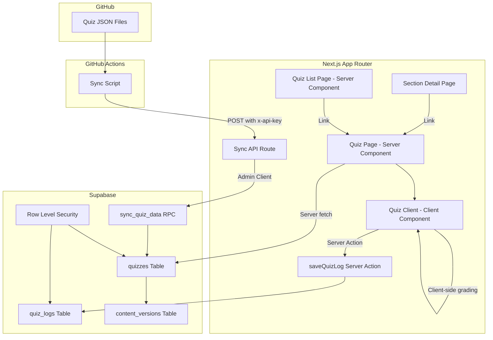
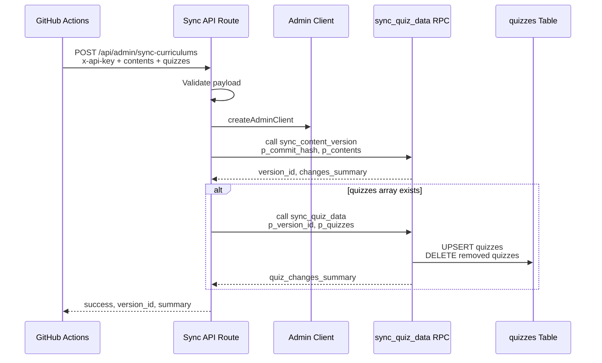
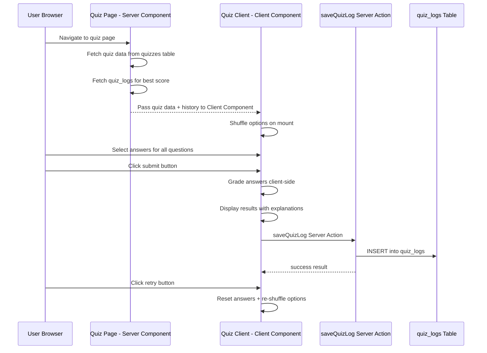
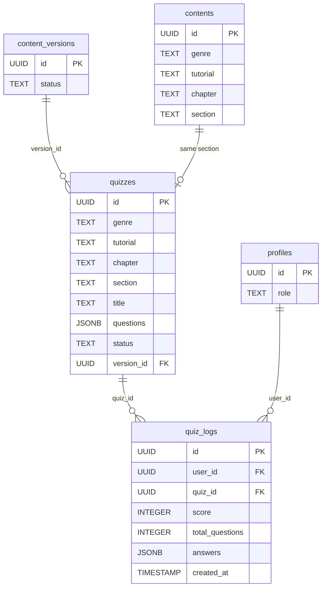

# 技術設計書: 演習問題（Quiz）

## Overview

本機能は、LMS（社内研修学習管理システム）に演習問題（Quiz）機能を追加する。教材セクションに紐づく選択式・複数選択式の演習問題をGitHubからJSON形式で同期し、受講生（User）が教材学習後にクイズを実施できるようにする。クライアントサイドで即時自動採点・結果表示を行い、`quiz_logs` テーブルに履歴を記録する。

**Users**: User（受講生）がクイズ解答・結果確認・履歴閲覧に、Super Admin がデータ管理に利用する。

**Impact**: 既存の同期API（`POST /api/admin/sync-curriculums`）をペイロード拡張し、教材一覧ページの「演習問題」タブを有効化し、セクション詳細ページにクイズ導線を追加する。

### Goals
- 既存同期APIを拡張し、クイズJSONデータをコンテンツと同一バージョンで同期する
- セクション学習後にクイズを解答できるUIを提供し、即時採点・フィードバックで理解度の自己確認を可能にする
- 回答履歴を記録し、過去の成績を振り返れるようにする

### Non-Goals
- 記述式問題の対応（将来検討）
- 制限時間の設定
- 合格ラインによるコンテンツロック
- Super Admin向けクイズ管理画面（将来検討）
- Manager向けクイズ成績閲覧機能

## Architecture

### Existing Architecture Analysis

現行システムの以下のパターンを踏襲・拡張する。

- **同期API**: `POST /api/admin/sync-curriculums` が `x-api-key` 認証 + `createAdminClient()`（RLSバイパス）+ RPC `sync_content_version` の構造で実装済み
- **バージョン管理**: `content_versions` テーブル（`draft` / `active` / `archived`）+ `resolveVersionId()` ユーティリティで active バージョンのIDを解決
- **UIパターン**: Server Component（データフェッチ） + Client Component（インタラクション）の分離。Server Actions（`createClient()` + `revalidatePath()`）でサーバーサイド処理
- **アクセス制御**: Middleware で `/contents/*` パスの `graduation_date` チェック + Supabase RLS の二重防御
- **DB型定義**: `lib/types/database.ts` に手動で Row/Insert/Update 型を定義

### Architecture Pattern & Boundary Map



**Architecture Integration**:
- **Selected pattern**: 既存の同期API拡張 + Server/Client Component分離パターンの踏襲
- **Domain boundaries**: 同期ドメイン（API Route + RPC）、クイズ出題ドメイン（UI Components）、履歴ドメイン（Server Action + quiz_logs）の3境界
- **Existing patterns preserved**: バージョン管理（`version_id`）、RLSアクセス制御、Server Component優先、AdminClient によるRLSバイパス
- **New components rationale**: クイズ固有のインタラクション（回答選択、採点、シャッフル）に専用 Client Component が必要
- **Steering compliance**: TypeScript strict mode、Server Components優先、Supabase RLS依存、Docs as Code分離

### Technology Stack

| Layer | Choice / Version | Role in Feature | Notes |
|-------|------------------|-----------------|-------|
| Frontend | Next.js 16 App Router, React 19 | クイズ出題・回答UI、結果表示 | Server Component + Client Component 分離 |
| UI Components | shadcn/ui, Tailwind CSS v4 | UI コンポーネント、スタイリング | Dialog, Button 等を活用 |
| Backend | Next.js API Routes, Server Actions | 同期API拡張、回答履歴保存 | 既存パターン踏襲 |
| Data | Supabase PostgreSQL, RLS | quizzes/quiz_logs テーブル、アクセス制御 | JSONB型でクイズデータ格納 |
| Validation | zod | クイズJSONバリデーション、APIペイロード検証 | 既存の auth バリデーションと同一ライブラリ |

## System Flows

### クイズ同期フロー



**Key Decisions**:
- クイズ同期は既存コンテンツ同期の後に実行。`quizzes` フィールドがペイロードに存在する場合のみクイズ同期を実行する（後方互換性維持）
- 同一 `version_id` で管理することでコンテンツとクイズのバージョン整合性を保証する

### クイズ解答・採点フロー



## Requirements Traceability

| Requirement | Summary | Components | Interfaces | Flows |
|-------------|---------|------------|------------|-------|
| 1.1 | 同期APIペイロード拡張 | SyncAPI | SyncRequest, SyncQuizItem | 同期フロー |
| 1.2 | quizzesテーブルUPSERT | SyncAPI, sync_quiz_data RPC | SyncQuizItem | 同期フロー |
| 1.3 | questions JSONB格納 | quizzesテーブル | QuizRow | 同期フロー |
| 1.4 | version_id管理 | quizzesテーブル, content_versions | QuizRow | 同期フロー |
| 1.5 | セクション単位紐づけ | quizzesテーブル | QuizRow | 同期フロー |
| 1.6 | sectionフィールド格納 | sync_quiz_data RPC | SyncQuizItem | 同期フロー |
| 1.7 | 削除時archived更新 | sync_quiz_data RPC | - | 同期フロー |
| 2.1 | quizzesテーブル定義 | quizzesテーブル | QuizRow | - |
| 2.2 | quiz_logsテーブル定義 | quiz_logsテーブル | QuizLogRow | - |
| 2.3 | ユニーク制約 | quizzesテーブル | - | - |
| 2.4 | 外部キー制約 | quiz_logsテーブル | - | - |
| 2.5 | quizzes RLS | RLSポリシー | - | - |
| 2.6 | quiz_logs RLS | RLSポリシー | - | - |
| 3.1 | 演習問題ボタン配置 | SectionQuizButton | SectionQuizButtonProps | - |
| 3.2 | クイズページ遷移 | SectionQuizButton, QuizPage | - | 解答フロー |
| 3.3 | 演習問題タブ一覧 | QuizListTab | QuizListTabProps | - |
| 3.4 | 設問・選択肢表示 | QuizClient | QuizClientProps | 解答フロー |
| 3.5 | 単一選択Radio | QuizClient | QuestionItem | 解答フロー |
| 3.6 | 複数選択Checkbox | QuizClient | QuestionItem | 解答フロー |
| 3.7 | 選択肢シャッフル | QuizClient | shuffleOptions | 解答フロー |
| 3.8 | 全問回答までdisabled | QuizClient | - | 解答フロー |
| 3.9 | 設問番号表示 | QuizClient | - | 解答フロー |
| 3.10 | 受講期間チェック | Middleware（既存） | - | - |
| 4.1 | クライアント即時採点 | QuizClient, gradeQuiz | GradeResult | 解答フロー |
| 4.2 | 完全一致方式 | gradeQuiz | - | 解答フロー |
| 4.3 | 正答数・正答率表示 | QuizClient | GradeResult | 解答フロー |
| 4.4 | 正解/不正解ハイライト | QuizClient | QuestionResult | 解答フロー |
| 4.5 | 正しい選択肢明示 | QuizClient | QuestionResult | 解答フロー |
| 4.6 | 解説表示 | QuizClient | QuestionItem | 解答フロー |
| 4.7 | リトライ・戻るボタン | QuizClient | - | 解答フロー |
| 4.8 | 再シャッフル | QuizClient | shuffleOptions | 解答フロー |
| 5.1 | quiz_logs記録 | saveQuizLog | SaveQuizLogInput | 解答フロー |
| 5.2 | Server Action保存 | saveQuizLog | SaveQuizLogResult | 解答フロー |
| 5.3 | セクションページ最新スコア | SectionQuizButton | SectionQuizButtonProps | - |
| 5.4 | クイズページ履歴表示 | QuizPage | QuizHistory | 解答フロー |
| 5.5 | 演習問題タブ最新スコア | QuizListTab | QuizWithScore | - |
| 6.1 | quizzes RLS有効化 | RLSポリシー | - | - |
| 6.2 | Manager SELECTブロック | RLSポリシー | - | - |
| 6.3 | quiz_logs自身のみ | RLSポリシー | - | - |
| 6.4 | Super Admin全レコード | RLSポリシー | - | - |
| 6.5 | Admin Client同期 | SyncAPI | - | 同期フロー |
| 7.1 | App Shell内表示 | QuizPage | - | - |
| 7.2 | デザイントークン準拠 | 全UIコンポーネント | - | - |
| 7.3 | ローディングSkeleton | QuizPage loading.tsx | - | - |
| 7.4 | Client Component実装 | QuizClient | - | - |
| 7.5 | パンくずリスト | QuizPage, ContentBreadcrumb | BreadcrumbItem | - |

## Components and Interfaces

| Component | Domain/Layer | Intent | Req Coverage | Key Dependencies | Contracts |
|-----------|-------------|--------|--------------|-----------------|-----------|
| SyncAPI（拡張） | Backend / API | クイズデータ同期APIの拡張 | 1.1-1.7, 6.5 | createAdminClient (P0), sync_quiz_data RPC (P0) | API |
| sync_quiz_data RPC | Data / RPC | クイズデータのUPSERT処理 | 1.2-1.7, 2.1, 2.3 | quizzes table (P0), content_versions (P0) | Service |
| QuizPage | UI / Server Component | クイズ解答ページのデータフェッチ | 3.2, 5.4, 7.1, 7.3, 7.5 | quizzes table (P0), quiz_logs table (P1) | - |
| QuizClient | UI / Client Component | クイズ解答・採点・結果表示UI | 3.4-3.9, 4.1-4.8, 7.4 | QuizPage (P0), saveQuizLog (P0) | State |
| QuizListTab | UI / Server Component | 演習問題タブの一覧表示 | 3.3, 5.5 | quizzes table (P0), quiz_logs table (P1) | - |
| SectionQuizButton | UI / Server Component | セクション→クイズ導線ボタン | 3.1, 5.3 | quizzes table (P0), quiz_logs table (P1) | - |
| saveQuizLog | Backend / Server Action | 回答履歴の保存 | 5.1, 5.2 | quiz_logs table (P0) | Service |
| gradeQuiz | Logic / Utility | クライアントサイド採点ロジック | 4.1, 4.2 | - | Service |
| shuffleOptions | Logic / Utility | 選択肢のランダムシャッフル | 3.7, 4.8 | - | Service |
| RLSポリシー | Data / Security | quizzes/quiz_logsのアクセス制御 | 2.5, 2.6, 6.1-6.4 | profiles table (P0) | - |

### Backend / API

#### SyncAPI（拡張）

| Field | Detail |
|-------|--------|
| Intent | 既存同期APIのペイロードにクイズデータを追加し、クイズ同期処理を実行する |
| Requirements | 1.1, 1.2, 1.3, 1.4, 1.5, 1.6, 1.7, 6.5 |

**Responsibilities & Constraints**
- 既存のコンテンツ同期処理に影響を与えず、クイズ同期をオプショナルに追加する
- `quizzes` フィールドが存在する場合のみクイズ同期を実行する（後方互換性）
- コンテンツ同期で取得した `version_id` をクイズ同期に引き渡す

**Dependencies**
- Inbound: GitHub Actions -- HTTP POST リクエスト (P0)
- Outbound: sync_content_version RPC -- コンテンツ同期 (P0)
- Outbound: sync_quiz_data RPC -- クイズ同期 (P0)
- External: createAdminClient -- RLSバイパス (P0)

**Contracts**: API [x]

##### API Contract

| Method | Endpoint | Request | Response | Errors |
|--------|----------|---------|----------|--------|
| POST | /api/admin/sync-curriculums | SyncRequestV3 | SyncResponseV3 | 400, 401, 500 |

```typescript
interface SyncQuizItem {
  /** クイズファイルのパス識別子 */
  file_path: string
  /** チャプター内のセクション識別子 */
  section: string
  /** クイズタイトル */
  title: string
  /** ジャンル */
  genre: string
  /** チュートリアル */
  tutorial: string
  /** チャプター */
  chapter: string
  /** 問題データ配列 */
  questions: QuestionItem[]
}

interface QuestionItem {
  id: string
  type: "single" | "multiple"
  text: string
  options: OptionItem[]
  correct: string | string[]
  explanation: string
}

interface OptionItem {
  id: string
  text: string
}

/** V3: quizzes フィールド追加 */
interface SyncRequestV3 {
  contents: SyncContentItem[]
  quizzes?: SyncQuizItem[]
  commit_hash?: string
}

interface SyncResponseV3 {
  success: boolean
  version_id?: string
  summary: {
    created: number
    archived: number
  }
  quiz_summary?: {
    created: number
    archived: number
  }
  errors?: string[]
}
```

**Implementation Notes**
- Integration: 既存の `validatePayload()` を拡張し、`quizzes` 配列のバリデーションを追加。`quizzes` フィールドはオプショナルのため、既存リクエストはそのまま動作する
- Validation: 各クイズアイテムの必須フィールド（`file_path`, `section`, `title`, `genre`, `tutorial`, `chapter`, `questions`）を検証。`questions` 配列内の各問題の `type`, `text`, `options`, `correct` を検証
- Risks: RPC呼び出しが2回になるが、Admin Client での呼び出しのため許容範囲

---

#### saveQuizLog

| Field | Detail |
|-------|--------|
| Intent | クイズ採点結果を quiz_logs テーブルに保存する Server Action |
| Requirements | 5.1, 5.2 |

**Responsibilities & Constraints**
- 認証済みユーザーのみ実行可能
- 同一クイズに対して何度でも記録可能（制限なし）
- `revalidatePath` でキャッシュ無効化

**Dependencies**
- Inbound: QuizClient -- 採点完了後の呼び出し (P0)
- Outbound: quiz_logs table -- INSERT (P0)
- External: createClient -- ユーザー認証付きSupabaseクライアント (P0)

**Contracts**: Service [x]

##### Service Interface

```typescript
interface SaveQuizLogInput {
  quizId: string
  score: number
  totalQuestions: number
  answers: QuizAnswerRecord[]
}

interface QuizAnswerRecord {
  questionId: string
  selectedOptionIds: string[]
  isCorrect: boolean
}

interface SaveQuizLogResult {
  success: boolean
  message: string
}

/** Server Action signature */
function saveQuizLog(input: SaveQuizLogInput): Promise<SaveQuizLogResult>
```

- Preconditions: ユーザーが認証済みであること
- Postconditions: quiz_logs テーブルに1レコードがINSERTされること
- Invariants: user_id は認証セッションから取得（クライアント指定不可）

**Implementation Notes**
- Integration: `"use server"` ディレクティブ、`createClient()` でユーザー認証、`revalidatePath("/contents")` でキャッシュ無効化
- Validation: quizId の存在チェック、score の範囲チェック（0 <= score <= totalQuestions）

### Data / RPC

#### sync_quiz_data RPC

| Field | Detail |
|-------|--------|
| Intent | クイズデータを quizzes テーブルにUPSERT し、削除されたクイズをarchived にする |
| Requirements | 1.2, 1.3, 1.4, 1.5, 1.6, 1.7 |

**Responsibilities & Constraints**
- 指定 version_id に対してクイズデータを UPSERT する
- 送信されなかったクイズ（同一 version_id 内）の status を `archived` に更新する
- `(genre, tutorial, chapter, section, version_id)` のユニーク制約で UPSERT の判定を行う

**Dependencies**
- Inbound: SyncAPI -- RPC呼び出し (P0)
- Outbound: quizzes table -- UPSERT/UPDATE (P0)

**Contracts**: Service [x]

##### Service Interface

```typescript
/** RPC Parameters */
interface SyncQuizDataParams {
  p_version_id: string
  p_quizzes: Array<{
    file_path: string
    section: string
    title: string
    genre: string
    tutorial: string
    chapter: string
    questions: QuestionItem[]
  }>
}

/** RPC Return */
interface SyncQuizDataResult {
  quiz_changes_summary: {
    added: number
    updated: number
    deleted: number
  }
}
```

- Preconditions: `p_version_id` が content_versions テーブルに存在すること
- Postconditions: 指定されたクイズデータが全て quizzes テーブルに反映されること
- Invariants: 同一 `(genre, tutorial, chapter, section, version_id)` のレコードは1件のみ

### Logic / Utility

#### gradeQuiz

| Field | Detail |
|-------|--------|
| Intent | クライアントサイドでクイズの採点を行い、各問題の正誤と全体スコアを算出する |
| Requirements | 4.1, 4.2 |

**Responsibilities & Constraints**
- 単一選択: ユーザーの選択と正解文字列の完全一致で判定
- 複数選択: ユーザーの選択セットと正解セットの完全一致で判定（順序不問）
- 純粋関数（副作用なし）

**Contracts**: Service [x]

##### Service Interface

```typescript
interface UserAnswer {
  questionId: string
  selectedOptionIds: string[]
}

interface QuestionResult {
  questionId: string
  isCorrect: boolean
  correctOptionIds: string[]
  selectedOptionIds: string[]
}

interface GradeResult {
  score: number
  totalQuestions: number
  percentage: number
  questionResults: QuestionResult[]
}

function gradeQuiz(
  questions: QuestionItem[],
  answers: UserAnswer[]
): GradeResult
```

- Preconditions: `questions` と `answers` の `questionId` が対応していること
- Postconditions: 全問の正誤判定と合計スコアが返却されること

**Implementation Notes**
- 複数選択の完全一致判定: 両方の配列をソートして比較、または Set の等価比較を使用

---

#### shuffleOptions

| Field | Detail |
|-------|--------|
| Intent | Fisher-Yates アルゴリズムで選択肢配列をランダムにシャッフルする |
| Requirements | 3.7, 4.8 |

**Contracts**: Service [x]

##### Service Interface

```typescript
function shuffleOptions<T>(options: readonly T[]): T[]
```

- Preconditions: 空でない配列
- Postconditions: 元の配列を変更せず、シャッフルされた新しい配列を返す

### UI / Server Component

#### QuizPage

| Field | Detail |
|-------|--------|
| Intent | クイズ解答ページのデータフェッチとレイアウト構成 |
| Requirements | 3.2, 5.4, 7.1, 7.3, 7.5 |

**Responsibilities & Constraints**
- `resolveVersionId()` で active バージョンを解決し、quizzes テーブルからクイズデータをフェッチ
- quiz_logs テーブルから当該ユーザーの挑戦回数・最高スコアをフェッチ
- パンくずリスト（教材 > チュートリアル > チャプター > セクション > 演習問題）を構成
- フェッチしたデータを QuizClient に渡す

**Dependencies**
- Inbound: ブラウザナビゲーション (P0)
- Outbound: QuizClient -- クイズデータと履歴を渡す (P0)
- Outbound: quizzes table -- SELECT (P0)
- Outbound: quiz_logs table -- SELECT (P1)

**Implementation Notes**
- Route: `app/(authenticated)/contents/[tutorial]/[chapter]/[section]/quiz/page.tsx`
- `searchParams` から `genre` を取得（既存パターン踏襲）
- クイズが存在しない場合は `notFound()` を返す

---

#### QuizListTab

| Field | Detail |
|-------|--------|
| Intent | 教材一覧ページの「演習問題」タブで全クイズの一覧と最新スコアを表示する |
| Requirements | 3.3, 5.5 |

**Responsibilities & Constraints**
- active バージョンの全クイズを取得し、カード形式で一覧表示
- 各クイズの最新スコア（quiz_logs から取得）を表示
- クイズ解答ページへのリンクを提供

**Dependencies**
- Inbound: ContentsTabs のタブ切替 (P0)
- Outbound: quizzes table -- SELECT (P0)
- Outbound: quiz_logs table -- SELECT (P1)

**Implementation Notes**
- `ContentsTabs` を拡張し、タブ切替を URL ベース（`/contents?tab=quizzes&genre=...`）で管理
- 既存の `ContentsPage` にタブ判定ロジックを追加

---

#### SectionQuizButton

| Field | Detail |
|-------|--------|
| Intent | セクション詳細ページの読了ボタン付近に「演習問題に挑戦」ボタンを表示する |
| Requirements | 3.1, 5.3 |

**Responsibilities & Constraints**
- 当該セクションにクイズが存在する場合のみ表示
- 最新スコアがある場合はスコアも表示
- クイズ解答ページへのリンク

**Dependencies**
- Inbound: セクション詳細ページ (P0)
- Outbound: quizzes table -- 存在チェック (P0)
- Outbound: quiz_logs table -- 最新スコア取得 (P1)

**Implementation Notes**
- Server Component として実装し、セクション詳細ページの `ReadCompleteButton` の近くに配置
- クイズが存在しないセクションでは `null` を返す

### UI / Client Component

#### QuizClient

| Field | Detail |
|-------|--------|
| Intent | クイズの解答操作、採点、結果表示を管理する Client Component |
| Requirements | 3.4, 3.5, 3.6, 3.7, 3.8, 3.9, 4.1, 4.2, 4.3, 4.4, 4.5, 4.6, 4.7, 4.8, 7.4 |

**Responsibilities & Constraints**
- 出題時に選択肢をシャッフルして表示
- 単一選択（Radio）と複数選択（Checkbox）の回答UIを提供
- 全問回答するまで送信ボタンを disabled にする
- 送信後にクライアントサイドで即時採点し、結果を表示
- 「もう一度挑戦する」で回答リセット + 再シャッフル

**Dependencies**
- Inbound: QuizPage -- クイズデータと履歴データ (P0)
- Outbound: gradeQuiz -- 採点処理 (P0)
- Outbound: shuffleOptions -- 選択肢シャッフル (P0)
- Outbound: saveQuizLog -- 履歴保存 (P0)

**Contracts**: State [x]

##### State Management

```typescript
interface QuizClientProps {
  quiz: {
    id: string
    title: string
    questions: QuestionItem[]
  }
  history: {
    attemptCount: number
    bestScore: number
    bestTotal: number
  } | null
  backPath: string
  genre: string
}

/** Client-side state */
type QuizPhase = "answering" | "graded"

interface QuizState {
  phase: QuizPhase
  /** シャッフル済み選択肢を持つ問題配列 */
  shuffledQuestions: ShuffledQuestion[]
  /** 各問題のユーザー回答 */
  answers: Map<string, string[]>
  /** 採点結果（graded フェーズのみ） */
  gradeResult: GradeResult | null
}

interface ShuffledQuestion extends QuestionItem {
  shuffledOptions: OptionItem[]
}
```

- State model: `QuizPhase` による2フェーズ管理（answering / graded）
- Persistence: クイズ状態はメモリ内のみ（リロードでリセット）
- Concurrency: 単一ユーザーの操作のみ。並行処理なし

**Implementation Notes**
- Integration: `"use client"` ディレクティブ。`useState` + `useMemo` で状態管理
- Validation: 全問回答チェックは `answers` Map のサイズと `questions` 配列長の比較で実装
- Risks: 正解データがクライアントに送信されるが、学習目的のクイズのため許容（requirements Q3参照）

## Data Models

### Domain Model



**Business Rules & Invariants**:
- 1セクション = 0〜1クイズ（`(genre, tutorial, chapter, section, version_id)` のユニーク制約で保証）
- クイズは `content_versions` の active ステータスに連動して公開・非公開が決まる
- `quiz_logs` は追記のみ（UPDATE/DELETE 不可）。何度でもチャレンジ可能
- 複数選択の採点は完全一致方式

### Physical Data Model

#### quizzes テーブル

| Column | Type | Constraints | Description |
|--------|------|-------------|-------------|
| id | UUID | PK, DEFAULT gen_random_uuid() | レコードID |
| genre | TEXT | NOT NULL | ジャンル識別子 |
| tutorial | TEXT | NOT NULL | チュートリアル識別子 |
| chapter | TEXT | NOT NULL | チャプター識別子 |
| section | TEXT | NOT NULL | セクション識別子 |
| title | TEXT | NOT NULL | クイズタイトル |
| questions | JSONB | NOT NULL | 問題データ配列 |
| status | TEXT | NOT NULL, DEFAULT 'active' | active / archived |
| version_id | UUID | NOT NULL, FK -> content_versions(id) | バージョンID |
| created_at | TIMESTAMPTZ | NOT NULL, DEFAULT now() | 作成日時 |
| updated_at | TIMESTAMPTZ | NOT NULL, DEFAULT now() | 更新日時 |

**Constraints**:
- UNIQUE `(genre, tutorial, chapter, section, version_id)`
- FK `version_id` REFERENCES `content_versions(id)`

**Indexes**:
- `idx_quizzes_version_status` ON `(version_id, status)` -- active バージョンのクイズ取得用
- `idx_quizzes_section_lookup` ON `(genre, tutorial, chapter, section, version_id)` -- セクション紐づけクイズ検索用（ユニーク制約がカバー）

#### quiz_logs テーブル

| Column | Type | Constraints | Description |
|--------|------|-------------|-------------|
| id | UUID | PK, DEFAULT gen_random_uuid() | レコードID |
| user_id | UUID | NOT NULL, FK -> auth.users(id) | ユーザーID |
| quiz_id | UUID | NOT NULL, FK -> quizzes(id) | クイズID |
| score | INTEGER | NOT NULL | 正答数 |
| total_questions | INTEGER | NOT NULL | 総問題数 |
| answers | JSONB | NOT NULL | 各問の回答詳細 |
| created_at | TIMESTAMPTZ | NOT NULL, DEFAULT now() | 回答日時 |

**Constraints**:
- FK `user_id` REFERENCES `auth.users(id)`
- FK `quiz_id` REFERENCES `quizzes(id)`
- CHECK `score >= 0 AND score <= total_questions`

**Indexes**:
- `idx_quiz_logs_user_quiz` ON `(user_id, quiz_id, created_at DESC)` -- ユーザー別履歴取得用
- `idx_quiz_logs_quiz_id` ON `(quiz_id)` -- クイズ別ログ検索用

### Data Contracts & Integration

#### questions JSONB スキーマ

```typescript
/** quizzes.questions カラムの型定義 */
type QuestionsJsonb = QuestionItem[]

interface QuestionItem {
  id: string
  type: "single" | "multiple"
  text: string
  options: OptionItem[]
  correct: string | string[]
  explanation: string
}

interface OptionItem {
  id: string
  text: string
}
```

#### answers JSONB スキーマ

```typescript
/** quiz_logs.answers カラムの型定義 */
type AnswersJsonb = QuizAnswerRecord[]

interface QuizAnswerRecord {
  questionId: string
  selectedOptionIds: string[]
  isCorrect: boolean
}
```

#### Database 型定義への追加

```typescript
/** database.ts に追加する型定義 */
quizzes: {
  Row: {
    id: string
    genre: string
    tutorial: string
    chapter: string
    section: string
    title: string
    questions: QuestionItem[]
    status: "active" | "archived"
    version_id: string
    created_at: string
    updated_at: string
  }
  Insert: {
    id?: string
    genre: string
    tutorial: string
    chapter: string
    section: string
    title: string
    questions: QuestionItem[]
    status?: "active" | "archived"
    version_id: string
    created_at?: string
    updated_at?: string
  }
  Update: {
    id?: string
    genre?: string
    tutorial?: string
    chapter?: string
    section?: string
    title?: string
    questions?: QuestionItem[]
    status?: "active" | "archived"
    version_id?: string
    created_at?: string
    updated_at?: string
  }
  Relationships: [
    {
      foreignKeyName: "quizzes_version_id_fkey"
      columns: ["version_id"]
      referencedRelation: "content_versions"
      referencedColumns: ["id"]
    }
  ]
}
quiz_logs: {
  Row: {
    id: string
    user_id: string
    quiz_id: string
    score: number
    total_questions: number
    answers: QuizAnswerRecord[]
    created_at: string
  }
  Insert: {
    id?: string
    user_id: string
    quiz_id: string
    score: number
    total_questions: number
    answers: QuizAnswerRecord[]
    created_at?: string
  }
  Update: {
    id?: string
    user_id?: string
    quiz_id?: string
    score?: number
    total_questions?: number
    answers?: QuizAnswerRecord[]
    created_at?: string
  }
  Relationships: [
    {
      foreignKeyName: "quiz_logs_user_id_fkey"
      columns: ["user_id"]
      referencedRelation: "users"
      referencedColumns: ["id"]
    },
    {
      foreignKeyName: "quiz_logs_quiz_id_fkey"
      columns: ["quiz_id"]
      referencedRelation: "quizzes"
      referencedColumns: ["id"]
    }
  ]
}
```

## Error Handling

### Error Categories and Responses

**User Errors (4xx)**:
- クイズが存在しないセクションへのアクセス: `notFound()` で404表示
- 未認証状態でのクイズページアクセス: `/auth/login` へリダイレクト
- 受講期間切れでのアクセス: `/dashboard` へリダイレクト（既存Middleware）

**System Errors (5xx)**:
- クイズデータ取得失敗: error.tsx でエラー表示、リトライ促進
- quiz_logs INSERT失敗: ユーザーにエラーメッセージ表示。採点結果は画面上に残り、手動リトライ可能
- 同期API RPC呼び出し失敗: エラーレスポンスを返却し、GitHub Actions側でログ出力

**Business Logic Errors (422)**:
- 同期ペイロードのバリデーションエラー: 具体的なフィールドエラーを返却
- 不正なクイズJSONスキーマ: バリデーションエラーとしてエラー詳細を返却

### Monitoring
- 同期APIのエラーは `console.error` でログ出力（既存パターン踏襲）
- quiz_logs 保存失敗時のエラーを `console.error` でログ出力

## Testing Strategy

### Unit Tests
- `gradeQuiz`: 単一選択の正誤判定、複数選択の完全一致判定、全問正解/全問不正解のケース
- `shuffleOptions`: シャッフル後の要素が全て含まれていること、元の配列が変更されないこと
- `validatePayload`（拡張部分）: quizzes フィールドの各種バリデーションパターン

### Integration Tests
- 同期APIのクイズ同期フロー: ペイロードにquizzesを含む場合のUPSERT動作確認
- saveQuizLog Server Action: 認証済みユーザーでのINSERT、未認証でのエラー
- QuizPage データフェッチ: クイズ存在時/非存在時のレンダリング

### E2E Tests
- クイズ解答フロー: セクション→クイズ→回答→採点→結果表示→リトライの一連の流れ
- 演習問題タブ: タブ切替→一覧表示→クイズ遷移
- アクセス制御: 受講期間切れユーザーのクイズアクセスブロック

## Security Considerations

- **RLS ポリシー**: `quizzes` テーブルは User/Super Admin ロールのみ active ステータスの SELECT を許可。Manager は明示的にブロック。`quiz_logs` テーブルは User は自身のレコードのみ SELECT/INSERT 可能、Super Admin は全レコード SELECT 可能
- **同期API認証**: 既存の `x-api-key` 認証を踏襲。Admin Client（service_role key）でRLSバイパス
- **クライアントサイド採点のリスク**: 正解データがブラウザに送信されるが、学習目的のクイズであり不正防止は要件外。将来的に秘匿が必要になった場合はサーバーサイド採点に移行可能
- **JSONB インジェクション**: クイズデータはGitHub管理のJSONから同期されるため、ユーザー入力由来のインジェクションリスクは低い。同期APIのバリデーションで追加防御
