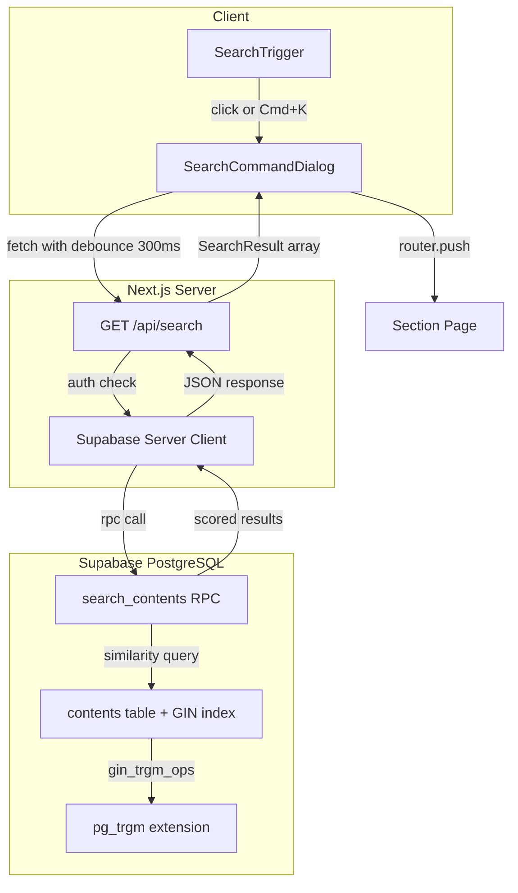
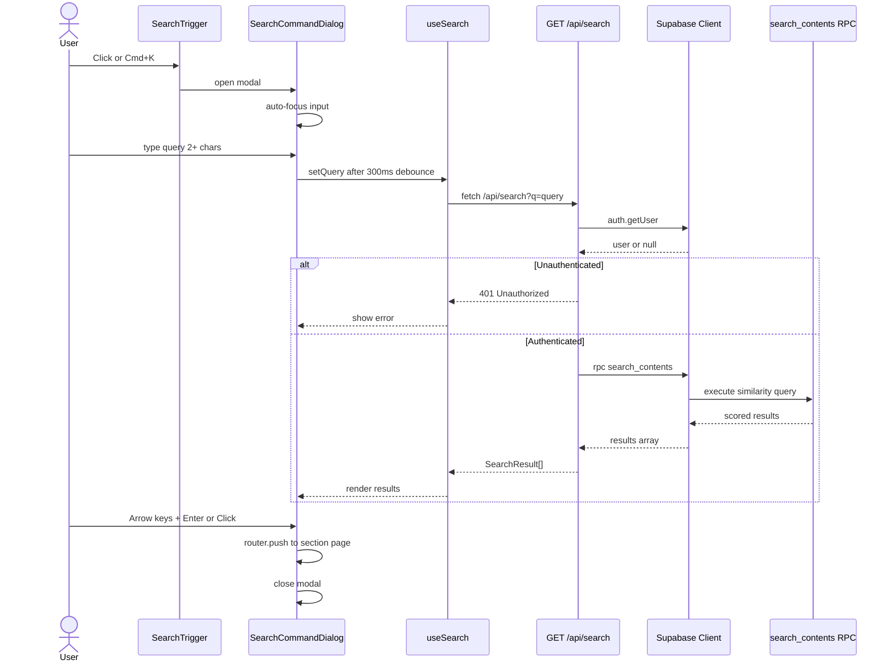

# Technical Design: semantic-search

## Overview

**Purpose**: 本機能は、LMS受講生がヘッダーの検索バーからキーワードを入力し、教材セクションをあいまい検索して直接ナビゲーションできる体験を提供する。

**Users**: User（受講生）ロールが教材学習フロー中にキーワード検索で目的のセクションへ最短経路で到達するために利用する。

**Impact**: 既存の `SearchBarPlaceholder`（disabled 状態）を機能的な検索トリガーに置き換え、Command Palette 風のモーダル検索UIを追加する。バックエンドには PostgreSQL pg_trgm 拡張による GIN インデックス検索と Supabase RPC 関数を新設する。

### Goals
- pg_trgm によるタイトル×3 + 本文×1 の重み付けあいまい検索を200ms以内で実行する
- Cmd+K / Ctrl+K のキーボードショートカットで検索モーダルを即座に開閉できる
- 検索結果から該当セクションページへワンクリック/Enter で直接遷移できる
- 外部API依存なし、Supabase 内で完結する無料アーキテクチャを維持する

### Non-Goals
- 意味的（セマンティック）検索（Embedding ベース）の実装は現スコープ外
- Manager / Super Admin ロールへの検索機能提供
- 検索結果のキャッシュ戦略（外部API呼び出しがないため不要）
- レート制限の実装（社内利用・受講生限定のため不要）

## Architecture

### Existing Architecture Analysis

現在のシステムには以下の統合ポイントが存在する:

- **AppHeader**: `components/app-shell/app-header.tsx` に `SearchBarPlaceholder` がUserロール限定で配置済み
- **contents テーブル**: `title`, `body`, `genre`, `tutorial`, `chapter`, `section`, `content_type`, `version_id` カラムが定義済み。`content_versions` テーブルとの外部キー関係で active バージョン管理を実現
- **getActiveVersionId**: `lib/supabase/content-version.ts` に active バージョン解決ユーティリティが存在
- **Middleware**: `graduation_date` ベースの `/contents/*` アクセス制御が実装済み
- **API Route パターン**: `app/api/admin/sync-curriculums/route.ts` が NextResponse.json + エラーハンドリングの実装パターンを提供
- **RLS**: contents テーブルに `users_select_active_contents` ポリシーが適用済み（`status='active'` かつ `role IN ('user', 'super_admin')` のみ SELECT 可）

### Architecture Pattern & Boundary Map



**Architecture Integration**:
- **Selected pattern**: API Route + Supabase RPC。既存の `sync-curriculums` と同じパターンで一貫性を維持
- **Domain boundaries**: 検索ロジックは PostgreSQL RPC 関数に閉じ込め、UIコンポーネントは表示とナビゲーションに専念
- **Existing patterns preserved**: Supabase Server Client による認証チェック、NextResponse.json によるレスポンス構築、shadcn/ui コンポーネント利用
- **New components rationale**: SearchTrigger（トリガーUI）、SearchCommandDialog（検索モーダル）、useSearch（検索ロジックフック）、search_contents RPC（SQL検索関数）の4つを新設
- **Steering compliance**: TypeScript strict mode、shadcn/ui + Tailwind CSS、Server Components 優先の原則を維持

### Technology Stack

| Layer | Choice / Version | Role in Feature | Notes |
|-------|------------------|-----------------|-------|
| Frontend | React 19 + shadcn/ui Command (cmdk) | 検索モーダルUI、キーボードナビゲーション | `npx shadcn@latest add command` で追加 |
| Backend | Next.js 16 API Route | 検索APIエンドポイント、認証チェック | `app/api/search/route.ts` |
| Data | PostgreSQL pg_trgm + GIN index | あいまい検索、重み付けスコアリング | Supabase RPC 関数 `search_contents` |
| Infrastructure | Supabase (BaaS) | DB、Auth、RLS | 既存インフラを利用、追加コストなし |

## System Flows

### 検索実行フロー



**Key Decisions**:
- 300ms デバウンスでキー入力ごとの不要なAPIリクエストを抑制
- 認証チェックは API Route 層で `supabase.auth.getUser()` を使用（RLS に加えた二重防御）
- 検索結果の `genre`, `tutorial`, `chapter`, `section` からナビゲーションURLを構築

## Requirements Traceability

| Requirement | Summary | Components | Interfaces | Flows |
|-------------|---------|------------|------------|-------|
| 1.1 | pg_trgm 拡張有効化 | Migration | -- | -- |
| 1.2, 1.3 | title, body に GIN インデックス作成 | Migration | -- | -- |
| 1.4 | content_type='section' + active 限定 | search_contents RPC | SearchParams | 検索実行フロー |
| 1.5 | インデックス自動更新 | PostgreSQL 標準動作 | -- | -- |
| 2.1, 2.2 | ヘッダー検索バートリガー | SearchTrigger | -- | -- |
| 2.3, 2.4 | モーダル開閉（click, Cmd+K） | SearchTrigger, SearchCommandDialog | -- | 検索実行フロー |
| 2.5 | 自動フォーカス | SearchCommandDialog | -- | -- |
| 2.6, 2.7 | モーダル閉じる（Esc, 背景クリック） | SearchCommandDialog | -- | -- |
| 2.8 | キーボード操作ヒント | SearchCommandDialog | -- | -- |
| 3.1 | 2文字以上で 300ms デバウンス検索 | useSearch | SearchParams | 検索実行フロー |
| 3.2 | title×3 + body×1 スコアリング | search_contents RPC | SearchResult | -- |
| 3.3 | 最大5件 | search_contents RPC, API Route | SearchResult | -- |
| 3.4 | section + active 限定 | search_contents RPC | -- | -- |
| 3.5 | 空/1文字で検索不実行 | useSearch, SearchCommandDialog | -- | -- |
| 3.6 | ローディングスケルトン | SearchCommandDialog | SearchState | -- |
| 3.7 | 0件メッセージ | SearchCommandDialog | -- | -- |
| 3.8 | エラーメッセージ | SearchCommandDialog | SearchState | -- |
| 4.1 | タイトル表示 | SearchResultItem | SearchResult | -- |
| 4.2 | 階層パスのパンくず表示 | SearchResultItem | SearchResult | -- |
| 4.3 | 本文冒頭100文字スニペット | search_contents RPC, SearchResultItem | SearchResult | -- |
| 4.4 | ファイルアイコン | SearchResultItem | -- | -- |
| 4.5 | スコアカラーバッジ | SearchResultItem | SearchResult | -- |
| 4.6, 4.7 | キーボードナビゲーション | SearchCommandDialog (cmdk built-in) | -- | -- |
| 5.1 | セクションページ遷移 | SearchCommandDialog | SearchResult | 検索実行フロー |
| 5.2 | 遷移後モーダル閉じる | SearchCommandDialog | -- | -- |
| 5.3 | genre クエリパラメータ維持 | SearchCommandDialog | SearchResult | -- |
| 6.1 | /api/search エンドポイント | API Route | SearchAPIResponse | 検索実行フロー |
| 6.2 | similarity + 重み付けスコア | search_contents RPC, API Route | SearchResult | -- |
| 6.3 | 結果に ID, title, path, snippet, score | search_contents RPC | SearchResult | -- |
| 6.4 | 未認証で 401 | API Route | SearchAPIResponse | -- |
| 6.5 | 空/1文字で 400 | API Route | SearchAPIResponse | -- |
| 6.6 | 200ms 以内レスポンス | search_contents RPC, GIN Index | -- | -- |
| 7.1 | 認証済みユーザー限定 | API Route | -- | 検索実行フロー |
| 7.2 | active バージョンのみ | search_contents RPC | -- | -- |
| 7.3 | graduation_date アクセス制御 | Middleware (既存) | -- | -- |
| 7.4 | SQL インジェクション対策 | search_contents RPC | -- | -- |
| 8.1 | GIN gin_trgm_ops インデックス | Migration | -- | -- |
| 8.2 | 200ms 以内 | search_contents RPC | -- | -- |
| 8.3 | 閾値 + 最低1件保証 | search_contents RPC | -- | -- |

## Components and Interfaces

| Component | Domain/Layer | Intent | Req Coverage | Key Dependencies (P0/P1) | Contracts |
|-----------|-------------|--------|--------------|--------------------------|-----------|
| SearchTrigger | UI / App Shell | ヘッダー検索バートリガー | 2.1, 2.2, 2.3, 2.4 | AppHeader (P0) | State |
| SearchCommandDialog | UI / Modal | Command Palette 検索モーダル | 2.3-2.8, 3.1, 3.5-3.8, 4.1-4.7, 5.1-5.3 | useSearch (P0), cmdk (P0) | State |
| SearchResultItem | UI / Modal | 検索結果1件の表示 | 4.1-4.5 | SearchCommandDialog (P0) | -- |
| useSearch | Logic / Hook | 検索ロジック（デバウンス、fetch、状態管理） | 3.1, 3.5, 3.6, 3.8 | API Route (P0) | Service |
| API Route | Backend / API | /api/search エンドポイント | 6.1-6.6, 7.1, 7.4 | Supabase Server Client (P0), search_contents RPC (P0) | API |
| search_contents RPC | Data / PostgreSQL | pg_trgm similarity 検索関数 | 1.4, 3.2-3.4, 4.3, 6.2, 6.3, 7.2, 8.2, 8.3 | pg_trgm (P0), GIN Index (P0) | Service |
| Migration | Data / Schema | pg_trgm 拡張 + GIN インデックス + RPC 関数 | 1.1-1.3, 8.1 | -- | -- |

### UI Layer

#### SearchTrigger

| Field | Detail |
|-------|--------|
| Intent | ヘッダーに配置される検索バー型トリガー。クリックまたはキーボードショートカットで検索モーダルを開く |
| Requirements | 2.1, 2.2, 2.3, 2.4 |

**Responsibilities & Constraints**
- 既存の `SearchBarPlaceholder` を置き換える形で実装する
- User ロール限定の表示制御は既存ロジックを引き継ぐ
- Cmd+K (macOS) / Ctrl+K (Windows/Linux) のグローバルキーボードショートカットを登録する
- OS判定によるショートカットヒントバッジの表示（macOS: `⌘K`、その他: `Ctrl+K`）

**Dependencies**
- Inbound: AppHeader -- 検索バートリガーの配置先 (P0)
- Outbound: SearchCommandDialog -- モーダルの開閉制御 (P0)

**Contracts**: State [x]

##### State Management
- `isOpen: boolean` -- 検索モーダルの開閉状態
- `setIsOpen: (open: boolean) => void` -- 開閉トグル関数
- キーボードショートカットリスナーは `useEffect` で document レベルに登録し、クリーンアップする

**Implementation Notes**
- Integration: `AppHeader` 内で `SearchBarPlaceholder` を `SearchTrigger` + `SearchCommandDialog` に置き換える
- Validation: User ロール以外では何もレンダリングしない
- Risks: グローバルキーボードショートカットが他のコンポーネントと競合する可能性。`event.preventDefault()` で制御する

#### SearchCommandDialog

| Field | Detail |
|-------|--------|
| Intent | Command Palette 風の検索モーダル。テキスト入力、結果表示、キーボードナビゲーション、ページ遷移を統合する |
| Requirements | 2.3-2.8, 3.1, 3.5-3.8, 4.6, 4.7, 5.1-5.3 |

**Responsibilities & Constraints**
- shadcn/ui `CommandDialog` をベースに構築する
- `shouldFilter={false}` で cmdk のクライアントサイドフィルタリングを無効化し、サーバーサイド検索結果を直接表示する
- 検索状態（loading, error, empty, results）に応じた表示切り替え
- 結果選択時に `router.push` でセクションページに遷移し、モーダルを閉じる
- フッターにキーボード操作ヒント（↑↓ ナビゲーション、Enter 選択、Esc 閉じる）を表示する

**Dependencies**
- Inbound: SearchTrigger -- open/close 制御 (P0)
- Outbound: useSearch -- 検索ロジック (P0)
- Outbound: Next.js Router -- ページ遷移 (P0)
- External: cmdk (shadcn/ui Command) -- UI基盤 (P0)

**Contracts**: State [x]

##### State Management
- `open: boolean` -- props として受け取るモーダル開閉状態
- `onOpenChange: (open: boolean) => void` -- props として受け取る開閉コールバック
- `query: string` -- テキスト入力値
- 検索結果・ローディング・エラーは `useSearch` フックから取得

**Implementation Notes**
- Integration: `SearchTrigger` と同階層に配置。Portal でオーバーレイ表示される
- Validation: 2文字未満のクエリでは検索を発火せず、初期状態（プレースホルダーメッセージ）を表示する
- Risks: cmdk の `onSelect` コールバック内での `router.push` は非同期。遷移完了前にモーダルを閉じることで体感速度を向上させる

#### SearchResultItem

summary-only コンポーネント。`SearchCommandDialog` 内で各検索結果1件を表示する。

- ファイルアイコン（Lucide `FileText`）
- タイトル（太字）
- 階層パスのパンくず（genre > tutorial > chapter、`>` 区切り）
- 本文スニペット（最大100文字、muted テキスト）
- スコアカラーバッジ（高スコア >= 0.6: 緑、中スコア >= 0.3: 黄、低スコア < 0.3: デフォルト）

**Implementation Notes**: `CommandItem` を拡張し、`onSelect` で遷移URLを構築する。パンくずラベルは検索結果の `genre_title`, `tutorial_title`, `chapter_title` フィールドから構築する。

### Logic Layer

#### useSearch

| Field | Detail |
|-------|--------|
| Intent | 検索クエリの状態管理、デバウンス、API呼び出し、結果/エラー状態の管理を行うカスタムフック |
| Requirements | 3.1, 3.5, 3.6, 3.8 |

**Responsibilities & Constraints**
- 入力値の 300ms デバウンス処理
- 2文字未満のクエリでは API を呼び出さず、結果を空配列にリセットする
- fetch のキャンセル（AbortController）による競合リクエスト防止
- ローディング/エラー/結果の状態管理

**Dependencies**
- Outbound: API Route `/api/search` -- 検索API呼び出し (P0)

**Contracts**: Service [x]

##### Service Interface

```typescript
interface UseSearchReturn {
  query: string;
  setQuery: (query: string) => void;
  results: SearchResult[];
  isLoading: boolean;
  error: string | null;
}

function useSearch(): UseSearchReturn;
```

- Preconditions: コンポーネントが Client Component 内でマウントされていること
- Postconditions: query が 2文字以上の場合、300ms デバウンス後に results が更新される
- Invariants: isLoading が true の間は error が null。error が非 null の場合は results が空配列

**Implementation Notes**
- Integration: `SearchCommandDialog` 内で呼び出す
- Validation: クエリ文字列の trim と長さチェックをフック内で実施
- Risks: 高速な入力切り替え時に古いリクエストの結果が表示される可能性。AbortController で対処

### Backend Layer

#### API Route: GET /api/search

| Field | Detail |
|-------|--------|
| Intent | 認証チェック + バリデーション + Supabase RPC 呼び出しで検索結果を返却する |
| Requirements | 6.1-6.6, 7.1, 7.4 |

**Responsibilities & Constraints**
- 認証済みユーザーのみアクセス可能（`supabase.auth.getUser()` で検証）
- クエリパラメータ `q` のバリデーション（空/1文字は 400）
- `search_contents` RPC を呼び出し、結果を整形して返却する
- エンドポイントパス: `app/api/search/route.ts`

**Dependencies**
- Inbound: useSearch フック -- HTTP GET リクエスト (P0)
- Outbound: Supabase Server Client -- 認証チェック + RPC 呼び出し (P0)
- Outbound: search_contents RPC -- 検索実行 (P0)

**Contracts**: API [x]

##### API Contract

| Method | Endpoint | Request | Response | Errors |
|--------|----------|---------|----------|--------|
| GET | /api/search?q={query} | query param `q`: string (2+ chars) | SearchAPIResponse | 400, 401, 500 |

```typescript
/** 検索APIレスポンス */
interface SearchAPIResponse {
  results: SearchResult[];
  query: string;
  total: number;
}

/** 検索APIエラーレスポンス */
interface SearchAPIErrorResponse {
  error: string;
}
```

エラーレスポンス:
- `400 Bad Request`: `q` パラメータが空、空白のみ、または1文字の場合
- `401 Unauthorized`: 未認証ユーザーからのアクセス
- `500 Internal Server Error`: Supabase RPC 呼び出しエラー

**Implementation Notes**
- Integration: `app/api/search/route.ts` に配置。Middleware の matcher パターンに含まれるため認証チェックが二重に行われる（Middleware + API Route 内）
- Validation: `q` パラメータの trim + 長さチェック。SQL インジェクション対策はパラメータ化クエリ（RPC 引数）で担保
- Risks: Middleware の graduation_date チェックは `/contents/*` パスのみに適用されるため、`/api/search` パスには直接適用されない。ただし検索結果は active バージョンの section のみを返却するため、期限切れユーザーが検索してもナビゲーション先で Middleware がブロックする

### Data Layer

#### search_contents RPC

| Field | Detail |
|-------|--------|
| Intent | pg_trgm similarity 関数による重み付けあいまい検索を実行し、スコア付き結果を返却する |
| Requirements | 1.4, 3.2-3.4, 4.3, 6.2, 6.3, 7.2, 8.2, 8.3 |

**Responsibilities & Constraints**
- `content_type = 'section'` かつ active バージョンのコンテンツのみを検索対象とする
- `similarity(title, query) * 3 + similarity(body, query) * 1` で複合スコアを算出する
- スコア閾値を設定し、低関連度の結果を除外する（閾値未満でも最低1件は返却する）
- 結果は最大5件、スコア降順で返却する
- 本文スニペットは body の冒頭100文字を切り出す
- 階層パス情報（genre, tutorial, chapter のタイトル）をサブクエリで取得する

**Dependencies**
- External: pg_trgm extension -- similarity 関数 (P0)
- External: GIN index (gin_trgm_ops) -- 検索高速化 (P0)
- Inbound: API Route -- `.rpc('search_contents', ...)` 呼び出し (P0)

**Contracts**: Service [x]

##### Service Interface

```sql
-- RPC 関数シグネチャ
CREATE FUNCTION search_contents(
  search_query TEXT,
  result_limit INTEGER DEFAULT 5,
  score_threshold REAL DEFAULT 0.1
)
RETURNS TABLE (
  id UUID,
  title TEXT,
  snippet TEXT,
  genre TEXT,
  tutorial TEXT,
  chapter TEXT,
  section TEXT,
  genre_title TEXT,
  tutorial_title TEXT,
  chapter_title TEXT,
  score REAL
)
```

- Preconditions: pg_trgm 拡張が有効化済み、GIN インデックスが作成済み、active バージョンが1つ以上存在する
- Postconditions: スコア降順で最大 `result_limit` 件の結果を返却。閾値未満でも最低1件を保証
- Invariants: 返却される全レコードが `content_type = 'section'` かつ active バージョンに属する

**Implementation Notes**
- Integration: Supabase マイグレーションで関数を作成。`supabase.rpc('search_contents', { search_query, result_limit, score_threshold })` で呼び出す
- Validation: `search_query` が空文字の場合は空の結果セットを返却する（API Route 側でバリデーション済みだが防御的に処理）
- Risks: `similarity()` の計算コストは対象行数に比例する。GIN インデックスにより大幅に軽減されるが、コンテンツ量が極端に増加した場合は `LIMIT` 前のフィルタリング効率を監視する

## Data Models

### Domain Model

検索機能は既存の `contents` テーブルと `content_versions` テーブルを参照するのみで、新規エンティティは作成しない。

- **Aggregate**: contents（既存）-- 検索対象エンティティ
- **Value Object**: SearchResult -- 検索結果の一時的なデータ構造（永続化しない）
- **Business Rules**: content_type='section' かつ active バージョンのみが検索可能。スコア閾値による品質フィルタリング + 最低1件保証

### Logical Data Model

既存の contents テーブルに対して GIN インデックスを追加する。テーブル構造の変更は不要。

**検索結果の構造**:

```typescript
/** 検索結果1件の型定義 */
interface SearchResult {
  id: string;
  title: string;
  snippet: string;
  genre: string;
  tutorial: string;
  chapter: string;
  section: string;
  genreTitle: string;
  tutorialTitle: string;
  chapterTitle: string;
  score: number;
}
```

### Physical Data Model

**新規マイグレーションで追加するオブジェクト**:

1. **pg_trgm 拡張**:
```sql
CREATE EXTENSION IF NOT EXISTS pg_trgm;
```

2. **GIN インデックス**:
```sql
CREATE INDEX idx_contents_title_trgm ON public.contents
  USING GIN (title gin_trgm_ops);

CREATE INDEX idx_contents_body_trgm ON public.contents
  USING GIN (body gin_trgm_ops);
```

3. **search_contents 関数**: 前述の RPC 関数シグネチャ参照。関数内で以下のクエリロジックを実行する:
   - active バージョン ID を `content_versions` テーブルから取得
   - `contents` テーブルから `content_type='section'` かつ active バージョンのレコードを対象に similarity スコアを算出
   - サブクエリで genre, tutorial, chapter の各タイトルを取得
   - body の冒頭100文字をスニペットとして切り出し
   - スコア閾値フィルタリング + UNION ALL で最低1件保証
   - スコア降順、最大 result_limit 件で返却

### Data Contracts & Integration

**API Data Transfer**:

リクエスト:
- `GET /api/search?q={query}` -- query は URL エンコードされた文字列

レスポンス（成功時）:
```typescript
{
  results: SearchResult[];  // 最大5件
  query: string;            // エコーバック
  total: number;            // 返却件数
}
```

レスポンス（エラー時）:
```typescript
{
  error: string;  // エラーメッセージ
}
```

**Serialization**: JSON。SearchResult の `score` は `number`（0.0 - 4.0 の範囲、title×3 + body×1 の最大値）。フロントエンドでの表示用に正規化が必要な場合はカラーバッジのロジックで処理する。

## Error Handling

### Error Strategy

| Error Category | Trigger | Response | UI Treatment |
|----------------|---------|----------|--------------|
| Validation Error (400) | `q` が空/1文字 | `{ error: "検索クエリは2文字以上で入力してください" }` | フック側でリクエスト自体を抑制（フォールバック） |
| Authentication Error (401) | 未認証アクセス | `{ error: "認証が必要です" }` | 通常は発生しない（ログイン済みでのみUIが表示される） |
| Server Error (500) | RPC 呼び出し失敗 | `{ error: "検索中にエラーが発生しました" }` | SearchCommandDialog にエラーメッセージを表示 |
| Network Error | fetch 失敗 | -- | useSearch フックが catch してエラー状態に遷移 |

### Monitoring

- API Route 内で `console.error` によるエラーログ出力（既存パターンと統一）
- RPC エラー時は Supabase のエラーメッセージをサーバーログに記録し、クライアントには汎用メッセージを返却する

## Testing Strategy

### Unit Tests
- `useSearch` フック: デバウンス動作、2文字未満の抑制、AbortController によるキャンセル
- API Route: 認証チェック、バリデーション、正常系レスポンス、エラーハンドリング
- `search_contents` RPC: 重み付けスコアリング、閾値フィルタリング、最低1件保証、active バージョン限定

### Integration Tests
- 検索フロー E2E: クエリ入力 -> デバウンス -> API呼び出し -> 結果表示
- ナビゲーション: 結果クリック -> セクションページ遷移 -> genre パラメータ維持
- 認証: 未認証状態での API 呼び出しが 401 を返却すること

### E2E/UI Tests
- Cmd+K でモーダルが開閉すること
- 検索結果が表示され、キーボード上下矢印で選択できること
- Enter キーでセクションページに遷移すること
- Esc キー / 背景クリックでモーダルが閉じること
- 0件時のメッセージ表示

## Security Considerations

- **認証**: API Route 内で `supabase.auth.getUser()` による認証チェック。未認証は 401
- **RLS**: contents テーブルの既存 RLS ポリシー（`users_select_active_contents`）が RPC 内でも適用される。ただし RPC 関数が `SECURITY DEFINER` の場合は RLS がバイパスされるため、`SECURITY INVOKER` で作成する
- **SQL インジェクション**: RPC 関数のパラメータバインディングにより防御。動的 SQL は使用しない
- **graduation_date**: 検索API自体には graduation_date チェックを適用しない。検索結果のナビゲーション先（`/contents/*`）で既存の Middleware がアクセス制御する

## Performance & Scalability

- **Target**: 検索APIレスポンス 200ms 以内
- **GIN インデックス**: `gin_trgm_ops` による similarity 検索の高速化。フルスキャン対比で 98%+ の性能改善が期待される
- **デバウンス**: 300ms のクライアントサイドデバウンスでサーバー負荷を抑制
- **LIMIT**: SQL レベルで最大5件に制限し、不要なデータ転送を防止
- **スケーリング**: 現在の教材規模（数百〜数千セクション）では pg_trgm + GIN で十分。数万セクション規模に成長した場合は Embedding 検索への移行パスが requirements.md で定義済み

## Migration Strategy

単一マイグレーションファイルで以下を順次実行する:

1. `CREATE EXTENSION IF NOT EXISTS pg_trgm` -- pg_trgm 拡張の有効化
2. `CREATE INDEX idx_contents_title_trgm` -- title カラムの GIN インデックス
3. `CREATE INDEX idx_contents_body_trgm` -- body カラムの GIN インデックス
4. `CREATE FUNCTION search_contents(...)` -- 検索 RPC 関数の作成

**Rollback**: `DROP FUNCTION`, `DROP INDEX`, `DROP EXTENSION` の逆順で実行可能。既存テーブル構造に変更はないためデータロスのリスクなし。
