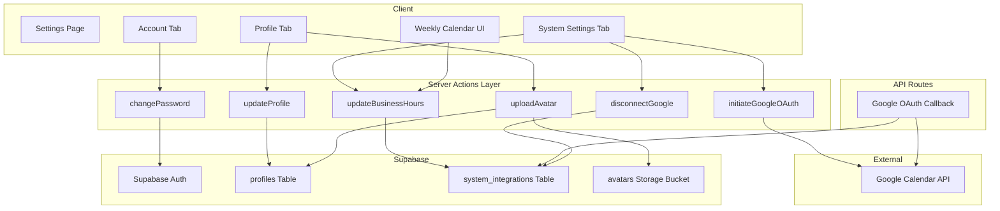
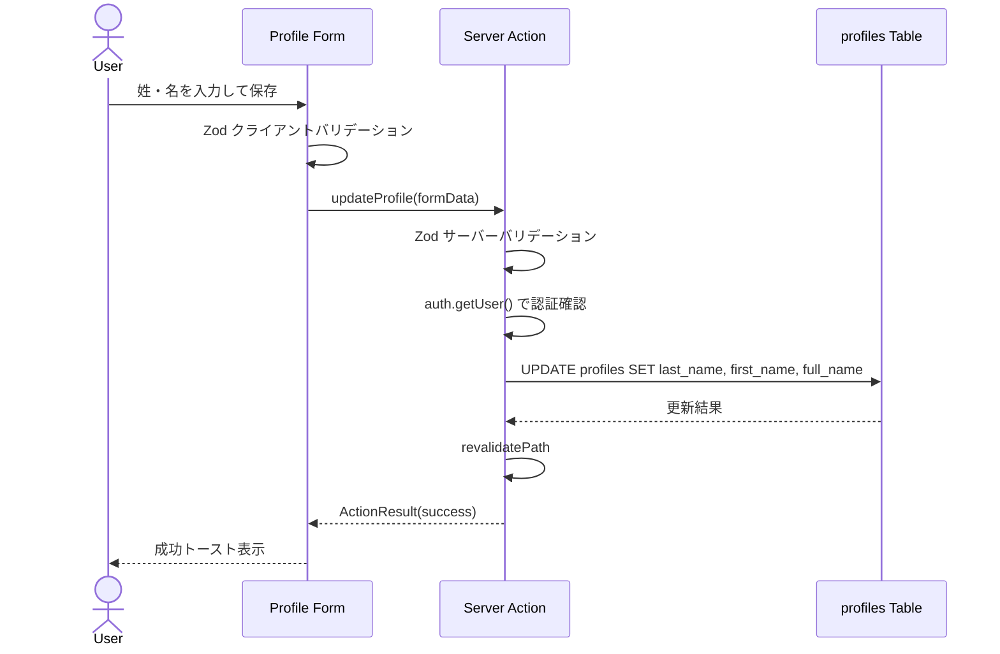
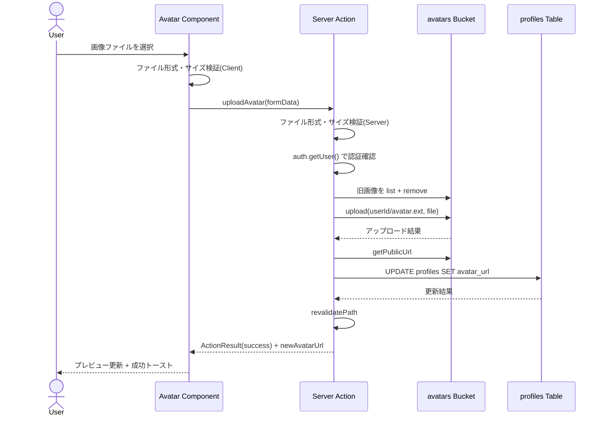
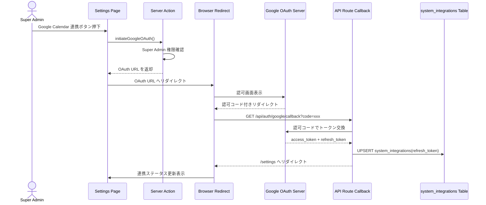
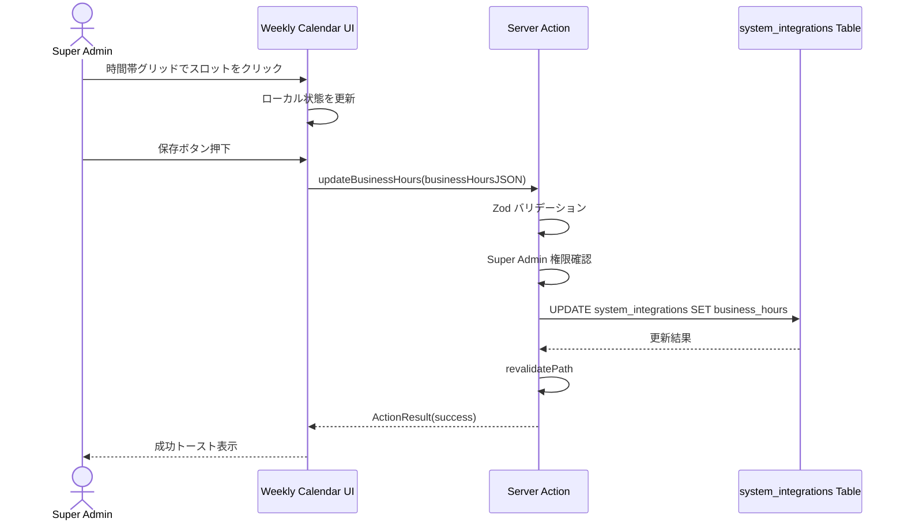
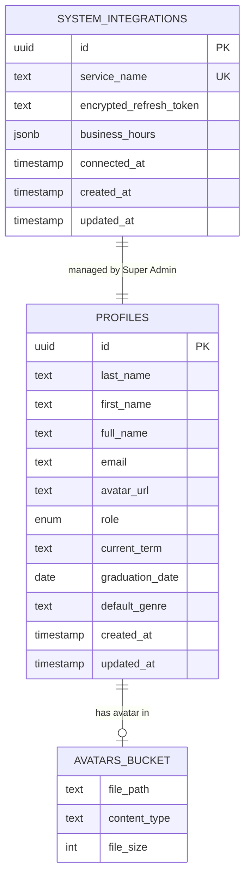
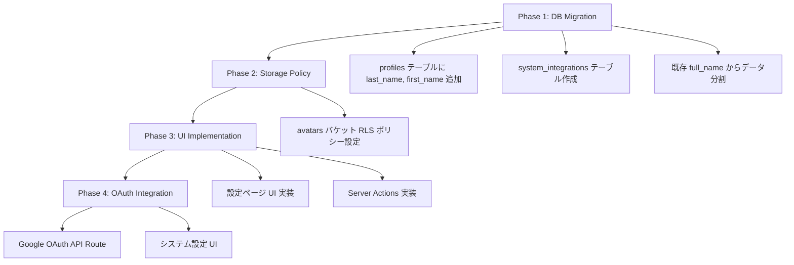

# Design Document -- settings-profile

## Overview

**Purpose**: 全ロールのユーザー（User / Manager / Super Admin）に対して、プロフィール編集、パスワード変更、およびシステム設定（Super Admin 限定）を統合的に管理できる設定ページ（`/settings`）を提供する。

**Users**: 全ロールのユーザーがプロフィール情報の確認・編集とパスワード変更を行う。Super Admin はこれに加えて Google Calendar 連携設定および LMS 稼働時間枠の管理を行う。

**Impact**: `profiles` テーブルに `last_name` / `first_name` カラムを追加し、姓名の分割管理を実現する。新規テーブル `system_integrations` を作成し、Google Calendar 連携とビジネスアワー設定を永続化する。Supabase Storage の `avatars` バケットに対する RLS ポリシーを整備する。

### Goals
- 全ロール共通のプロフィール編集・パスワード変更機能を `/settings` で提供する
- Super Admin 向けに Google Calendar OAuth 連携設定と稼働時間枠管理を同一ページ内で提供する
- Zod + React Hook Form による堅牢なクライアントサイド・サーバーサイド双方のバリデーションを実装する
- 既存の認証基盤・Server Action パターンとの一貫性を維持する

### Non-Goals
- メールアドレスの変更機能（表示のみ、変更不可として確定済み）
- 自己紹介（bio）フィールド（不要として確定済み）
- コーチング予約のクレジット管理（別機能のスコープ）
- コーチング予約の実際のスロット計算ロジック（本機能では稼働時間枠の設定のみ）
- `profiles` テーブルの既存 `full_name` 参照箇所の全面的なリファクタリング（本機能では `last_name` / `first_name` 追加と同期更新の仕組みのみ提供）

## Architecture

> 詳細な調査ログは `research.md` を参照。本セクションではすべての設計判断を自己完結的に記述する。

### Existing Architecture Analysis

- **認証基盤**: Supabase Auth（`@supabase/ssr`）によるセッション管理。Middleware でトークンリフレッシュを処理
- **Server Action パターン**: `ActionResult` 型（`{ success: boolean; message: string } | null`）を返す。Zod バリデーション → 認証確認 → DB 操作 → `revalidatePath` の定型フロー
- **profiles テーブル**: `full_name` カラムのみ。招待登録時に `"${lastName} ${firstName}"` として結合保存
- **avatars バケット**: 招待登録フローで `${user.id}/avatar.${ext}` パスに `upsert: true` でアップロード済み
- **UI パターン**: shadcn/ui コンポーネント + React Hook Form + Zod。`useActionState` / `useTransition` による非同期フォーム送信
- **ルーティング**: `(authenticated)` Route Group 配下。`AppShellLayout` によるサイドバー付きレイアウト

### Architecture Pattern & Boundary Map



**Architecture Integration**:
- **Selected pattern**: Server Action 中心のフルスタック構成（既存パターン踏襲）。OAuth コールバックのみ API Route を使用
- **Domain/feature boundaries**: 設定ページは `app/(authenticated)/settings/` に配置。Server Actions は `actions.ts` に集約。バリデーションスキーマは `lib/validations/settings.ts` に定義
- **Existing patterns preserved**: `ActionResult` 型、Zod バリデーション、`createClient` / `createAdminClient` パターン、`useActionState` / `useTransition` フック
- **New components rationale**: 週間カレンダー UI は複雑なインタラクションを持つため専用コンポーネントとして分離。Google OAuth フローは API Route が必須
- **Steering compliance**: Server Components 優先、RLS 適用、Tailwind CSS + shadcn/ui 準拠

### Technology Stack

| Layer | Choice / Version | Role in Feature | Notes |
|-------|------------------|-----------------|-------|
| Frontend | React 19 + Next.js 16 App Router | 設定ページ UI、タブ制御、フォーム管理 | Server Components + Client Components 併用 |
| Form | React Hook Form 7.x + Zod 4.x + @hookform/resolvers 5.x | バリデーション付きフォーム制御 | 既存の依存関係を使用 |
| UI | shadcn/ui (Tabs, Form, Input, Button, Card, Select) | 統一的な UI コンポーネント | 既存導入済み |
| Backend | Next.js Server Actions + API Route | プロフィール更新、パスワード変更、OAuth コールバック | Server Action パターン踏襲 |
| Auth | Supabase Auth (@supabase/ssr) | パスワード変更、セッション管理 | 既存基盤 |
| Data | Supabase PostgreSQL (profiles, system_integrations) | ユーザー情報・システム設定の永続化 | RLS 適用 |
| Storage | Supabase Storage (avatars bucket) | アバター画像の保存・配信 | 既存バケット利用 |
| External | Google Calendar API (OAuth2) | カレンダー連携設定 | OAuth Authorization Code Flow |

## System Flows

### プロフィール更新フロー



### アバター画像アップロードフロー

> **TBD-1: アップロード方式の選択**（後述の TBD セクション参照）



### Google Calendar OAuth 連携フロー



### 稼働時間枠設定フロー



## Requirements Traceability

| Requirement | Summary | Components | Interfaces | Flows |
|-------------|---------|------------|------------|-------|
| 1.1 | `/settings` パスでアクセス可能 | SettingsPage | -- | -- |
| 1.2 | 認証済み全ロールがアクセス可能 | SettingsPage, AuthenticatedLayout | -- | -- |
| 1.3 | プロフィール・アカウントのタブ表示 | SettingsPage, ProfileTab, AccountTab | -- | -- |
| 1.4 | Super Admin にシステム設定タブ表示 | SettingsPage, SystemSettingsTab | -- | -- |
| 1.5 | 非 Super Admin にシステム設定を非表示 | SettingsPage | -- | -- |
| 1.6 | 未認証時ログインへリダイレクト | AuthenticatedLayout, Middleware | -- | -- |
| 2.1 | 現在の名前を表示 | ProfileTab | -- | -- |
| 2.2 | 現在のアバター画像を表示 | ProfileTab, AvatarUploader | -- | -- |
| 2.3 | アバター未設定時デフォルトアイコン | AvatarUploader | -- | -- |
| 2.4 | メールアドレスを表示 | ProfileTab | -- | -- |
| 2.5 | ロールを表示 | ProfileTab | -- | -- |
| 3.1 | 名前の編集と保存 | ProfileTab, ProfileForm | updateProfile | プロフィール更新フロー |
| 3.2 | 名前空欄時バリデーションエラー | ProfileForm | profileSchema | -- |
| 3.3 | 名前更新成功メッセージ | ProfileForm | updateProfile | -- |
| 3.4 | 名前更新エラー時のフォーム保持 | ProfileForm | updateProfile | -- |
| 4.1 | アバター画像のアップロードと保存 | AvatarUploader | uploadAvatar | アバターアップロードフロー |
| 4.2 | 画像形式制限（JPEG, PNG, WebP） | AvatarUploader | avatarSchema | -- |
| 4.3 | 不正形式エラー表示 | AvatarUploader | avatarSchema | -- |
| 4.4 | 2MB 超過エラー表示 | AvatarUploader | avatarSchema | -- |
| 4.5 | アップロード成功時プレビュー表示 | AvatarUploader | uploadAvatar | -- |
| 4.6 | アップロードエラー時メッセージ表示 | AvatarUploader | uploadAvatar | -- |
| 4.7 | 旧アバター画像の自動削除 | -- | uploadAvatar | アバターアップロードフロー |
| 5.1 | パスワード変更フォーム表示 | AccountTab, PasswordForm | -- | -- |
| 5.2 | Supabase Auth でパスワード更新 | PasswordForm | changePassword | -- |
| 5.3 | パスワード不一致エラー | PasswordForm | passwordSchema | -- |
| 5.4 | 最低文字数バリデーション | PasswordForm | passwordSchema | -- |
| 5.5 | パスワード変更成功メッセージ | PasswordForm | changePassword | -- |
| 5.6 | パスワード変更エラーメッセージ | PasswordForm | changePassword | -- |
| 6.1 | Super Admin にシステム設定表示 | SystemSettingsTab | -- | -- |
| 6.2 | Google Calendar 連携ステータス表示 | GoogleCalendarSection | -- | -- |
| 6.3 | OAuth 認可フロー開始 | GoogleCalendarSection | initiateGoogleOAuth | Google OAuth フロー |
| 6.4 | OAuth 成功時トークン保存・ステータス更新 | GoogleOAuthCallback | -- | Google OAuth フロー |
| 6.5 | 連携解除ボタンとトークン削除 | GoogleCalendarSection | disconnectGoogle | -- |
| 6.6 | 稼働時間枠の表示・編集 | BusinessHoursSection, WeeklyCalendarGrid | -- | -- |
| 6.7 | 稼働時間枠の保存 | BusinessHoursSection | updateBusinessHours | 稼働時間枠設定フロー |
| 6.8 | システム設定保存エラーメッセージ | SystemSettingsTab | updateBusinessHours | -- |
| 7.1 | プロフィール更新は自身のみ（RLS） | -- | RLS Policy | -- |
| 7.2 | パスワード変更は自身のみ | -- | changePassword | -- |
| 7.3 | システム設定は Super Admin のみ | SystemSettingsTab | verifySuperAdmin | -- |
| 7.4 | リフレッシュトークンの暗号化保存 | -- | GoogleOAuthCallback | -- |
| 7.5 | アバターのサーバーサイドファイル形式検証 | -- | uploadAvatar | -- |
| 8.1 | shadcn/ui による一貫した UI | 全コンポーネント | -- | -- |
| 8.2 | ローディング表示と二重送信防止 | ProfileForm, PasswordForm, BusinessHoursSection | -- | -- |
| 8.3 | バリデーションエラーのハイライト | ProfileForm, PasswordForm | Zod schemas | -- |
| 8.4 | レスポンシブデザイン対応 | 全コンポーネント | -- | -- |

## Components and Interfaces

| Component | Domain/Layer | Intent | Req Coverage | Key Dependencies | Contracts |
|-----------|--------------|--------|--------------|-----------------|-----------|
| SettingsPage | UI / Page | 設定ページのエントリーポイント。タブ制御とロール別表示 | 1.1-1.6 | AppShellLayout (P0), Supabase Auth (P0) | -- |
| ProfileTab | UI / Tab | プロフィール表示・編集セクション | 2.1-2.5, 3.1-3.4, 4.1-4.7 | ProfileForm (P0), AvatarUploader (P0) | -- |
| ProfileForm | UI / Form | 姓名編集フォーム（Zod + React Hook Form） | 3.1-3.4 | updateProfile (P0) | Service |
| AvatarUploader | UI / Form | アバター画像のプレビュー・アップロード | 4.1-4.7 | uploadAvatar (P0) | Service |
| AccountTab | UI / Tab | パスワード変更セクション | 5.1-5.6 | PasswordForm (P0) | -- |
| PasswordForm | UI / Form | パスワード変更フォーム | 5.1-5.6 | changePassword (P0) | Service |
| SystemSettingsTab | UI / Tab | Super Admin 向けシステム設定セクション | 6.1-6.8 | GoogleCalendarSection (P0), BusinessHoursSection (P0) | -- |
| GoogleCalendarSection | UI / Section | Google Calendar 連携状態表示と連携/解除ボタン | 6.2-6.5 | initiateGoogleOAuth (P0), disconnectGoogle (P0) | Service |
| BusinessHoursSection | UI / Section | 稼働時間枠設定のコンテナ | 6.6-6.8 | WeeklyCalendarGrid (P0), updateBusinessHours (P0) | Service |
| WeeklyCalendarGrid | UI / Interactive | 月〜日 x 時間帯のグリッド UI | 6.6 | -- | State |
| updateProfile | Server Action | プロフィール情報更新 | 3.1-3.4, 7.1 | profiles Table (P0) | Service |
| uploadAvatar | Server Action | アバター画像アップロード | 4.1-4.7, 7.5 | avatars Bucket (P0), profiles Table (P0) | Service |
| changePassword | Server Action | パスワード変更 | 5.1-5.6, 7.2 | Supabase Auth (P0) | Service |
| updateBusinessHours | Server Action | 稼働時間枠の保存 | 6.6-6.8, 7.3 | system_integrations Table (P0) | Service |
| initiateGoogleOAuth | Server Action | OAuth 認可 URL 生成 | 6.3, 7.3 | Google OAuth (P0) | Service |
| disconnectGoogle | Server Action | Google Calendar 連携解除 | 6.5, 7.3 | system_integrations Table (P0) | Service |
| GoogleOAuthCallback | API Route | OAuth コールバック処理 | 6.4, 7.4 | Google OAuth (P0), system_integrations Table (P0) | API |

### UI Layer

#### SettingsPage

| Field | Detail |
|-------|--------|
| Intent | 設定ページの Server Component エントリーポイント。認証確認、プロフィールデータフェッチ、ロール別タブ制御 |
| Requirements | 1.1, 1.2, 1.3, 1.4, 1.5, 1.6 |

**Responsibilities & Constraints**
- Server Component として `profiles` テーブルからユーザー情報（`last_name`, `first_name`, `full_name`, `email`, `avatar_url`, `role`）をフェッチ
- Super Admin の場合は `system_integrations` テーブルから Google Calendar 連携状態と `business_hours` もフェッチ
- shadcn/ui `Tabs` コンポーネントで「プロフィール」「アカウント」（+ 「システム設定」）を切り替え
- ロールに基づきシステム設定タブの表示/非表示を制御

**Dependencies**
- Inbound: AppShellLayout -- レイアウト提供 (P0)
- External: Supabase Auth -- 認証確認 (P0)
- External: profiles Table -- ユーザーデータ取得 (P0)
- External: system_integrations Table -- システム設定データ取得（Super Admin のみ）(P1)

**Implementation Notes**
- ファイルパス: `app/(authenticated)/settings/page.tsx`
- 認証パターンは既存の `admin/users/page.tsx` を踏襲
- メールアドレスは `supabase.auth.getUser()` の `user.email` から取得（profiles テーブルにも email カラムが存在するが、Auth が正）

#### ProfileForm

| Field | Detail |
|-------|--------|
| Intent | 姓名編集用フォーム。Zod バリデーション付き React Hook Form で構成 |
| Requirements | 3.1, 3.2, 3.3, 3.4 |

**Responsibilities & Constraints**
- Client Component（`"use client"`）
- `last_name` / `first_name` の2フィールド構成
- 「※ 正式な表記で氏名を入力してください」注意書きを表示
- `useActionState` + `useTransition` で Server Action を呼び出し
- 送信中はボタンを disabled 化してローディング表示

**Contracts**: Service [x]

##### Service Interface
```typescript
// Zod Schema
const profileSchema = z.object({
  lastName: z.string().min(1, { message: "姓を入力してください" }),
  firstName: z.string().min(1, { message: "名を入力してください" }),
})

type ProfileFormValues = z.infer<typeof profileSchema>
```

**Implementation Notes**
- メールアドレスはロックアイコン付き読み取り専用フィールドとして表示
- ロールはバッジまたは読み取り専用テキストとして表示
- 既存の `inviteSetupStep1Schema` と同様のバリデーションルールを適用

#### AvatarUploader

| Field | Detail |
|-------|--------|
| Intent | アバター画像のプレビュー表示、ファイル選択、アップロード処理を管理 |
| Requirements | 2.2, 2.3, 4.1, 4.2, 4.3, 4.4, 4.5, 4.6, 4.7 |

**Responsibilities & Constraints**
- Client Component
- 現在のアバター画像を円形で表示（未設定時はデフォルトアイコン）
- ファイル選択時にクライアントサイドでファイル形式（JPEG, PNG, WebP）とサイズ（2MB 上限）を検証
- 選択後にプレビューを表示し、アップロードを実行
- アップロード成功時にプレビューを新画像に更新

**Contracts**: Service [x]

##### Service Interface
```typescript
// クライアントサイドバリデーション
const ACCEPTED_IMAGE_TYPES = ["image/jpeg", "image/png", "image/webp"]
const MAX_FILE_SIZE = 2 * 1024 * 1024 // 2MB

interface AvatarUploaderProps {
  currentAvatarUrl: string | null
  userId: string
}
```

**Implementation Notes**
- 既存の招待登録フォームのアバターアップロード UI パターンを参考にする
- ファイル選択は hidden input + クリックハンドラのパターン

#### PasswordForm

| Field | Detail |
|-------|--------|
| Intent | パスワード変更フォーム。新パスワードと確認パスワードの入力を管理 |
| Requirements | 5.1, 5.2, 5.3, 5.4, 5.5, 5.6 |

**Responsibilities & Constraints**
- Client Component
- 新しいパスワード + 確認パスワードの2フィールド構成（現在のパスワード入力は不要: Admin API 使用のため）
- `useActionState` + `useTransition` で Server Action を呼び出し
- 成功時にフォームをリセット

**Contracts**: Service [x]

##### Service Interface
```typescript
const passwordChangeSchema = z
  .object({
    newPassword: z
      .string()
      .min(1, { message: "新しいパスワードを入力してください" })
      .min(8, { message: "パスワードは8文字以上で入力してください" }),
    confirmPassword: z
      .string()
      .min(1, { message: "確認用パスワードを入力してください" }),
  })
  .refine((data) => data.newPassword === data.confirmPassword, {
    message: "パスワードが一致しません",
    path: ["confirmPassword"],
  })

type PasswordChangeFormValues = z.infer<typeof passwordChangeSchema>
```

**Implementation Notes**
- 既存の `inviteSetupStep2Schema` / `resetPasswordConfirmSchema` と同様のバリデーション構造

#### WeeklyCalendarGrid

| Field | Detail |
|-------|--------|
| Intent | 月〜日 x 時間帯のグリッド UI。クリックで稼働/非稼働を切り替える |
| Requirements | 6.6 |

**Responsibilities & Constraints**
- Client Component
- 7列（月〜日）x 時間帯行のグリッドレイアウト
- 各セルのクリックで稼働（active）/非稼働（inactive）をトグル
- 行の範囲は営業時間帯を網羅（例: 8:00〜22:00）
- 追加設定: 祝日シフト（チェックボックス）、前後確保時間（分単位 Input）、1枠のスロット時間（分単位 Input）

**Contracts**: State [x]

##### State Management
```typescript
// 1時間単位のスロット（30分単位にする場合は key を "mon_0800", "mon_0830" 等に拡張）
interface BusinessHoursState {
  /** 各曜日・時間帯の稼働フラグ。key: "{day}_{HHMM}", value: boolean */
  slots: Record<string, boolean>
  /** 祝日を平日シフトとして扱うかどうか */
  holidayShift: boolean
  /** 予約前後の確保時間（分） */
  bufferMinutes: number
  /** 1枠のスロット時間（分） */
  slotDurationMinutes: number
}

type DayOfWeek = "mon" | "tue" | "wed" | "thu" | "fri" | "sat" | "sun"
```

- **Persistence**: `useState` でローカル管理し、保存ボタン押下時に Server Action へ送信
- **Concurrency**: 楽観的更新は行わず、保存ボタンによる明示的なコミットパターン

**Implementation Notes**
- グリッドの時間帯範囲はハードコードで良い（後のコーチング予約機能で参照）
- ドラッグ選択は初期スコープ外（クリックトグルのみ）
- レスポンシブ対応: モバイルでは横スクロール可能なテーブルレイアウト

#### GoogleCalendarSection

| Field | Detail |
|-------|--------|
| Intent | Google Calendar の連携ステータス表示と連携/解除操作 |
| Requirements | 6.2, 6.3, 6.4, 6.5 |

**Responsibilities & Constraints**
- Client Component
- 連携ステータス（連携済み / 未連携）をバッジで表示
- 未連携時: 「Google Calendar と連携」ボタンを表示
- 連携済み時: 連携済みステータスと「連携解除」ボタンを表示

**Implementation Notes**
- 連携ボタン押下時は `initiateGoogleOAuth` Server Action で OAuth URL を取得し、`window.location.href` でリダイレクト
- 連携解除は確認ダイアログ表示後に `disconnectGoogle` Server Action を実行

### Server Action Layer

#### updateProfile

| Field | Detail |
|-------|--------|
| Intent | profiles テーブルの `last_name`, `first_name`, `full_name` を更新 |
| Requirements | 3.1, 3.2, 3.3, 3.4, 7.1 |

**Responsibilities & Constraints**
- 認証確認（`auth.getUser()`）
- Zod サーバーサイドバリデーション
- `full_name` を `"${last_name} ${first_name}"` として同期更新
- RLS により自身のプロフィールのみ更新可能

**Contracts**: Service [x]

##### Service Interface
```typescript
async function updateProfile(
  prevState: ActionResult,
  formData: FormData
): Promise<ActionResult>
// formData: lastName, firstName
// Returns: { success: true, message: "プロフィールを更新しました。" }
//        | { success: false, message: "..." }
```
- Preconditions: ユーザーが認証済みであること
- Postconditions: `profiles.last_name`, `profiles.first_name`, `profiles.full_name`, `profiles.updated_at` が更新される
- Invariants: `full_name` は常に `"${last_name} ${first_name}"` と一致する

#### uploadAvatar

| Field | Detail |
|-------|--------|
| Intent | アバター画像を avatars バケットにアップロードし、profiles.avatar_url を更新 |
| Requirements | 4.1, 4.2, 4.3, 4.4, 4.5, 4.6, 4.7, 7.5 |

**Responsibilities & Constraints**
- 認証確認
- サーバーサイドでのファイル形式（MIME type）・サイズ検証
- 既存アバターファイルの削除（`storage.from("avatars").list(userId)` + `remove`）
- 新画像のアップロード（`${userId}/avatar.${ext}`, `upsert: true`）
- `profiles.avatar_url` を新しい publicUrl で更新

**Contracts**: Service [x]

##### Service Interface
```typescript
interface AvatarUploadResult {
  success: boolean
  message: string
  avatarUrl?: string
}

async function uploadAvatar(
  prevState: ActionResult,
  formData: FormData
): Promise<AvatarUploadResult>
// formData: avatar (File)
```
- Preconditions: ユーザーが認証済み、ファイルが JPEG/PNG/WebP、2MB 以下
- Postconditions: avatars バケットに新画像が保存され、古い画像が削除され、`profiles.avatar_url` が更新される

#### changePassword

| Field | Detail |
|-------|--------|
| Intent | Supabase Auth Admin API 経由でパスワードを更新 |
| Requirements | 5.2, 5.3, 5.4, 5.5, 5.6, 7.2 |

**Responsibilities & Constraints**
- 認証確認（`auth.getUser()` でユーザー ID を取得）
- Zod サーバーサイドバリデーション（8文字以上、確認一致）
- `adminClient.auth.admin.updateUserById(userId, { password })` で更新（既存パターン踏襲）

**Contracts**: Service [x]

##### Service Interface
```typescript
async function changePassword(
  prevState: ActionResult,
  formData: FormData
): Promise<ActionResult>
// formData: newPassword, confirmPassword
```
- Preconditions: ユーザーが認証済み
- Postconditions: Supabase Auth のパスワードが更新される
- Invariants: Admin API を使用するため、Secure password change 設定に依存しない

#### updateBusinessHours

| Field | Detail |
|-------|--------|
| Intent | system_integrations テーブルの business_hours を更新 |
| Requirements | 6.7, 6.8, 7.3 |

**Responsibilities & Constraints**
- Super Admin 権限確認（`verifySuperAdmin` パターン踏襲）
- Zod でビジネスアワー JSON のバリデーション
- `system_integrations` テーブルの `business_hours` カラムを UPSERT

**Contracts**: Service [x]

##### Service Interface
```typescript
const businessHoursSchema = z.object({
  slots: z.record(z.string(), z.boolean()),
  holidayShift: z.boolean(),
  bufferMinutes: z.number().int().min(0).max(120),
  slotDurationMinutes: z.number().int().min(15).max(120),
})

async function updateBusinessHours(
  prevState: ActionResult,
  formData: FormData
): Promise<ActionResult>
// formData: businessHours (JSON string)
```
- Preconditions: ユーザーが Super Admin であること
- Postconditions: `system_integrations.business_hours` が更新される

#### initiateGoogleOAuth

| Field | Detail |
|-------|--------|
| Intent | Google OAuth2 認可 URL を生成して返却 |
| Requirements | 6.3, 7.3 |

**Contracts**: Service [x]

##### Service Interface
```typescript
interface OAuthUrlResult {
  success: boolean
  message: string
  url?: string
}

async function initiateGoogleOAuth(): Promise<OAuthUrlResult>
```
- Preconditions: ユーザーが Super Admin であること。環境変数 `GOOGLE_CLIENT_ID`, `GOOGLE_REDIRECT_URI` が設定済み
- Postconditions: Google OAuth 認可画面への URL が返却される

**Implementation Notes**
- OAuth URL パラメータ: `access_type=offline`, `prompt=consent`, `scope=https://www.googleapis.com/auth/calendar.readonly`
- CSRF 対策として `state` パラメータにランダムトークンを含め、セッション Cookie で検証

#### disconnectGoogle

| Field | Detail |
|-------|--------|
| Intent | Google Calendar 連携を解除し、保存済みトークンを削除 |
| Requirements | 6.5, 7.3 |

**Contracts**: Service [x]

##### Service Interface
```typescript
async function disconnectGoogle(
  prevState: ActionResult,
  formData: FormData
): Promise<ActionResult>
```
- Preconditions: ユーザーが Super Admin であること
- Postconditions: `system_integrations` テーブルの `refresh_token` が NULL に更新される

### API Route Layer

#### GoogleOAuthCallback

| Field | Detail |
|-------|--------|
| Intent | Google OAuth2 コールバックを処理し、リフレッシュトークンを保存 |
| Requirements | 6.4, 7.4 |

**Responsibilities & Constraints**
- API Route（`/api/auth/google/callback`）
- 認可コードをアクセストークン + リフレッシュトークンに交換
- `state` パラメータで CSRF 検証
- リフレッシュトークンを暗号化して `system_integrations` テーブルに保存
- 処理完了後 `/settings` へリダイレクト

**Contracts**: API [x]

##### API Contract
| Method | Endpoint | Request | Response | Errors |
|--------|----------|---------|----------|--------|
| GET | /api/auth/google/callback | Query: code, state | 302 Redirect to /settings | 400 (invalid state), 500 (token exchange failure) |

**Implementation Notes**
- Google token endpoint: `https://oauth2.googleapis.com/token`
- 環境変数: `GOOGLE_CLIENT_ID`, `GOOGLE_CLIENT_SECRET`, `GOOGLE_REDIRECT_URI`
- リフレッシュトークンの暗号化は `GOOGLE_TOKEN_ENCRYPTION_KEY` 環境変数を使用した AES-256-GCM

## Data Models

### Domain Model



- **Aggregate: Profile** -- ユーザー自身の情報を管理する自己完結型エンティティ。`profiles` テーブルが aggregate root。アバター画像は Storage に外部保存
- **Aggregate: SystemIntegration** -- システム全体の連携設定を管理するシングルトンエンティティ。Super Admin のみが操作可能

### Physical Data Model

#### profiles テーブル更新（既存テーブルへのカラム追加）

```sql
-- Migration: profiles テーブルに last_name / first_name カラムを追加
ALTER TABLE public.profiles
  ADD COLUMN last_name text,
  ADD COLUMN first_name text;

-- 既存データのマイグレーション: full_name を姓名に分割
-- full_name のフォーマットは "姓 名" であるため、最初のスペースで分割
UPDATE public.profiles
SET
  last_name = SPLIT_PART(full_name, ' ', 1),
  first_name = SUBSTRING(full_name FROM POSITION(' ' IN full_name) + 1)
WHERE full_name IS NOT NULL AND full_name != '';
```

#### system_integrations テーブル（新規作成）

```sql
CREATE TABLE public.system_integrations (
  id uuid PRIMARY KEY DEFAULT gen_random_uuid(),
  service_name text NOT NULL UNIQUE,
  encrypted_refresh_token text,
  business_hours jsonb DEFAULT '{}'::jsonb,
  connected_at timestamptz,
  created_at timestamptz NOT NULL DEFAULT now(),
  updated_at timestamptz NOT NULL DEFAULT now()
);

-- RLS 有効化
ALTER TABLE public.system_integrations ENABLE ROW LEVEL SECURITY;

-- Super Admin のみ SELECT 可能
CREATE POLICY "Super Admin can read system_integrations"
  ON public.system_integrations FOR SELECT
  TO authenticated
  USING (
    EXISTS (
      SELECT 1 FROM public.profiles
      WHERE profiles.id = auth.uid() AND profiles.role = 'super_admin'
    )
  );

-- Super Admin のみ UPDATE 可能
CREATE POLICY "Super Admin can update system_integrations"
  ON public.system_integrations FOR UPDATE
  TO authenticated
  USING (
    EXISTS (
      SELECT 1 FROM public.profiles
      WHERE profiles.id = auth.uid() AND profiles.role = 'super_admin'
    )
  );

-- Super Admin のみ INSERT 可能
CREATE POLICY "Super Admin can insert system_integrations"
  ON public.system_integrations FOR INSERT
  TO authenticated
  WITH CHECK (
    EXISTS (
      SELECT 1 FROM public.profiles
      WHERE profiles.id = auth.uid() AND profiles.role = 'super_admin'
    )
  );

-- 初期データ: google_calendar 行を SEED
INSERT INTO public.system_integrations (service_name, business_hours)
VALUES ('google_calendar', '{
  "slots": {},
  "holidayShift": false,
  "bufferMinutes": 0,
  "slotDurationMinutes": 60
}'::jsonb);
```

#### avatars バケット RLS ポリシー

```sql
-- avatars バケットの RLS ポリシー（Storage）
-- 認証ユーザーが自身のフォルダにのみアップロード可能
CREATE POLICY "Users can upload own avatar"
  ON storage.objects FOR INSERT
  TO authenticated
  WITH CHECK (
    bucket_id = 'avatars' AND
    (storage.foldername(name))[1] = auth.uid()::text
  );

-- 認証ユーザーが自身のフォルダのアバターのみ更新可能
CREATE POLICY "Users can update own avatar"
  ON storage.objects FOR UPDATE
  TO authenticated
  USING (
    bucket_id = 'avatars' AND
    (storage.foldername(name))[1] = auth.uid()::text
  );

-- 認証ユーザーが自身のフォルダのアバターのみ削除可能
CREATE POLICY "Users can delete own avatar"
  ON storage.objects FOR DELETE
  TO authenticated
  USING (
    bucket_id = 'avatars' AND
    (storage.foldername(name))[1] = auth.uid()::text
  );

-- 全ユーザーがアバター画像を参照可能（パブリック表示用）
CREATE POLICY "Anyone can view avatars"
  ON storage.objects FOR SELECT
  TO public
  USING (bucket_id = 'avatars');
```

#### business_hours JSONB スキーマ

```typescript
/**
 * business_hours の JSONB 構造定義
 *
 * slots: 曜日_時刻 をキーとしたブール値マップ
 *   - キーフォーマット: "{day}_{HHMM}" (例: "mon_0900", "fri_1430")
 *   - true = 稼働, false = 非稼働
 *   - 存在しないキーは非稼働として扱う
 *
 * holidayShift: 祝日を直近の平日シフトとして扱うか
 * bufferMinutes: 予約前後の確保時間（分）
 * slotDurationMinutes: 1枠のスロット時間（分）
 */
interface BusinessHours {
  slots: Record<string, boolean>
  holidayShift: boolean
  bufferMinutes: number
  slotDurationMinutes: number
}
```

### Data Contracts & Integration

**Database 型定義の更新** (`lib/types/database.ts`):

```typescript
// profiles テーブルへの追加カラム
profiles: {
  Row: {
    // ...既存フィールド
    last_name: string | null
    first_name: string | null
  }
  Insert: {
    // ...既存フィールド
    last_name?: string | null
    first_name?: string | null
  }
  Update: {
    // ...既存フィールド
    last_name?: string | null
    first_name?: string | null
  }
}

// system_integrations テーブル（新規追加）
system_integrations: {
  Row: {
    id: string
    service_name: string
    encrypted_refresh_token: string | null
    business_hours: BusinessHours
    connected_at: string | null
    created_at: string
    updated_at: string
  }
  Insert: {
    id?: string
    service_name: string
    encrypted_refresh_token?: string | null
    business_hours?: BusinessHours
    connected_at?: string | null
    created_at?: string
    updated_at?: string
  }
  Update: {
    id?: string
    service_name?: string
    encrypted_refresh_token?: string | null
    business_hours?: BusinessHours
    connected_at?: string | null
    created_at?: string
    updated_at?: string
  }
  Relationships: []
}
```

## TBD -- 確定済み

### TBD-1: アバター画像のアップロード方式 → **A案: Server Action 経由**（確定）

既存の招待登録フローと同じパターンを採用。`next.config.ts` で `serverActions.bodySizeLimit: "3mb"` を設定する。サーバーサイドで完全なファイル検証を行い、単一のトランザクション的フローを維持する。

### TBD-2: フロントエンドでの画像リサイズ・圧縮 → **B案: Canvas API でリサイズ・圧縮**（確定）

アップロード前に Canvas API で最大 512x512px にリサイズし、WebP 形式で品質調整して圧縮する。ストレージ効率の向上と画像配信の高速化を実現する。2MB 制限はリサイズ後のファイルサイズに対しても適用する。

## Error Handling

### Error Strategy

本機能のエラーハンドリングは既存の `ActionResult` パターンを踏襲する。Server Action は `{ success: boolean; message: string }` を返し、UI 側で sonner の `toast` を使用してフィードバックを表示する。

### Error Categories and Responses

**User Errors (4xx 相当)**:
- バリデーションエラー（空欄、文字数不足、パスワード不一致）→ フィールドレベルの `FormMessage` で即時表示
- ファイル形式・サイズ不正 → アップロード前にクライアントサイドでブロック + サーバーサイドで再検証
- 権限不足（非 Super Admin がシステム設定を操作）→ `verifySuperAdmin` でブロック、エラーメッセージ返却

**System Errors (5xx 相当)**:
- Supabase DB/Storage エラー → `ActionResult.success = false` でエラーメッセージ表示、フォーム入力は保持
- Google OAuth トークン交換失敗 → `/settings` へリダイレクト + エラークエリパラメータ
- ネットワークエラー → Next.js のデフォルトエラーハンドリング（error.tsx）

### Monitoring
- Server Action 内のエラーは `console.error` で出力（既存パターン踏襲）
- Google OAuth 関連エラーは詳細なログ出力（トークン値は除外）

## Testing Strategy

### Unit Tests
- `profileSchema` / `passwordChangeSchema` / `businessHoursSchema` の Zod バリデーション（正常系・異常系）
- `BusinessHoursState` のスロットトグルロジック
- アバターファイルのクライアントサイドバリデーション（形式、サイズ）

### Integration Tests
- `updateProfile` Server Action: 認証確認 → バリデーション → DB 更新 → `revalidatePath` のフロー
- `uploadAvatar` Server Action: ファイル検証 → Storage アップロード → 旧ファイル削除 → profiles 更新
- `changePassword` Server Action: Admin API 経由のパスワード更新
- `updateBusinessHours` Server Action: Super Admin 権限確認 → JSON バリデーション → DB 更新

### E2E Tests
- プロフィール編集: 姓名変更 → 保存 → 更新確認
- アバター画像変更: ファイル選択 → アップロード → プレビュー更新確認
- パスワード変更: 新パスワード入力 → 保存 → 成功メッセージ確認
- タブ切り替え: プロフィール ↔ アカウント ↔ システム設定（Super Admin のみ）

## Security Considerations

- **RLS による自己プロフィール制限**: `profiles` テーブルの UPDATE ポリシーで `auth.uid() = id` を強制。アプリケーション層とDB層の二重防御
- **Storage RLS**: avatars バケットへの書き込みは `(storage.foldername(name))[1] = auth.uid()::text` で自身のフォルダに限定
- **パスワード変更**: Admin API（`service_role` キー）を使用。Server Action 内でのみ呼び出し、クライアントに `service_role` キーが露出しない
- **Google OAuth トークン保護**: リフレッシュトークンは AES-256-GCM で暗号化して `system_integrations.encrypted_refresh_token` に保存。暗号化キーは環境変数 `GOOGLE_TOKEN_ENCRYPTION_KEY` で管理
- **CSRF 対策**: OAuth フローの `state` パラメータにランダムトークンを含め、Cookie に保存した値と照合
- **ファイル形式のサーバーサイド検証**: MIME type をサーバーサイドでも検証し、拡張子詐称を防止（7.5）

## Migration Strategy



- **Phase 1**: DB マイグレーション -- `profiles` テーブルへのカラム追加と `system_integrations` テーブル作成。既存データの姓名分割マイグレーション
- **Phase 2**: Storage ポリシー -- avatars バケットの RLS ポリシー設定
- **Phase 3**: UI + Server Actions -- プロフィール編集、アバターアップロード、パスワード変更の実装
- **Phase 4**: OAuth 連携 -- Google Calendar OAuth フロー + 稼働時間枠設定

ロールバック: 各フェーズは独立しており、後続フェーズのロールバックが先行フェーズに影響しない設計。DB マイグレーションはカラム追加のみ（破壊的変更なし）。
