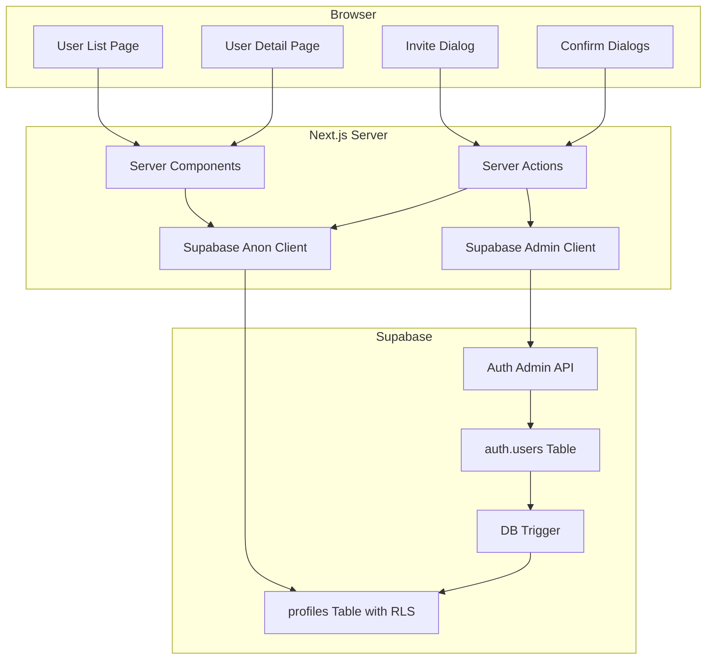
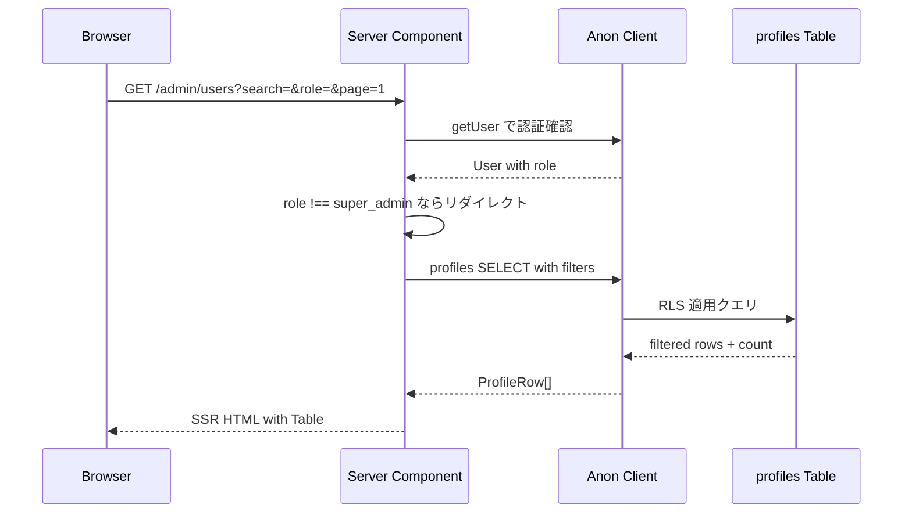
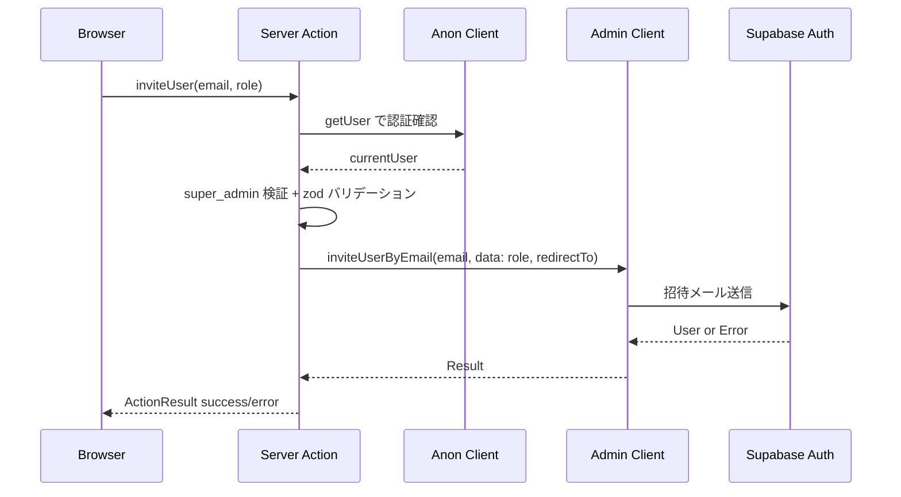
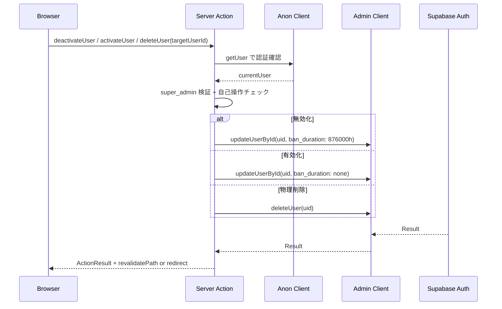

# Design Document: user-management

## Overview

**Purpose**: Super Admin 向けのユーザー管理機能を提供し、LMS におけるユーザーのライフサイクル（招待・閲覧・ロール変更・無効化・有効化・物理削除）を一元管理する。

**Users**: Super Admin ロールのユーザーが、`/admin/users` 配下のページからユーザー管理ワークフローを実行する。

**Impact**: 既存の認証基盤（Supabase Auth）と profiles テーブルの上に管理画面を構築する。profiles テーブルへの email カラム追加、RLS ポリシーの新設、Supabase Auth Admin API 用の service_role クライアント新設が必要。

### Goals

- Super Admin がユーザー一覧を検索・フィルタ・ページネーション付きで閲覧できる
- 招待制アカウント管理（inviteUserByEmail）による新規ユーザー追加
- ユーザー詳細の閲覧とロール変更
- アカウント無効化（ban）・有効化（unban）・物理削除（deleteUser）の安全な実行
- profiles テーブルに対する RLS ポリシーによるアクセス制御

### Non-Goals

- コーチングクレジット管理（別機能）
- コンテンツ関連の権限管理
- 受講期間・卒業日管理
- ユーザー自身によるプロフィール編集（設定・プロフィール画面で対応）
- バルク操作（一括招待、一括削除等）

## Architecture

### Existing Architecture Analysis

既存システムの構成要素と本機能での活用:

- **認証基盤**: Supabase Auth（signInWithPassword, signOut, getUser）が稼働中。Middleware でセッションリフレッシュを実行
- **profiles テーブル**: `id, full_name, avatar_url, role, current_term, created_at, updated_at` が定義済み。auth.users INSERT トリガーで自動作成
- **Supabase クライアント**: `lib/supabase/server.ts`（anon キー）と `lib/supabase/client.ts`（ブラウザ用）が存在。service_role クライアントは未作成
- **App Shell**: `(authenticated)/layout.tsx` でユーザー認証・プロフィール取得を実行し、AppShellLayout でサイドバー・ヘッダーを描画
- **ナビゲーション**: `config/navigation.ts` で super_admin 向けに「ユーザー管理」（`/users`）が定義済み。パスを `/admin/users` に変更する
- **Server Actions パターン**: `app/auth/actions/auth.ts` で確立済み。zod バリデーション → Supabase 操作 → redirect/ActionResult のフロー
- **shadcn/ui コンポーネント**: Button, Card, Input, Table, Badge, Avatar, Dialog, Skeleton 等が導入済み。Select, Pagination は未導入

### Architecture Pattern & Boundary Map



**Architecture Integration**:
- **Selected pattern**: Server Components + Server Actions（既存パターンの踏襲）
- **Domain boundary**: `/admin/users` ルートグループ内に全コンポーネントを配置。管理操作は Server Actions に集約
- **Existing patterns preserved**: zod バリデーション → Supabase 操作 → ActionResult の Server Action パターン、Server Component でのデータフェッチ、URL SearchParams によるフィルタ状態管理
- **New components rationale**: Admin クライアント（service_role キー使用）は既存の anon クライアントと分離してセキュリティを確保
- **Steering compliance**: TypeScript strict mode、shadcn/ui ベース、Tailwind CSS、Server Components 優先、RLS 適用

### Technology Stack

| Layer | Choice / Version | Role in Feature | Notes |
|-------|------------------|-----------------|-------|
| Frontend | Next.js 16 (App Router) + React 19 | Server Components によるデータフェッチ、Client Components によるインタラクション | 既存 |
| UI | shadcn/ui + Tailwind CSS v4 | Table, Dialog, Select, Badge, Pagination 等 | Select, Pagination を新規追加 |
| Form | react-hook-form + zod (v4) | 招待フォームのバリデーション | 既存パターン |
| Backend | Next.js Server Actions | ミューテーション処理（招待、ロール変更、無効化、有効化、削除） | 既存パターン |
| BaaS | Supabase Auth Admin API (supabase-js v2.97) | inviteUserByEmail, updateUserById, deleteUser, getUserById | service_role キー使用 |
| Data | Supabase PostgreSQL + RLS | profiles テーブル（email カラム追加）、RLS ポリシー | マイグレーション必要 |
| Utility | date-fns v4 | 経過日数計算、日付フォーマット | 既存 |

## System Flows

### ユーザー一覧表示フロー



URL SearchParams（`search`, `role`, `page`）をサーバー側で処理し、SQL レベルでフィルタリング・ページネーションを実行する。

### ユーザー招待フロー



招待時に `options.data: { role }` で user_metadata にロールを設定。DB トリガーが profiles 作成時に `raw_user_meta_data.role` を読み取って profiles.role に反映する。

### アカウント無効化・有効化・物理削除フロー



すべての破壊的操作で自己操作防止チェック（`currentUser.id !== targetUserId`）を実行する。

## Requirements Traceability

| Requirement | Summary | Components | Interfaces | Flows |
|-------------|---------|------------|------------|-------|
| 1.1-1.6 | ユーザー一覧（検索・フィルタ・ページネーション・ローディング） | UserListPage, UserSearchFilter, UserTable, UserTablePagination | fetchUsers | ユーザー一覧表示フロー |
| 2.1-2.7 | ユーザー招待（メール・ロール指定、バリデーション） | InviteUserDialog, inviteUserSchema | inviteUser | ユーザー招待フロー |
| 3.1-3.4 | ユーザー詳細閲覧（プロフィール情報、ローディング、404） | UserDetailPage, UserProfileCard, UserActionsCard | fetchUserDetail | -- |
| 4.1-4.5 | ロール変更（選択肢、成功/エラー、自己操作防止） | RoleChangeSelect | changeUserRole | -- |
| 5.1-5.5 | アカウント無効化（確認ダイアログ、ban、自己操作防止） | DeactivateUserDialog | deactivateUser | 無効化フロー |
| 6.1-6.4 | アカウント有効化（ボタン表示切替、unban） | UserActionsCard | activateUser | 有効化フロー |
| 7.1-7.6 | 物理削除（確認ダイアログ、deleteUser、自己操作防止） | DeleteUserDialog | deleteUserPermanently | 物理削除フロー |
| 8.1-8.3 | RLS ポリシー（super_admin: SELECT+UPDATE全行、user/manager: SELECT自行のみ） | ProfilesRLSPolicies | -- | -- |

## Components and Interfaces

| Component | Domain/Layer | Intent | Req Coverage | Key Dependencies (P0/P1) | Contracts |
|-----------|--------------|--------|--------------|--------------------------|-----------|
| SupabaseAdminClient | Infra | service_role キーによる Admin クライアント生成 | 2, 4, 5, 6, 7 | supabase-js (P0) | Service |
| UserManagementActions | Backend | ユーザー管理の全 Server Actions | 2, 4, 5, 6, 7 | SupabaseAdminClient (P0), AnonClient (P0) | Service |
| UserListPage | UI/Page | ユーザー一覧ページ（Server Component） | 1.1-1.6 | AnonClient (P0), UserSearchFilter (P1) | State |
| UserDetailPage | UI/Page | ユーザー詳細ページ（Server Component） | 3.1-3.4, 4, 5, 6, 7 | SupabaseAdminClient (P0), AnonClient (P0) | State |
| InviteUserDialog | UI/Interactive | ユーザー招待ダイアログ | 2.1-2.7 | UserManagementActions (P0) | State |
| UserSearchFilter | UI/Interactive | 検索・ロールフィルタ | 1.3, 1.4 | -- | State |
| UserTable | UI/Presentational | ユーザーテーブル表示 | 1.1, 1.2 | -- | -- |
| UserTablePagination | UI/Presentational | ページネーション | 1.5 | -- | -- |
| UserProfileCard | UI/Presentational | プロフィールカード | 3.2 | -- | -- |
| UserActionsCard | UI/Interactive | ロール変更・無効化/有効化・削除アクション | 4, 5, 6, 7 | UserManagementActions (P0) | State |
| DeactivateUserDialog | UI/Interactive | 無効化確認ダイアログ | 5.1-5.4 | UserManagementActions (P0) | State |
| ActivateUserSection | UI/Interactive | 有効化ボタンとハンドラ | 6.1-6.4 | UserManagementActions (P0) | State |
| DeleteUserDialog | UI/Interactive | 物理削除確認ダイアログ | 7.1-7.5 | UserManagementActions (P0) | State |
| ProfilesRLSPolicies | Data/Security | RLS ポリシー定義 | 8.1-8.3 | -- | -- |

### Infrastructure Layer

#### SupabaseAdminClient

| Field | Detail |
|-------|--------|
| Intent | service_role キーを使用した Supabase Admin クライアントの生成 |
| Requirements | 2, 4, 5, 6, 7 |

**Responsibilities & Constraints**
- Supabase Auth Admin API へのアクセスを提供する唯一のクライアント
- RLS をバイパスするため、Server Actions 内でのみ使用する
- 環境変数 `SUPABASE_SERVICE_ROLE_KEY` が必須（`NEXT_PUBLIC_` プレフィックスなし）

**Dependencies**
- External: `@supabase/supabase-js` v2.97 -- createClient (P0)

**Contracts**: Service [x]

##### Service Interface

```typescript
// lib/supabase/admin.ts
import { createClient } from "@supabase/supabase-js"
import type { Database } from "@/lib/types/database"

function createAdminClient(): SupabaseClient<Database>
```

- Preconditions: `NEXT_PUBLIC_SUPABASE_URL` と `SUPABASE_SERVICE_ROLE_KEY` が環境変数に設定されていること
- Postconditions: RLS をバイパスする Admin 権限のクライアントが返却される
- Invariants: セッション管理は無効（`auth.autoRefreshToken: false`, `auth.persistSession: false`）

**Implementation Notes**
- Integration: `lib/supabase/server.ts` と同じパターンで、Admin 専用として分離
- Risks: service_role キーの漏洩。`NEXT_PUBLIC_` プレフィックスを付けないことで防止

---

### Backend Layer

#### UserManagementActions

| Field | Detail |
|-------|--------|
| Intent | ユーザー管理のミューテーション操作を提供する Server Actions 群 |
| Requirements | 2.1-2.7, 4.1-4.5, 5.1-5.5, 6.1-6.4, 7.1-7.6 |

**Responsibilities & Constraints**
- すべてのミューテーションで呼び出し元ユーザーの super_admin 権限を検証する
- 自己操作（ロール変更、無効化、物理削除）を防止する
- zod によるサーバーサイドバリデーションを実行する
- 成功時に `revalidatePath` または `redirect` を呼び出す

**Dependencies**
- Inbound: InviteUserDialog, UserActionsCard, DeactivateUserDialog, DeleteUserDialog -- ミューテーション呼び出し (P0)
- Outbound: SupabaseAdminClient -- Auth Admin API 操作 (P0)
- Outbound: Supabase Anon Client -- 認証ユーザー取得、profiles 読み取り (P0)

**Contracts**: Service [x]

##### Service Interface

```typescript
// app/(authenticated)/admin/users/actions.ts
"use server"

/** Server Actions の共通戻り値型（既存パターン踏襲） */
type ActionResult = {
  success: boolean
  message: string
} | null

/** ユーザー招待 */
function inviteUser(
  prevState: ActionResult,
  formData: FormData
): Promise<ActionResult>

/** ロール変更 */
function changeUserRole(
  prevState: ActionResult,
  formData: FormData
): Promise<ActionResult>

/** アカウント無効化（ban） */
function deactivateUser(
  prevState: ActionResult,
  formData: FormData
): Promise<ActionResult>

/** アカウント有効化（unban） */
function activateUser(
  prevState: ActionResult,
  formData: FormData
): Promise<ActionResult>

/** 物理削除 */
function deleteUserPermanently(
  prevState: ActionResult,
  formData: FormData
): Promise<ActionResult>
```

各 Server Action の共通フロー:
1. `createClient()` (anon) で `getUser()` → 認証確認
2. profiles テーブルから role を取得 → super_admin 検証
3. zod バリデーション（入力値検証）
4. 自己操作チェック（対象ユーザーID !== 現在のユーザーID）
5. `createAdminClient()` で Admin API 操作
6. 成功: `revalidatePath` + ActionResult、または `redirect`
7. 失敗: エラーメッセージ付き ActionResult

**Implementation Notes**
- Integration: 既存の `app/auth/actions/auth.ts` の ActionResult パターンに準拠。`useActionState` と連携
- Validation: `lib/validations/user-management.ts` に zod スキーマを定義
- Risks: Server Actions は誰でも呼び出せるため、認可チェックは必須。formData からの入力は必ず zod で検証

---

### Data Layer

#### ProfilesRLSPolicies

| Field | Detail |
|-------|--------|
| Intent | profiles テーブルに RLS ポリシーを適用し、ロールベースのアクセス制御を実現 |
| Requirements | 8.1-8.3 |

**Responsibilities & Constraints**
- RLS を有効化（`ALTER TABLE profiles ENABLE ROW LEVEL SECURITY`）
- super_admin: 全行の SELECT, UPDATE を許可
- user / manager: 自行（`auth.uid() = id`）の SELECT のみ許可
- INSERT ポリシーは不要（profiles は DB トリガーで自動作成）
- DELETE ポリシーは不要（物理削除は Auth Admin API 経由、CASCADE で profiles も削除）

**Dependencies**
- External: Supabase PostgreSQL RLS -- ポリシーエンジン (P0)

**Contracts**: Service [x]

##### Service Interface

```sql
-- RLS 有効化
ALTER TABLE profiles ENABLE ROW LEVEL SECURITY;

-- super_admin: 全行 SELECT
CREATE POLICY "super_admin_select_all" ON profiles
  FOR SELECT
  USING (
    (SELECT role FROM profiles WHERE id = auth.uid()) = 'super_admin'
  );

-- super_admin: 全行 UPDATE
CREATE POLICY "super_admin_update_all" ON profiles
  FOR UPDATE
  USING (
    (SELECT role FROM profiles WHERE id = auth.uid()) = 'super_admin'
  );

-- user/manager: 自行 SELECT
CREATE POLICY "user_select_own" ON profiles
  FOR SELECT
  USING (auth.uid() = id);
```

- Preconditions: profiles テーブルが存在すること
- Postconditions: 各ロールに応じた行レベルアクセス制御が有効
- Invariants: RLS は常に有効。service_role クライアントは RLS をバイパスする

**Implementation Notes**
- Integration: Supabase Dashboard または SQL マイグレーションで適用
- Risks: ポリシーの条件式にサブクエリを使用するため、パフォーマンスに注意。profiles テーブルの id カラムにインデックスが必要（PRIMARY KEY で担保済み）

---

### UI Layer -- Pages

#### UserListPage

| Field | Detail |
|-------|--------|
| Intent | ユーザー一覧ページ。検索・フィルタ・ページネーション付きテーブルを Server Component で描画 |
| Requirements | 1.1-1.6 |

**Responsibilities & Constraints**
- Server Component としてデータフェッチを実行
- URL SearchParams（`search`, `role`, `page`）からフィルタ・ページ状態を読み取る
- 1ページあたりの表示件数: 10件
- `loading.tsx` でローディング UI を提供（Skeleton）

**Dependencies**
- Outbound: Supabase Anon Client -- profiles SELECT (P0)
- Inbound: UserSearchFilter -- フィルタ入力 (P1)
- Inbound: UserTable -- テーブル表示 (P1)
- Inbound: UserTablePagination -- ページネーション (P1)
- Inbound: InviteUserDialog -- 招待ダイアログ (P1)

**Contracts**: State [x]

##### State Management

- State model: URL SearchParams（`search: string`, `role: UserRole | ""`, `page: string`）
- Persistence: URL（ブックマーク・共有・ブラウザバック対応）
- Concurrency: Server Component のため競合なし

**ファイル構成**:
```
app/(authenticated)/admin/users/
  page.tsx              -- UserListPage (Server Component)
  loading.tsx           -- Skeleton ローディング
  layout.tsx            -- (必要に応じて)
  [id]/
    page.tsx            -- UserDetailPage (Server Component)
    loading.tsx         -- Skeleton ローディング
    not-found.tsx       -- 404 表示
  actions.ts            -- Server Actions
  _components/          -- 画面固有コンポーネント
    user-search-filter.tsx
    user-table.tsx
    user-table-pagination.tsx
    invite-user-dialog.tsx
    user-profile-card.tsx
    user-actions-card.tsx
    deactivate-user-dialog.tsx
    delete-user-dialog.tsx
    role-change-select.tsx
```

---

#### UserDetailPage

| Field | Detail |
|-------|--------|
| Intent | ユーザー詳細ページ。プロフィール情報と管理アクションを Server Component で描画 |
| Requirements | 3.1-3.4, 4, 5, 6, 7 |

**Responsibilities & Constraints**
- Server Component として profiles データと Auth User データ（banned_until）をフェッチ
- 存在しないユーザー ID の場合 `notFound()` を呼び出し
- ban 状態に応じて「無効化」/「有効化」ボタンの表示を切り替え
- 自分自身の詳細ページでは破壊的操作ボタンを非表示にする

**Dependencies**
- Outbound: Supabase Anon Client -- profiles SELECT (P0)
- Outbound: SupabaseAdminClient -- auth.admin.getUserById for banned_until (P0)
- Inbound: UserProfileCard -- プロフィール表示 (P1)
- Inbound: UserActionsCard -- 管理アクション (P1)

**Contracts**: State [x]

##### State Management

- State model: パスパラメータ `[id]` からユーザー ID を取得
- Persistence: URL パス
- Concurrency: Server Component のため競合なし

---

### UI Layer -- Interactive Components

#### InviteUserDialog

| Field | Detail |
|-------|--------|
| Intent | ユーザー招待ダイアログ。メールアドレスとロールを入力して招待メールを送信 |
| Requirements | 2.1-2.7 |

**Responsibilities & Constraints**
- Client Component（Dialog の開閉状態を管理）
- react-hook-form + zod でクライアントサイドバリデーション
- ロール選択肢: `user`, `manager`（super_admin は含めない）
- `useActionState` で Server Action の結果をハンドリング
- 成功時にダイアログを閉じ、toast で成功メッセージを表示

**Dependencies**
- Outbound: UserManagementActions.inviteUser -- Server Action (P0)
- External: shadcn/ui Dialog, Input, Select, Button -- UI コンポーネント (P1)

**Contracts**: State [x]

##### State Management

- State model: `isOpen: boolean`, `ActionResult` (from useActionState)
- Persistence: コンポーネントローカル state
- Concurrency: `useActionState` の pending 状態で二重送信を防止

**Implementation Notes**
- Integration: Pencil デザイン Screen 2 (KOAiY) に準拠
- Validation: `inviteUserSchema` で email 形式 + role の enum バリデーション

---

#### UserSearchFilter

| Field | Detail |
|-------|--------|
| Intent | 検索入力とロールフィルタのコンポーネント。URL SearchParams を更新してサーバーサイドフィルタリングをトリガー |
| Requirements | 1.3, 1.4 |

**Responsibilities & Constraints**
- Client Component（入力状態の管理）
- 検索入力はデバウンス（300ms）後に URL SearchParams を更新
- ロールフィルタは即時 URL SearchParams を更新
- `useRouter` + `useSearchParams` で URL を操作

**Dependencies**
- External: shadcn/ui Input, Select -- UI コンポーネント (P1)

**Contracts**: State [x]

##### State Management

- State model: URL SearchParams（`search`, `role`）を読み書き。ページは 1 にリセット
- Persistence: URL
- Concurrency: デバウンスで過剰なナビゲーションを抑制

---

#### UserActionsCard

| Field | Detail |
|-------|--------|
| Intent | ユーザー詳細ページの管理アクションカード。ロール変更、無効化/有効化、物理削除のトリガー |
| Requirements | 4, 5, 6, 7 |

**Responsibilities & Constraints**
- Client Component（インタラクティブ操作のため）
- ロール変更: Select の変更時に Server Action を呼び出し
- ban 状態に応じて「無効化」/「有効化」ボタンを切り替え表示
- 自分自身のページでは破壊的操作を非表示

**Dependencies**
- Outbound: UserManagementActions -- changeUserRole, deactivateUser, activateUser, deleteUserPermanently (P0)
- Inbound: DeactivateUserDialog -- 無効化確認 (P1)
- Inbound: DeleteUserDialog -- 物理削除確認 (P1)

**Contracts**: State [x]

##### State Management

- State model: `isBanned: boolean`, `isSelf: boolean`, `currentRole: UserRole`
- Persistence: Server Component から props として受信
- Concurrency: 各 Action の pending 状態で二重操作を防止

**Implementation Notes**
- Integration: Pencil デザイン Screen 3 (LdzCl) の Actions Card に準拠
- Validation: ロール変更は Select の value から直接取得。自己操作はサーバー側でも再検証

---

#### DeactivateUserDialog

| Field | Detail |
|-------|--------|
| Intent | アカウント無効化の確認ダイアログ |
| Requirements | 5.1-5.4 |

**Implementation Notes**
- Integration: Pencil デザイン Screen 4 (c1HEm) に準拠。Destructive カラーのタイトル、赤背景の警告ボックス、ユーザー名を含む確認メッセージ
- Validation: サーバー側で認可チェックと自己操作チェックを実行

---

#### DeleteUserDialog

| Field | Detail |
|-------|--------|
| Intent | 物理削除の確認ダイアログ |
| Requirements | 7.1-7.5 |

**Implementation Notes**
- Integration: Pencil デザイン Screen 5 (q2JIv) に準拠。「この操作は取り消せません」の警告、完全削除の不可逆性を明示
- Validation: サーバー側で認可チェックと自己操作チェックを実行

---

### UI Layer -- Presentational Components

#### UserTable

- Intent: ユーザー一覧テーブルの描画（氏名+アバター、メールアドレス、ロール Badge、作成日、経過日数、アクション）
- Requirements: 1.1, 1.2
- Implementation Notes: Pencil デザイン Screen 1 (an3i5) に準拠。既存の shadcn/ui Table コンポーネントを使用。行クリックで `/admin/users/[id]` へ遷移

#### UserTablePagination

- Intent: ページネーション UI（「全 N 件中 X-Y 件を表示」+ ページ番号ナビゲーション）
- Requirements: 1.5
- Implementation Notes: Pencil デザイン Screen 1 の Table Footer に準拠。shadcn/ui Pagination（新規追加）を使用

#### UserProfileCard

- Intent: ユーザー詳細のプロフィール表示カード（アバター、氏名、メール、ロール Badge、ターム、作成日、経過日数）
- Requirements: 3.2
- Implementation Notes: Pencil デザイン Screen 3 (LdzCl) の Profile Card に準拠

## Data Models

### Domain Model

本機能で扱うエンティティ:

- **Profile**: LMS ユーザーのプロフィール情報。auth.users と 1:1 の関係。id は auth.users.id と一致
- **UserRole**: `"user" | "manager" | "super_admin"` の判別共用体
- **AuthUser**: Supabase Auth のユーザー情報。email, banned_until 等を含む

```mermaid
erDiagram
    AUTH_USERS ||--|| PROFILES : "id = id (CASCADE)"
    AUTH_USERS {
        uuid id PK
        string email
        timestamp banned_until
        jsonb raw_user_meta_data
    }
    PROFILES {
        uuid id PK_FK
        string full_name
        string email
        string avatar_url
        enum role
        string current_term
        timestamp created_at
        timestamp updated_at
    }
```

### Logical Data Model

**profiles テーブル（変更後）**:

| Column | Type | Constraints | Notes |
|--------|------|-------------|-------|
| id | uuid | PK, FK → auth.users.id ON DELETE CASCADE | Supabase Auth ユーザーID |
| full_name | text | nullable | 姓名（「姓 名」形式） |
| email | text | not null | **新規追加**。DB トリガーで auth.users.email と同期 |
| avatar_url | text | nullable | アバター画像 URL |
| role | text | not null, check in ('user','manager','super_admin') | ロール |
| current_term | text | nullable | 現在のターム |
| created_at | timestamptz | not null, default now() | 作成日時 |
| updated_at | timestamptz | not null, default now() | 更新日時 |

**Consistency & Integrity**:
- `profiles.id` は `auth.users.id` への外部キー（ON DELETE CASCADE）
- `profiles.email` は DB トリガーで `auth.users.email` と同期。auth.users の email 変更時にも自動更新
- RLS ポリシーで SELECT/UPDATE の行レベルアクセス制御

### Physical Data Model

**マイグレーション（email カラム追加）**:

```sql
-- profiles テーブルに email カラムを追加
ALTER TABLE profiles ADD COLUMN email text;

-- 既存データの email を auth.users から同期
UPDATE profiles
SET email = au.email
FROM auth.users au
WHERE profiles.id = au.id;

-- NOT NULL 制約を追加
ALTER TABLE profiles ALTER COLUMN email SET NOT NULL;

-- 検索用インデックス
CREATE INDEX idx_profiles_email ON profiles (email);
CREATE INDEX idx_profiles_role ON profiles (role);
CREATE INDEX idx_profiles_full_name ON profiles USING gin (full_name gin_trgm_ops);
```

**トリガー（email 同期）**:

```sql
-- auth.users の INSERT/UPDATE 時に profiles.email を同期するトリガー関数
CREATE OR REPLACE FUNCTION sync_profile_email()
RETURNS TRIGGER AS $$
BEGIN
  UPDATE profiles SET email = NEW.email WHERE id = NEW.id;
  RETURN NEW;
END;
$$ LANGUAGE plpgsql SECURITY DEFINER;

CREATE TRIGGER on_auth_user_email_change
  AFTER INSERT OR UPDATE OF email ON auth.users
  FOR EACH ROW EXECUTE FUNCTION sync_profile_email();
```

### Data Contracts & Integration

**アプリケーション型定義**:

```typescript
// lib/types/database.ts への追加
// profiles テーブルの Row 型に email を追加
type ProfileRow = {
  id: string
  full_name: string | null
  email: string
  avatar_url: string | null
  role: "user" | "manager" | "super_admin"
  current_term: string | null
  created_at: string
  updated_at: string
}
```

```typescript
// lib/types/user-management.ts
import type { UserRole } from "@/lib/types/app-shell"

/** ユーザー一覧の1行分のデータ */
interface UserListItem {
  id: string
  fullName: string | null
  email: string
  avatarUrl: string | null
  role: UserRole
  createdAt: string
}

/** ユーザー一覧のフェッチ結果 */
interface UserListResult {
  users: UserListItem[]
  totalCount: number
  page: number
  perPage: number
}

/** ユーザー詳細のデータ */
interface UserDetail {
  id: string
  fullName: string | null
  email: string
  avatarUrl: string | null
  role: UserRole
  currentTerm: string | null
  createdAt: string
  isBanned: boolean
}

/** ユーザー一覧のフィルタパラメータ */
interface UserListFilter {
  search: string
  role: UserRole | ""
  page: number
  perPage: number
}
```

```typescript
// lib/validations/user-management.ts
import { z } from "zod"

/** 招待フォームのバリデーションスキーマ */
const inviteUserSchema = z.object({
  email: z
    .string()
    .min(1, { message: "メールアドレスを入力してください" })
    .email({ message: "メールアドレスの形式が正しくありません" }),
  role: z.enum(["user", "manager"], {
    errorMap: () => ({ message: "ロールを選択してください" }),
  }),
})

/** ロール変更のバリデーションスキーマ */
const changeRoleSchema = z.object({
  userId: z.string().uuid(),
  role: z.enum(["user", "manager", "super_admin"]),
})

/** ユーザーID指定操作の共通スキーマ */
const userIdSchema = z.object({
  userId: z.string().uuid(),
})
```

## Error Handling

### Error Strategy

既存の `ActionResult` パターン（`{ success: boolean, message: string } | null`）を踏襲し、Server Actions のエラーを UI にフィードバックする。成功時は `sonner` の toast で通知。

### Error Categories and Responses

**User Errors (4xx)**:
- 未認証 → `/auth/login` へリダイレクト
- 権限不足（super_admin 以外） → `{ success: false, message: "この操作を行う権限がありません" }`
- 自己操作 → `{ success: false, message: "自分自身に対してこの操作は実行できません" }`
- バリデーションエラー → フィールドレベルのエラーメッセージ（zod）
- 重複メールアドレス → `{ success: false, message: "このメールアドレスは既に登録されています" }`

**System Errors (5xx)**:
- Supabase Auth Admin API エラー → `{ success: false, message: "操作に失敗しました。もう一度お試しください" }`
- DB 接続エラー → `{ success: false, message: "サーバーエラーが発生しました" }`

**Business Logic Errors (422)**:
- 存在しないユーザー → `notFound()` (詳細ページ) または `{ success: false, message: "ユーザーが見つかりません" }` (Actions)

### Monitoring

- Server Actions 内でエラー発生時に `console.error` でログ出力（将来的に構造化ログへ移行）
- Supabase Auth Admin API のエラーコードをログに記録

## Testing Strategy

### Unit Tests
- `inviteUserSchema`, `changeRoleSchema`, `userIdSchema` の zod バリデーション
- 経過日数計算ロジック（`differenceInDays` 相当）
- ユーザー一覧フィルタパラメータのパース

### Integration Tests
- Server Actions の認可チェック（super_admin 以外の呼び出し拒否）
- Server Actions の自己操作チェック
- inviteUser → Supabase Auth Admin API 連携
- deactivateUser / activateUser → ban_duration の設定・解除

### E2E/UI Tests
- ユーザー一覧ページの表示・検索・フィルタ・ページネーション
- 招待ダイアログのフォーム送信フロー
- ロール変更の即時反映
- 無効化・物理削除の確認ダイアログフロー

## Security Considerations

- **service_role キーの保護**: 環境変数 `SUPABASE_SERVICE_ROLE_KEY` は `NEXT_PUBLIC_` プレフィックスなしで管理。Server Actions 内でのみ使用
- **二重認可チェック**: Server Actions（アプリケーション層）+ RLS（データベース層）の二重防御
- **自己操作防止**: ロール変更、無効化、物理削除で自分自身を対象にする操作を Server Actions 内でブロック
- **CSRF 保護**: Next.js Server Actions はデフォルトで CSRF トークンを検証
- **入力サニタイズ**: zod スキーマによるすべての入力値の型安全なバリデーション

## Supporting References

### ナビゲーション設定の変更

既存の `config/navigation.ts` で super_admin 向けの「ユーザー管理」のパスを `/users` から `/admin/users` に変更する必要がある。これにより `(authenticated)/admin/` Route Group 配下に配置される管理画面と整合する。

### shadcn/ui コンポーネントの追加

本機能で新規に追加が必要な shadcn/ui コンポーネント:
- `Select` -- ロールフィルタ、ロール変更、招待フォームのロール選択
- `Pagination` -- ユーザー一覧のページネーション

### Pencil デザインとコンポーネントの対応表

| Pencil Screen | Screen ID | Primary Component |
|---------------|-----------|-------------------|
| ユーザー一覧 | an3i5 | UserListPage + UserTable + UserSearchFilter + UserTablePagination |
| ユーザー招待 | KOAiY | InviteUserDialog |
| ユーザー詳細 | LdzCl | UserDetailPage + UserProfileCard + UserActionsCard |
| 無効化確認 | c1HEm | DeactivateUserDialog |
| 物理削除確認 | q2JIv | DeleteUserDialog |
