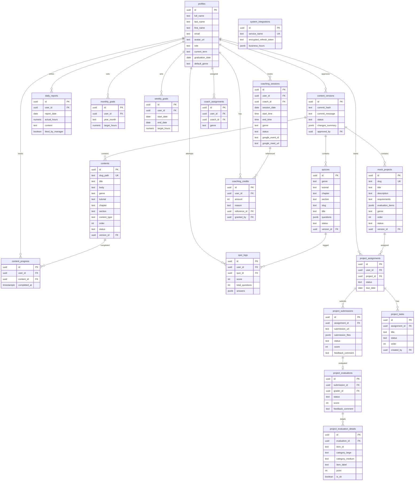

# iField LMS

社内研修学習管理システム（LMS） - エンジニアリングおよびデザイン領域のスキル習得を目的とした社内学習プラットフォーム。

## 概要

学習者のトラッキングと評価（採点・コーチング等）に専念し、教材・演習問題・模擬案件のコンテンツ管理は GitHub（Docs as Code）に完全移行したアーキテクチャを採用しています。

## 主要機能

- **認証・招待制アカウント管理** - Super Admin が招待 URL を発行し、トークン検証による登録フロー
- **教材閲覧・学習トラッキング** - Markdown ベースの教材、進捗管理、演習問題
- **模擬案件と採点** - 階層別チェックリスト評価、スキルレポート（レーダーチャート）
- **日報・学習目標** - 月次/週次目標管理、1 日複数回入力対応
- **コーチング予約** - Google Calendar 連携、クレジット制、稼働時間枠管理
- **Docs as Code 同期** - GitHub Actions から LMS の同期 API へ自動連携

## ロール

| ロール | 説明 |
| --- | --- |
| **User（受講生）** | 教材閲覧、日報入力、演習実施、模擬案件提出、コーチング予約 |
| **Manager（管理者）** | 進捗閲覧、日報リアクション。コンテンツ閲覧権限なし |
| **Super Admin（スーパー管理者）** | ユーザー管理、招待、採点、期間延長、システム設定 |

## 技術スタック

- **フレームワーク**: Next.js 16 (App Router) + React 19
- **言語**: TypeScript (strict mode)
- **BaaS**: Supabase (Auth / PostgreSQL / Storage / RLS)
- **UI**: shadcn/ui + Tailwind CSS v4
- **CI/CD**: GitHub Actions
- **デプロイ**: Vercel

## リポジトリ構成

```
├── lms-fe/          # Next.js フロントエンド
├── supabase/        # Supabase マイグレーション
├── scripts/         # ユーティリティスクリプト
├── designs/         # デザインファイル (.pen)
├── docs/            # ドキュメント
└── .github/         # GitHub Actions ワークフロー
```

## セットアップ

```bash
# 依存関係のインストール
cd lms-fe && npm install

# 環境変数の設定
cp .env.local.example .env.local
# .env.local を編集して各種キーを設定

# 開発サーバー起動
npm run dev
```

## 環境変数

| 変数名 | 説明 |
| --- | --- |
| `NEXT_PUBLIC_SUPABASE_URL` | Supabase プロジェクト URL |
| `NEXT_PUBLIC_SUPABASE_ANON_KEY` | Supabase Anon Key |
| `SUPABASE_SERVICE_ROLE_KEY` | Supabase Service Role Key |
| `SYNC_API_KEY` | コンテンツ同期 API キー |
| `GOOGLE_CLIENT_ID` | Google OAuth クライアント ID |
| `GOOGLE_CLIENT_SECRET` | Google OAuth クライアントシークレット |
| `GOOGLE_REDIRECT_URI` | Google OAuth リダイレクト URI |
| `GOOGLE_TOKEN_ENCRYPTION_KEY` | Google トークン暗号化キー |

## ER 図



## 関連リポジトリ

- [ifield-curriculums](https://github.com/estra-inc/ifield-curriculums) - 教材・演習問題・模擬案件コンテンツ

## ライセンス

本リポジトリはソースコードを公開していますが、オープンソースではありません。無断での複製・改変・再配布・利用を禁じます（All rights reserved）。
